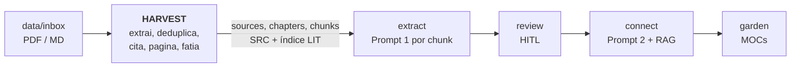
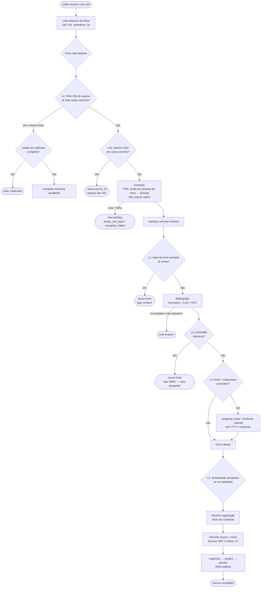
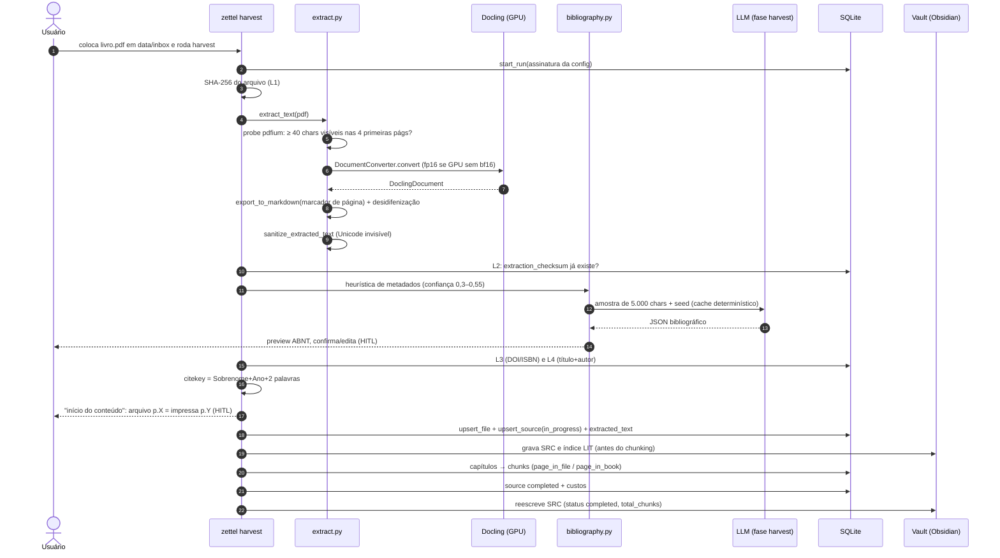
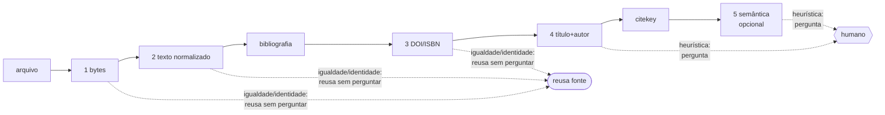
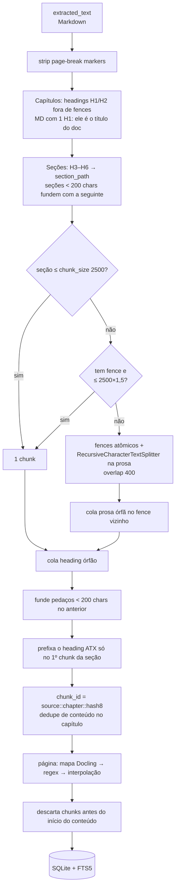
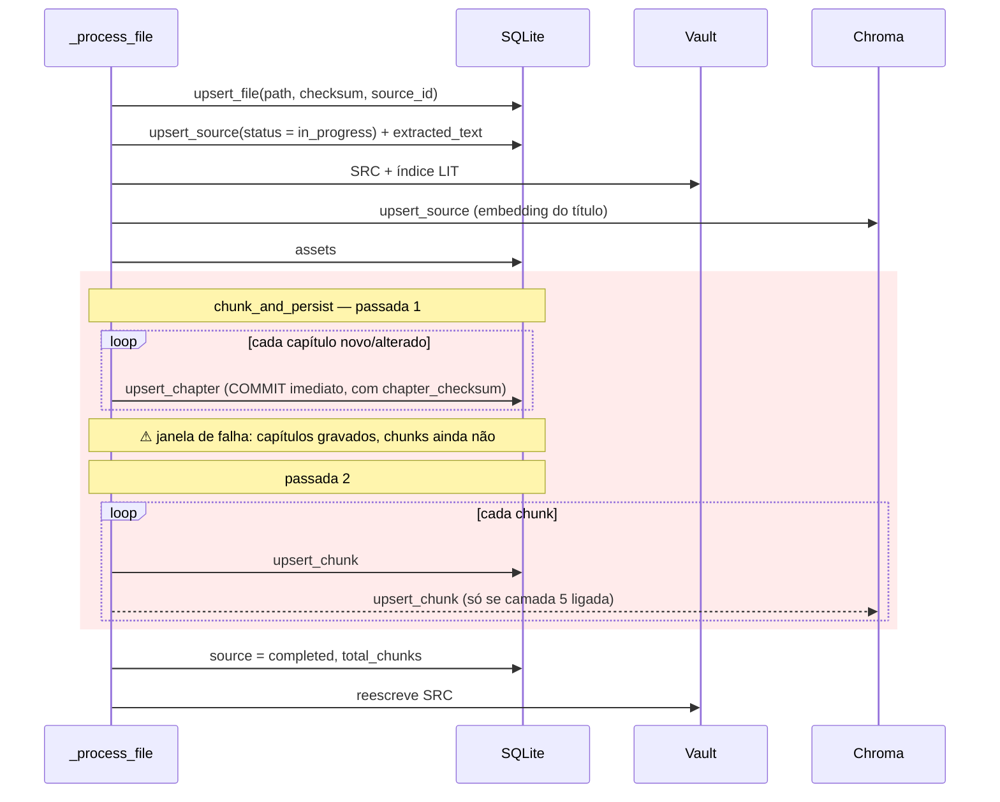
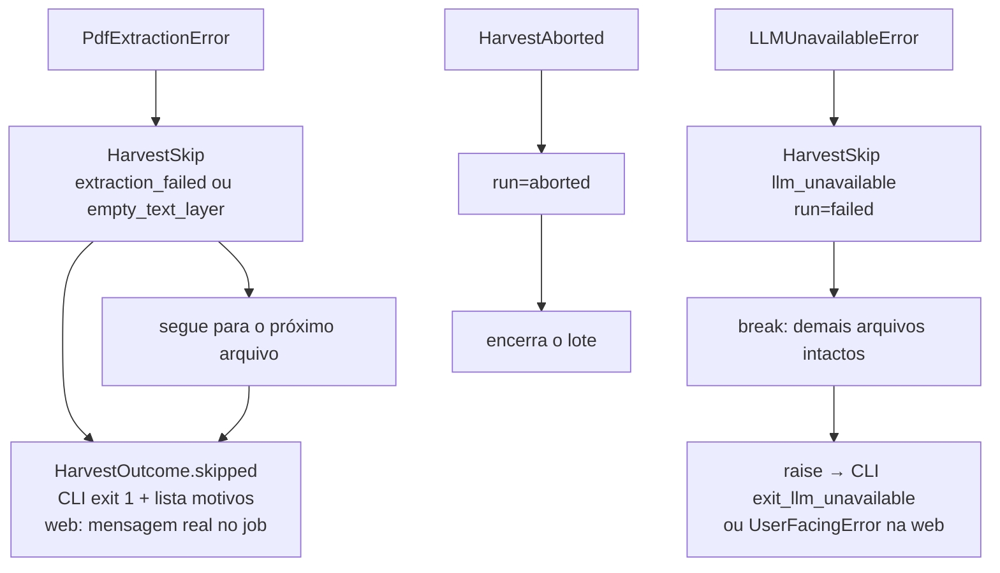

# Harvest: a porta de entrada de um pipeline Zettelkasten com LLM — e por que ela decide a qualidade de tudo que vem depois

> Artigo 1 de uma série sobre o `zettel_app`, um pipeline que transforma PDFs e Markdown em notas permanentes (Zettelkasten) compatíveis com o Obsidian.
> Esta parte cobre apenas a fase **HARVEST**. Versão analisada: `main` @ `bbe767a` (2026-10-13). Corpus usado nas medições: 7 fontes (4 PDFs, 3 Markdown), 1.073 chunks.

---

## 0. Resumo (para quem tem pouco tempo)

O pipeline tem cinco fases: `harvest → extract → review → connect → garden`. Quase todo o dinheiro (LLM) e toda a atenção humana (revisão) são gastos *depois* do harvest, mas **tudo o que o harvest errar é herdado, sem chance de correção, pelas quatro fases seguintes**: uma página errada vira uma citação ABNT errada em uma nota permanente; um chunk mal cortado vira um rascunho rejeitado; uma duplicata aceita vira um grafo poluído.

Ao auditar o harvest eu li o código, os ADRs, e **medi o comportamento no meu próprio acervo** (SQLite somente-leitura e os PDFs originais). O resumo honesto:

| # | Achado | Gravidade | Evidência |
|---|--------|-----------|-----------|
| 1 | **A numeração de páginas do PDF desliza.** O Docling emite *um* marcador por salto de página; páginas vazias não geram marcador, e o `page_map` numera por posição. Todo chunk depois de uma página vazia fica com `page_in_file` menor que o real. | **Alta** (corrompe citações) | Kim 2022: 299 págs. no PDF, 289 no mapa, erro médio de **5,7 páginas** (máx. 10). Hui 2026: erro médio 1,9 (máx. 4) |
| 2 | **Janela de inconsistência no checkpoint de chunking.** O `chapter_checksum` é gravado *antes* dos chunks. Uma falha no meio faz o retry concluir "nada a fazer" com chunks faltando — e nem o `rechunk` repara. | Alta (silenciosa, rara) | Reproduzido com falha injetada: 4 capítulos gravados, 1 chunk; retomada responde "completo" |
| 3 | **Tabelas viram lixo caro.** O Markdown de tabelas do Docling vem preenchido com espaços; 82% dos caracteres desses chunks são padding, e **130 de 130** são rejeitados pelo `extract` (32% de todas as rejeições). | Média | Medido no `state.db` |
| 4 | **O estágio "estrutural H3–H6" é inerte para PDFs.** Nos 4 PDFs há *zero* cabeçalhos H3+ e nenhum H1: só H2. O "chunking híbrido" vira, na prática, "um capítulo por heading + splitter por tamanho". | Média | Contagem de headings nas 4 fontes PDF |
| 5 | **Atribuição de página é O(chunks × páginas).** Benchmark sintético: 300 págs. → 11,9 s; 1.000 págs. → 132 s (×11,1, exatamente o previsto por escala quadrática). | Média | Benchmark local |
| 6 | **A camada 3 de dedupe funde sem perguntar com base em ISBN/DOI vindo de um LLM.** Sem validação de dígito verificador; ISBN de livro aparece em capítulos avulsos. Risco de descartar uma fonte legítima em silêncio. | Média | Análise de código + literatura |
| 7 | **O "confidence" bibliográfico é uma medida de completude, não de correção**, e em modo não interativo (web, `--yes`) metadados completos porém errados passam sem prompt. O LLM também sobrescreve metadados que o próprio usuário escreveu no frontmatter. | Média | Código + literatura de calibração |
| 8 | **Citekey não é sanitizado** (o sobrenome vem cru do metadado do PDF/LLM) e acentos quebram o `author_year_label`. | Baixa–Média | Teste com funções reais |

O que está **muito bem feito**: idempotência em camadas de hash, a decisão explícita de *falhar rápido* em vez de degradar em silêncio, a sanitização de Unicode invisível *antes* do checksum, a separação "identidade vs. heurística" nas camadas de dedupe (e o default irreversível-é-perigoso), a documentação das decisões e de seus *erros* nos ADRs (o ADR-014 tem medições que desmentiram a própria hipótese). Isso é raro e vale ser dito.

---

## 1. Por que o harvest é a fase mais subestimada

Sistemas de RAG e de "segundo cérebro" costumam ser avaliados pelo fim do funil: a qualidade da resposta, da nota gerada, do grafo. O harvest parece "só leitura de arquivo". Mas ele define quatro invariantes das quais o resto depende:

1. **Identidade**: o que é uma *fonte*? (`source_id`, `citekey`, deduplicação). Duas fontes que são o mesmo livro duplicam notas; duas obras distintas fundidas perdem conteúdo.
2. **Texto canônico**: qual é *o* texto sobre o qual tudo é calculado (checksums, chunks, prompts, embeddings, âncoras de citação).
3. **Localização**: onde, na obra original, está cada trecho (página impressa, caminho de seção). É a base da citação.
4. **Granularidade**: em que unidades o LLM vai ler (chunks). Chunk ruim → rascunho ruim → revisão humana desperdiçada.

Como as fases seguintes **não reabrem o arquivo original** (trabalham em cima do que o harvest persistiu em `sources.extracted_text` e `chunks`), cada erro de harvest é, na prática, permanente — só se corrige com `rechunk`, `set-paging` ou um novo harvest. É por isso que esta fase merece um artigo inteiro.

### Onde o harvest se encaixa



Uma observação de custo que muda como pensar a fase: o harvest chama um LLM **uma vez por arquivo** (para metadados bibliográficos, ~5.000 caracteres de entrada). O custo de LLM do harvest é desprezível; o custo real é **tempo de GPU** (Docling), **tempo humano** (confirmar bibliografia e paginação) e, opcionalmente, **embeddings** (camada 5 de dedupe, desligada por padrão).

---

## 2. Metodologia: o que eu li, o que eu medi, o que eu não verifiquei

Para que este texto possa ser contestado, aqui está a base:

- **Lido**: todo o pacote `zettel/harvester/` (pipeline, extract, chunking, duplicates, biblio_dedupe, biblio_hitl, citekey, prepared, set_paging), `paging.py`, `hashing.py`, `text_sanitize.py`, `markdown_fences.py`, `bibliography.py` (trechos), o caminho web de preparação/confirmação em `web_app.py`, o schema SQLite, `config.yaml`, e os ADRs 007, 011, 012, 013, 014, 027, 033, 046, além de `CLAUDE.md` e `docs/pipeline.md`.
- **Medido (somente leitura)**: o `state.db` (1.073 chunks, 295 capítulos) e os PDFs originais, comparando o `page_map` persistido com o texto de cada página lido diretamente pelo `pypdfium2`. Também li o código-fonte instalado do `docling-core` 2.92 e do `docling` 2.123 para entender o serializador de Markdown.
- **Reproduzido com falha injetada**: o achado #2, com as funções reais sobre um SQLite temporário (seção 5).
- **Não verificado**: não rodei benchmarks de qualidade de extração contra outros conversores; não medi o efeito de nenhuma alternativa que sugiro (isso é o próximo passo, na seção 10).
- **Limites do corpus**: 7 fontes, domínio estreito (Kant/IA, prompt engineering). Os percentuais ilustram o mecanismo; não são estatística de população.

> Nenhuma linha de código ou de documentação do projeto foi alterada para produzir este artigo.

---

## 3. Visão geral da fase

### 3.1 Mapa de decisões



### 3.2 Caminho feliz, em sequência



Dois detalhes de projeto aparecem no diagrama e merecem nota:

- **SRC e índice LIT são gravados *antes* do chunking.** Isso é deliberado ("antes dos embeddings, que podem demorar minutos"): o usuário vê a fonte no Obsidian cedo. O custo é que passa a existir um estado intermediário (`processing_status=in_progress`) que precisa de um protocolo de retomada correto — ver seção 6 (o achado #2 mora aqui).
- **A chamada de LLM acontece antes de qualquer escrita.** Se o LLM está indisponível (`LLMUnavailableError`), o arquivo corrente *não é persistido* e o lote para. Isso é uma boa propriedade: falha antes de efeito colateral.

---

## 4. Etapa por etapa: o que acontece, por que, e o que eu mudaria

### 4.1 Descoberta e idempotência por hash (camadas 1 e 1b)

`run_harvest` varre `inbox/**` por `.pdf/.md/.markdown/.txt` e, para cada arquivo, calcula SHA-256 dos bytes (leitura em blocos de 1 MiB). Dois casos:

- *Mesmo caminho, mesmo hash* → "inalterado". Mas antes de pular, verifica se os capítulos persistidos cobrem o `split_into_chapters(extracted_text)` atual; se não cobrem, **retoma** o chunking (`_complete_incomplete_source`).
- *Outro caminho, mesmo hash* → é uma cópia/renomeação: associa o novo caminho ao `source_id` existente e registra `duplicate_file_count`.

**Sobre a escolha de SHA-256** (o ADR-007 deixa isso como `[NEEDS INPUT]`): hashes não criptográficos (xxHash, BLAKE3) seriam mais rápidos, mas aqui isso é irrelevante. SHA-256 processa centenas de MB/s; um PDF de 20 MB leva da ordem de dezenas de milissegundos, contra **0,5 a 3 s por página** na conversão do Docling (seção 4.2). O hash nunca é gargalo, e SHA-256 elimina qualquer discussão sobre colisão acidental ou adversarial. Decisão correta, por razões diferentes das que o ADR sugere.

**Colisões no ID de chunk.** O `chunk_id` é `source_id::chapter_id::short_hash(checksum)` com 8 hex (32 bits). Pelo limite do aniversário, a probabilidade de colisão com *n* itens é ≈ n²/2³³. Se o escopo fosse o acervo todo (n = 1.073), seria ≈ 1,3 × 10⁻⁴ — não desprezível. Mas o ID embute `source_id` e `chapter_id`, então o escopo real é o capítulo (média medida: 1.073/295 ≈ 3,6 chunks; mesmo n = 50 dá ≈ 1,5 × 10⁻⁷). Está seguro **por causa do prefixo**, não do hash de 32 bits — um detalhe que vale um comentário no código, para que ninguém "simplifique" o prefixo depois.

### 4.2 Extração: Docling como único extrator

**Decisão (ADR-012)**: Docling é obrigatório, sem *fallback*. A motivação original era técnica (manter o PyMuPDF como plano B); foi revertida por **licença** — o PyMuPDF é AGPL-3.0, o que bloquearia distribuição além do uso pessoal. É uma decisão que prioriza liberdade de distribuição sobre robustez, e está registrada como tal. Eu concordo com o desenho: um *fallback* silencioso para texto simples produziria uma fonte "completa" e ruim — pior que uma falha explícita.

**Por que Docling e não outro conversor?** O relatório técnico do Docling v2 descreve um pipeline de modelos especializados (layout via DocLayNet, estrutura de tabelas via TableFormer) em que **todo o texto vem do PDF programático ou de OCR, nunca de um modelo generativo** — a principal vantagem contra abordagens com VLM, que podem "inventar" conteúdo. No benchmark do próprio paper (89 PDFs, 4.008 páginas, OCR e tabelas ligados): em CPU x86 de 8 threads o Docling levou 3,1 s/página (MinerU 3,3; Marker >16; Unstructured 4,2); na GPU L4, 0,49 s/página (MinerU 0,21; Marker 0,86). **O relatório não publica métricas de acurácia de layout**, só tempo — então "Docling é o melhor" não está demonstrado por essa fonte; o que se demonstra é "rápido o bastante e fiel por construção". Registro isso porque é fácil citar o paper como se ele provasse mais do que prova.

#### A saga do `bfloat16` (a melhor história de engenharia da fase)

O código tem um comentário longo em `extract.py` que merece virar tabela. Com *enrichment* de fórmulas e código ligado, o Docling carrega o modelo `CodeFormulaV2` em `bfloat16`. Numa GPU sem bf16 nativo (Turing, RTX 2060, 6 GB), o PyTorch **emula** bf16, e a emulação custa *mais* memória que float32:

| dtype | tempo (7 págs. de matemática) | pico de VRAM |
|-------|------|------|
| bfloat16 (emulado) | 776 s | 8,63 GB — estoura a VRAM física, vaza para RAM |
| float32 | 150–163 s | 4,13 GB |
| float16 | 123 s | 2,45 GB |

Ou seja, **6,3× mais rápido e 3,5× menos memória** só trocando o dtype, com Markdown byte-idêntico entre fp16 e fp32. O código detecta a ausência de bf16 nativo e força fp16. A condição de bf16 emulado é a mesma sob a qual um harvest real morreu com `STATUS_HEAP_CORRUPTION (0xc0000374)` sem traceback Python — o que motivou o módulo `crashlog.py` (`faulthandler` apontado para `data/logs/`). É um bom exemplo de engenharia orientada a medição: o problema (memória emulada) foi isolado por experimento, não por palpite.

#### Probe de camada de texto: falhar barato

Antes de construir o `DocumentConverter`, `assert_pdf_has_text_layer` abre o PDF com `pypdfium2` (já dependência do Docling — não reintroduz o PyMuPDF) e soma o texto visível das **4 primeiras páginas**; abaixo de **40 caracteres**, levanta `EmptyTextLayerError` sugerindo OCR. Racional: um scan custa ~1,5 s/página para não produzir nada. Se o `pypdfium2` falhar ao abrir, o probe é ignorado e o teste de "texto visível == 0" pós-extração pega o mesmo arquivo, só que mais tarde e mais caro.

> **Nota de divergência de documentação.** O ADR-033 e `docs/pipeline.md` dizem "3 primeiras páginas"; o código usa `TEXT_LAYER_PROBE_PAGES = 4`. O `CLAUDE.md` já diz 4. Detalhe, mas é o tipo de drift que confunde quem audita.

**Crítica de projeto — recusar scans é uma escolha, não uma limitação do Docling.** O Docling tem OCR embutido (`do_ocr=True` é o padrão; engines RapidOCR/EasyOCR/Tesseract; modo `FULL_PAGE`). O projeto prefere recusar o scan e mandar o usuário para `ocrmypdf`. É defensável (mantém o pipeline determinístico e barato, e OCR ruim contamina tudo a jusante), mas o custo é *fricção de fluxo*: o usuário sai do sistema, roda outra ferramenta, volta — e depois enfrenta a dedupe pós-OCR descrita no ADR-046. Uma terceira via seria **oferecer OCR opt-in** (`harvest.ocr: auto|off`) com aviso de qualidade, mantendo o default atual. Há um agravante sutil: como `PdfPipelineOptions()` nunca desliga `do_ocr`, o Docling pode estar rodando OCR em regiões *bitmap* de PDFs digitais — custo que eu **não medi** e que vale a pena medir (`do_ocr=False` em PDFs com camada de texto).

#### Conversor recriado a cada arquivo

`extract_pdf_docling` constrói um `DocumentConverter` por arquivo e depois **esvazia manualmente** `converter.initialized_pipelines` (há uma explicação de por que o conversor não é coletado: um traceback de exceção em cache mantém o frame vivo). A documentação do Docling descreve exatamente o oposto como padrão: pipelines são cacheados por `(classe, hash das opções)` para os modelos carregarem **uma vez** e serem reutilizados. Liberar por arquivo troca *tempo de carga de modelos em cada arquivo* por *VRAM devolvida*. Numa GPU de 6 GB isso é compreensível; num lote de 50 PDFs é desperdício. Sugestão: um *context manager* de lote que reutiliza o conversor durante `run_harvest` e libera ao final.

#### Sanitização de Unicode invisível (ADR-033)

`extract_text` é o **único** ponto de sanitização: remove caracteres de largura zero, controles bidi, BOM e o bloco de tags Unicode (U+E0000–E007F) *antes* do `extraction_checksum`. Ordem importa: se a sanitização viesse depois, o mesmo conteúdo em duas codificações deixaria de colidir na camada 2.

O vetor é real: o "ASCII smuggling" (Goodside, Rehberger) esconde instruções no bloco de tags, que não renderiza mas é lido pelo modelo; a mitigação recomendada é exatamente remover/normalizar antes do modelo ver o texto. O ADR acerta ao observar que o *gate* de revisão é um humano lendo Markdown renderizado — um canal invisível o contorna.

**Lacuna que a sanitização não cobre: texto invisível por *renderização*.** Texto branco sobre branco ou fonte de 1 pt é perfeitamente visível para o extrator e invisível para o olho; há medições reais disso em currículos (um estudo com 200 mil currículos reais encontrou injeções desse tipo) e extratores baseados em texto os preservam, enquanto os baseados em imagem/OCR os ignoram. Para um acervo pessoal de leituras escolhidas a mão o risco é baixo; para a UI web que aceita upload, não. Mitigação possível sem novo extrator: comparar o texto do `pypdfium2` com e sem filtro de visibilidade, ou ao menos sinalizar texto com contraste ~0.

#### Desidifenização: correta no caso comum, destrutiva em bordas

`dehyphenate_pdf_linebreaks` junta `palavra-\nseguinte` quando o próximo caractere **não é maiúsculo**. Testei a função isolada:

| Entrada | Saída | Correto? |
|---|---|---|
| `pala-\nvra` | `palavra` | ✔ |
| `Sao-\nPaulo` | `Sao-\nPaulo` | ✔ (maiúscula preservada) |
| `COVID-\n19` | `COVID19` | ✘ |
| `entre 2010-\n2020` | `entre 20102020` | ✘ |
| `pp. 200-\n210` | `pp. 200210` | ✘ |
| `state-\nof-the-art` | `stateof-the-art` | ✘ |

O código já documenta o caso `bem-\nvindo`; os de **dígito** e de composto com continuação minúscula são piores porque corrompem faixas de páginas e datas — justamente o que citações usam. A exposição real depende de quantas quebras com hífen o Docling ainda deixa no Markdown (o Docling faz a sua própria junção de hífen ao mesclar elementos, então o conjunto restante é menor do que em texto bruto de PDF). Eu **não medi** a incidência; recomendo contar quantas vezes a regex dispara no corpus antes de decidir. Se disparar pouco, restringir a regra a `letra-\nletra-minúscula` (excluir dígito) elimina a classe mais danosa.

### 4.3 Metadados bibliográficos: heurística → LLM → humano

`build_bibliographic_metadata` roda três estágios:

1. **Heurística** (`infer_from_file_metadata`): metadados do arquivo + palavras-chave na amostra e no nome do arquivo escolhem um `document_type` (livro, artigo, tese, capítulo, material de curso…) com confiança inicial de 0,30–0,55.
2. **LLM** (`enrich_with_llm`): amostra de `biblio_text_sample_chars` = 5.000 caracteres + o seed em JSON. Chamada com **cache determinístico** (`compute_llm_call_checksum` sobre prompt, amostra, seed, modelo, temperatura, idioma, provider, `top_p`, *thinking*). Falhas de parse viram "devolve o seed" — exceto `LLMUnavailableError`, que propaga (política *fail-fast* do ADR-045).
3. **Humano** (`resolve_bibliography`): em modo interativo, **sempre** mostra o preview ABNT e pede confirmação, mesmo se completo; em modo não interativo, completo passa, incompleto pula o arquivo (a menos que `--skip-biblio`).

**Onde isso é frágil:**

- **A heurística usa substring.** `"curso" in "discurso"` e `"tese" in "hipótese"` são ambos verdadeiros (conferi); um arquivo chamado `Discurso do método.pdf` nasce `material_curso`. O LLM costuma corrigir, mas com `biblio_llm_enabled: false` o erro passa.
- **"Confiança" aqui é completude disfarçada.** `_merge_biblio` define `confidence = max(seed, llm)` e **eleva para 0,85 sempre que todos os campos obrigatórios do tipo estão preenchidos**. O limiar de aceitação é 0,7. Logo, "campos preenchidos" ⇒ "alta confiança", independentemente de estarem *certos*. Isso importa porque a confiança auto-declarada por LLM é notoriamente mal calibrada (Tian et al., 2023, medem que modelos com RLHF são superconfiantes em *tokens*, e que confiança verbalizada ajuda mas não resolve). Em modo web, um livro com editora e ano alucinados e todos os campos presentes é aceito sem prompt.
- **A precedência está invertida para Markdown.** No harvest, `prefer_seed=False`: valores não vazios do LLM *vencem* o seed. Se o usuário escreveu `author:` e `year:` no frontmatter do `.md` (confiança 0,85), o LLM, que só viu o corpo, pode sobrescrevê-los. O caminho manual (`preview_manual_bibliography`) usa `prefer_seed=True` — o harvest deveria seguir o mesmo princípio: **dado fornecido pelo usuário vence dado inferido**.
- **Entrada não confiável alimenta um LLM cujo resultado vira nome de arquivo e chave de dedupe.** Ver 4.5.

**Alternativa que muda a natureza do problema: consultar um catálogo autoritativo.** Se há DOI, a API REST do Crossref devolve título, autores, ano, periódico, volume e páginas; se há ISBN, o Open Library (`/isbn/{isbn}.json`) devolve edição, editora e páginas. Metadado vindo de catálogo não alucina. O LLM passaria a preencher só o que o catálogo não tem, e o `confidence` poderia ser *real* (campo veio de fonte autoritativa vs. inferido). Para PDFs científicos, o GROBID é a referência de extração de cabeçalhos (em benchmark independente de ferramentas de extração acadêmica foi o melhor em metadados e referências). A combinação "regex de DOI/ISBN determinística → Crossref/Open Library → LLM só para lacunas" é mais barata, mais correta e mais auditável.

### 4.4 Deduplicação em cinco camadas

A ideia central (ADR-011 → ADR-046) é *do mais barato e mais certo para o mais caro e mais incerto*, e separar **identidade** (funde sem perguntar) de **heurística** (pergunta):

| # | Camada | Natureza | Ação | Custo |
|---|---|---|---|---|
| 1 | SHA-256 do arquivo | igualdade | reusa `source_id` | I/O |
| 2 | SHA-256 do texto normalizado | igualdade | reusa | extração já paga |
| 3 | DOI / ISBN normalizados | **identidade** | reusa, **sem perguntar** | SQLite indexado |
| 4 | Título (sem subtítulo) + sobrenome de autor | **heurística** | **sempre pergunta**; sem TTY ⇒ *continuar* | varredura linear em SQLite |
| 5 | Similaridade semântica de chunks | similaridade | pergunta / ação configurada; **desligada por padrão** | embeddings de *todos* os chunks |



**O que está certo:**

- **Ordenar por custo** e rodar 3/4 *antes* de `generate_citekey` evita "queimar" um citekey desambiguado (`Silva2020Obra → Silva2020Obraa`) para uma fonte que será rejeitada.
- **A assimetria de erro está bem argumentada**: falso positivo na camada 4 *perde* uma fonte única de forma não reversível; falso negativo deixa duas fontes que `delete-source` remove. Daí o default `continue` sem TTY, ignorando `non_interactive_duplicate_action`.
- **Não usar fuzzy matching na camada 4** (comparar último token do sobrenome em vez de distância de edição) evita introduzir *outro* limiar não calibrado — o mesmo defeito que o ADR-046 aponta na camada 5.
- **A camada 5 desligada, com o flag governando escrita *e* leitura juntas**, é uma lição de design: gatear só um dos lados produziria *falso negativo silencioso* (consultar um índice que o pipeline parou de popular).

**Pontos de atenção:**

1. **A camada 3 trata ISBN como identidade, mas ISBN identifica uma *edição*, e PDFs de capítulo costumam trazer o ISBN do livro.** Se o LLM extrair o ISBN da página de copyright de um capítulo avulso de um livro já ingerido (ou de outro capítulo), a regra "mesmo ISBN ⇒ reusa a fonte sem perguntar" **descarta o capítulo em silêncio** — "sem gerar novo citekey/SRC/LIT/chunks". Não testei com um capítulo real, mas o mecanismo é direto do código. O DOI não tem esse problema (cada capítulo tem o seu); o ISBN tem.
2. **Nenhuma validação de dígito verificador.** `normalize_isbn` aceita qualquer string de 10 ou 13 dígitos. O ISBN-13 usa soma ponderada (pesos 1 e 3) módulo 10; um número aleatório de 13 dígitos passa em ~10% das vezes, mas um erro de OCR/alucinação de *um* dígito é sempre detectado. Como a ação é irreversível e sem prompt, validar o dígito é o mínimo. O `normalize_doi` também não aparou pontuação final (".", ")") que o Crossref avisa acompanhar DOIs extraídos de texto corrido, e sua regex recomendada (`^10\.\d{4,9}/[-._;()/:A-Z0-9]+$`, case-insensitive) cobre 74,4M de 74,9M de DOIs vistos.
3. **Origem do identificador.** Ele vem do LLM (5.000 primeiros caracteres). Para ações irreversíveis, preferir identificador extraído por **regex determinística** do texto, e tratar o do LLM como *sugestão* que degrada a camada 3 para "perguntar".
4. **Reingestão de arquivo *modificado* não tem caminho.** Pela leitura do código, o ramo "texto extraído inalterado para `{source_id}`" (`pipeline.py`, depois de `generate_citekey`) é praticamente inalcançável: `generate_citekey` garante um citekey inexistente, portanto `db.get_source(source_id)` volta vazio. Se o usuário corrige um PDF no mesmo caminho (bytes novos), a camada 1 falha, a 2 também (texto mudou) e o arquivo vira **uma nova fonte** (`...a`), enquanto a linha em `files` passa a apontar para ela; a fonte anterior fica órfã. Não existe "atualizar fonte".
5. **Probabilidade de detecção na camada 5.** Ela amostra `s = 5` chunks e acha duplicata se *algum* deles tiver vizinho com cos ≥ 0,88 em outra fonte. Se uma fração *f* dos chunks do arquivo novo repete outra fonte, `P(detectar) = 1 − (1 − f)^5`:

   | f (fração repetida) | 10% | 20% | 30% | 50% |
   |---|---|---|---|---|
   | P(detectar) | 41% | 67% | 83% | 97% |

   Para "mesma obra reeditada" (f alto) funciona; para uma coletânea que reaproveita 10% de outra, é praticamente cara-ou-coroa. E o limiar 0,88 continua sem calibração própria (diferente do 0,88 de `corroborates`, que foi medido contra rótulos cegos).
6. **Alternativa clássica para quase-duplicatas de texto: MinHash/LSH sobre *shingles*** (Broder). Estima a similaridade de Jaccard com erro-padrão √(J(1−J)/k) — com k = 128 permutações e J = 0,8, ≈ 0,035 —, sem nenhum embedding, em tempo linear. Pega cópia/reedição/versão revisada, não paráfrase. Comparado à camada 5, tem custo próximo de zero e um limiar com interpretação estatística direta. Eu o colocaria *no lugar* de "embedar tudo para dedupe".

### 4.5 Citekey

`generate_citekey` monta `{Sobrenome}{Ano}{2 palavras do título}` (variações quando falta autor/ano) e resolve colisão com sufixo `a, b, c…`. Três problemas pequenos, um deles de segurança:

- **O sobrenome não é sanitizado.** O título passa por `re.sub(r"[^\w\s]", "", …)`; o autor, não: `surname = parts[-1]`. O autor vem do metadado `/Author` do PDF, do LLM ou do HITL. Testei: um autor `"John ../../evil"` produz o citekey `../../evil2020SomeTitle` e o nome de arquivo `SRC - ../../evil2020SomeTitle - some-title.md`. Eu não escrevi nenhum arquivo; mas, como o caminho é montado por `vault_path / "10_Sources" / nome`, componentes `..` são interpretados pelo sistema de arquivos. Em app local de uso próprio é baixo risco; **na UI web com upload, é um vetor de escrita fora do vault.** Correção óbvia: `re.sub(r"[^\w]", "", surname)` e rejeitar separadores.
- **Acentos quebram `author_year_label`.** A regex é `^([A-Za-z]+\d{4})` (ASCII). `Silva2020Obra` vira `Silva2020`; `Gonçalves2021AnáliseDe` e `Müller2019Teoria` **não casam** e o nome do arquivo fica com o citekey inteiro. Em um acervo em português isso é comum.
- **Colisão por sufixo alfabético** limita-se a 26 (`chr(96 + n)` passa de `z` para `{`). Irrelevante na prática; vale um `assert`.

### 4.6 Paginação: a parte mais difícil e a que mais importa

O sistema separa dois números: `page_in_file` (índice no PDF) e `page_in_book` (número impresso), ligados por

```
page_in_book = page_in_file − content_start_file + content_start_book
```

`content_start_*` vem de: flags explícitas > `--skip-paging` > HITL interativo (default = sugestão da heurística) > heurística silenciosa (modo não interativo) > 1 = 1. A heurística procura a primeira página, fora de sumário, que combine `Capítulo 1 / Chapter 1 / 1. / Introduction / Introdução`, com impressa = 1; para artigo, usa a faixa `pages: 200-210` da bibliografia. Páginas antes do início **não geram chunks**. Markdown nativo não tem página (o localizador é o `section_path`, e dígitos soltos não viram página — decisão correta).

A inferência por chunk tem três camadas (ADR-013): (1) mapa de páginas do Docling, (2) regex no texto, só sem mapa e fora de Markdown, (3) interpolação linear entre vizinhos conhecidos.

#### Achado #1 — o mapa de páginas desliza (e eu consigo provar)

Como o mapa é construído: `export_to_markdown(page_break_placeholder="<!-- zettel:page-break -->")` e depois `page_map_from_marked_markdown` faz `text.split(MARKER)` e numera `i + 1`. Isso assume **exatamente um marcador entre páginas consecutivas**.

Lendo o serializador do `docling-core`: ele itera os itens do documento e, quando a página do item atual é maior que a anterior, emite um `_PageBreakNode(prev_page, next_page)` — que carrega os dois números —, mas o `serialize_doc` o substitui pelo texto bruto do placeholder, **descartando `next_page`**. Uma página sem nenhum item exportável (página em branco, só imagem sem texto, só cabeçalho/rodapé, que o export padrão exclui) simplesmente não aparece; o salto 100 → 102 gera **um** marcador. Daí em diante, todo número de página do mapa fica uma unidade abaixo do real. O erro é cumulativo: `e(p) = nº de páginas vazias até p`.

Os números já denunciam: Kim 2022 tem 299 páginas e **288 marcadores** (289 partes); Hui 2026 tem 145 páginas e 137 marcadores. Para medir o efeito, abri os PDFs com `pypdfium2`, tomei 6 palavras do meio de cada página como "impressão digital" e procurei em qual parte do `page_map` persistido elas estão (descartando impressões ambíguas). Resultado (erro = página real − página atribuída):

| Fonte | Págs. no PDF | Partes no mapa | Amostras | Erro médio | Mediana | Máx. | % com erro ≥ 3 | % com erro ≥ 5 |
|---|---|---|---|---|---|---|---|---|
| Kim 2022 | 299 | 289 | 233 | **5,7** | 7 | 10 | 99% | 56% |
| Hui 2026 | 145 | 138 | 127 | **1,9** | 2 | 4 | 22% | 0% |
| Huang 2021 / Latorre 2021 | 15 / 8 | 15 / 8 | não medido | — | — | — | — | — |

Nos dois PDFs menores a contagem de marcadores é consistente com o número de páginas (sem deriva esperada; não medi o erro diretamente). O erro médio ≈ E/2 (E = páginas ausentes do mapa = 10 em Kim) é o que se espera de um acúmulo aproximadamente uniforme. A maior página atribuída no Kim é 289, num PDF de 299.

**Consequências em cascata**, todas verificáveis no código:

- `page_in_book` fica errado (deslocado do mesmo valor). O ADR-051 refina a página com `locate_quote_pages` — que usa **o mesmo mapa** — logo a citação ABNT `(KIM, 2022, p. 45)` herda o erro.
- O `content_start_file_page` que o usuário digita no HITL vem do *visualizador de PDF* (coordenada real), mas os chunks vivem na coordenada deslocada. O corte "descartar chunks com `page_in_file < start_file`" e a conversão para página impressa misturam dois sistemas de coordenadas.
- O rótulo de confiança é `explicit` para esses chunks (ver próximo achado), então nada sinaliza a imprecisão.

**Como eu corrigiria (sem implementar aqui):** (a) construir o mapa a partir de `DoclingDocument.iterate_items()` usando `prov[0].page_no` (a verdade estrutural, sem string intermediária); ou (b) gerar um item de página por *toda* página de `1..num_pages`, vazia ou não (o próprio código já tem `docling_page_map_by_export` com `export_to_markdown(page_no=n)` como *fallback*); ou (c) incluir o número no marcador. Em qualquer caso, **uma invariante barata e permanente**: `len(page_map) == total_pages_file`, com aviso/erro quando divergir. O código já conhece os dois números (`docling_num_pages` e o tamanho do mapa) — só não os compara.

#### Achado — o rótulo `explicit` mistura exato e fuzzy

`lookup_page_for_chunk` tenta, na ordem: (i) a sonda de 120 caracteres do início do chunk como *substring* de uma página normalizada; (ii) se nenhuma página contém a sonda inteira (ela atravessa uma quebra de página, por exemplo), cai numa pontuação por **interseção de conjuntos de palavras** com limiar `max(3, 4) = 4` palavras em comum. Qualquer texto razoável compartilha 4 palavras com dezenas de páginas ("de", "que", "the", "of"). Em `extract_page_hint`, **qualquer** `meta_page` não nulo vira `confidence="explicit"`. Logo, `explicit` = "exato" ∪ "chute fuzzy".

Medição nos meus PDFs: do total, 2,0% (Kim) e 2,7% (Hui) dos chunks caem no caminho fuzzy; 5 chunks em cada um têm a sonda em *mais de uma* página (a primeira vence — um cabeçalho repetido pode atribuir a página errada). Pequeno em volume, mas é um rótulo que mente: a confiança deveria ser `exact | fuzzy | inferred | unknown`.

E os 61 chunks `inferred` do Hui? São todos tabelas cujo início, depois de normalizado, tem menos de 20 caracteres (a sonda é descartada) — e todos foram rejeitados pelo `extract`. Ou seja, o canal de interpolação está sendo exercitado quase só por lixo (ver 4.7).

#### Achado — custo quadrático

`lookup_page_for_chunk` renormaliza **todo** o texto de página a cada chamada (regex de heading + `\s+`), sem cache, com saída antecipada na primeira página que contém a sonda. Complexidade: O(C · P · L) para C chunks, P páginas, L caracteres por página — e C e P crescem juntos com o tamanho do livro, logo é **quadrático no tamanho do documento**. Benchmark (texto sintético, ~2,8 mil caracteres/página, ordem das páginas aleatória):

| Páginas × chunks | Tempo |
|---|---|
| 300 × 450 | 11,9 s |
| 1.000 × 1.500 | 132,3 s |

A razão 132,3/11,9 = 11,1 é exatamente (1000/300)·(1500/450). Um tratado de 3.000 páginas levaria da ordem de **20 minutos** só atribuindo página (extrapolação). A correção é trivial: normalizar cada página uma vez e, melhor, indexar por deslocamento de caractere (`bisect` sobre os inícios de página) em vez de varrer.

#### Alternativas sem PyMuPDF para o número impresso

O ADR-012/013 afirma que não há varredura automática de cabeçalho/rodapé porque o PyMuPDF foi removido. Há duas fontes automáticas que **não** exigem PyMuPDF:

1. **Rótulos de página do PDF.** O `pypdfium2` expõe `PdfDocument.get_page_label(index)`, que devolve o rótulo lógico (`"xii"`, `"1"`, `"200"`) quando o PDF define `/PageLabels`. Quando existe — comum em PDFs de editoras e de periódicos —, resolve *exatamente* o par (arquivo → impresso), inclusive o artigo que começa na p. 200. É uma leitura de milissegundos com uma dependência que já está na árvore.
2. **Itens `page_footer`/`page_header` do próprio Docling.** O Markdown exclui rodapés, mas o `DoclingDocument` os mantém, classificados, com `prov.page_no`. O número impresso é, tipicamente, o texto do rodapé/cabeçalho de cada página.

Com (1) como primeira tentativa e a heurística/HITL atuais como *fallback*, o prompt "em que página o conteúdo começa?" passaria a ser exceção, não regra.

### 4.7 Chunking

#### Os estágios



#### O que o ADR-014 acerta

- **Estrutura primeiro, tamanho depois.** Cortar onde o autor cortou preserva unidades de sentido; o splitter recursivo só entra quando a unidade estoura. A evidência externa é compatível: no relatório da Chroma (Smith & Troynikov, 2024), o `RecursiveCharacterTextSplitter` de 200 tokens obteve recall ≈ 88,5% e IoU ≈ 7,0%, à frente do splitter por tokens (86,7% / 5,1%) e a poucos pontos dos chunkers semânticos e baseados em LLM (valores segundo reproduções secundárias do apêndice; não consegui abrir o PDF original). E o estudo "Is Semantic Chunking Worth the Computational Cost?" (Vectara, NAACL 2025 Findings) conclui que o custo extra do chunking semântico **não** se justifica por ganhos consistentes. Ou seja: o baseline estrutural + recursivo é uma escolha de estado da arte *pragmático*, não de preguiça.
- **Fences atômicos, com exceção de tamanho declarada.** Cortar um bloco de código ou um template no meio é pior que um chunk grande. A regra é implementada por um scanner CommonMark mínimo (`iter_fenced_spans`) em um módulo-folha, o que permitiu reutilizá-lo em todos os leitores de Markdown (corrigindo o problema #204, em que o *dump* de extração listava 64 comentários Python como H1). Essa história — sintoma ≠ causa, causa estava num leitor *diferente* do chunker — é um bom caso de por que regras de estrutura devem viver num único lugar.
- **ADR com autocrítica.** O addendum de `fence_section_slack` registra que a hipótese ("fence + prosa juntos recuperam conceitos") foi **refutada pela medição**: o capítulo passou de 3 chunks (1 candidato) para 1 chunk (0 candidatos), porque a seção era 69% código. O parâmetro foi mantido por outra razão (representação mais fiel e 1 chamada em vez de 3), com a ressalva explícita de que não é correção de rendimento. Registrar a hipótese falsa é o que diferencia engenharia de dogma.
- **Piso `min_chunk_chars = 200` com justificativa quantitativa.** Dos 680 chunks da época, 116 (17%) tinham menos de 200 caracteres e **100%** eram rejeitados; um piso de 600 eliminaria mais 301 chamadas, mas ao custo de 35 notas aceitas. A escolha de "zero falso-negativo" foi explícita.

#### O que a medição no meu acervo mostra

Distribuição de tamanho dos 1.073 chunks (em caracteres): mediana 1.823, média 1.711, P90 2.435, máximo 4.715; 29 chunks (2,7%) acima de `chunk_size = 2500` (os fences/seções com folga). Com ~4 caracteres/token, a média é ≈ 430 tokens — acima da faixa de 150–300 tokens que um estudo recente de 2026 (arXiv 2601.14123; Natural Questions + SPLADE + Ministral-8B) recomenda *para QA*. Aqui, porém, o chunk não é só unidade de recuperação: é a **unidade de leitura do `extract`**, que precisa de contexto suficiente para uma tese e uma âncora literal. A comparação com a literatura de recuperação é, portanto, ilustrativa, não prescritiva — e é exatamente o tipo de parâmetro que deveria ser medido contra o *rendimento de notas aprovadas*, não contra recall.

**Taxa de rejeição pelo `extract` por faixa de tamanho** (404 de 1.073 chunks rejeitados no total, 37,7%):

| Faixa (chars) | Chunks | Rejeitados | % |
|---|---|---|---|
| < 400 | 31 | 23 | 74% |
| 400–1.000 | 166 | 74 | 45% |
| 1.000–2.000 | 424 | 171 | 40% |
| 2.000–2.500 | 423 | 127 | 30% |
| > 2.500 | 29 | 9 | 31% |

Há uma relação monotônica clara: quanto menor o chunk, maior a rejeição (as causas incluem referências, sumários, afiliações — não só tamanho). O piso de 200 caracteres já corta o pior; o gradiente sugere que **o piso poderia ser maior para PDFs** (onde o ruído é maior: 39,6% de rejeição vs 30,1% em Markdown), mas isso é hipótese a testar contra o conjunto-ouro (ADR-050), não decisão.

#### Achado #4 — o estágio estrutural é inerte em PDF

`split_into_chapters` usa `^#{1,2}`. Nos meus PDFs:

| Fonte | H1 | H2 | H3+ | Capítulos gerados |
|---|---|---|---|---|
| Kim 2022 (299 págs.) | 0 | 162 | 0 | 149 |
| Hui 2026 (145 págs.) | 0 | 23 | 0 | 22 |
| Huang 2021 | 0 | 25 | 0 | 25 |
| Latorre 2021 | 0 | 14 | 0 | 14 |

O Docling (a partir do PDF, sem estrutura de bookmarks aproveitada) exporta todos os `section_header` no mesmo nível (`##`). Consequência: (a) para PDFs, **"capítulo" significa "qualquer heading"** (Kim: 149 "capítulos" em 299 páginas, ~2 págs. cada — títulos de subseção e de figura incluídos); (b) o estágio H3–H6, o `section_path` hierárquico e a fusão de seções pequenas quase nunca atuam; (c) os resumos por capítulo (ADR-047) são resumos de *seções*, não de capítulos. Isso não é bug — o CLAUDE.md afirma que PDF mantém o split histórico — mas o *marketing interno* "chunking híbrido H1–H6" descreve melhor Markdown autoral do que PDF. Para PDFs, os níveis reais podem vir de: bookmarks/outline do PDF (`pypdfium2` expõe o sumário), ou do `HierarchicalChunker` do Docling-core, que usa a hierarquia do `DoclingDocument` (e há uma pós-processação de hierarquia de headings no ecossistema Docling).

#### Achado #3 — tabelas: padding e cortes sem cabeçalho

Chunks cujo texto *começa* numa linha de tabela: **130**, somando 219.889 caracteres, dos quais só **39.589** sobrevivem ao colapso de espaços — **82% de padding**. Os 130 foram rejeitados pelo `extract` (32% de todas as rejeições). Dois mecanismos se combinam:

1. O Markdown de tabelas do Docling alinha colunas com espaços, inflando a contagem de **caracteres** que `chunk_size` usa como orçamento. Uma tabela de índice vira vários chunks "cheios" de espaços (`| 69 | | | ...`).
2. O splitter recursivo corta tabelas em `\n`, no meio das linhas; 123 desses 130 chunks não contêm a linha separadora `|---|`, ou seja, **continuam uma tabela cujo cabeçalho ficou no chunk anterior**. Fences são atômicos; tabelas não (o ADR registra "fora de escopo").

No acervo inteiro, 10,9% dos caracteres armazenados são espaços de padding (1.835.969 → 1.636.483 após colapso). O dano em dinheiro é pequeno — o próprio ADR-049 estima ~US$ 0,003 por chunk, ≈ US$ 0,39 para esses 130 — mas o dano em **ruído** não: a fila de revisão, as métricas de rejeição e o `purge-rejected` carregam lixo estrutural, e se houver uma tabela de dados *real* num PDF, ela jamais vira nota. Correções baratas: colapsar espaços repetidos *dentro* de linhas de tabela na extração (o texto de tabela não perde informação), tratar a tabela como unidade atômica (com repetição do cabeçalho se cortada), e/ou tratar chunk majoritariamente tabular como categoria própria.

#### Overlap: o número no ADR e o que a literatura diz

O `chunk_overlap = 400` sobre `chunk_size = 2500` é r = 16% (o ADR corrigiu o "10–15%" original). Dois pontos que o addendum já faz bem: o overlap só existe *dentro de seções que estouram* o tamanho (seção que cabe vira 1 chunk sem overlap), e portanto não é constante do acervo. Aritmeticamente, a inflação de chunks por seção cortada é 1/(1 − r) = 1,19×. A literatura recente é cética: o estudo de 2026 acima mediu **nenhum ganho mensurável** (variações de BERTScore ≤ 0,004 e de EM ≤ 0,001, dentro dos intervalos de bootstrap) e recomenda overlap zero, com o ressalvante de que foi um único recuperador esparso e um único conjunto de dados; outros trabalhos reportam efeito pequeno ou negativo, e um relata ganho de cobertura de fronteira ao custo de resultados redundantes no top-k. Para este sistema, onde os chunks alimentam um *extrator de teses com âncora literal* (e não um top-k de QA), o overlap tem um efeito distinto: pode produzir a **mesma tese em dois chunks adjacentes**, o que o dedupe do `review` precisa então resolver. Eu testaria `chunk_overlap = 0` medindo (a) rendimento de notas aprovadas e (b) `dedupe_pending` — não recall.

#### E o futuro: contexto

Dois resultados recentes mudam o que "um bom chunk" significa e são compatíveis com a arquitetura atual:

- **Contextual Retrieval (Anthropic)**: prefixar a cada chunk 50–100 tokens de contexto gerado pelo documento reduziu em 35% (5,7% → 3,7%) as falhas de recuperação no top-20 com *embeddings* contextuais, 49% (→ 2,9%) adicionando BM25 contextual e 67% (→ 1,9%) com *reranking* (melhor modelo de embedding testado). O sistema já prefixa o **heading ATX** ao primeiro chunk — uma forma barata e determinística do mesmo princípio — e já tem BM25 + RRF. Um passo adicional natural seria prefixar o *caminho de seção + resumo de capítulo* (que o ADR-047 já produz) ao texto **embedado**, sem alterar o texto armazenado nem o `chunk_id`.
- **Late chunking (Jina)**: embedar o documento longo inteiro e só então fazer *pooling* por chunk, preservando o contexto; ganhos reportados de ~2,7–3,6% em nDCG@10 (resumo secundário). Exige embedding de contexto longo; o sistema usa `gemini-embedding-2`, então vale checar a janela suportada antes.

Nenhum dos dois é urgente: como a camada 5 (que consome embeddings de chunk) está desligada, **hoje o harvest nem gera embeddings de chunk** — o ganho potencial está no `connect`/`ask`, não aqui.

### 4.8 Imagens, fórmulas e código

- **Fórmulas e código** (`formulas.enabled`, `code.enabled`) rodam o modelo `CodeFormulaV2` e trocam o placeholder `<!-- formula-not-decoded -->` por LaTeX, e blocos achatados por código. Mudam o texto extraído, portanto entram no `docling_config_hash`.
- **Imagens**: `extract_docling_images` salva imagens ≥ 64×64 px de forma *content-addressed* (`img-<sha16>.png`) em `90_Assets/`, substitui o placeholder pela referência Markdown e guarda um trecho de contexto de 600 caracteres; a descrição multimodal acontece depois, no `extract`. O descarte de ícones por tamanho é uma heurística razoável.
- **Detalhe de engenharia**: o `docling_config_hash` (16 hex) cobre os parâmetros de chunking, imagens, fórmulas e código — e **não** a versão do Docling (o ADR candidato sobre o hash a descreve como "implícita", mas o payload do hash não a contém). Ele detecta troca de configuração mas não upgrade da biblioteca, que é justamente o que mais altera o Markdown (e o ADR-012 diz que upgrades são deliberados). Incluir `docling.__version__` no hash custaria uma linha.

---

## 5. Persistência e ordem de escrita (e o achado #2)

Ordem de escrita em `_process_file`, depois que todas as camadas de dedupe passaram:



**O problema.** Em `chunk_and_persist`, a passada 1 percorre os capítulos e chama `db.upsert_chapter(...)` — que faz `commit()` na hora — para cada capítulo cujo checksum mudou; só depois, numa segunda passada, grava os chunks. A retomada decide "completo" por `_chapters_fully_persisted`: *todos os `chapter_id` esperados existem na tabela?* e, ao encontrar um capítulo com o mesmo `chapter_checksum`, o pula como "inalterado".

Se o processo morre (ou uma chamada de embedding falha, com a camada 5 ligada e um provedor remoto) **depois da passada 1 e antes de a passada 2 terminar**, os capítulos existem com checksum correto e os chunks estão faltando ou incompletos. Na próxima execução: arquivo com mesmo hash → `source_chunking_incomplete` retorna **falso** (todos os capítulos existem) → "Arquivo inalterado, pulando". `processing_status` permanece `in_progress` na SRC, mas **nenhum caminho de código lê esse valor** para retomar (conferi: só o próprio `pipeline.py` o usa). O resultado é uma fonte com chunks faltando, marcada como pronta para o `extract`.

Reproduzi com as funções reais, sobre um SQLite temporário: 4 capítulos Markdown e uma exceção injetada no 2º `upsert_chunk`.

```
capitulos esperados: 4 | capitulos gravados: 4
chunks gravados apos a queda: 1
source_chunking_incomplete -> False
chunks apos nova passada (retomada manual): 1
```

A última linha é a pior: chamar `chunk_and_persist` de novo — exatamente o que `zettel rechunk` faz — **não recupera nada**, porque todo capítulo com checksum igual é pulado como "inalterado". A única saída é apagar a fonte e re-harvestar.

Com os padrões atuais (`semantic_duplicate_enabled: false`, sem rede na passada 2) a janela é pequena — uma queda de energia ou um `KeyboardInterrupt` precisaria cair em milissegundos de `INSERT`s locais — o que explica por que ninguém viu. Mas a camada 5 ligada com Gemini remoto abre uma janela de segundos a minutos.

**Correção conceitualmente simples**: tornar a passada atômica por capítulo (gravar `upsert_chapter` *depois* de persistir os chunks do capítulo, ou na mesma transação) ou fazer `source_chunking_incomplete` também verificar `processing_status != 'completed'` / contagem esperada de chunks por capítulo. Existe, na outra ponta, um sinal que o código já usa: o `last_chunk_processed`/`total_chunks` na fonte — só não é comparado.

---

## 6. Tratamento de erros e fluxos de exceção

### 6.1 Catálogo

| Situação | Onde é detectada | Resultado | Lote continua? |
|---|---|---|---|
| Inbox inexistente | `run_harvest` | warning, retorno vazio | — |
| `selected_file` fora do inbox | `run_harvest` | `ValueError` (impede *path traversal* de seleção) | não |
| PDF sem camada de texto | probe `pypdfium2` → `EmptyTextLayerError` | `HarvestSkip(empty_text_layer)`, mensagem sugere `ocrmypdf` | **sim** |
| Docling não instalado / conversão lança | `extract_pdf_docling` → `PdfExtractionError` | `HarvestSkip(extraction_failed)` | **sim** |
| Texto vazio após sanitização | `extract_text` | `EmptyTextLayerError` | sim |
| LLM indisponível (auth/rede/cota) | `enrich_with_llm` → `LLMUnavailableError` | arquivo **não persistido**, `run.status=failed`, lote **interrompido**, exceção propagada | **não** (falha sistêmica) |
| LLM responde lixo / parse falha | `enrich_with_llm` | devolve o seed heurístico (loga warning) | sim |
| Bibliografia incompleta, não interativo | `resolve_bibliography` | arquivo pulado (ou segue com `--skip-biblio`) | sim |
| Usuário recusa preview ABNT | `resolve_bibliography` | `None` ⇒ pulado | sim |
| Duplicata L1/L2/L3 | `_process_file` | reusa `source_id`, registra contador | sim |
| Duplicata L4 | `resolve_title_author_decision` | pular/continuar/abortar; sem TTY: continuar | depende |
| Duplicata L5 | `resolve_duplicate_decision` | pular/continuar/abortar; sem TTY: `non_interactive_duplicate_action` (default `skip`) | depende |
| Usuário aborta | `HarvestAborted` | `run.status=aborted`; fontes já criadas permanecem | **não** |
| Arquivo muda entre preparar e confirmar (web) | `file_sha256` vs snapshot | `ValueError` ⇒ `UserFacingError` | não (aquele job) |
| Config de extração mudou entre preparar e confirmar | `config_hash` do snapshot | `ValueError` | não |
| Interrupção no meio do chunking | — | ver seção 5 | — |
| Config do Docling mudou desde o último harvest | `_process_file` | **warning**, nada automático; usuário deve rodar `rechunk` | sim |

### 6.2 Fluxo de exceção, em um diagrama



**Por que isso é bem projetado.** Há três classes de falha com tratamentos distintos, e a distinção é a parte inteligente:

1. **Falha do arquivo** (scan, Docling quebrou): isolada, reportada, o lote segue. O operador perde um arquivo, não a noite.
2. **Falha sistêmica** (LLM inacessível): *todo* arquivo falharia do mesmo jeito e gastaria tempo de GPU antes de descobrir, então o lote para e **nada do arquivo corrente foi gravado** (a chamada de LLM precede qualquer escrita). É a política *fail-fast* do ADR-045 aplicada corretamente.
3. **Decisão humana** (abort): estado parcial legítimo e documentado.

**Lacunas**: (a) nenhuma *transação* envolve o par SQLite + vault + Chroma; a recuperação é por idempotência (re-rodar), não por *rollback*. Aceitável para um vault de desenvolvimento ("pode ser reiniciado à vontade", diz o CLAUDE.md) mas é a razão do achado #2. (b) `except Exception: pass` em torno dos metadados de origem do Docling engole qualquer erro de leitura de título/autor — perda silenciosa de metadado, sem log. (c) Não encontrei *timeout* por arquivo na conversão: um PDF patológico pode travar o lote.

---

## 7. O fluxo do usuário: faz sentido?

### 7.1 O que o usuário faz

**CLI interativo** (`zettel harvest`): para *cada arquivo*, (1) revisa/edita o preview bibliográfico, (2) responde aos prompts de duplicata (L4/L5, se ocorrerem), (3) informa "arquivo p.X = impressa p.Y". **Web**: duas fases — `prepare_harvest` (extrai e infere, grava um snapshot `.json.gz` com `checksum` e `config_hash`, mostra o formulário de bibliografia) e `harvest` (confirma; usa o snapshot, **sem reextrair**), com reconciliação de snapshots órfãos.

### 7.2 Avaliação

O que **faz sentido**:

- *Preview sempre, mesmo quando completo*: a citação ABNT sai direto dos metadados; confirmar custa 5 segundos e evita um erro que se propaga para todas as notas.
- *Preparar → confirmar na web*: separa a etapa cara (GPU) da decisão humana e evita reextrair; o snapshot casado por `checksum` e `config_hash` é um desenho cuidadoso (um arquivo modificado entre as etapas é recusado).
- *Início da paginação como par (arquivo, impresso)*: modela corretamente o caso do livro (capa, prefácio) e do artigo de periódico (p. 200).
- *Páginas anteriores ao início não viram chunk*: economiza chamadas de LLM em front matter.

O que **não faz sentido** (ou faz menos do que poderia):

1. **O humano responde a perguntas que a máquina poderia responder.** O número impresso quase sempre está nos `/PageLabels` do PDF ou nos rodapés (seção 4.6). Hoje, para um livro, o usuário abre o PDF, procura o capítulo 1, anota a página do arquivo e a impressa. Com rótulos de página, o prompt só apareceria quando o PDF não os tem.
2. **A pergunta é feita no momento errado do fluxo.** A paginação pergunta *depois* da bibliografia e das camadas de dedupe, mas *antes* de qualquer confirmação do que será gravado. Como `content_start_file` é a coordenada real e os chunks estão na coordenada deslocada (achado #1), a resposta correta do usuário é aplicada a um mapa errado. O sistema deveria **mostrar o que entendeu** (a primeira linha do primeiro chunk atribuído à página X) para o usuário validar antes de gravar.
3. **Modo não interativo é lenient exatamente onde o erro é caro.** Bibliografia "completa" passa (e completo ≠ certo, seção 4.3); heurística de paginação "heurística" é aceita silenciosamente; L4 continua. Cada decisão tem justificativa isolada, mas a *soma* é um caminho em que a web (que é sempre `interactive=False` no `harvest`, com a revisão feita na fase `prepare`) grava paginação heurística sem uma confirmação explícita no formulário — a UI de bibliografia revisa bibliografia, mas a paginação em web depende de `content_start_*` opcional no payload. Vale expor o par sugerido no mesmo formulário.
4. **Sem "dry-run" do harvest.** O usuário não consegue pedir "diga o que você faria" (quantos capítulos, quantos chunks, quais páginas, qual citekey). O `preflight` existe para extract/connect/article, não para harvest — coerente com o custo de LLM ser quase nulo aqui, mas o *custo humano* (tempo de GPU + revisão) não é estimado.
5. **Reparos ficam em comandos separados** (`rechunk`, `set-paging`, `dump-chunks`, `dump-extraction`) — bem pensado como ferramenta de inspeção, mas a descoberta depende de ler o warning de `docling_config_hash`. Um `zettel doctor --sources` que listasse "fontes cuja config divergiu" ajudaria.

**Veredito**: o fluxo é correto e conservador no que deve ser (identidade e bibliografia), e *excessivamente manual* no que podia ser automatizado (número impresso). Eu reduziria o humano a duas confirmações — bibliografia e "primeiro parágrafo da p. X" — e automatizaria o resto.

---

## 8. Decisões arquiteturais e seus porquês

| Decisão | ADR | Motivo declarado | Trade-off aceito | Meu veredito |
|---|---|---|---|---|
| Docling único, sem fallback | 012 | Licença AGPL do PyMuPDF; fallback silencioso é pior que falha | Dependência pesada (torch/CUDA), falha total se Docling quebra | **Acertada.** Falta: OCR opt-in, reutilizar conversor, fixar a versão no hash de config |
| Probe de camada de texto com `pypdfium2` | 033 | Scan custa ~1,5 s/pág. para não produzir nada | Heurística de 40 chars/4 págs.; capa-imagem seguida de texto é recusada | **Acertada.** Corrigir a divergência 3 vs 4 páginas na doc |
| Sanitização única, antes do checksum | 033 | Canal invisível contorna o gate humano; colisão L2 | Fontes antigas ficam com checksum antigo | **Acertada.** Estender a texto invisível por renderização |
| Dedupe em 5 camadas, barata→cara | 011/046 | Custo crescente; identidade vs heurística | Mais ramos para testar; L4 por varredura linear | **Boa.** Endurecer L3 (checksum de ISBN, ISBN≠capítulo, origem determinística) |
| L4 nunca funde sozinha; sem TTY ⇒ continuar | 046 | Fusão é irreversível; colisões de título comuns | Duplicatas passam em modo batch | **Acertada** |
| L5 desligada, flag governa escrita+leitura | 046 | Embedar todo chunk só para dedupe é caro | Material sem metadado perde a rede | **Acertada**; avaliar MinHash como substituto sem embeddings |
| Chunking estrutural + recursivo | 014 | Respeitar a estrutura do autor; limite de tamanho garantido | Overlap infla; fronteiras permanentes até `rechunk` | **Acertada**, mas inerte em PDF (só H2) — usar a hierarquia real do documento |
| Fences atômicos / `fence_section_slack` | 014 add. | Não cortar código/template | Chunks acima do teto | **Acertada**, e a autocrítica sobre o rendimento é exemplar |
| `min_chunk_chars = 200` | 014 add. | 100% dos chunks < 200 eram rejeitados | Pode haver gradiente acima de 200 | **Boa**; testar piso maior para PDF contra o ouro |
| `section_path` com título do documento (MD) | 014 add. | Localizador sem contexto do documento | Invalida cache de LLM de todos os chunks MD | **Aceitável**; o custo foi medido e documentado |
| Mapa de páginas via marcador no Markdown | 013 | Docling não é PyMuPDF; mesmo dialeto dos chunks | **Desliza com páginas vazias** (achado #1) | **Defeito.** Construir o mapa de `prov.page_no` + invariante |
| 3 camadas de inferência de página + confiança | 013 | Cobertura sem bloquear o harvest | Rótulo `explicit` mistura exato e fuzzy | **Boa ideia, rótulo enganoso** |
| SRC/LIT gravados antes do chunking | pipeline | Visibilidade rápida no Obsidian | Exige retomada correta (achado #2) | Aceitável **se** a retomada for corrigida |
| Sem migração de schema | CLAUDE.md | Vault de dev, "pode ser reiniciado" | Re-harvest para qualquer mudança | Coerente com o estágio do projeto |

---

## 9. Comparação com abordagens alternativas (resumo)

| Tema | Abordagem atual | Alternativa | Quando eu migraria |
|---|---|---|---|
| Extração de PDF | Docling | MinerU (mais rápido em GPU no benchmark do paper), Marker, GROBID (cabeçalhos científicos) | Se medir acurácia no *meu* corpus e não só tempo |
| Scans | Recusa + `ocrmypdf` | OCR do próprio Docling (`do_ocr`, RapidOCR/EasyOCR/Tesseract, modo página inteira) | Se o fluxo de scan for frequente |
| Metadados | Heurística + LLM + HITL | DOI→Crossref, ISBN→Open Library, GROBID + LLM só em lacunas | **Já.** Menos alucinação, confiança real |
| Número impresso | Heurística + HITL | `PdfDocument.get_page_label`; rodapés do Docling | **Já.** Elimina o prompt na maioria dos PDFs |
| Dedupe de texto | Embeddings de chunks amostrados | MinHash/LSH sobre shingles | Se a camada 5 vier a ser ligada |
| Chunking | Estrutura + recursivo, 2.500 chars, overlap 400 | HierarchicalChunker/HybridChunker do Docling-core (consciente de tokens e de hierarquia), overlap 0 | Após medir rendimento de notas |
| Contexto do chunk | Heading prefixado | Contextual Retrieval; late chunking | Na fase `connect`/`ask`, não aqui |
| Hash | SHA-256 | BLAKE3/xxHash | **Nunca** — não é gargalo |

---

## 10. Plano de correção sugerido (priorizado, com como validar)

| Prioridade | Item | Como validar (critério de aceite) |
|---|---|---|
| **P0** | Corrigir o mapa de páginas (usar `prov.page_no`/marcador numerado) e adicionar a invariante `len(page_map) == total_pages_file` | Reexecutar a medição de deriva (Apêndice A, item 2): erro médio 0 nos PDFs com páginas vazias; teste com PDF sintético contendo páginas em branco |
| **P0** | Tornar a persistência de capítulos+chunks atômica (ou verificar contagem esperada na retomada) | Teste com `idx.upsert_chunk`/`db.upsert_chunk` levantando exceção no chunk *k*; o segundo `harvest` **e** o `rechunk` precisam completar os chunks restantes |
| **P1** | Indexar páginas por deslocamento (`bisect`) e normalizar cada página uma vez | Benchmark 1.000×1.500 < 2 s; resultados idênticos aos atuais nos casos exatos |
| **P1** | Endurecer a camada 3: validar dígito verificador de ISBN, aparar pontuação do DOI, não fundir ISBN quando `document_type ∈ {capitulo_livro, anais_evento}` ou o título difere, preferir identificador por regex | Teste com ISBN inválido, capítulo de livro já ingerido, DOI com `.` final |
| **P1** | Dar precedência ao seed do usuário (frontmatter) sobre o LLM; trocar `confidence` por um indicador de procedência por campo (`catalog` / `llm` / `user`) | Frontmatter `author:` sobrevive ao harvest; teste de merge |
| **P1** | Sanitizar o sobrenome do citekey e aceitar acentos em `author_year_label` | `../../x` não gera separador; `Gonçalves2021` ⇒ `Gonçalves2021` |
| **P2** | Tabelas: colapsar padding, tratar como unidade atômica (repetindo cabeçalho) | Chunks que começam em tabela: ≥ 90% com cabeçalho; padding < 20% |
| **P2** | Rótulo de confiança de página em 4 níveis (`exact`/`fuzzy`/`inferred`/`unknown`) | Distribuição reportada em `status`; `set-paging` preserva |
| **P2** | Números de página impressos via `get_page_label` / rodapés; HITL só no fallback | % de PDFs sem prompt de paginação |
| **P2** | Incluir versão do Docling no `docling_config_hash` | Upgrade de patch dispara o warning |
| **P3** | Hierarquia real para PDF (bookmarks/`HierarchicalChunker`) | Presença de H3+ ou `section_path` com ≥ 2 níveis em PDFs |
| **P3** | Reutilizar o `DocumentConverter` no lote; `do_ocr=False` em PDFs com camada de texto (se a medição justificar) | Tempo/página antes e depois |
| **P3** | Texto invisível por renderização (cor/tamanho de fonte) | PDF de teste com texto branco é sinalizado |
| **P3** | Revisar a regra de desidifenização (excluir dígito) | `2010-\n2020` e `COVID-\n19` preservados |

**Como eu mediria o ganho de cada mudança de chunking**, sem se enganar: usar o conjunto-ouro humano que o próprio projeto já tem (ADR-050) e comparar *rendimento de notas aprovadas por 1.000 caracteres lidos* e *taxa de rejeição por causa*, não recall de recuperação — e declarar a hipótese e a regra de decisão antes de rodar, como o projeto já faz em #218 e #231.

---

## 11. Conclusão

O harvest do `zettel_app` é um bom exemplo de engenharia que **prefere falhar alto a degradar em silêncio**: Docling obrigatório, scan recusado com instrução acionável, LLM indisponível interrompe o lote sem gravar nada, dedupe que só funde quando é identidade. As decisões estão registradas com seus *trade-offs* — e, mais raro, com as hipóteses que a medição derrubou.

As falhas que encontrei têm uma assinatura comum: **uma invariante implícita que ninguém verificou**. O mapa de páginas supõe "um marcador por página" e nunca confere com `num_pages`; a retomada supõe "capítulo gravado ⇒ chunks gravados"; a camada 3 supõe "ISBN extraído por LLM ⇒ identidade"; o rótulo `explicit` supõe "achou página ⇒ achou certo". Cada uma é barata de verificar e cara de errar, porque a fase seguinte não reabre o PDF.

A lição que levo para o resto da série: **num pipeline de várias fases com LLM no meio, a fase mais determinística é onde estão os erros mais silenciosos** — porque ninguém suspeita de código que "só lê arquivo". O próximo artigo trata do `extract`, onde o ruído que o harvest deixa passa a ser pago em chamadas de modelo e em minutos de revisão humana.

---

## Apêndice A — Como reproduzir as medições

Todas as medições foram feitas em modo somente leitura (`sqlite3` com `mode=ro`; PDFs lidos com `pypdfium2`). Nenhum arquivo do projeto foi modificado.

1. **Estatísticas do acervo**: contagem de `chunks`/`chapters`, distribuição de `length(text)`, taxa de `status='rejected'` por faixa, `page_confidence` por `origin_type`, headings por nível via `re.findall(r"^#{n}\s", extracted_text, re.M)`.
2. **Deriva de página**: para cada página *p* do PDF (`pypdfium2`), pegar 6 palavras do meio do texto dobrado (`fold_for_match`), procurar a *única* parte do `page_map_from_marked_markdown(extracted_text)` que a contém; erro = `p − índice_no_mapa`.
3. **Caminho fuzzy e ambiguidade**: para cada chunk, reproduzir `_normalize_for_page_lookup` e testar se `needle[:120]` é substring de alguma página; contar zero acertos (fuzzy), mais de um (ambíguo) e `len(needle) < 20` (sem sonda).
4. **Custo quadrático**: texto sintético (vocabulário de 5.000 palavras, 420 palavras/página), chunks de 400 caracteres escolhidos ao acaso, tempo de `lookup_page_for_chunk` sobre o mapa inteiro.
5. **Padding de tabelas**: `len(texto)` vs `len(re.sub(r"[ \t]+", " ", texto))` para chunks que começam com `|`.
6. **Desidifenização e citekey**: chamadas diretas às funções `dehyphenate_pdf_linebreaks`, `generate_citekey` e `author_year_label` com entradas escolhidas.
7. **Retomada após falha**: `StateDB` em diretório temporário, texto Markdown com 4 capítulos, `db.upsert_chunk` substituído por uma versão que levanta exceção na 2ª chamada; depois, `source_chunking_incomplete` e uma segunda chamada de `chunk_and_persist` com a função original.

## Apêndice B — Fontes externas consultadas

- Livathinos et al., *Docling: An Efficient Open-Source Toolkit for AI-driven Document Conversion* (arXiv 2501.17887) e *Docling Technical Report* (arXiv 2408.09869): <https://arxiv.org/html/2501.17887v1>, <https://arxiv.org/pdf/2408.09869>
- Documentação do Docling (opções de OCR, `HybridChunker`, cache de pipelines no `DocumentConverter`): <https://docling-project.github.io/docling/concepts/OCR/>, <https://docling-project.github.io/docling/concepts/chunking/>
- Qu, Bao, Tu — *Is Semantic Chunking Worth the Computational Cost?* (Findings of NAACL 2025): <https://arxiv.org/html/2410.13070v1>
- Smith & Troynikov (Chroma), *Evaluating Chunking Strategies for Retrieval* (2024) — valores conforme reproduções secundárias: <https://www.plushcap.com/companies/chroma/blog/summaries/2024/07>
- *A Systematic Analysis of Chunking Strategies for Reliable Question Answering* (arXiv 2601.14123): <https://arxiv.org/html/2601.14123v1>
- Anthropic, *Contextual Retrieval*: <https://anthropic.com/news/contextual-retrieval>
- Günther et al., *Late Chunking* (arXiv 2409.04701): <https://arxiv.org/html/2409.04701v3>
- Crossref, *DOIs and matching regular expressions*: <https://www.crossref.org/blog/dois-and-matching-regular-expressions/> e *REST API*: <https://crossref.org/documentation/retrieve-metadata/rest-api>
- Open Library API (ISBN): <https://openlibrary.org/developers/api>
- Meuschke et al., *A Benchmark of PDF Information Extraction Tools…* (arXiv 2303.09957); GROBID: <https://arxiv.org/pdf/2303.09957>, <https://grobid.readthedocs.io/en/latest/Introduction/>
- Tian et al., *Just Ask for Calibration* (EMNLP 2023, arXiv 2305.14975): <https://arxiv.org/abs/2305.14975v2>
- ASCII smuggling (Goodside; Rehberger): <https://promptfoo.dev/docs/red-team/plugins/ascii-smuggling/>, <https://reference.garak.ai/en/stable/ascii_smuggling.html>
- Texto oculto em PDFs e injeção de prompt: <https://arxiv.org/pdf/2605.28999>
- Broder, *Syntactic Clustering of the Web*; MinHash: <https://en.wikipedia.org/wiki/MinHash>, <https://www.eecs.harvard.edu/~michaelm/postscripts/jcss2000.pdf>
- `pypdfium2` — `PdfDocument.get_page_label`: <https://pypdfium2.readthedocs.io/en/stable/python_api.html>
- OCRmyPDF: <https://ocrmypdf.readthedocs.io/en/stable/introduction.html>

> Observação sobre citações: números de terceiros marcados como "secundários" vieram de resumos e reproduções, não do documento original; confira na fonte antes de citá-los em outro lugar.
