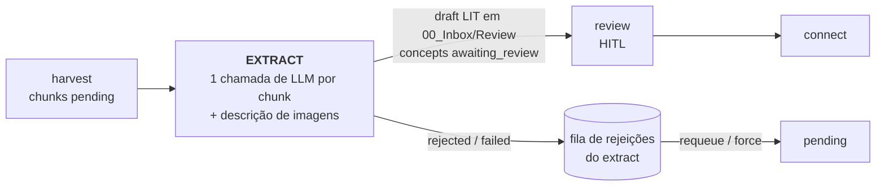
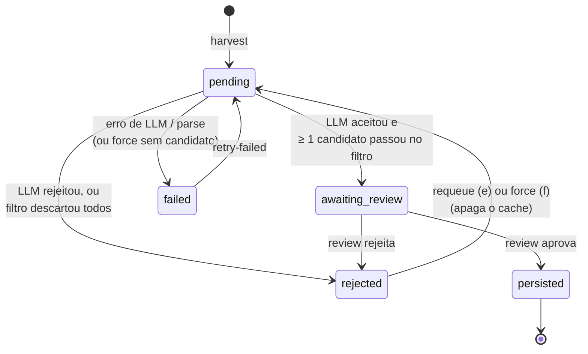
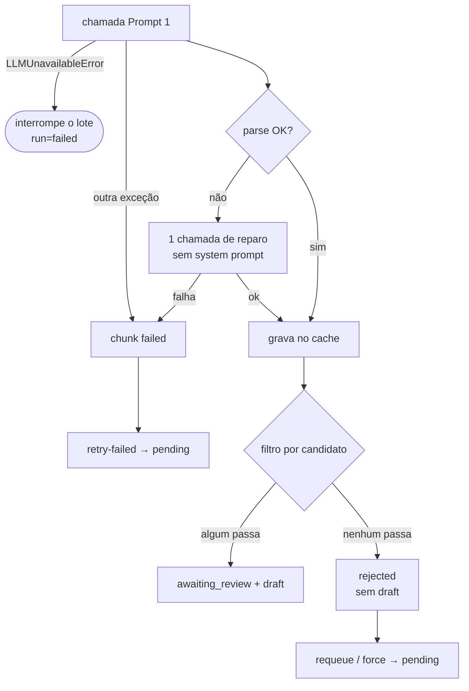

# Extract: ensinar um LLM a dizer "não" — e medir quando ele acerta

> Artigo 2 de uma série sobre o `zettel_app`, um pipeline que transforma PDFs e Markdown em notas permanentes (Zettelkasten) compatíveis com o Obsidian.
> Esta parte cobre a fase **EXTRACT**. Versão analisada: `main` @ `bbe767a`. Corpus usado nas medições: 7 fontes, 1.073 chunks, 782 candidatos persistidos, 1.831 respostas de Prompt 1 no cache.
> O artigo 1 (harvest) está em [`01-harvest.md`](01-harvest.md).

---

## 0. Resumo (para quem tem pouco tempo)

O `extract` pega cada chunk produzido pelo harvest, faz **uma** chamada de LLM (o "Prompt 1") e decide duas coisas ao mesmo tempo: (1) este trecho merece virar nota? (2) se sim, quais são as teses atômicas, com definição, intuição, limites e uma **citação literal** que as ancora no texto. O resultado vira um rascunho de nota de literatura que um humano revisa na fase seguinte.

É a fase em que o projeto tem a **melhor disciplina de avaliação** que eu já vi num projeto pessoal: gold set rotulado às cegas, pré-registro da regra de decisão antes de rodar, teste de McNemar, pesos de inclusão para corrigir a estratificação. Graças a isso, os números abaixo são confiáveis — inclusive os desconfortáveis.

| # | Achado | Gravidade | Evidência |
|---|--------|-----------|-----------|
| 1 | **Notas perdidas pelo teto da citação.** 31 chunks que o LLM *aceitou* foram rejeitados porque a citação-âncora tinha 38–64 palavras (teto tolerado: 37). As 36 citações descartadas eram **literalmente presentes** no texto. Nem o "forçar extração" recupera esses chunks, e o revisor os vê como *"Categoria `-`, Sem motivo"*. | **Alta** (perda silenciosa) | Medido no `state.db` |
| 2 | **O gate de auto-aprovação aprova praticamente tudo.** O `review_confidence` vale exatamente 0,90 em 67% dos drafts e ≥ 0,75 em ≥ 99%; contra rótulos humanos, AUC 0,49 (ADR-017). Com `--auto-approve` ou no `run-all` da web, "aprovar acima do limiar" ≈ "aprovar tudo". | **Alta** (precisão ~66%) | Medido + ADR-017/050 |
| 3 | **Saída JSON por instrução, não por esquema.** Nenhuma chamada usa saída estruturada do provedor. O parser tem um defeito comprovado (um bloco de código dentro de um campo quebra a extração do JSON) e as falhas de parse do ADR-050 (5/120) não têm causa conhecida porque **a resposta que falhou não é gravada**. | Média | Teste da função + leitura de código |
| 4 | **O pré-voo de custo subestima a entrada em ~38%.** Ele conta o template do prompt (3.723 tokens), não o prompt preenchido com few-shots (~5.941). | Média | Medido |
| 5 | **Cache de prompt do provedor rende 56% do teto teórico de ~89%.** 93% do prompt é estático; só 56% dos tokens de entrada foram lidos do cache implícito do Gemini. | Média (custo) | Tabela `runs` |
| 6 | **Imagens pendentes viram contexto perdido para sempre.** Se a descrição de imagens aborta por rate limit, o chunk é extraído sem o contexto visual e nunca é reprocessado quando a imagem é descrita depois. E uma credencial de visão ausente marca **todas** as imagens como `failed`, contra a política fail-fast do projeto. | Média | Leitura de código |
| 7 | **O prompt diz coisas que não são mais verdade** (overlap de "~200 caracteres", "pode conter marcadores de página") e pede fórmulas em LaTeX dentro de JSON. | Baixa | Prompt × código |
| 8 | **`concept_id` com 32 bits por fonte inteira** (não por capítulo, como o `chunk_id`). Colisão improvável, mas silenciosa. | Baixa | Cálculo |

O que está **muito bem feito**: o cache determinístico com chave abrangente, a separação system/user para cache de prompt, a âncora literal verificada por código (não pelo LLM), a recusa em construir um *gate* pré-LLM que as medições mostraram não compensar (ADR-049), e a troca de modelo decidida contra rótulos humanos com regra pré-registrada (ADR-050).

---

## 1. O problema que o extract resolve — e por que ele é difícil

Um Zettelkasten vale pelo que **deixa de fora**. Uma nota permanente boa é atômica (uma ideia), autônoma (se entende sem a fonte) e citável (aponta para onde a ideia está no original). Um livro de 300 páginas tem, digamos, 40 ideias que merecem esse tratamento — e 400 chunks de texto.

O extract, portanto, é antes de tudo um **classificador com taxa-base desfavorável**: a maioria dos trechos *não* deve virar nota (sumários, referências, transições, exemplos sem generalização). E é também um **gerador**: para os trechos que passam, precisa escrever a tese em português, com uma citação literal no idioma original.

Há três tensões de projeto que atravessam todo o resto do artigo:

1. **Seletividade × recall.** Um extrator rigoroso perde notas boas em silêncio (o chunk rejeitado não gera rascunho, ninguém vê). Um extrator generoso enche a fila de revisão de lixo.
2. **Auto-avaliação × avaliação externa.** O LLM dá uma nota de relevância ao próprio candidato. Isso é barato e tentador como sinal de aprovação automática — e, como veremos, não funciona.
3. **Liberdade × contrato.** Um JSON livre, guiado por instruções, deixa o modelo "pensar"; um esquema rígido garante o parse. Nenhum dos dois é grátis.

### Onde o extract se encaixa



---

## 2. Metodologia

- **Lido**: `zettel/extractor.py` (inteiro), `prompts/literature_note.md`, `zettel/schemas.py`, `zettel/llm.py` (cliente, chamada, parse, reparo de LaTeX), `zettel/assets.py` (descrição de imagens), `zettel/preflight.py`, `zettel/cli/curation.py`, os trechos de `zettel/review.py` que tratam rejeições do extract, `config/config.yaml`, e os ADRs 015, 017 (todos os adendos), 034, 049 e 050.
- **Medido (somente leitura)**: `data/state.db` — 1.073 chunks com `summary_json`, 783 conceitos, 1.831 respostas de Prompt 1 no `llm_cache`, tabela `runs`; as gravações das quatro rodadas do gold set em `.eval-work/prompt1/`; o tamanho real do prompt preenchido (montado pela própria `prompt1_messages`, sem chamar o modelo).
- **Testado**: funções puras chamadas diretamente (`extract_json`, `parse_llm_json`, `quote_is_grounded`, `_prompt_tokens`).
- **Não verificado**: não fiz nenhuma chamada de LLM; não medi o efeito de nenhuma das alternativas propostas; não consegui determinar a causa das 5 falhas de parse do ADR-050 (as respostas que falharam não foram gravadas).

> Nenhuma linha de código ou documentação do projeto foi alterada para produzir este artigo.

---

## 3. Visão geral da fase

### 3.1 O ciclo de vida de um chunk



Distribuição atual no acervo: `persisted` 669, `rejected` 404 (dos quais 371 rejeitados pelo LLM e 31 aceitos pelo LLM mas zerados pelo filtro), `failed` 0.

### 3.2 Caminho feliz de um chunk

```mermaid
sequenceDiagram
    autonumber
    participant X as run_extract
    participant A as assets
    participant DB as SQLite
    participant C as llm_cache
    participant L as LLM (gemini-3.5-flash-lite)
    participant V as Vault

    X->>A: describe_pending_assets (visão, com pacing e retry de 429)
    X->>DB: chunks pending
    loop cada chunk (sequencial)
        X->>DB: contexto de imagens (mesmo capítulo, página ±1)
        X->>C: checksum(prompt, chunk, modelo, temp, top_p, idioma, imagens, provider, thinking, variant)
        alt cache hit
            C-->>X: resposta gravada
        else miss
            X->>L: system (≈5,9 mil tokens, estático) + user (fonte, seção, localizador, imagens, chunk)
            L-->>X: texto com JSON
        end
        X->>X: parse (extract_json → repair_latex_escapes → Pydantic)
        X->>X: score de confiança + filtro determinístico por candidato
        X->>C: grava a resposta (só se o parse passou)
        X->>V: draft LIT em 00_Inbox/Review/{Citekey}/
        X->>DB: chunk = awaiting_review + summary_json; concepts = awaiting_review
    end
```

Duas propriedades importantes, ambas corretas:

- **Checkpoint por chunk.** O status é gravado ao fim de cada chunk; uma interrupção perde no máximo uma chamada.
- **Só o que foi parseado entra no cache.** Uma resposta malformada nunca é reproduzida de graça numa nova execução.

---

## 4. Etapa por etapa

### 4.1 Descrição de imagens (antes de qualquer chunk)

Se `images.enabled`, o extract começa descrevendo com um modelo de visão toda imagem `pending` que o harvest registrou. O desenho de resiliência é bom: intervalo mínimo entre chamadas, *retry* com *backoff* em 429, a imagem fica `pending` (não `failed`) quando o rate limit esgota, e o lote aborta depois de N esgotamentos consecutivos para não queimar a janela de TPM.

Dois problemas de fronteira:

1. **Ordem e cache conspiram contra a imagem atrasada.** A descrição da imagem entra no Prompt 1 do chunk (`images_context`) e na chave do cache. Se o lote de imagens aborta, os chunks são extraídos **sem** o contexto visual, vão para `awaiting_review`, e nada os reprocessa quando a imagem é descrita depois. O prompt tem uma regra específica para isso ("não rejeite como `fragmented` se houver figura conceitual no contexto") — que simplesmente não dispara. Correção: pular (deixar `pending`) os chunks cuja vizinhança tem imagem ainda não descrita, ou reenfileirá-los quando a imagem for descrita.
2. **Credencial de visão ausente vira "todas as imagens falharam".** O `except Exception` final de `describe_pending_assets` captura também `LLMUnavailableError`, e cada imagem é marcada `failed`. O resto do projeto adota *fail-fast* para indisponibilidade de LLM (ADR-045). Aqui, o extract segue em frente sem imagens — e o operador precisa saber que existe `retry-failed --assets`.

Um detalhe menor: a chave de cache da visão (`prompt|imagem|contexto|modelo|idioma`) não inclui provider, temperatura nem *thinking*, ao contrário da chave do Prompt 1. Trocar de provedor mantendo o nome do modelo reutilizaria descrições antigas.

### 4.2 Montagem do Prompt 1

O prompt (`prompts/literature_note.md`) é dividido por um marcador `<!-- zettel:user -->` em:

- **system** — instruções estáveis (critérios de rejeição, critérios de aceitação, escala de relevância, regras de composição, formato de saída) e **few-shots do domínio** carregados de `config/domain_examples.yaml` (ADR-042);
- **user** — fonte, seção, localizador, contexto de imagens e o texto do chunk.

Medi o prompt preenchido de um chunk típico (1.735 caracteres):

| parte | caracteres | ≈ tokens (chars/4) |
|---|---|---|
| system (instruções + few-shots) | 23.765 | **5.941** |
| — dos quais few-shots | 9.107 | 2.277 |
| user | 1.928 | 482 |
| **fração estática do prompt** | | **≈ 93%** |

Na tabela `runs`, a maior execução do extract (860 chamadas) registrou **6.688 tokens de entrada e 417 de saída por chamada**, a **US$ 0,0030 por chamada** (US$ 2,59 no total). Com os 2,37 s por chamada medidos no ADR-049, o lote leva ~34 minutos, **sequencial**.

**O que está certo:** a separação system/user existe exatamente para que provedores reaproveitem o prefixo (ADR-025). **O que dá para melhorar:**

- **O cache implícito rende pouco do que poderia.** Com 93% de prefixo idêntico entre chamadas consecutivas, o teto teórico de leitura do cache é ~89% dos tokens de entrada (5.941 / 6.688). O medido foi **56%** (3,22 M de 5,75 M). O cache implícito do Gemini é "melhor esforço"; o **cache explícito** (`cachedContent`) garante o desconto para um prefixo fixo de ~6 mil tokens, que é exatamente o caso aqui.
- **O extract não é sensível a latência.** Ninguém espera o resultado em tempo real: ele vai para uma fila de revisão. O **modo batch** do Gemini cobra metade do preço com entrega em até 24 h. Para reprocessar um acervo inteiro (como na troca de modelo do ADR-050), é o caminho óbvio. Em paralelo, um pool pequeno de workers (respeitando o rate limit) reduziria os 34 minutos para menos de 10 no modo síncrono.
- **Comprimento do prompt tem custo de qualidade, não só de dinheiro.** Levy, Jacoby e Goldberg (ACL 2024) mostram que o raciocínio dos LLMs degrada com o tamanho da entrada muito antes do limite técnico da janela. Um prompt de 6 mil tokens com dezenas de regras, várias em tensão ("seja implacável" × "a definição fundacional é válida"), é um candidato natural a uma ablação: quais seções movem a precisão no gold set e quais são peso morto?

### 4.3 O contrato de saída e o parse

O modelo devolve, por chunk:

```json
{
  "chunk_status": "accepted | rejected",
  "rejection_reason": "...", "rejection_category": "structural | narrative | promotional | trivial | fragmented",
  "summary": "≤ 280 chars", "key_concepts": ["..."],
  "candidates": [{
    "thesis": "...", "definition": "...", "intuition": "...", "limits": "...",
    "anchor_quote": "10–25 palavras, literal", "source_locator": "...", "tags": ["..."],
    "relevance_score": 1-5, "relevant_image_ids": [],
    "decision_rules": [], "anti_patterns": [], "named_frameworks": []
  }]
}
```

O contrato é validado por Pydantic (`LiteratureChunkOutput`), com tolerâncias deliberadas: categoria desconhecida vira `""`, `summary` longo é truncado em vez de falhar, listas de julgamento do autor são cortadas em 3 itens (ADR-034). A lógica é boa: **um campo acessório nunca deve custar um *retry* pago**.

O parse, porém, é por **instrução**, não por esquema. Nenhuma chamada usa a saída estruturada do provedor (`responseSchema` no Gemini, `json_schema` estrito na OpenAI, *tool use* na Anthropic). Em vez disso, `parse_llm_json` faz: extrair o JSON do texto → reparar barras invertidas de LaTeX → `json.loads` → Pydantic; se falha, **uma** chamada de reparo ("corrija e devolva só o JSON"), sem o prompt de sistema; se falha de novo, o chunk vira `failed`.

Três observações:

1. **O extrator de JSON tem um defeito comprovado.** `extract_json` procura primeiro um bloco cercado por crases com uma regex não gulosa. Se a resposta vier **sem** cerca externa mas com um bloco de código dentro de uma string (algo natural num acervo de *prompt engineering*), a regex captura o código interno:

   ```
   extract_json('{"definition": "Use ```python\nprint(1)\n``` aqui", "x": 1}')
     -> 'python\nprint(1)'          # e json.loads falha
   ```

   No cache atual não há nenhuma resposta nesse formato (1.027 vêm cercadas por ```` ```json ````, e nenhuma delas tem cerca interna) — mas o cache só guarda o que **passou** no parse, então ele é cego a esse tipo de falha por construção.
2. **As falhas de parse não deixam rastro.** O ADR-050 registrou 5 falhas em 120 chunks em duas de três rodadas do Gemini, "concentradas em chunks que um humano guardaria". Cruzei os 9 itens faltantes das gravações com o texto de origem: nenhum tem LaTeX, `$` ou blocos de código na **entrada**. A causa pode estar na **saída** (o prompt pede fórmulas em LaTeX dentro do JSON) — mas não dá para saber, porque a resposta bruta que falhou não é gravada em lugar nenhum. Registrar as falhas (resposta + erro) num diretório de diagnóstico custa uma linha e transforma um mistério em dado.
3. **Saída estruturada tem custo, e o projeto deveria medi-lo, não assumi-lo.** Tam et al. (*Let Me Speak Freely?*, EMNLP 2024 Industry) mostram que restrições de formato podem **degradar raciocínio**, embora sejam neutras ou positivas em classificação, e que a ordem das chaves importa (pedir a justificativa antes do veredito ajuda). O contrato atual já tem uma ordem favorável (`chunk_status` e `rejection_reason` antes dos candidatos). A proposta honesta não é "ligue o JSON mode", é: rodar o gold set com e sem `responseSchema` e decidir pela regra pré-registrada, como em ADR-050.

### 4.4 O filtro determinístico: onde a âncora é verificada

Depois do parse, cada candidato passa por `_check_candidate`:

| regra | config | aplicada com `force`? |
|---|---|---|
| candidato marcado `rejected` | — | não |
| `relevance_score ≥ 3` | `min_relevance_score` | não |
| tese ≥ 5 palavras | `min_thesis_words` | não |
| definição ≥ 10 palavras | `min_definition_words` | não |
| âncora não vazia | `require_anchor_quote` | **sim** |
| âncora ≥ 10 palavras (exceto dentro de bloco de código) | `anchor_quote_min_words` | **sim** |
| âncora ≤ 25 × 1,5 = **37** palavras | `anchor_quote_max_words` × `tolerance` | **sim** |
| âncora literalmente presente no chunk | `quote_is_grounded`, razão ≥ 0,85 | **sim** |

**A verificação de âncora é a melhor ideia da fase.** O LLM escolhe a citação; o **código** prova que ela está no texto. `quote_is_grounded` dobra os dois textos (`fold_for_match`: NFKC, sem acentos, minúsculas, pontuação colapsada), testa substring e, se falhar, soma o tamanho de **todos** os blocos coincidentes do `SequenceMatcher`:

```
cobertura = Σ |bloco_i| / |citação|  ≥ 0,85
```

Somar todos os blocos (e não só o maior) é o que deixa passar uma citação com elipse editorial ("[...]") e barra uma paráfrase, que compartilha só palavras curtas. No acervo, **nenhum** candidato atual cai por "âncora não encontrada" — numa auditoria anterior eram 39 de 298 (13%). É a métrica de *citation precision* do ALCE (Gao et al., EMNLP 2023) feita deterministicamente, sem modelo de NLI.

**O que ela não garante** (e o projeto admite): que a citação *sustenta* a tese. Ela prova que o trecho existe, não que ele diz o que a tese diz. O ALCE mede exatamente essa segunda propriedade com um modelo de NLI (premissa = citação, hipótese = tese). Um *cross-encoder* de NLI pequeno, local, daria um **sinal contínuo de suporte** por candidato — e esse é um candidato natural ao sinal que o ADR-017 procura (ver 4.6).

#### Achado #1 — o teto da citação descarta notas que o LLM aceitou

Os números do acervo:

- **Todos** os 36 candidatos descartados pelo filtro caíram pela regra de tamanho da âncora — nenhum por relevância, tese ou definição.
- 34 por **excesso** (> 37 palavras) e 2 por falta (< 10).
- As 36 citações são **literalmente presentes** no chunk (`quote_is_grounded` = verdadeiro para todas).
- Tamanhos das descartadas: `7, 9, 38×7, 39×4, 40×3, 41×6, 42×4, 43, 44, 45×3, 46×2, 48, 55, 64` — a maioria logo acima do teto.
- **31 chunks** que o LLM classificou como `accepted` terminaram `rejected` porque **todos** os seus candidatos caíram aqui. Isso é ~4,4% dos chunks aceitos pelo modelo.

Três agravantes:

1. **O revisor não sabe por quê.** Esses chunks entram na fila de "rejeitados pelo extract" com `rejection_category=""` e `rejection_reason=""` (quem rejeitou foi o filtro, não o modelo), e o cartão do review mostra *"Categoria `-` / Motivo: Sem motivo."*. O motivo real está em `summary_json.rejected_candidates`, que o cartão não lê.
2. **Nenhuma ação do revisor recupera.** *Requeue* refaz a mesma chamada (mesmo prompt, temperatura 0,1) e tende a produzir a mesma citação longa. *Force* pula relevância e tamanho de tese/definição, **mas não as regras de âncora** — o candidato cai de novo e o chunk vira `failed`.
3. **A regra contradiz a própria justificativa.** O issue #153 deu tolerância ao teto justamente porque "a contagem de palavras é só um proxy do que `quote_is_grounded` mede de fato" e "descartar o candidato inteiro por duas palavras a mais troca um erro de forma por perda de conteúdo". O dado mostra que a tolerância de 1,5× não basta: o modelo tende a citar a frase inteira.

**Correção proposta (determinística, sem LLM):** quando a citação passa do teto mas é literal, **recortar** a janela de ≤ 25 palavras de maior sobreposição com a tese (ou a primeira frase completa que caiba). O recorte é uma substring da citação, que é uma substring do chunk — a propriedade de ancoragem continua provada por construção. E, independentemente disso, o cartão do review deve mostrar o motivo do filtro.

### 4.5 O índice de confiança e a auto-aprovação

`_score_review_confidence` produz um número em [0, 1] por chunk:

```
C = 0,50·R + 0,30·I + 0,20·K

R = 0,6 + 0,4 · clip((r̄ − 3) / 2, 0, 1)     r̄ = relevance_score médio dos candidatos aprovados
I = aprovados / (aprovados + descartados pelo filtro)
K = média, por candidato, da presença de `intuition` e `limits` (0, ½ ou 1)
casos especiais: chunk rejeitado → 0,1; sem candidatos aprovados → 0,2
```

O histórico do desenho está bem documentado (ADR-017, adendo de 2026-09-05): a versão anterior pesava o **tamanho** da definição e tornava matematicamente impossível um chunk de relevância 3 atingir o limiar. A versão atual mede **defeitos** — filtro descartou algo, modelo deu nota mínima, faltam campos de profundidade. O raciocínio é sólido. O problema é empírico:

| `relevance_score` dos 782 candidatos persistidos | 3 | 4 | 5 |
|---|---|---|---|
| quantidade | 217 (28%) | **535 (68%)** | 30 (4%) |

| `review_confidence` dos 668 drafts | 0,90 | 0,80 | 0,85 | 1,00 | outros |
|---|---|---|---|---|---|
| quantidade | **445 (67%)** | 156 | 28 | 23 | 16 |

Com I e K quase sempre em 1 (97% dos casos, pelo ADR-017), o score se reduz a uma função da nota que o modelo dá ao próprio candidato — e essa nota **colapsa em 4**. Um chunk impecável com r̄ = 4 vale exatamente 0,5·0,8 + 0,3 + 0,2 = **0,90**. O limiar é 0,75; praticamente nenhum draft fica abaixo dele.

O ADR-017 (adendo de 2026-09-13) mediu isso contra o gold set humano: **AUC 0,491 [0,298; 0,684]** — indistinguível de uma moeda. Um juiz LLM separado (nota 1–5) deu AUC 0,479 e atribuiu "4" a 37 de 38 chunks. A conclusão do próprio projeto é a correta: **escala Likert absoluta de um LLM não é sinal utilizável aqui**; o próximo candidato deve forçar discriminação (comparação par a par) ou usar outro juiz. Isso converge com a literatura de *LLM-as-a-judge*: notas absolutas comprimem para o meio da escala; comparações par a par discriminam melhor, mas trazem viés de posição (no MT-Bench, o veredito se manteve em só ~65% dos pares com a ordem trocada, segundo reproduções secundárias), mitigado avaliando nos dois sentidos.

**A política do projeto** é manter o gate e **avisar** em todo caminho que aprova por limiar (`AUTO_APPROVE_UNVALIDATED_WARNING`). É defensável como opção informada do operador. Mas há um caminho em que ninguém lê o aviso: o job `run_all` da web chama `run_review(auto_approve=True, interactive=False)`. Com o score atual, isso significa **aprovar ~100% dos drafts** — e a precisão medida do extract é ~66% (ADR-050). Um terço do que vira nota permanente pelo `run-all` é algo que um humano descartaria.

**Sinais candidatos que o próprio projeto já tem à mão** (nenhum validado ainda para *esta* decisão):

- o **suporte citação→tese** por NLI (seção 4.4), que mede uma propriedade diferente da nota auto-atribuída;
- a camada de decisão tipada (ADR-055), que mediu AUC 0,818–0,853 para a decisão *aceitar/rejeitar chunk* — mas é indistinguível de moeda dentro dos chunks **já aceitos** (estrato do leitor), que é justamente onde o gate opera;
- julgamento **comparativo** (par de drafts da mesma fonte, nos dois sentidos).

### 4.6 O "forçar extração" e a fila de rejeições

Dois mecanismos recentes (issues #201 e #202) dão ao revisor uma segunda chance sobre o que o extract rejeitou: `requeue` (outra opinião, mesmo prompt) e `force` (instrução extra **só na mensagem do usuário**, para não mudar o hash do prompt e o cache de todos os outros chunks; a chave ganha uma `variant`). O desenho é elegante — e o achado #1 mostra o seu limite: o `force` relaxa o julgamento do modelo, mas o filtro de forma da âncora continua sendo a última palavra.

Um detalhe: para um chunk forçado, o `review_confidence` é calculado **sem** o modo `force`, então um candidato com relevância 2 que o revisor pediu explicitamente recebe confiança 0,2 — é escrito como draft, mas com um número que diz o contrário.

### 4.7 Identidade dos conceitos

Cada candidato vira uma linha em `concepts` com:

```
concept_id = f"{source_id}::concept::{sha256(source|chunk|sha256(âncora))[:8]}"
```

Dois pontos:

- **Usar a âncora na identidade é uma boa ideia**: a mesma tese reescrita pelo modelo em duas execuções mantém o mesmo id se citar o mesmo trecho. Verifiquei: nenhum chunk tem dois candidatos com a mesma âncora (o que colidiria).
- **O escopo do hash é a fonte inteira**, com 32 bits. Para *n* conceitos numa fonte, P(colisão) ≈ n²/2³³: ≈ 2,4 × 10⁻⁵ para os 454 chunks do maior livro, ≈ 10⁻³ para uma fonte de 3.000 conceitos. Improvável, mas a consequência seria um `upsert` sobrescrevendo outro conceito em silêncio. O `chunk_id` resolveu o mesmo problema embutindo o capítulo no prefixo; aqui bastaria embutir o `chunk_id`.

### 4.8 O que o prompt diz e o que o sistema faz

Três divergências entre o Prompt 1 e o código atual:

| o prompt diz | o código faz |
|---|---|
| "Chunks vizinhos se sobrepõem em ~200 caracteres" | `chunk_overlap: 400`, e só dentro de seções cortadas pelo tamanho (seções que cabem não têm overlap) |
| "O texto pode conter marcadores `<!-- zettel:page-break -->`" | os marcadores são removidos antes do chunk ser gravado |
| "tese: máximo 3 frases" | o esquema descreve a tese como "uma frase declarativa" |

E uma instrução que cria trabalho para o parser: "para conceitos sempre inclua a fórmula, em `$ $`". LaTeX dentro de strings JSON é a origem do `repair_latex_escapes` — uma função cuidadosa (distingue `\t` de tabulação de `\theta`, `\n` de `\nabla`), mas que existe para remendar uma escolha de formato. Com saída estruturada do provedor, o escape é responsabilidade da serialização, não do modelo.

---

## 5. Tratamento de erros e fluxos de exceção

| situação | onde | resultado | lote continua? |
|---|---|---|---|
| LLM indisponível (auth, rede, cota) | `call_llm` → `LLMUnavailableError` | run `failed`, **lote interrompido**; chunks já processados ficam salvos | **não** |
| outro erro na chamada | `_process_chunk` | chunk `failed` | sim |
| JSON malformado | `parse_llm_json` → `ValueError` | 1 chamada de reparo; se falhar, `failed` | sim |
| JSON válido fora do contrato | Pydantic → `ValidationError` | 1 chamada de reparo com a mensagem de erro; se falhar, `failed` | sim |
| campo acessório fora do formato | validadores tolerantes | trunca/normaliza com *warning*, sem *retry* | sim |
| LLM rejeita o chunk | `chunk_status=rejected` | `rejected`, sem draft, entra na fila de rejeições | sim |
| filtro descarta todos os candidatos | `_check_candidate` | `rejected`, sem draft, **sem motivo visível** (achado #1) | sim |
| `force` sem candidato utilizável | `_process_chunk` | `failed` + flag mantida + cache apagado | sim |
| imagem: 429 esgotado | `describe_pending_assets` | imagem fica `pending`; aborta após N seguidos | sim (sem imagens) |
| imagem: credencial ausente | idem | **todas** as imagens `failed` | sim (contra ADR-045) |



**O que está bem resolvido:** a fronteira entre falha **sistêmica** (para tudo) e falha **local** (marca o chunk e segue) é a mesma do harvest e está correta. O cache só de respostas válidas evita reprocessar lixo de graça.

**Lacunas:**

1. A chamada de reparo vai **sem o prompt de sistema** e sem o esquema: para um erro de contrato (campo faltando, tipo errado), o modelo recebe só a mensagem do Pydantic.
2. A resposta que falhou não é persistida (ver 4.3).
3. Não há limite de tempo por chamada além do que o cliente do provedor impõe; numa execução de 34 minutos, um *timeout* de rede vira `failed` (bom), mas um travamento silencioso do cliente segura o lote.

---

## 6. O fluxo do usuário: faz sentido?

O fluxo é: `zettel extract` → painel de pré-voo com custo estimado e confirmação → barra de progresso → mensagem "N candidatos em `awaiting_review` (use `zettel review`)". Na web, um job de extract e, no `run-all`, extract seguido de review automático.

O que **faz sentido**:

- **Pré-voo antes de gastar.** Mostrar a estimativa e pedir confirmação (ADR-037) é a atitude certa para uma fase que custa dinheiro.
- **Extract nunca aprova sozinho por padrão.** O `--auto-approve` é *opt-in* e vem com aviso.
- **A fila de rejeições é revisável** com o texto inteiro do chunk e ações de segunda opinião.

O que **não faz sentido** (ou faz menos do que poderia):

1. **O pré-voo erra para baixo na entrada.** `_prompt_tokens` conta o arquivo do prompt com os *placeholders* vazios (3.723 tokens), não o prompt **preenchido** com few-shots (~5.941). Somando o chunk, a estimativa é ~4,2 mil tokens de entrada por chamada contra 6,7 mil medidos (**−38%**). Na saída, erra para cima (800 estimados contra 417 medidos). O painel se descreve como "limite superior" porque não desconta o cache — mas a entrada não é um limite superior.
2. **O revisor não vê por que um chunk aceito pelo modelo foi rejeitado** (achado #1).
3. **O `run-all` da web aprova por um sinal que é moeda** (seção 4.5). Num sistema cujo valor é a curadoria, o caminho "um clique" é justamente o que pula a curadoria. Eu tiraria a auto-aprovação do `run-all` até existir um sinal validado, ou exigiria uma confirmação explícita no formulário.
4. **Ordem de imagens e chunks** (seção 4.1): o usuário não tem como saber que um chunk foi extraído "às cegas" porque a imagem ainda estava pendente.

---

## 7. A ciência por trás das decisões (o melhor do projeto)

Vale a pena destacar como o projeto decidiu as duas questões mais caras da fase, porque é o tipo de rigor que raramente aparece fora de pesquisa.

### 7.1 ADR-049: não construir o *gate* pré-LLM

A ideia óbvia é prever a rejeição com um classificador barato (regressão logística sobre embeddings) e pular a chamada. O projeto mediu antes:

- **corrigiu a própria métrica** (a versão anterior contava como "economia" chunks que o gate mandava para o LLM: 23,5% relatado contra 1,7% real);
- **validou por fonte, não por chunk** (chunks vizinhos são quase duplicatas no espaço de embedding; dividir por chunk mede memorização);
- **fixou os critérios antes** (0% de notas perdidas, ≥ 15% de chamadas evitadas, pegar mais que só `structural`).

Resultado: o sinal existe (AUC por fold de 0,75 a 1,0), mas sob perda zero e um limiar global a economia é **5,4%** — US$ 0,03 no acervo inteiro — e o classificador só detecta `structural`. E a regra que sobrevive a troca de modelo:

> o gate só ganha em tempo quando `% de chamadas evitadas > t_embed / t_call`

Com 845 ms para embedar um chunk e 2,37 s por chamada, o ponto de equilíbrio é **35,7%** de chamadas evitadas; o melhor caso medido foi 31,6%. O gate deixaria o maior livro 28% **mais lento**. Decisão: não construir.

Meu único complemento: a medição desta auditoria mostra que **84% das rejeições são `structural`** (313 de 371) e que 130 delas são tabelas com 82% de espaços (artigo 1, achado #3). O lugar barato para atacar o `structural` não é um classificador antes do LLM — é o próprio **harvest**, que pode tratar tabelas e sumários como estruturas, não como prosa.

### 7.2 ADR-050: trocar de modelo contra rótulos humanos

A troca `gpt-4o-mini` → `gemini-3.5-flash-lite` foi decidida assim:

- **gold set** de 120 chunks estratificados, rotulados às cegas por um humano ("eu guardaria isto como nota?"), com pesos de inclusão para corrigir a estratificação;
- **regra pré-registrada** num commit anterior à primeira chamada: mais acertos líquidos com McNemar exato p < 0,05, estabilidade ≥ 95% entre duas rodadas, ≤ 6 falhas de parse, e mesmo sinal no acervo ponderado;
- **o critério é do usuário**: uma nota perdida pesa o mesmo que um lixo admitido.

Os 22 itens discordantes se dividiram 18 × 4 a favor do Gemini. O teste de McNemar exato é um teste binomial sobre os discordantes:

```
p = 2 · Σ_{k=0}^{4} C(22, k) / 2²² = 2 · (1 + 22 + 231 + 1540 + 7315) / 4.194.304 ≈ 0,0043
```

Precisão ponderada de 60,9% → 65,8%, recall de 97,5% → 92,5%. Em unidades do acervo: ~15 notas a mais perdidas para ~43 lixos a menos. O ADR registra honestamente o custo: as notas perdidas **triplicam** e são silenciosas, o custo sobe ~2,7×, e a evidência está concentrada num livro. E diz o que reabriria a decisão — inclusive "se uma nota perdida pesar ~3× mais que um lixo admitido, a decisão inverte".

Isso é o que separa uma decisão de engenharia de um palpite: o critério, o limiar e a condição de reversão escritos antes do resultado.

---

## 8. Comparação com abordagens alternativas

| tema | abordagem atual | alternativa | quando eu migraria |
|---|---|---|---|
| Classificar + gerar | uma chamada faz as duas coisas | pipeline em estágios, como o **Claimify** (Metropolitansky & Larson, Microsoft, 2025): seleção → desambiguação → decomposição, com exclusão explícita do que não se resolve pelo contexto | se a ablação mostrar que o prompt longo degrada a geração; a seleção pode ser um `choice` tipado (enum) com probabilidade |
| Atomicidade | instrução ("1 tese = 1 conceito") | decomposição em fatos atômicos verificáveis, como no **FActScore** (Min et al., EMNLP 2023), com verificação de suporte por fato | para medir a atomicidade, não necessariamente para gerar |
| Ancoragem | substring/fuzzy da citação no chunk (determinístico) | + suporte citação→tese por NLI, como a *citation precision* do **ALCE** | **já**, como sinal de revisão a medir contra o gold set |
| Formato de saída | JSON por instrução + reparo | `responseSchema` / *structured outputs* do provedor | após medir no gold set (risco de degradação — Tam et al., 2024) |
| Sinal de auto-aprovação | Likert auto-atribuído (colapsa em 4) | julgamento comparativo em pares, nos dois sentidos; NLI; camada tipada | quando algum sinal tiver limite inferior do IC da AUC > 0,5 |
| Custo | síncrono, sequencial, cache implícito | cache explícito do prefixo; batch (−50%); workers paralelos | **já** para reprocessamentos de acervo |
| Gate pré-LLM | não existe (ADR-049) | — | só nas condições que o próprio ADR lista |

---

## 9. Plano de correção sugerido

| prioridade | item | como validar |
|---|---|---|
| **P0** | Recortar deterministicamente a âncora literal acima do teto (janela ≤ 25 palavras) em vez de descartar o candidato; mostrar no review o motivo do filtro | Reprocessar os 31 chunks: ≥ 90% viram draft; teste com citação de 45 palavras; cartão do review exibe o motivo |
| **P0** | Tirar a auto-aprovação do `run-all` da web (ou exigir confirmação explícita) até haver sinal validado | Teste do job; documentação no ADR-017 |
| **P1** | Gravar respostas que falharam no parse (texto + erro) e corrigir `extract_json` para não capturar cercas internas | Teste com bloco de código dentro de string; diretório de falhas populado |
| **P1** | Pré-voo com o prompt **preenchido** (few-shots) e saída calibrada pelo histórico de `runs` | Estimativa vs `runs` com erro < 10% |
| **P1** | Imagens: não extrair chunk cuja imagem vizinha está pendente; `LLMUnavailableError` na visão interrompe (ADR-045) | Teste com lote de imagens abortado; teste sem credencial |
| **P2** | Medir `responseSchema` no gold set (pré-registrado) | Regra do ADR-050 |
| **P2** | Cache explícito do prefixo e/ou modo batch para reprocessamentos; workers paralelos | Custo e tempo por chunk antes/depois |
| **P2** | Sinal de suporte citação→tese por NLI, medido contra o gold set | AUC com IC (procedimento do ADR-017) |
| **P3** | Alinhar o prompt ao sistema (overlap, marcadores, tese); avaliar ablação das seções do prompt | Gold set |
| **P3** | `concept_id` com o `chunk_id` no prefixo; confiança de chunk forçado calculada com `force` | Testes unitários |

---

## 10. Conclusão

O extract é a fase em que o `zettel_app` mais se parece com um projeto de pesquisa — no bom sentido. As duas decisões mais caras (não construir um gate, trocar de modelo) foram tomadas com gold set, pré-registro e teste estatístico, e os ADRs registram o que as tornaria erradas. Isso é raro e é o que mais vale mostrar.

Os problemas que encontrei têm uma forma comum: **uma regra de forma que sobrevive à razão que a justificava.** O teto de palavras da citação existe como *proxy* de "é uma citação, não um parágrafo"; o código já mede a propriedade real (está no texto?) e mesmo assim descarta notas que passam nela. O índice de confiança existe para separar o bom do ruim; foi medido e não separa, mas o caminho de um clique continua aprovando por ele. O JSON por instrução existe porque é flexível; sua falha deixa de ser medida porque a resposta que falhou é descartada.

A lição para a série: **num pipeline com LLM, cada regra determinística deveria declarar qual propriedade ela aproxima — e ser substituída pela própria propriedade assim que o código conseguir medi-la.** O próximo artigo trata do `review`, onde o humano entra e onde esse índice de confiança deveria estar ajudando.

---

## Apêndice A — Como reproduzir as medições

Tudo em modo somente leitura (`sqlite3` com `mode=ro`), sem chamadas de LLM.

1. **Veredictos e categorias**: `chunks.status` e `json_extract(summary_json, '$.chunk_status' | '$.rejection_category')`.
2. **Candidatos e relevância**: `summary_json.candidates[*].relevance_score`; candidatos por chunk; âncoras repetidas no mesmo chunk.
3. **Descartes do filtro**: `summary_json.rejected_candidates[*].reason` e `anchor_quote`; para cada um, `quote_is_grounded(anchor, chunks.text, 0.85)`; chunks com `chunk_status='accepted'`, `status='rejected'` e `candidates` vazio.
4. **Confiança**: distribuição de `chunks.review_confidence` fora de `rejected`.
5. **Custo**: tabela `runs` onde `pipeline_signature='extract'` (chamadas, tokens, `prompt_cache_read_tokens`, custo).
6. **Tamanho do prompt**: `prompt1_messages(cfg, db, chunk, load_prompt_parts(...), render_for_prompt(load_domain_examples(...), "literature_note"), "")` e `preflight._prompt_tokens(cfg, "literature_note.md")`.
7. **Parser**: `extract_json` com um JSON sem cerca externa contendo um bloco de código numa string; contagem de respostas no `llm_cache` com cercas.
8. **Falhas de parse do ADR-050**: diferença de chaves entre `.eval-work/prompt1/gemini-t01-a.json` e as rodadas `t01-b`/`t00`, cruzada com `evals/gold/extracao-GABARITO-NAO-ABRIR.json` e o texto em `extracao-planilha.csv`.

## Apêndice B — Fontes externas consultadas

- Metropolitansky & Larson (Microsoft Research), *Towards Effective Extraction and Evaluation of Factual Claims* (Claimify), arXiv 2502.10855: <https://arxiv.org/abs/2502.10855>
- Min et al., *FActScore: Fine-grained Atomic Evaluation of Factual Precision in Long Form Text Generation*, EMNLP 2023: <https://aclanthology.org/2023.emnlp-main.741>
- Gao, Yen, Yu & Chen, *Enabling Large Language Models to Generate Text with Citations* (ALCE), EMNLP 2023: <https://arxiv.org/abs/2305.14627>
- Tam et al., *Let Me Speak Freely? A Study on the Impact of Format Restrictions on Performance of LLMs*, EMNLP 2024 Industry: <https://arxiv.org/abs/2408.02442>
- Levy, Jacoby & Goldberg, *Same Task, More Tokens: the Impact of Input Length on the Reasoning Performance of LLMs*, ACL 2024: <https://aclanthology.org/2024.acl-long.818>
- Tian et al., *Just Ask for Calibration*, EMNLP 2023: <https://arxiv.org/abs/2305.14975>
- Zheng et al., *Judging LLM-as-a-Judge with MT-Bench and Chatbot Arena* (2023) — números de viés de posição citados via fontes secundárias: <https://arxiv.org/abs/2306.05685>; discussão pontual × par a par: <https://arxiv.org/html/2602.02219v1>
- Google, *Structured output* (Gemini API, `responseSchema`): <https://ai.google.dev/gemini-api/docs/json-mode>; *Improving Structured Outputs in the Gemini API*: <https://blog.google/technology/developers/gemini-api-structured-outputs/>
- OpenAI, *Introducing Structured Outputs in the API*: <https://openai.com/index/introducing-structured-outputs-in-the-api/>
- Google, *Batch Mode in the Gemini API*: <https://developers.googleblog.com/en/scale-your-ai-workloads-batch-mode-gemini-api/>; *Gemini 2.5 models now support implicit caching*: <https://developers.googleblog.com/en/gemini-2-5-models-now-support-implicit-caching/>; *Context caching*: <https://ai.google.dev/gemini-api/docs/caching>

> Observação: números de terceiros citados a partir de resumos (viés de posição no MT-Bench, descontos de cache por plataforma) devem ser conferidos na fonte original antes de serem reutilizados.
