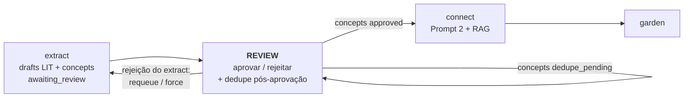
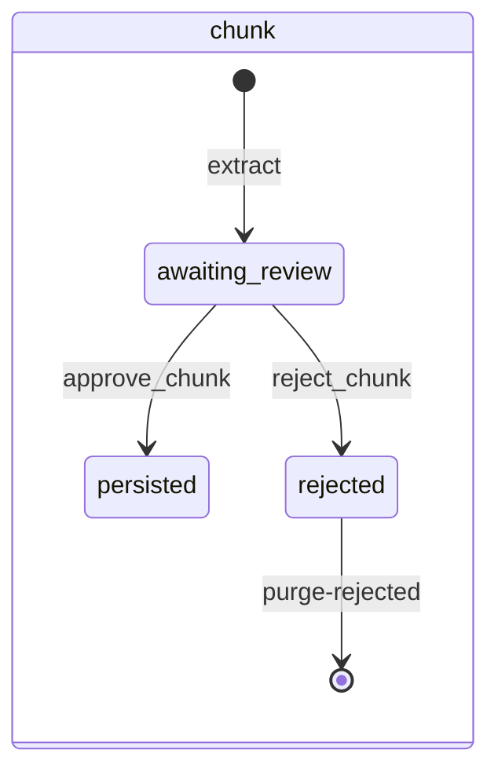
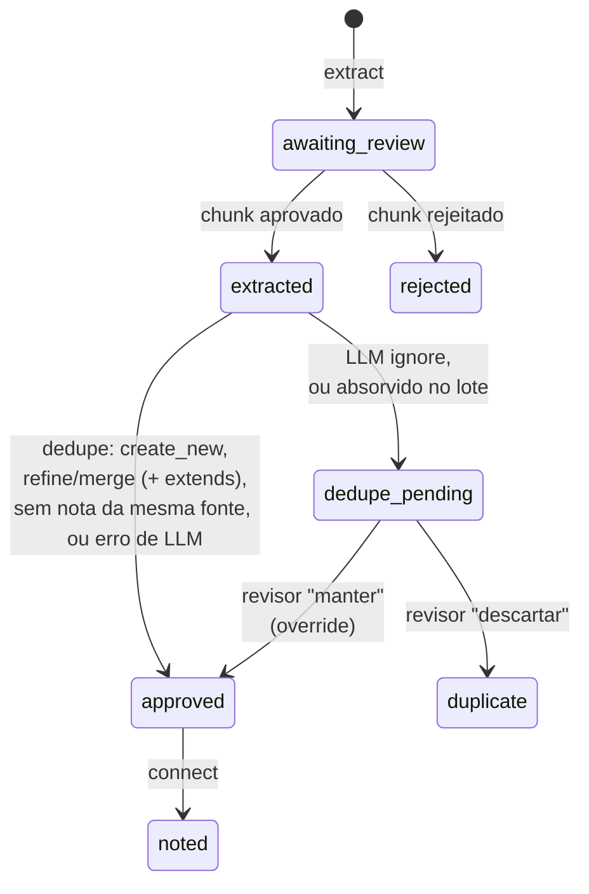
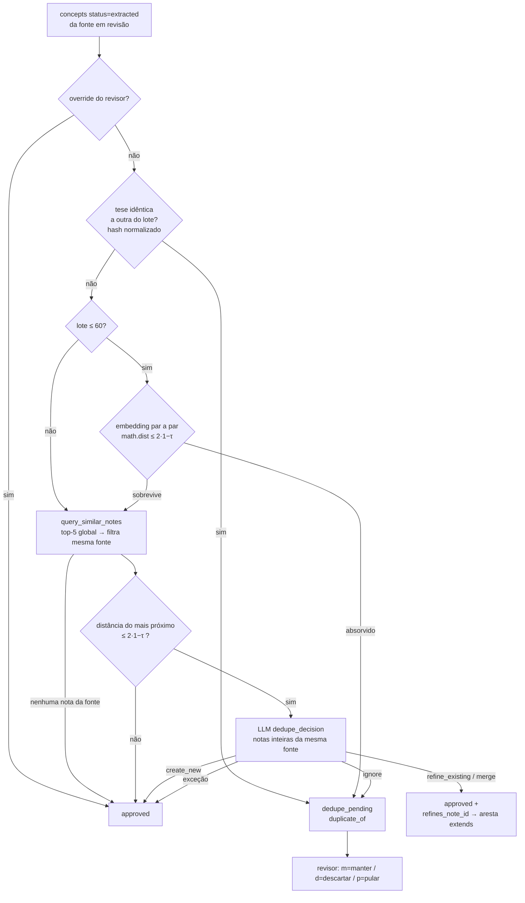
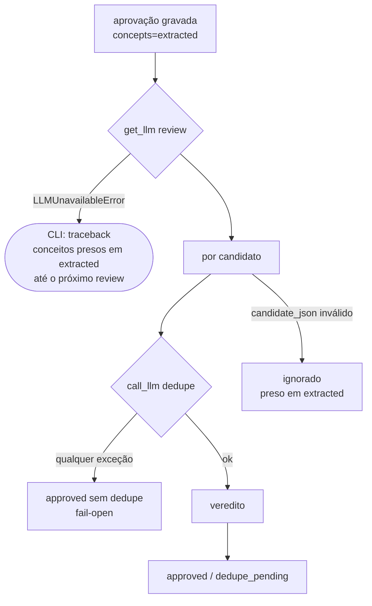
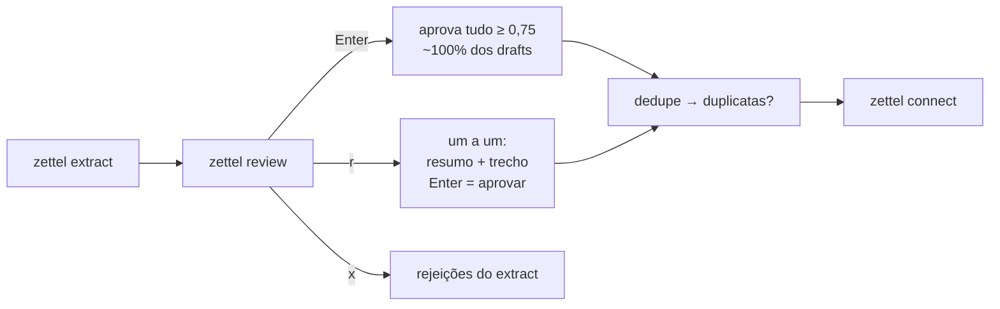

# Review: o portão humano de um pipeline com LLM — e o que acontece quando ninguém passa por ele

> Artigo 3 de uma série sobre o `zettel_app`, um pipeline que transforma PDFs e Markdown em notas permanentes (Zettelkasten) compatíveis com o Obsidian.
> Esta parte cobre a fase **REVIEW**. Versão analisada: `main` @ `678db37` (2026-10-18). Corpus usado nas medições: 7 fontes, 1.073 chunks, 669 drafts aprovados, 783 conceitos, 781 notas permanentes, 190 decisões de dedupe gravadas.
> Os artigos anteriores estão em [`01-harvest.md`](01-harvest.md) e [`02-extract.md`](02-extract.md).

---

## 0. Resumo (para quem tem pouco tempo)

O `review` é a única fase do pipeline em que um humano decide. Ele recebe os rascunhos de notas de literatura que o `extract` escreveu, um por chunk, e faz três coisas:

1. **aprova ou rejeita** cada rascunho (manual, por faixa de confiança ou por limiar);
2. depois da aprovação, roda uma **deduplicação semântica** dos conceitos contra as notas permanentes da mesma fonte (embedding + LLM);
3. oferece uma **segunda chance** aos chunks que o próprio `extract` recusou (reenfileirar, forçar, apagar).

No papel, o desenho é bom: o LLM propõe e o humano decide, toda decisão é gravada na hora, nada é descartado sem confirmação. Ao medir o acervo, encontrei uma fase em que **o humano quase não decide** e em que a deduplicação compara números em escalas diferentes.

| # | Achado | Gravidade | Evidência |
|---|--------|-----------|-----------|
| 1 | **O limiar de dedupe está na escala errada.** O Chroma devolve **distância de cosseno** (`1 − cos`); o código a trata como L2 ao quadrado (`2 − 2·cos`). O "0,85" configurado vira **cos ≥ 0,70** no filtro contra notas existentes e **cos ≥ 0,955** no filtro intra-lote. 53% das 144 arestas `extends` criadas pela dedupe ligam pares abaixo de 0,85. | **Alta** | Sonda numa cópia do índice + teste da função |
| 2 | **O portão humano coincidiu com o limiar em 670 de 670 drafts do pipeline.** Os 668 aprovados têm confiança ≥ 0,75; os 2 rejeitados são os únicos abaixo. A ação padrão do menu (Enter) é "aprovar tudo acima do limiar", e o gold set mostra que ~1/3 do que o `extract` aceita seria descartado por um humano. | **Alta** | `state.db` + código + ADR-017 |
| 3 | **O revisor julga o objeto errado.** O cartão do CLI mostra o resumo e o trecho, mas **não** a tese, a definição nem a citação que vão virar a nota permanente. A aprovação é por chunk (15% dos drafts têm 2+ candidatos), e editar o rascunho no Obsidian **não muda** o que o `connect` vai escrever. | **Alta** | Código (`format_review_item`, `sync.py`) |
| 4 | **"A dedupe propõe, você decide" quase nunca propõe.** Em 190 decisões, o LLM sinalizou duplicata 4 vezes, e o humano reverteu as 4. Nos gold sets, as 10 duplicatas reais nunca receberam `ignore` do prompt atual. Em produção, 76% das chamadas viraram aresta `extends`, com precisão medida de ~43%. | **Média–Alta** | `decision_shadow` + `evals/results` |
| 5 | **A dedupe não enxerga conceitos aprovados e ainda não conectados.** Duas sessões de review antes do `connect`, ou `a` e depois `r` na mesma sessão, deixam passar duplicatas da mesma fonte. | Média | Leitura de código |
| 6 | **Falha de LLM na dedupe aprova o conceito sem dedupe** (*fail-open*), enquanto credencial ausente derruba o comando com traceback. Os dois contrariam o ADR-059 (*fail-fast*). | Média | Leitura de código |
| 7 | **As decisões humanas não viram dado.** Não há registro de quem aprovou o quê, quando e por qual modo. `purge-rejected` apaga os únicos rótulos negativos, e `retry-failed --rejected` desfaz rejeições do revisor. | Média | Esquema do SQLite |
| 8 | **O modelo da dedupe foi trocado sem medição** (`gpt-4o-mini` → `gpt-6-luna`, commit `4f3e80a`), contra a disciplina que o próprio projeto estabeleceu no ADR-050 e nos #209/#218. | Média | `git show` |
| 9 | **Web e ADRs fora de sincronia.** A web não resolve duplicatas pendentes. O ADR-018 manda aplicar o limiar no servidor e o código não aplica (e, a meu ver, o código está certo). O `run-all` aprova drafts de **todas** as fontes enquanto a página diz "nada é autoaprovado aqui". Há dois ADR-045 (o de fail-fast passou a ser o ADR-059 em 2026-10-19, #275). | Baixa–Média | Código + ADRs |

O que está **muito bem feito**: a decisão de que a dedupe nunca apaga nada sozinha (vira `dedupe_pending`), o escopo da dedupe restrito à própria fonte (ADR-045), que transforma sobreposição entre autores em corroboração e não em perda, a fila de rejeições do `extract` revisável com o texto inteiro, a gravação imediata de cada decisão, e principalmente **a medição do próprio índice de confiança contra rótulos humanos**, que teve a honestidade de concluir "não separa" (ADR-017, AUC 0,49).

---

## 1. O problema que o review resolve — e por que ele é difícil

Um pipeline com LLM que escreve notas permanentes tem um problema de confiança: o modelo é fluente, rápido, e erra de um jeito difícil de ver. A resposta clássica é o *human-in-the-loop*: o LLM produz, um humano aprova. O review é esse humano.

Só que um portão humano tem três modos de falhar, e nenhum deles aparece num teste unitário:

1. **Volume.** No meu acervo, os 669 drafts aprovados somam **193 mil palavras** de texto-fonte (mediana de 309 por chunk). A 250 palavras por minuto, são ~13 horas só de leitura, sem contar a decisão. Qualquer portão que custe isso será contornado.
2. **Viés de automação.** Parasuraman & Manzey (2010) mostram que, diante de uma recomendação automática, humanos verificam menos do que deveriam. O efeito aparece em novatos e especialistas, e treinamento ou instruções não o eliminam. Em anotação de linguagem, o mesmo fenômeno tem nome: **viés de pré-anotação** (Fort & Sagot, 2010; Berzak et al., 2016). O anotador se ancora na sugestão da máquina.
3. **Efeito default.** Uma meta-análise de 58 estudos (Jachimowicz et al., 2019) encontrou efeito médio d = 0,68 da opção pré-selecionada. Num prompt de terminal, a opção pré-selecionada é a que o Enter escolhe.

E há uma segunda tarefa escondida na fase: **deduplicação**. Um livro volta ao mesmo conceito muitas vezes. Um chunk sobreposto ao vizinho gera a mesma tese duas vezes. Sem dedupe, o grafo enche de paráfrases. Com dedupe agressiva demais, ideias distintas são fundidas e se perdem. É um problema de *entity resolution* (Peeters & Bizer, 2023/2025), resolvido aqui com embeddings para gerar candidatos e um LLM para decidir.

### Onde o review se encaixa



---

## 2. Metodologia

- **Lido**: `zettel/review.py` (inteiro), a deduplicação em `zettel/extractor.py` (`deduplicate_candidates`, `_intra_batch_dedupe`, `_same_source_notes`, `existing_note_contents`, `_score_review_confidence`), `prompts/dedupe_decision.md`, `zettel/cli/curation.py`, `zettel/web/review.py`, `zettel/templates/review.html`, os *handlers* de review e `run_all` em `zettel/web_app.py`, `zettel/sync.py` (caminho das LIT do pipeline), `zettel/index.py` (adaptador de embeddings e consultas), `config/config.yaml`, `docs/pipeline.md` e os ADRs 016, 017 (todos os adendos), 018, 045 (os dois), 050 e 055.
- **Medido (somente leitura)**: `data/state.db` com `mode=ro` (status de chunks e conceitos, `review_confidence`, `dedupe_json`, `decision_shadow`, `runs`); uma **cópia** de `data/chroma/` no diretório temporário, onde comparei a distância devolvida pelo Chroma com o cosseno calculado à mão e medi, para as 781 notas, o vizinho mais próximo da mesma fonte e de outras fontes; os resultados gravados dos gold sets de dedupe (`evals/results/dedupe-*.json`).
- **Testado**: `_intra_batch_dedupe` chamada diretamente com vetores sintéticos de cosseno conhecido.
- **Não verificado**: não fiz chamada de LLM; não medi o `gpt-6-luna` na dedupe; não tenho como saber **como** cada draft foi aprovado (o sistema não grava isso, ver achado #7). Os cossenos entre notas foram calculados com o lado "documento" do embedding, e a dedupe consulta com o lado "consulta" (o Gemini é assimétrico), então os números de §4.7 são uma aproximação da distribuição real.

> Nenhuma linha de código, configuração ou documentação do projeto foi alterada para produzir este artigo.

---

## 3. Visão geral da fase

### 3.1 Os dois objetos e seus estados

O review mexe em duas tabelas com ciclos de vida acoplados: **chunks** (o rascunho) e **concepts** (cada candidato a nota permanente do rascunho).





Distribuição atual: 669 chunks `persisted`, 404 `rejected` (402 pelo `extract`, **2** pelo revisor); conceitos: 781 `noted`, 2 `rejected`, 0 pendentes.

O ADR-016 chama a cadeia `awaiting_review → extracted → approved` de garantia: o `connect` só lê `approved`, e o único caminho até lá passa pela dedupe. É um bom uso do modelo de dados como contrato.

### 3.2 Caminho feliz (modo interativo)

```mermaid
sequenceDiagram
    autonumber
    actor U as Revisor
    participant R as run_review
    participant DB as SQLite
    participant V as Vault
    participant X as Chroma
    participant L as LLM (review)

    R->>U: aviso "limiar não validado" (ADR-017)
    R->>U: duplicatas pendentes de sessões anteriores (m/d/p)
    loop menu até q
        R->>U: tabela (20 primeiros) + faixas + contagem de rejeições do extract
        U->>R: a | d | r | x | q
        alt a / r aprova
            R->>V: move draft 00_Inbox/Review → 20_Literature, status=approved
            R->>V: bloco auto-source-excerpt; índice LIT (mapa de capítulos)
            R->>DB: chunk=persisted; concepts=extracted
            R->>R: _dedupe_approved_concepts (status=extracted)
            R->>X: 1 embedding em lote (intra-lote) + 1 consulta por candidato
            R->>L: Prompt de dedupe (só se há nota da mesma fonte perto)
            R->>DB: concepts=approved | dedupe_pending (+ dedupe_json)
            R->>U: resolve duplicatas pendentes (m/d/p)
        else d
            R->>U: escopo (t/b/m/h) + confirmação s/n
            R->>V: apaga drafts; R->>DB: chunk=rejected
        else x
            R->>U: chunk recusado pelo extract (motivo + texto inteiro)
            U->>R: e (requeue) | f (force) | d (apagar) | m | p | q
        end
    end
```

Duas propriedades corretas e importantes:

- **Cada decisão é gravada imediatamente.** Interromper a sessão não perde o que já foi decidido (ADR-017).
- **Nada some sem uma decisão humana explícita.** Duplicata vira `dedupe_pending`; apagar um chunk recusado pede confirmação "não dá para desfazer".

---

## 4. Etapa por etapa

### 4.1 Modos de entrada

| Entrada | O que faz | Interativo? |
|---|---|---|
| `zettel review` | menu `a/d/r/x/q` | sim |
| `zettel review --yes` ou `--auto-approve` | aprova tudo ≥ limiar, o resto "pulado" | não |
| `zettel review --low-confidence-only` | filtra drafts < limiar | sim (com `--yes`, não aprova nada) |
| `zettel extract --auto-approve` | aprova por limiar logo após o extract | não |
| Web `/review` | seleção manual por checkbox, aprovar/rejeitar em lote | sim |
| Web `/review?queue=rejected` | requeue / force / discard das rejeições do extract | sim |
| Web `run-all` | `run_review(auto_approve=True)` sobre **todas** as fontes | não |

Uma observação pequena: `--low-confidence-only` combinado com `--yes` filtra os drafts abaixo do limiar e em seguida aprova só os que estão **acima** dele. O resultado é sempre zero aprovações. Não causa dano, mas a combinação deveria ser recusada.

### 4.2 O índice de confiança e as faixas

O artigo 2 tratou a fórmula. Aqui interessa o que ela faz com as **faixas**:

```
C = 0,50·R + 0,30·I + 0,20·K          (draft só existe se ≥ 1 candidato sobreviveu ao filtro)
R ∈ [0,6; 1]    I = aprovados/(aprovados+descartados) ∈ [1/n; 1]    K ∈ [0; 1]

faixa baixíssima: C ≤ 0,4     faixa média: 0,4 < C < 0,75     faixa alta: C ≥ 0,75
```

O menor valor possível para um draft é `0,5·0,6 + 0,3·(1/n) + 0 = 0,30 + 0,30/n`. Ele só fica ≤ 0,4 quando `n ≥ 3`: um chunk com três ou mais candidatos, um único sobrevivente, relevância 3 e nenhum campo de profundidade. Na prática, a faixa "baixíssima" é inalcançável para drafts normais. Ela só recebe os drafts **forçados** (que, como o artigo 2 mostrou, recebem 0,2 porque a confiança é calculada sem o modo `force`).

A faixa média só tem drafts com **algum defeito detectado** (o filtro descartou um candidato, ou faltam campos). E isso explica um dado do acervo:

| `review_confidence` dos 668 drafts do pipeline aprovados | 0,90 | 0,80 | 0,85 | 1,00 | 0,95 | 0,83 | 0,87 | 0,75 | 0,93 |
|---|---|---|---|---|---|---|---|---|---|
| quantidade | 445 | 156 | 28 | 23 | 6 | 3 | 3 | 3 | 1 |

Os **2** drafts que o revisor rejeitou têm confiança **0,65**: são os dois únicos que caíram na faixa média, por terem tido um candidato descartado pelo filtro. Nenhum draft aprovado está abaixo de 0,75 (o 669º chunk aprovado é uma LIT escrita à mão e adotada pelo `sync-manual`, sem confiança).

#### Achado #2 — o humano decidiu igual ao limiar em 670 de 670 casos

Isso não prova que o revisor não leu. Pode ser que todos os drafts ≥ 0,75 fossem bons e os dois de 0,65 fossem ruins. Mas o gold set do próprio projeto diz o contrário: entre os chunks que o `extract` aceita, um humano descartaria ~1/3 (precisão ponderada de 60,9% a 65,8%, ADR-017/050), e **os 14 descartes do gold set tinham todos confiança ≥ 0,75**. Se o portão humano estivesse filtrando, a taxa de rejeição acima do limiar não seria 0 em 668.

O código torna esse resultado o caminho de menor esforço:

1. **O Enter aprova tudo.** No menu, `default="a" if chunks else "q"`, e `a` aprova todo draft ≥ limiar **sem confirmação**. A rejeição em lote (`d`) pede confirmação e tem default `c` (cancelar). A assimetria está ao contrário: a ação irreversível e de maior volume é a que dispensa confirmação.
2. **No modo um a um, o Enter também aprova.** `ask_review_decision` usa `default = "a" if conf >= limiar else "p"`. Com ~100% dos drafts acima do limiar, o Enter aprova cada um.
3. **A tabela do menu mostra os 20 primeiros**, não os 20 de menor confiança (o comentário do `batch_sample_size` no YAML diz "max drafts de **baixa confiança** listados"; o código pega `chunks[:20]`).

A literatura sobre *defaults* e viés de automação prevê exatamente isso. A pergunta de projeto não é "o revisor deveria ler", é "o sistema torna a leitura o caminho fácil?". Hoje, não.

### 4.3 O que o revisor vê

#### Achado #3 — o cartão mostra o insumo, não o produto

O que vira nota permanente no `connect` é o **candidato**: `thesis`, `definition`, `intuition`, `limits`, `anchor_quote`, gravados em `concepts.candidate_json`. O que o revisor vê:

| superfície | resumo do LLM | texto-fonte | tese/definição | citação-âncora | intuição/limites | relevância |
|---|---|---|---|---|---|---|
| CLI `r` (um a um) | sim | **inteiro** | **não** | **não** | não | não |
| Web `/review` | sim | 550 caracteres | sim (recolhido) | **não** | não | não |
| Arquivo do draft no Obsidian | sim | inteiro | sim | sim | sim | sim |

O revisor do CLI aprova um chunk lendo o **resumo** (280 caracteres) e o **trecho**. Ele está julgando "este trecho é bom?", que é a pergunta do `extract`. A pergunta do review deveria ser "esta tese é fiel ao trecho e merece ser uma nota?". A informação para responder está no arquivo do draft, mas não no cartão.

Dois agravantes:

- **Aprovação por chunk, não por candidato.** 101 dos 669 drafts (15%) têm 2 ou mais candidatos. Não há como aprovar um e rejeitar o outro.
- **Editar o draft não adianta.** Um revisor que abre o rascunho no Obsidian e corrige a tese está corrigindo só a nota de literatura. `approve_chunk` copia o arquivo editado para `20_Literature`, mas os conceitos continuam vindo de `candidate_json`. `sync-manual` ignora o corpo das LIT geradas pelo pipeline (`_sync_pipeline_granular_literature` só atualiza caminho e id, de propósito, para não sobrescrever o texto extraído). O `connect` escreve a tese **original** do LLM. A correção se perde em silêncio, e a documentação não avisa.

A comparação natural é com ferramentas de anotação como o Prodigy, onde a unidade de decisão é exatamente o que será usado (uma entidade, uma categoria), e "rejeitar" é uma resposta registrada, não só a ausência de aprovação.

### 4.4 Aprovar e rejeitar: a mecânica

`approve_chunk`:

1. lê o draft (ou o reconstrói de `summary_json` se o arquivo sumiu: boa tolerância);
2. grava em `20_Literature/{Citekey}/` com `status: approved` e apaga o draft;
3. reescreve o bloco `auto-source-excerpt` com o texto do chunk;
4. `chunk.status = persisted`; conceitos `awaiting_review → extracted`;
5. reescreve o índice LIT da fonte (mapa de capítulos) e o bloco `auto-lit-permanent`.

`reject_chunk` apaga o draft e marca chunk e conceitos como `rejected`, **mantendo** os candidatos em `summary_json`. É isso que separa uma rejeição do revisor de uma rejeição do `extract` (que não tem candidatos), e a separação é usada corretamente em `requeueable_extract_ids` para que a web nunca reenfileire ou apague uma decisão do revisor.

Três observações:

- **Sem atomicidade entre vault e SQLite.** Se o processo morrer entre o passo 2 e o 4, o arquivo aprovado existe e o chunk continua `awaiting_review` apontando para um draft apagado. A próxima aprovação reconstrói o arquivo a partir do `summary_json` e o sobrescreve: idempotente no resultado, mas perde qualquer edição manual. É a consequência conhecida do ADR-005 (dois stores sem transação), e aqui o custo é baixo.
- **Índice reescrito a cada aprovação.** `refresh_chapter_map` recalcula e regrava o mapa de capítulos da fonte inteira por draft aprovado. Aprovar *n* drafts de uma fonte custa O(*n*) reescritas de um arquivo de tamanho O(*n*). Não medi; com 343 drafts no maior livro, é um candidato a ser feito uma vez por lote.
- **Aprovar não tem volta.** Não há "desaprovar". Uma nota de literatura aprovada por engano só sai com edição manual ou `delete-source`. Isso reforça o achado #2: a ação irreversível é a mais fácil.

### 4.5 A fila de rejeições do extract (`x`)

Bem resolvida. O revisor vê o chunk recusado com categoria, motivo e **texto inteiro**, e pode:

| tecla | efeito | observação |
|---|---|---|
| `e` | volta a `pending`, apaga o cache do Prompt 1 | segunda opinião; o modelo pode recusar de novo |
| `f` | idem + `force_extract` | o `extract` é instruído a não recusar; a âncora continua verificada |
| `d` | apaga do SQLite e do Chroma | pede confirmação; sem VACUUM |
| `m` | mantém e esconde até o fim da sessão | |

O limite (artigo 2, achado #1): os 31 chunks que o LLM **aceitou** mas cujos candidatos o filtro de tamanho da citação descartou aparecem aqui como *"Categoria `-` / Sem motivo"*, e nem o `f` os recupera.

Uma inconsistência fora do menu: `zettel retry-failed --rejected --source-id X` reseta **todos** os chunks `rejected` da fonte, inclusive as rejeições **do revisor**, sem o filtro `requeueable_extract_ids` que o menu e a web usam. Um comando de "tentar de novo o que o extract recusou" desfaz decisões humanas.

### 4.6 Deduplicação pós-aprovação: o desenho



As decisões de desenho, todas registradas em ADR:

- **Quando** (ADR-016): depois da aprovação, para só pagar LLM por conceitos que um humano aceitou.
- **Escopo** (ADR-045): só notas **da mesma fonte**. Dois autores dizendo a mesma coisa é corroboração, ganha uma aresta `corroborates` no `connect` e nunca passa pelo LLM aqui. É a melhor decisão da fase: ela transforma um bug potencial (fundir Kahneman com Gigerenzer e perder a citação de um dos dois) em informação.
- **Quem decide** (#209/#218): o LLM vê as notas existentes **inteiras** e um prompt que compara **afirmações, não temas**.
- **Ninguém apaga sozinho**: o veredito `ignore` não descarta, vira `dedupe_pending` com a nota-alvo e as notas comparadas.

### 4.7 Achado #1 — a dedupe compara números de escalas diferentes

O limiar é `linking.dedupe_threshold: 0.85`, documentado no YAML como "similaridade; distância L2 = 2·(1 − threshold)". O código converte o limiar em distância:

```python
similarity_threshold_distance = 2 * (1 - cfg.linking.dedupe_threshold)   # 0,30
```

A fórmula pressupõe que o Chroma devolve **L2 ao quadrado** sobre vetores unitários, para a qual `d = 2·(1 − cos)`. O `CLAUDE.md` afirma o mesmo ("collections carry no explicit `hnsw:space`, so Chroma's default squared-L2 applies"). A documentação do Chroma confirma que o *default* do índice é `l2`. Mas a mesma documentação diz que **cada função de embedding declara seu espaço padrão**, e o adaptador do projeto declara:

```python
def default_space(self) -> str:
    return "cosine"
```

Medi numa cópia do índice: para a nota `01M34Q…`, o Chroma devolveu distância 0,0673 ao vizinho cujo cosseno calculado à mão é 0,9327. Ou seja, **`d = 1 − cos`**, distância de cosseno, e não `2·(1 − cos)` = 0,1346. Repeti para os cinco vizinhos seguintes, com o mesmo resultado.

Para vetores unitários, as três distâncias em jogo se relacionam assim:

| métrica | fórmula | `d ≤ 2·(1 − τ)` equivale a | com τ = 0,85 |
|---|---|---|---|
| L2 ao quadrado (o que o código supõe) | `2 − 2·cos` | `cos ≥ τ` | cos ≥ **0,85** |
| distância de cosseno (o que o Chroma devolve) | `1 − cos` | `cos ≥ 2τ − 1` | cos ≥ **0,70** |
| L2 euclidiana (`math.dist`, intra-lote) | `√(2 − 2·cos)` | `cos ≥ 1 − 2·(1 − τ)²` | cos ≥ **0,955** |

As duas passadas de dedupe, que o comentário diz usarem "o mesmo `dedupe_threshold`", usam na verdade cortes de **0,70** e **0,955**. Confirmei a segunda chamando `_intra_batch_dedupe` com dois vetores de cosseno conhecido: 0,86, 0,90 e 0,95 **não** são marcados como duplicata; 0,96 é.

**Consequências medidas.** Calculei, para cada uma das 781 notas, o cosseno até a nota mais próxima da **mesma fonte**:

| cos do vizinho mais próximo da mesma fonte ≥ | 0,70 | 0,80 | 0,85 | 0,90 | 0,955 |
|---|---|---|---|---|---|
| fração das notas | 99,9% | 99,4% | 87,2% | 42,5% | 7,0% |

E para os 144 pares (nova nota, nota-alvo) em que a dedupe decidiu `refine_existing`/`merge`: cosseno mínimo 0,779, mediana 0,847, **53% abaixo de 0,85**. Cerca de 77 arestas `extends` existem no grafo **só** porque o filtro deixou passar pares que o limiar configurado barraria.

Três leituras:

1. **O filtro de embedding não filtra.** Com o corte efetivo de 0,70, praticamente todo candidato de uma fonte com algumas notas vai ao LLM. Mesmo o corte pretendido (0,85) mandaria 87%. O espaço de embedding é **anisotrópico** (Ethayarajh, 2019): textos do mesmo livro, sobre o mesmo assunto, têm cosseno alto por padrão. Um limiar absoluto de cosseno não significa "quase igual" sem antes medir a linha de base do corpus.
2. **A passada intra-lote não disparou nenhuma vez.** 0,955 é praticamente "texto idêntico", que o hash já pega. No acervo, nenhum conceito tem `duplicate_of` preenchido: os 4 `dedupe_pending` que existiram vieram todos do `ignore` do LLM (§4.8), e o humano manteve os 4.
3. **O problema atravessa o sistema.** O `Retriever` e o `connect` convertem distância em "similaridade" com `1 − d/2`. Com `d = 1 − cos`, isso dá `s = (1 + cos)/2`, ou seja, `cos = 2s − 1`. O piso de relevância de 0,70 corresponde a **cos 0,40**; o limiar de corroboração de 0,88 corresponde a **cos 0,76**. Esses números foram calibrados empiricamente contra rótulos (ADR-003, #208/#226), então **continuam funcionando como cortes** nessa escala. O que está errado é o rótulo "cosseno" em ADRs, logs e scripts, e qualquer fórmula que misture escalas, como a dedupe. O script `probe_relevance_floor.py` verifica que os vetores têm norma 1, o que é necessário mas não suficiente: ele não verifica o **espaço** da coleção.

**Correção proposta:** uma única função `cosine_from_distance(distance, space)` usada por todos os consumidores, o espaço declarado explicitamente na criação da coleção (`configuration={"hnsw": {"space": ...}}`), um teste que crie uma coleção real e fixe a relação distância × cosseno, e `math.dist` substituído por produto interno na passada intra-lote. Depois, recalibrar o limiar de dedupe **relativo à linha de base do corpus** (por exemplo, percentil do vizinho mais próximo de outra fonte), não como número absoluto. Se a escala do `Retriever` mudar, os pisos medidos precisam ser convertidos (`s_novo = 2·s_antigo − 1`), não remedidos.

### 4.8 Achado #4 — o LLM de dedupe quase nunca diz "duplicata"

As 190 decisões de dedupe gravadas em `decision_shadow` (rodadas de 2026-10-06, antes da reescrita do prompt em #218 e da troca de modelo):

| veredito do LLM | quantidade | o que acontece |
|---|---|---|
| `refine_existing` / `merge` ("link") | **144 (76%)** | aprovado + aresta `extends`, `origin='llm'` |
| `create_new` | 42 (22%) | aprovado |
| `ignore` | 4 (2%) | `dedupe_pending` → o humano **manteve os 4** |

Nos gold sets rotulados às cegas pelo autor do projeto (`evals/results/dedupe-*.json`), a configuração de produção daquela época teve:

- **precisão de "link"** de 13/30 (43%) na rodada 1 e 12/30 (40%) na rodada 2: mais da metade das arestas `extends` liga notas que o humano rotulou como "nova";
- **0 acertos de `ignore`**: os 4 `ignore` eram, para o humano, notas novas.

O prompt atual (#218) melhora muito o "link" (12/15 e 8/16), mas tem uma lacuna que o próprio ADR-016 registra: nas duas rodadas, as **10 duplicatas reais** ("repete") **nunca** receberam `ignore` (viraram `create_new` ou "link"). Como `ignore` é o único veredito do LLM que chega ao revisor, a promessa "a dedupe propõe, você decide" fica restrita às duplicatas idênticas do lote. Uma repetição real vira uma nota nova ou, pior, uma aresta `extends` entre duas notas que dizem a mesma coisa.

Dois detalhes do contrato do prompt:

- O procedimento pede para "escrever a afirmação central do candidato e de cada nota", mas o JSON de saída não tem campo para isso. A razão vem **depois** da decisão. Pedir a justificativa **antes** do veredito no próprio JSON é a ordem que Tam et al. (2024) mostram ajudar.
- Os 4 `ignore` de produção mostram o custo dessa ordem: nenhum nomeou a nota-alvo, e em 2 deles a própria justificativa argumenta o contrário do veredito ("aborda um tema distinto", "apresenta uma tese distinta… sem relação direta com a nota existente"). A regra que torna o alvo obrigatório em `ignore` entrou no prompt depois dessas chamadas (`291a760`), mas o esquema (`DedupeResult`) continua aceitando `ignore` sem alvo.
- O alvo (`target_note_id`) não é validado contra as notas comparadas. Um id inventado vira uma aresta descartada no `connect` (está protegido), mas no cartão de duplicata aparece como "Nota existente: <id>" sem título.

E as 144 arestas `extends` produzidas pela configuração antiga **não foram reconstruídas** depois do #218. O grafo atual carrega o viés medido da versão anterior.

### 4.9 Achado #5 — a janela cega entre aprovação e connect

A dedupe compara cada candidato com:

1. os outros conceitos `extracted` **desta chamada** (intra-lote);
2. as notas **permanentes** do Chroma.

Um conceito que já passou pela dedupe (`approved`) mas ainda não virou nota (`connect` não rodou) não está em nenhum dos dois. Sequências comuns que abrem a janela:

- na mesma sessão, `a` (aprova o lote alto, dedupe roda) e depois `r` (aprova mais, dedupe roda só sobre os novos);
- dois `zettel review` seguidos antes do `connect`;
- vários lotes na web antes do `connect`.

Em todos os casos, dois chunks vizinhos com a mesma tese, aprovados em momentos diferentes, viram duas notas permanentes. A correção é incluir os `approved` sem nota no conjunto intra-lote (eles têm `candidate_json`), ou mover a passada intra-lote para a entrada do `connect`, que é o único ponto em que o conjunto está completo.

Relacionado: `query_similar_notes` busca o top-5 na coleção **inteira** e só depois filtra pela fonte. Se cinco notas de outras fontes estiverem mais perto, a nota da mesma fonte some. Medi: acontece em 5 de 780 casos. É pouco, mas o Chroma aceita `where={"source_id": ...}` e os metadados já têm `source_id`, então o filtro deveria ir para dentro da consulta.

### 4.10 Achado #7 — as decisões humanas não viram dado

O ADR-017 concluiu que nenhum sinal disponível separa o que um humano guardaria (AUC 0,49) e que o próximo passo é encontrar um sinal **validado contra rótulos**. Construir o gold set custou um processo cuidadoso de amostragem estratificada e rotulagem às cegas. Enquanto isso, o review produz **decisões humanas** a cada sessão e não guarda nenhuma delas como rótulo:

- não há tabela de eventos de review (chunk, decisão, modo: manual/limiar/faixa, confiança no momento, data);
- `chunks` não tem data de revisão, e uma aprovação por limiar é indistinguível de uma manual (o ADR-018 já notava isso);
- `purge-rejected` apaga as rejeições do revisor junto com as do `extract`, ou seja, os **únicos rótulos negativos** do sistema (hoje, 2);
- só a dedupe grava o rótulo humano (`label_dedupe`), e só para o que o LLM sinalizou (4 rótulos).

Há uma ressalva estatística importante: rótulos do review **não substituem** o gold set. Eles têm viés de seleção (só vê o que o extract aceitou) e, pelo achado #2, viés de automação. Mas com o modo gravado, dá para separar decisões manuais de aprovações por limiar, e uma **amostra de auditoria aleatória** (alguns drafts por sessão apresentados sem a confiança, sem default) gera rótulos não enviesados a custo marginal. É o "controle de qualidade por amostragem" de qualquer linha de produção.

---

## 5. Tratamento de erros e fluxos de exceção

| situação | onde | resultado | sessão continua? |
|---|---|---|---|
| chunk não está `awaiting_review` (corrida, duplo clique na web) | `approve_chunk` / `reject_chunk` | `warning`, retorna `False`, conta como "pulado" | sim |
| draft sumiu do disco | `approve_chunk` | reconstrói de `summary_json` | sim |
| falha ao apagar o draft na rejeição | `reject_chunk` | `warning`, segue (arquivo órfão em `00_Inbox/Review`) | sim |
| `candidate_json` inválido | `_dedupe_approved_concepts` | conceito **ignorado em silêncio**, fica `extracted` para sempre | sim |
| erro na chamada de dedupe (rede, cota, parse) | `deduplicate_candidates` | `warning` "aprovando candidato", **aprovado sem dedupe** | sim |
| credencial/pacote do LLM ausente | `get_llm` em `_dedupe_approved_concepts` | `LLMUnavailableError` não tratado no CLI: traceback; aprovações já gravadas, conceitos ficam `extracted` | **não** |
| exceção no job web | `web_app` | run `failed`, job falha; aprovações anteriores ficam | não |
| `retry-failed --rejected` | `curation.py` | reseta rejeições do extract **e do revisor** | — |



**O que está bem resolvido:** a recuperação natural. Como a dedupe processa "todos os `extracted`", o próximo `review` retoma conceitos presos por uma falha anterior. É o "resume" que o ADR-016 perguntava: existe, implicitamente, e a resposta está no adendo de 2026-10-19.

**Lacunas:**

1. **Fail-open contraria o ADR-059** (*fail-fast on LLM unavailability*). Com o provedor fora do ar, cada candidato consome o orçamento de *retries*, falha, e é aprovado sem dedupe; o operador vê só *warnings*. O ADR manda parar e manter o item no estado anterior (`extracted`), que é exatamente o que tornaria a retomada correta. Hoje o comportamento depende do tipo de falha: credencial ausente derruba, rede fora aprova.
2. **Conceito com `candidate_json` inválido fica preso sem aviso.** Nunca vira `approved`, nunca aparece em `status`.
3. **A chamada de dedupe não usa o cache determinístico** (`llm_cache`) que o extract e o connect usam. Não é desperdício hoje (a dedupe não se repete para o mesmo conceito), mas significa que um replay offline das decisões de produção só é possível porque o *shadow* da camada de decisão gravou o veredito.

---

## 6. O fluxo do usuário: faz sentido?

O fluxo documentado é `extract → review → connect`. Para um usuário do CLI:



O que **faz sentido**:

- **Separar as filas.** Drafts e rejeições do extract são objetos diferentes e têm ações diferentes. O ADR-017 (adendo #201) acertou em não tratá-los como uma quarta faixa.
- **Dizer a verdade ao operador.** Toda sessão começa com o aviso de que o limiar não foi validado. Poucos sistemas admitem isso na própria interface.
- **Nada é apagado sem confirmação.**

O que **não faz sentido**:

1. **O caminho de menor esforço pula a curadoria.** Num sistema cujo valor está no que fica de fora, o Enter no menu aprova tudo. A ordem dos defaults deveria ser a inversa: aprovação em lote pede confirmação, a rejeição de um item não.
2. **A unidade de decisão está errada** (achado #3). O revisor decide sobre um chunk vendo o insumo; o sistema publica um candidato que ele não viu.
3. **A web é um cidadão de segunda classe.** Ela não resolve duplicatas (`dedupe_pending` só no CLI), não mostra a citação-âncora e corta o texto em 550 caracteres. Um usuário só da web acumula conceitos pendentes para sempre.
4. **O `run-all` da web aprova tudo, de todas as fontes.** `run_review(auto_approve=True)` é chamado sem `source_id`, então aprova também drafts antigos que o usuário deixou na fila de propósito, enquanto a página de revisão afirma "Nada é autoaprovado aqui".
5. **O ADR-018 manda o contrário do que o código faz, e o código está certo.** O ADR decidiu aplicar o limiar no servidor também para aprovações manuais da web. O código não aplica. Com AUC 0,49, impedir um humano de aprovar um draft que ele leu e selecionou, porque um número sem poder discriminativo é baixo, seria pôr a heurística acima do julgamento. O ADR deveria ser revisto: o limiar governa **aprovação automática**; seleção manual é *override* auditável (e é por isso que o evento de review do achado #7 importa).

---

## 7. A ciência por trás das decisões

### 7.1 ADR-017: medir o próprio portão e aceitar o resultado

O adendo de 2026-09-13 é o tipo de coisa que eu gostaria de ver mais em projetos com LLM:

- uma pergunta precisa ("entre os chunks aceitos, o índice ordena o que um humano guardaria acima do que descartaria?");
- AUC com intervalo de Hanley–McNeil: **0,491 [0,298; 0,684]**;
- uma análise de **poder**: com 38 itens, detecta AUC ≥ 0,73 a 80% de poder; separar um sinal de 0,70 exigiria 54 itens;
- um diagnóstico do mecanismo (integridade e completude saturadas em 97% dos casos; a relevância colapsa em 4);
- sete sinais testados, todos indistinguíveis de uma moeda, e o aviso de que um oitavo que "passar" deve ser confirmado em rótulos novos (o problema das comparações múltiplas).

O AUC aqui tem uma leitura direta: é a probabilidade de que um draft "guardar" sorteado tenha confiança maior que um draft "descartar" sorteado. 0,49 é jogar uma moeda.

### 7.2 #209 e #218: pré-registro contra o próprio palpite

A dedupe passou de "200 caracteres" para "nota inteira" com um resultado espetacular (43/64 contra 25/64, McNemar p = 0,0005) e, no mesmo dia, o autor reavaliou os rótulos, que tinham sido feitos por uma régua de score, rotulou de novo **à mão** e o resultado **inverteu** (26/64 contra 40/64). Isso foi registrado como correção no ADR, não apagado.

Depois, um prompt novo foi validado numa segunda rodada de itens nunca vistos, e não bateu a regra pré-registrada (p = 0,093 contra o limiar de 0,05). A decisão de mantê-lo foi tomada **e registrada como desvio**, com a justificativa (efeito na mesma direção nas duas rodadas, falta de poder em 42 itens) e com o issue aberto para uma rodada maior.

O teste de McNemar exato sobre os discordantes da rodada 2 (16 itens só o prompt novo acerta, 7 só o antigo):

```
p = 2 · Σ_{k=0}^{7} C(23, k) / 2²³ ≈ 0,093
```

É a disciplina certa. E é por isso que o achado #8 incomoda: a troca do modelo da dedupe para `gpt-6-luna`, num commit de configuração com a mensagem "for improved performance", não passou por nenhuma das réguas que o projeto construiu. O script para isso existe (`scripts/probe_dedupe_context.py`) e os rótulos também (`evals/gold/dedupe-rotulos.json` e a rodada 2): a medição custa algumas dezenas de chamadas.

### 7.3 Por que a dedupe é escopada à fonte

O argumento do ADR-045 vale ser repetido porque é contraintuitivo: num acervo de pesquisa, **duas fontes dizendo a mesma coisa não é redundância, é evidência**. Fundir as duas notas perde a capacidade de citar cada autor pelo que ele disse. O sistema transforma o caso em uma aresta `corroborates` derivada por código (fonte diferente + similaridade), sem LLM, e ainda economiza a chamada de dedupe. É a mesma ideia de *blocking* em *entity resolution*: restringir os pares candidatos por um atributo que já decide a questão.

---

## 8. Comparação com abordagens alternativas

| tema | abordagem atual | alternativa | quando eu migraria |
|---|---|---|---|
| Limiar de auto-aprovação | número fixo (0,75) sobre um índice com AUC 0,49 | **seleção com risco controlado**: calibrar o limiar em dados rotulados para que a taxa de erro entre os aprovados fique abaixo de α com alta probabilidade (*Learn-then-Test*, Angelopoulos et al., 2021; *Conformal Risk Control*, 2024; classificação seletiva, Geifman & El-Yaniv, 2017) | assim que existir um sinal com AUC > 0,5 e rótulos de auditoria; sem sinal, o método corretamente aprova **nada** |
| Ordem da fila | ordem do banco | **incerteza primeiro** (*active learning*, Settles, 2009): mostrar primeiro onde o sinal é menos confiante ou onde há discordância (ex.: camada tipada × LLM) | já, a custo zero |
| Unidade de decisão | chunk | **candidato**, com tese + definição + citação destacada no trecho | já |
| Qualidade do revisor | não medida | **itens de controle**: drafts sabidamente ruins (do gold set) injetados na fila; mede vigilância e viés de automação | quando houver o registro de eventos |
| Rótulos | só o gold set | **evento de review** + amostra aleatória de auditoria sem default | já |
| Geração de pares para dedupe | top-5 global, filtro depois, limiar absoluto | filtro `where` na consulta; limiar **relativo** à linha de base do corpus (anisotropia); ou rank do vizinho | junto com a correção da escala (P0) |
| Decisão "mesma afirmação?" | LLM, 4 classes, sem `ignore` na prática | **entailment bidirecional** por NLI (A ⊨ B e B ⊨ A ⇒ mesma afirmação; só A ⊨ B ⇒ refinamento), que tem semântica exatamente nessa forma; ou o LLM com rubrica de matching (Peeters & Bizer) e justificativa antes do veredito | se a rodada maior do #218 confirmar que `ignore` não sai do LLM |
| Janela da dedupe | `extracted` desta chamada + notas permanentes | conjunto completo na entrada do `connect` | já |

---

## 9. Plano de correção sugerido

| prioridade | item | como validar |
|---|---|---|
| **P0** | Unificar a conversão distância → cosseno por espaço; declarar o espaço da coleção; `math.dist` → produto interno na passada intra-lote; recalibrar `dedupe_threshold` contra a linha de base do corpus; converter (não remedir) os pisos do `Retriever` se a escala mudar | Teste com coleção Chroma real fixando `d` × `cos`; teste de `_intra_batch_dedupe` em cos = 0,86 |
| **P0** | Tirar o default de aprovação em lote: `a` pede confirmação com a contagem; Enter no modo `r` não aprova | Teste do menu; contagem de rejeições acima do limiar nas próximas sessões |
| **P0** | Cartão de review com os candidatos (tese, definição, citação destacada no trecho) e aprovação **por candidato** | Teste de `format_review_item`; template web |
| **P1** | Tabela de eventos de review (chunk/conceito, decisão, modo, confiança, data); `purge-rejected` preserva os eventos; `retry-failed --rejected` usa `requeueable_extract_ids` | Teste de cada caminho de aprovação gravando o modo |
| **P1** | Dedupe incluindo `approved` sem nota; filtro `where={"source_id"}` na consulta | Teste: dois lotes com a mesma tese antes do `connect` → `dedupe_pending` |
| **P1** | Dedupe *fail-fast* (ADR-059): parar e manter `extracted`; `candidate_json` inválido reportado no `status` | Teste com `call_llm` levantando `LLMUnavailableError` |
| **P1** | Medir `gpt-6-luna` com `probe_dedupe_context.py` nas duas rodadas antes de mantê-lo; reconstruir as 144 arestas `extends` da configuração antiga | Regra do #218 |
| **P2** | Web: resolver `dedupe_pending`; `run-all` restrito às fontes do próprio run e sem aprovação automática (ou com confirmação explícita no formulário) | Testes do job |
| **P2** | Revisar o ADR-018 (limiar só para aprovação automática); renumerar um dos dois ADR-045 (feito: fail-fast é o ADR-059); corrigir no `CLAUDE.md` a afirmação sobre L2 ao quadrado | Revisão de documentação |
| **P3** | Amostra de auditoria e itens de controle; ordenar a fila por incerteza; recusar `--low-confidence-only` + `--yes`; refazer o índice LIT uma vez por lote | Taxa de acerto em itens de controle |

---

## 10. Conclusão

O review é a fase em que o `zettel_app` coloca o humano no laço, e o projeto tratou isso com seriedade rara: mediu o próprio sinal de triagem, admitiu que ele não funciona, e escreveu isso na tela de quem revisa. A dedupe foi redesenhada três vezes contra rótulos cegos, com pré-registro e desvios documentados.

Os problemas que encontrei têm uma forma diferente dos dos artigos anteriores. No harvest e no extract, eram regras determinísticas que sobreviviam à razão que as justificava. Aqui, são **suposições silenciosas entre componentes**: a dedupe supõe uma distância que o índice não devolve; o portão supõe um humano que a interface convida a não ler; o revisor supõe que editar o rascunho muda a nota; o ADR supõe um código que não existe. Nenhuma delas quebra um teste, porque cada componente, isolado, faz o que diz.

A lição para a série: **num sistema *human-in-the-loop*, o laço precisa ser medido como qualquer outro componente.** A taxa de rejeição acima do limiar, a fração de decisões manuais e o acerto em itens de controle são métricas tão importantes quanto a AUC do índice. Sem elas, o portão humano é um carimbo, e o sistema não tem como saber.

O próximo artigo trata do `connect`, que recebe exatamente o que este portão deixou passar.

---

## Apêndice A — Como reproduzir as medições

Tudo em modo somente leitura (`sqlite3` com `mode=ro`), sem chamadas de LLM nem de embedding.

1. **Decisões do revisor × limiar**: `chunks.review_confidence` por `status`; chunks `rejected` cujo `summary_json.candidates` não é vazio (rejeições do revisor).
2. **Conceitos e dedupe**: `concepts.status`; formas de `dedupe_json` (`refines_note_id`, `override`, `duplicate_of`).
3. **Vereditos de dedupe**: `decision_shadow` com `site='dedupe'` (`baseline_json.decision`, `human_json`, `created_at`).
4. **Custo da fase**: `runs` com `pipeline_signature='review'` (15 execuções, 380 chamadas, US$ 0,085, ~1,8 mil tokens de entrada por chamada).
5. **Espaço de distância do Chroma**: copiar `data/chroma/` para um diretório temporário, abrir com `chromadb.PersistentClient`, ler embeddings de `permanent_notes` com `get(include=["embeddings"])`, consultar com `query_embeddings` e comparar `distances` com `1 − cos` e `2·(1 − cos)` calculados com NumPy.
6. **Vizinho mais próximo por fonte**: matriz de cossenos das 781 notas, mascarada por `notes.source_id`; cosseno dos 144 pares de `refines_note_id`; vizinho da mesma fonte fora do top-5 global.
7. **Passada intra-lote**: `_intra_batch_dedupe` com um `idx` falso cujo `embed_texts` devolve `[1, 0]` e `[cos, √(1 − cos²)]`.
8. **Gold sets de dedupe**: `confusion_human_to_model` em `evals/results/dedupe-context-209.json`, `dedupe-prompt-218-r1.json` e `-r2.json` (condições `llm`, `current:*`, `new:full-a`).
9. **Leitura**: soma de palavras de `chunks.text` dos `persisted`; candidatos por draft em `summary_json.candidates`.

## Apêndice B — Fontes externas consultadas

- Parasuraman & Manzey, *Complacency and Bias in Human Use of Automation: An Attentional Integration*, Human Factors 52(3), 2010: <https://depositonce.tu-berlin.de/items/0c787d91-6021-480b-a333-009e0d1d0092/full>
- Jachimowicz, Duncan, Weber & Johnson, *When and Why Defaults Influence Decisions: A Meta-Analysis of Default Effects*, Behavioural Public Policy, 2019: <https://business.columbia.edu/faculty/research/when-and-why-defaults-influence-decisions-meta-analysis-default-effects>
- Fort & Sagot, *Influence of Pre-annotation on POS-tagged Corpus Development*, LAW IV (ACL), 2010: <https://preview.aclanthology.org/fix_video/W10-1807.pdf>
- Berzak et al., *Anchoring and Agreement in Syntactic Annotations*, EMNLP 2016: <https://arxiv.org/abs/1605.04481>
- Mikulová et al., *Quality and Efficiency of Manual Annotation: Pre-annotation Bias*, 2023: <https://arxiv.org/abs/2306.09307>
- Ethayarajh, *How Contextual are Contextualized Word Representations?*, EMNLP 2019 (anisotropia): <https://arxiv.org/abs/1909.00512>
- Discussão sobre linha de base de cosseno e limiares não portáveis: <https://dev.to/ji_ai/embedding-anisotropy-why-cosine-similarity-never-hits-zero-a51> (texto informal, usado só como ilustração)
- Chroma, *Configure Collections* (espaço `l2` como default do índice; cada função de embedding declara seu espaço padrão): <https://docs.trychroma.com/docs/collections/configure>
- Peeters & Bizer, *Using ChatGPT for Entity Matching*, ADBIS 2023: <https://madoc.bib.uni-mannheim.de/65460>; *Entity Matching using Large Language Models*, EDBT 2025: <https://arxiv.org/abs/2310.11244>
- Angelopoulos, Bates, Candès, Jordan & Lei, *Learn then Test: Calibrating Predictive Algorithms to Achieve Risk Control*, 2021: <https://arxiv.org/abs/2110.01052>
- Angelopoulos, Bates, Fisch, Lei & Schuster, *Conformal Risk Control*, ICLR 2024: <https://arxiv.org/abs/2208.02814>
- Xu, Guo & Wei, *Selective Conformal Risk Control*, 2025: <https://arxiv.org/abs/2512.12844>
- Geifman & El-Yaniv, *Selective Classification for Deep Neural Networks*, NeurIPS 2017: <https://arxiv.org/abs/1705.08500>
- Settles, *Active Learning Literature Survey*, University of Wisconsin–Madison, 2009: <https://burrsettles.com/pub/settles.activelearning.pdf>
- Prodigy, fluxo binário aceitar/rejeitar e receita de revisão: <https://prodi.gy/docs/review>, <https://future.prodi.gy/features/text-classification>
- Tam et al., *Let Me Speak Freely? A Study on the Impact of Format Restrictions on Performance of LLMs*, EMNLP 2024 Industry: <https://arxiv.org/abs/2408.02442>

> Observação: as citações de Fort & Sagot são lidas de forma divergente por trabalhos posteriores (há quem relate viés nos rótulos e quem relate só influência no comportamento); a afirmação deste artigo se apoia no conjunto (Fort & Sagot; Berzak et al.; Mikulová et al.), não num número isolado.
