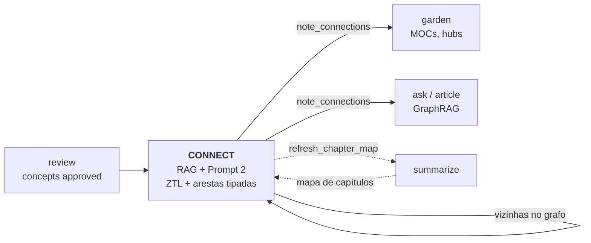
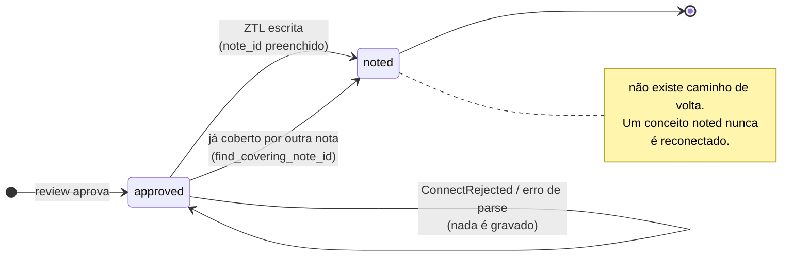
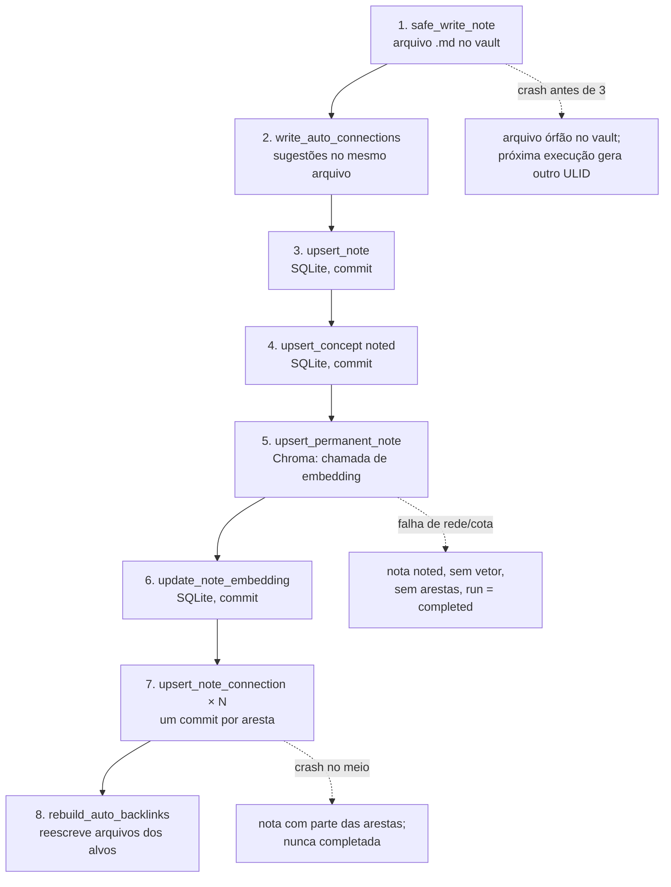
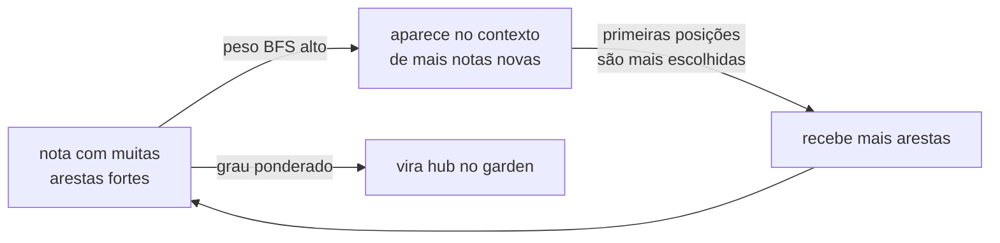
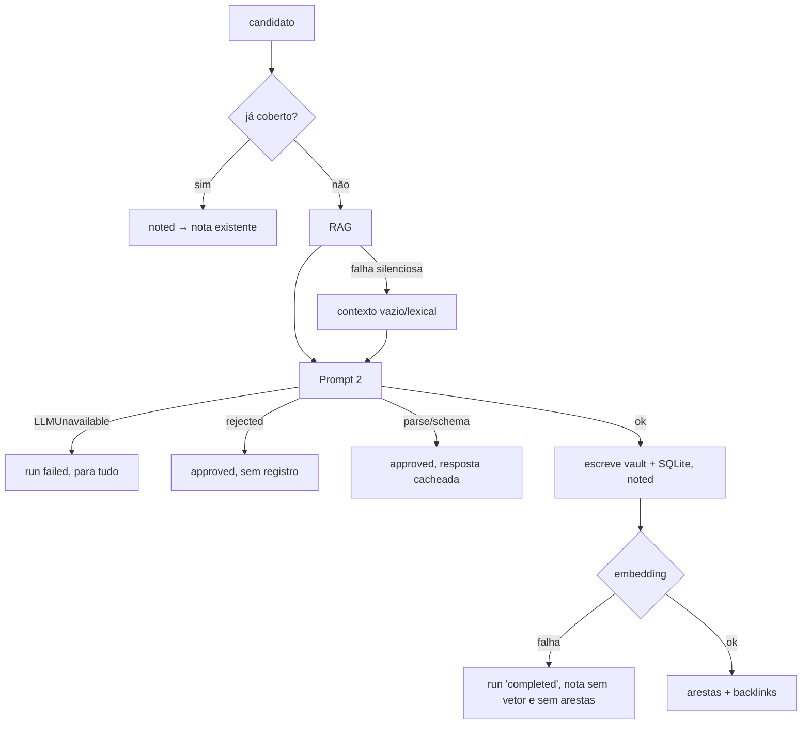

# Connect: quando o LLM escreve o grafo — e por que um grafo sem portão humano precisa ser medido como um modelo

> Artigo 4 de uma série sobre o `zettel_app`, um pipeline que transforma PDFs e Markdown em notas permanentes (Zettelkasten) compatíveis com o Obsidian.
> Esta parte cobre a fase **CONNECT**. Versão analisada: branch `epic/266-review-audit` @ `5cf341a` (2026-10-19), com as mudanças ainda não commitadas do ADR-058 (distância de cosseno) presentes na árvore de trabalho.
> Corpus usado nas medições: 7 fontes, 781 notas permanentes (780 do pipeline e 1 manual), 2.305 arestas tipadas, 7 execuções de `connect` entre 2026-09-22 e 2026-10-07.
> Os artigos anteriores estão em [`01-harvest.md`](01-harvest.md), [`02-extract.md`](02-extract.md) e [`03-review.md`](03-review.md).

---

## 0. Resumo (para quem tem pouco tempo)

O `connect` é a fase que transforma cada conceito aprovado no review numa **nota permanente** (ZTL) e a **liga ao resto do acervo**. Para cada conceito ele faz quatro coisas:

1. **recupera contexto** — notas parecidas (busca híbrida densa + BM25), vizinhas no grafo e "analogias distantes" de outro domínio;
2. **chama o Prompt 2**, que numa única resposta decide se o conceito merece nota, **reescreve** tese, definição, intuição, exemplo e limites, e propõe de 0 a 4 **conexões tipadas** (`supports`, `contradicts`, `extends`, `depends_on`, `exemplifies`, `related`);
3. **monta as arestas** — as do modelo, mais `extends` (vinda da dedupe do review) e `corroborates` (derivada por código quando a mesma ideia aparece em outra fonte);
4. **escreve** o arquivo no vault, a linha no SQLite, o vetor no Chroma, as arestas e os *backlinks*.

O desenho tem decisões excelentes: a citação e a página vêm do código, não do LLM (ADR-051); analogias especulativas viram sugestão e não aresta (ADR-043); corroboração entre autores vira ligação e não deduplicação (ADR-045); e o projeto **mediu** o próprio prompt de relações contra rótulos humanos cegos, com pré-registro (#212, #231, #226). Ao medir o acervo, porém, encontrei uma fase que **escreve um grafo que ninguém revisa**, com precisão medida de cerca de um terço, e que depois **não tem como ser refeito**.

| # | Achado | Gravidade | Evidência |
|---|--------|-----------|-----------|
| 1 | **O grafo é escrito sem portão humano e com precisão de ~30%.** As 2.116 arestas propostas por LLM vão direto para `note_connections` e passam a governar a travessia do `ask`, do `article` e do `garden`. Nos rótulos cegos do próprio projeto, o Prompt 2 acerta a relação exata em 17 a 27 de 69–80 pares, e todas as arestas atuais foram geradas **antes** do prompt corrigido em #231. | **Alta** | `state.db` + ADR-003/ADR-009 |
| 2 | **O grafo é congelado e depende da ordem.** Não existe comando para religar uma nota do pipeline: um conceito `noted` nunca volta ao `connect`. Arestas só apontam da nota nova para notas mais antigas, e o menu de relações não tem as inversas, então metade do espaço de relações é inexprimível. "Existing edges are not rebuilt" aparece em três ADRs, sem ferramenta para fazê-lo. | **Alta** | Código + medição de grau por ordem de criação |
| 3 | **70% das arestas `corroborates` estão abaixo do corte que o próprio projeto mediu.** Das 176 arestas com similaridade registrada, 123 ficam entre o corte antigo (0,85) e o medido (0,88, escala antiga). Na medição #226, a faixa acima de 0,85 errou 29 de 40 pares. | **Alta** | `decision_shadow` × `note_connections` |
| 4 | **Os limiares foram medidos (ou rotulados) com o modelo de embedding errado.** Desde 2026-09-21 o acervo usa `gemini-embedding-2@1536`. O piso de relevância (medido em 2026-09-06) é de `qwen3-embedding` e nunca foi remedido. O corte de corroboração foi medido sobre vetores Gemini, mas o ADR-045 e o pré-registro dizem que ele "vale só para qwen3". | **Média–Alta** | `notes.embedding_model`, datas, ADRs |
| 5 | **O RAG enxerga o próprio livro.** 87% dos 5 vizinhos mais próximos de uma nota são da mesma fonte (a taxa aleatória seria 33%), e 83% das arestas do LLM são intra-fonte. A promessa central do Zettelkasten, conectar autores diferentes, depende quase só da aresta `corroborates`. | **Média–Alta** | Matriz de cossenos das 781 notas |
| 6 | **O Prompt 2 reescreve o que o humano aprovou, sem ver a fonte.** Só 26,5% das teses saem idênticas à aprovada; a definição cresce 1,52× (mediana). O modelo não recebe o trecho-fonte nem a citação-âncora, mas a nota sai com citação ABNT e número de página ao lado desse texto. | **Média–Alta** | `concepts.candidate_json` × `notes.body` |
| 7 | **Viés de posição forte na escolha das conexões.** A 1ª nota similar do contexto é escolhida em 60% dos prompts; a 5ª, em 18,5%. Entre as vizinhas do grafo, de 12,7% para 2,1%. O teto de conexões virou cota: 93,7% das respostas têm exatamente 3. | Média | `llm_cache` (781 prompts) |
| 8 | **Falhas parciais deixam notas órfãs que nada repara.** Uma falha de embedding depois do Prompt 2 deixa a nota `noted`, sem vetor e sem arestas, e o `run` fica gravado como `completed`. `ConnectRejected` e erro de *parse* deixam o conceito `approved` para sempre, pagando de novo a cada execução quando o contexto muda. Uma relação inválida derruba a nota inteira. | Média | Leitura de código |
| 9 | **O portão de rejeição do Prompt 2 nunca disparou.** 0 rejeições em 781 chamadas, com ~13,5 mil caracteres de *system prompt* dedicados quase todos a critérios de rejeição. | Baixa–Média | `llm_cache` |
| 10 | **Pequenas incoerências de superfície**: `connect --dedupe-threshold` não faz nada (e está documentado); o pré-voo conta 21 notas de contexto e o prompt real tem 26; o `run-all` não tem pré-voo para o `connect`; o *guard* PT-BR não usa cache e engole `LLMUnavailableError`. | Baixa | Código + `docs/cli.md` |

O que está **muito bem feito**: a separação entre aresta derivada por código (`origin='derived'`) e aresta julgada por modelo (`origin='llm'`); a recusa em oferecer `corroborates` ao LLM, travada por teste; analogias distantes como sugestão; a página da citação localizada pela citação-âncora no mapa de páginas do Docling (552 de 597 notas com página saem com confiança `quote`); a reconstrução determinística dos *backlinks* a partir do grafo; e, acima de tudo, **a disciplina de medir mudanças de prompt contra rótulos humanos com regra pré-registrada, e registrar quando a regra não foi cumprida**.

---

## 1. O problema que o connect resolve — e por que ele é difícil

Um Zettelkasten não é uma pilha de fichas. Luhmann percebeu cedo que uma nota vale pelo seu contexto, pela rede de associações em que está inserida, e que algumas das ligações mais úteis são as menos óbvias, para áreas distantes do arquivo (é a leitura que Ahrens faz do método em *How to Take Smart Notes*). Se o `extract` é a leitura e o `review` é o julgamento, o `connect` é o **pensamento**: onde uma ideia nova encontra as antigas.

Automatizar isso tem quatro dificuldades que não aparecem num teste unitário:

1. **Predição de ligações é um problema de ranking com classe rara.** Com 781 notas, cada nota nova tem 780 alvos possíveis e, no máximo, quatro ligações escritas. O sistema precisa escolher candidatos (recuperação), escolher entre eles (ranking) e nomear a relação (classificação). Cada etapa tem seu próprio erro, e eles se multiplicam.
2. **Similaridade não é relação.** Duas notas sobre o mesmo tema ficam próximas no espaço de embeddings, mas "tratam do mesmo assunto" não é uma relação conceitual. Inversamente, uma contradição genuína pode ficar longe: o embedding mede vocabulário e tema, não tensão lógica.
3. **Relações tipadas são subjetivas.** "Estende" e "depende de" se confundem; "contradiz" e "aponta uma limitação" também. A literatura de *argument mining* mostra que até classificar apoio e ataque entre pares de argumentos é difícil, mesmo para modelos ajustados.
4. **O grafo realimenta a si mesmo.** As arestas que o `connect` escreve hoje entram no contexto do `connect` de amanhã (vizinhas no grafo) e na travessia do `ask` e do `article`. Um erro no grafo não é local: ele se propaga.

### Onde o connect se encaixa



A seta de `C` para `C` é o ponto central deste artigo: o `connect` consome o grafo que ele mesmo produz.

---

## 2. Metodologia

- **Lido**: o pacote `zettel/connector/` inteiro (`run.py`, `note.py`, `prompt.py`, `context.py`, `links.py`), `prompts/permanent_note.md`, `zettel/retrieval.py` (busca, piso, RRF, expansão no grafo), `zettel/graph.py`, `zettel/llm.py` (`cached_call_llm`, `LLMUnavailableError`), `zettel/manual_lit.py` (`find_covering_note_id`), `zettel/state/connections.py`, `zettel/decision/shadow.py` (`shadow_corroborates`), `zettel/preflight.py` (`estimate_connect`), `zettel/cli/synthesis.py`, `zettel/cli/pipeline.py`, os *handlers* de `connect` e `run_all` em `zettel/web_app.py`, `zettel/rebuild.py`, `config/config.yaml`, `docs/pipeline.md`, `docs/cli.md` e os ADRs 003, 009, 043, 045, 051, 053, 055, 058 e 059, além dos pré-registros #212, #226 e #231.
- **Medido (somente leitura)**: `data/state.db` aberto com `mode=ro` — notas, conceitos, arestas, execuções, `llm_cache` (os 781 prompts e respostas do Prompt 2), `decision_shadow`; uma **cópia** de `data/chroma/` no diretório temporário, de onde li os 781 vetores e calculei a matriz de cossenos.
- **Não verificado**: não fiz nenhuma chamada de LLM nem de embedding. Os cossenos entre notas foram calculados com o lado "documento" do embedding; o `Retriever` consulta com o lado "consulta" (o Gemini é assimétrico), então os números absolutos de §4.10 aproximam a distribuição que o `connect` viu. As similaridades da §4.7 vêm do `decision_shadow`, que gravou o lado consulta real.

> Nenhuma linha de código, configuração ou documentação existente do projeto foi alterada para produzir este artigo.

---

## 3. Visão geral da fase

### 3.1 O ciclo de vida de um conceito no connect



A porta de entrada é uma consulta: `status='approved' AND note_id IS NULL` (`load_approved_candidates`, `zettel/connector/run.py`). Não há passagem de estado em memória entre fases, o que é bom: o `connect` pode ser rodado a qualquer momento e retoma de onde parou.

### 3.2 Caminho feliz de um conceito

```mermaid
sequenceDiagram
    autonumber
    participant Run as run_connect
    participant Note as note._process
    participant Ret as Retriever
    participant LLM as Prompt 2
    participant V as Vault (.md)
    participant DB as SQLite
    participant Ch as Chroma

    Run->>Note: candidato aprovado
    Note->>DB: _target_note_id (já coberto?)
    Note->>DB: resolve_citation (página pela âncora)
    Note->>Ret: search_notes(tese + definição, topk=5)
    Ret->>Ch: kNN denso
    Ret->>DB: BM25 (FTS5) + topic index
    Ret->>Ret: RRF → piso → expansão no grafo (16 vizinhas)
    Note->>Ret: search_distant_analogies (5, outro bucket)
    Note->>LLM: system (13,5k chars) + user (conceito + 26 notas)
    LLM-->>Note: JSON aceito: nota + 0..4 conexões
    Note->>Note: guard PT-BR (se ≥3 palavras-função em inglês)
    Note->>Note: assemble_connections: rebaixa corroborates do LLM,<br/>injeta extends (dedupe) e corroborates (código)
    Note->>DB: resolve_connections (descarta alvo inexistente)
    Note->>V: safe_write_note (+ auto-connections)
    Note->>DB: upsert_note, concept → noted
    Note->>Ch: upsert_permanent_note (embedding)
    Note->>DB: upsert_note_connection (por aresta)
    Note->>V: rebuild_auto_backlinks (alvos + nota nova)
    Run->>V: refresh_chapter_map, auto-lit-permanent
```

### 3.3 O que a fase custou no acervo medido

| Medida | Valor |
|---|---|
| Execuções de `connect` | 7 (todas `completed`) |
| Notas geradas | 781 (0 *cache hits*) |
| Custo LLM / embedding | US$ 2,45 / US$ 0,17 |
| Custo médio por nota | US$ 0,0031 (`provenance_json.llm_cost_usd`) |
| Tokens de entrada / saída | 6,93 M / 0,61 M |
| Chamadas registradas | 1.939 = 781 do Prompt 2 + 1.158 do *shadow* `corroborates` (Jev, ~US$ 0,04) |
| Tamanho do prompt (mediana) | ~25 mil caracteres: 13,5 mil de *system*, ~9,6 mil de contexto RAG |
| Notas no contexto RAG | 26 em 673 de 781 prompts (5 sementes + 16 vizinhas no grafo + 5 analogias) |

O custo é baixo. O problema desta fase não é dinheiro; é **o que fica gravado**.

---

## 4. Etapa por etapa

### 4.1 Porta de entrada e ordem de processamento

`get_concepts_by_status("approved", without_notes=True)` executa `SELECT * FROM concepts WHERE status=? AND note_id IS NULL`, **sem `ORDER BY`**. No SQLite isso devolve, na prática, a ordem de inserção, mas não é garantido. A ordem importa mais do que parece: como veremos em §4.10, a nota processada primeiro não vê as seguintes, e o grafo resultante depende da sequência. Uma ordem estável e explícita (por fonte, capítulo e `chunk_index`) tornaria o resultado reprodutível e mais legível (as notas de um capítulo nasceriam na ordem do argumento do autor).

### 4.2 Decidir a nota-alvo

`_target_note_id` (`zettel/connector/note.py:214`) tem dois ramos:

- **conceito que já tem `note_id`**: reescreve a nota no lugar, salvo se ela for manual. Esse ramo é **inalcançável pelo pipeline**, porque a porta de entrada já filtrou `note_id IS NULL`. Não é um bug, mas é código que sugere uma capacidade ("reprocessar uma nota") que o sistema não oferece (ver achado #2).
- **conceito sem nota**: `find_covering_note_id` procura uma nota da mesma fonte cuja tese tenha o mesmo *hash* normalizado, ou uma nota manual cujo `literature_ref` cubra o chunk. Se achar, o conceito vira `noted` apontando para ela e nenhuma chamada de LLM é feita. É um *guard* barato contra a dupla geração entre o caminho manual (ADR-030) e o pipeline. A comparação é por igualdade exata de *hash*, então só pega cópias literais; quase-duplicatas são problema da dedupe do review.

### 4.3 Citação estrutural (ADR-051)

Antes de qualquer LLM, `resolve_citation` calcula a citação ABNT (`(AUTOR, ano, p. N)`) e a página. A página não é a do chunk: é a página onde a **citação-âncora** realmente está, achada pelo mapa `<!-- zettel:page N -->` do Docling, comparando as cinco primeiras e as cinco últimas palavras normalizadas (uma citação que atravessa a quebra vira `p. 42-43`).

No acervo: **552 notas com página por citação** (`quote`), **45 pela página do chunk** (`chunk`), **184 sem página** (Markdown nativo, que não tem páginas — ADR-013). É a melhor decisão da fase: o dado de que um pesquisador mais depende, a página, nunca passa pelo LLM.

### 4.4 Recuperação: o contexto do Prompt 2

A consulta é `tese + " " + definição` do candidato. O `Retriever` funde duas listas por **Reciprocal Rank Fusion**:

$$\text{RRF}(d) = \sum_{r \in \{\text{denso},\,\text{BM25}\}} \frac{1}{k + \text{rank}_r(d)}, \qquad k = 60$$

Depois aplica o **piso de relevância** (cosseno ≥ 0,40, com *bypass* para BM25 forte) e expande as sementes pelo grafo com uma BFS ponderada:

$$w(v) = \max_{\text{caminhos}} \; s_{\text{semente}} \cdot \prod_{i=1}^{h} \rho(e_i) \cdot \delta^{\,i-1}, \qquad \delta = 0{,}2$$

onde $\rho$ é o peso do tipo de aresta (`contradicts` 1,0; `extends` e `depends_on` 0,9; `supports` 0,8; `exemplifies` 0,7; `related` 0,5; `corroborates` 0,45) e a configuração permite até 5 saltos e 16 vizinhas. Por fim, uma segunda busca traz até 5 **analogias distantes**: notas fora do *bucket* taxonômico do candidato (o mesmo `argmax` de categoria que o `garden` usa), com piso local de cosseno −0,20.

O contexto é renderizado em três grupos, cada nota como cabeçalho (`note_id`, *wikilink*, tags ou relação) mais 150 caracteres do seu conteúdo (`linking.rag_note_chars`; o #212 mediu notas inteiras e não houve ganho).

Três observações sobre o que essa etapa entrega na prática:

- **O piso não filtra nada no `connect`.** Em 673 de 781 prompts o contexto veio cheio (26 notas). Com `gemini-embedding-2`, a mediana do cosseno entre **quaisquer** duas notas do acervo é 0,714 e o percentil 10 é 0,659 (lado documento). Um piso de 0,40 e um piso de analogia de −0,20 estão abaixo de praticamente todo par do corpus: as "analogias distantes" são simplesmente as 5 notas mais parecidas fora do *bucket*. Isso é anisotropia de embeddings (Ethayarajh, 2019), o mesmo fenômeno que o artigo 3 descreveu para a dedupe.
- **O grafo ocupa 62% do contexto.** 16 das 26 notas são vizinhas por aresta, até 5 saltos de distância, com os pesos da configuração compartilhada com o `ask` (o ADR-009 deixa isso como `[NEEDS INPUT]`). Elas rendem 32% das arestas propostas (§4.6).
- **O piso foi medido com outro modelo** (achado #4). A medição de 2026-09-06 usou `ollama/qwen3-embedding@1024d`; o acervo foi trocado para `gemini-embedding-2@1536` em 2026-09-21 (commit `6566919`), e as 781 notas têm `embedding_model = gemini-embedding-2`. O `CLAUDE.md` e o ADR-003 mandam remedir após qualquer troca de embedding; o ADR-058 converteu a escala, mas explicitamente não remediu.

### 4.5 O Prompt 2: três tarefas numa chamada

O `prompts/permanent_note.md` pede ao modelo, numa só resposta JSON, que:

1. **julgue** se o conceito merece nota (4 critérios de rejeição, 5 de aceitação, um *checklist*);
2. **escreva** a nota: título, tese, definição (3–6 frases, com fórmulas em LaTeX), intuição, exemplo ("preferencialmente diferente do exemplo da fonte"), limites e até 5 tags;
3. **conecte**: de 0 a 4 relações com as notas do contexto, aplicando os tipos em ordem (`contradicts` > `depends_on` > `exemplifies` > `extends` > `supports` > `related`).

A resposta é lida com `parse_llm_json` (extrai o objeto, repara escapes de LaTeX) e validada por Pydantic (`PermanentNoteLLMOutput`). Se `status == "rejected"`, levanta `ConnectRejected`. Se três ou mais palavras-função inglesas distintas aparecem na tese, definição ou intuição, um segundo prompt (`ptbr_guard.md`) reescreve os campos em PT-BR.

#### Achado #9 — o portão de rejeição nunca disparou

Das 781 respostas no `llm_cache`, **nenhuma** é `rejected`. Isso tem duas leituras, e as duas são legítimas: o review já filtrou bem (o humano aprovou, por que o modelo discordaria?), ou o prompt, que pede "rejeite apenas o que for genuinamente vazio", nunca será acionado por um conceito que passou por dois filtros antes. Em qualquer caso, ~13,5 mil caracteres de *system prompt*, a maior parte sobre critérios de rejeição, estão sendo pagos a cada chamada (o *prompt cache* do provedor amortiza parte disso) por uma decisão que nunca muda o resultado. E, quando mudar, o sistema terá **um LLM revertendo uma aprovação humana** sem registro (ver §5).

#### Achado #6 — a nota final não é a nota aprovada

O humano aprova no review o rascunho LIT com o candidato (tese, definição, intuição, limites). O Prompt 2 recebe esses campos **resumidos** e reescreve tudo. Comparei a tese do candidato aprovado (`concepts.candidate_json`) com a tese da ZTL gravada (`note_content.note_sections`):

| Medida (780 notas do pipeline) | Valor |
|---|---|
| Tese idêntica à aprovada | **207 (26,5%)** |
| Similaridade de caracteres da tese (mediana / p10) | 0,83 / 0,43 |
| Comprimento da definição, ZTL ÷ candidato (mediana / p90) | **1,52× / 1,90×** |

Um em cada dez teses foi substancialmente reescrita (similaridade < 0,43), e a definição ganha, em mediana, metade de texto novo. O modelo faz isso **sem ver o trecho-fonte nem a citação-âncora**: o payload do Prompt 2 (`prompt2_messages`, `zettel/connector/prompt.py:50`) não inclui `chunks.text` nem `anchor_quote`. O "exemplo", por instrução, deve preferencialmente ser diferente do da fonte.

O resultado é uma nota com uma citação ABNT de página exata ao lado de um texto que o autor citado pode não ter escrito, e que nenhum humano leu. A ancoragem (`quote_is_grounded`, no `extract`) prova que a citação é literal e foi escolhida para a tese **do candidato**; ninguém verifica se ela sustenta a tese **reescrita**. O pré-registro #261 (suporte citação→tese por NLI) mede exatamente essa relação, mas no candidato. É o lugar certo de aplicá-lo também à ZTL.

Isso não é um defeito do LLM; é uma escolha de arquitetura que vale tornar explícita: **o portão humano fica antes da etapa que mais escreve texto.**

### 4.6 Como o modelo escolhe as conexões

Classifiquei cada conexão proposta nas 781 respostas pelo grupo e pela posição em que o alvo aparecia no contexto:

| Grupo de origem do alvo | Propostas | Taxa de escolha por nota exibida |
|---|---|---|
| Similares por embedding (5 por prompt) | 1.271 (56%) | 33% |
| Vizinhas no grafo (16 por prompt) | 721 (32%) | 6% |
| Analogias distantes (5 por prompt) | 281 (12%) → viram sugestão | 8% |

#### Achado #7 — viés de posição e o teto que vira cota

Dentro de cada grupo a taxa de escolha cai monotonicamente com a posição:

| Posição no grupo | 1ª | 2ª | 3ª | 4ª | 5ª | … | 16ª |
|---|---|---|---|---|---|---|---|
| Similares por embedding | **60,0%** | 37,3% | 27,6% | 20,9% | 18,5% | | |
| Vizinhas no grafo | 12,7% | 10,9% | 7,0% | 7,4% | 8,2% | … | 2,1% |
| Analogias distantes | 8,1% | 5,1% | 8,3% | 8,2% | 9,4% | | |

Ao longo do contexto inteiro (26 posições), a taxa cai de 42% nas três primeiras para 2,4% nas posições 19–21 e **sobe de novo** para 7–9% nas últimas: a assinatura em U de *lost in the middle* (Liu et al., TACL 2024). O efeito está confundido com relevância, porque cada grupo vem ordenado por *score*. As analogias distantes, que também vêm ordenadas, têm taxa plana, o que sugere que a relevância explica parte da queda e a posição explica outra parte. Separar as duas exige um experimento com a ordem embaralhada, e a técnica já existe no próprio projeto: a camada Jev pergunta cada `choice` em três permutações (ADR-055). Tang et al. (NAACL 2024) mostram que agregar rankings sob permutação melhora o ranking listwise de 7% a 52%, conforme o modelo.

O segundo sinal é o número de conexões por resposta:

| Conexões por nota aceita | 0 | 1 | 2 | 3 |
|---|---|---|---|---|
| Respostas | 2 | 2 | 45 | **727 (93,7%)** |

Na época dessas execuções o prompt permitia de 0 a 3 conexões (o #231, de 2026-10-08, passou a 0–4). O modelo preencheu o teto em 93,7% dos casos. O #212 já tinha visto isso ("both conditions propose about 3 edges per note"). Quando o máximo vira o modo, o teto deixa de ser um limite e passa a ser uma cota: o número de arestas de uma nota diz mais sobre o prompt do que sobre a nota.

### 4.7 Montagem das arestas

`assemble_connections` (`zettel/connector/links.py:112`) aplica uma precedência clara:

1. as conexões do modelo, com qualquer `corroborates` rebaixado para `supports` (`demote_llm_corroborates`) — corroboração é fato de autoria, não julgamento;
2. `extends` para a nota que a dedupe do review julgou refinada (`refine_existing`/`merge`), se o modelo ainda não a ligou;
3. `corroborates` para sementes (`hop == 0`) de **outra fonte** com cosseno ≥ `linking.corroborates_min_similarity` (0,76, que é 0,88 na escala antiga), no máximo 3.

Depois, `resolve_connections` normaliza o `related_note_id` (tira `ZTL -`, `[[...]]`) e **descarta** alvos que não existem no SQLite ou no disco. Isso evita *wikilinks* fantasmas, mas aceita qualquer ULID existente, mesmo que não estivesse no contexto: o prompt diz "ignore qualquer id que não apareça nesse bloco", e o código não confere.

Por fim, as conexões cujo alvo veio do grupo de analogias distantes saem do grafo e vão para o bloco `auto-connections` (ADR-043): viram aresta só quando o autor move o *wikilink* para a prosa.

#### Achado #3 — as arestas `corroborates` atuais são, na maioria, do corte antigo

O acervo tem 189 arestas `corroborates`, todas criadas antes de 2026-10-08, com o corte antigo de 0,85. O *shadow* do #208 gravou a similaridade (lado consulta, escala antiga) de cada par de outra fonte acima de 0,75, o que me permitiu cruzar:

| Arestas `corroborates` | Quantidade |
|---|---|
| Total | 189 |
| Com similaridade registrada no *shadow* | 176 |
| **Abaixo do corte medido (0,88)** | **123 (70%)** |
| Acima | 53 |

O #226 (pré-registrado, 80 pares nunca rotulados) mediu que, entre pares acima de 0,85, a regra de 0,85 acertou **11 de 40** (os outros 29 eram "mesmo tema", não "mesma ideia"), e que o corte de 0,88 acerta 37 de 40. Pela medição do próprio projeto, então, a maior parte dessas 123 arestas liga notas que um humano não diria que afirmam a mesma ideia. O ADR-045 registra "Existing edges are not rebuilt". Como essa aresta é derivada por código, refazê-la é **gratuito e determinístico**: basta recalcular com o corte atual (o *shadow* já guarda a similaridade). Não há razão para manter 123 arestas que o próprio projeto mediu como provavelmente falsas, ainda mais numa relação que o `## Conexões` destaca para o leitor.

#### Achado #4 (continuação) — o corte de corroboração está rotulado com o modelo errado

O ADR-045 (adendo de 2026-10-08) e `evals/preregistration/226-corroborates-gate.md` dizem que 0,88 "vale só para `ollama/qwen3-embedding@1024d`". Mas as linhas do *shadow* usadas no #208 e no #226 foram gravadas em 2026-10-06 e 2026-10-07, num acervo em que as 781 notas já estavam em `gemini-embedding-2@1536` (desde 2026-09-21). Ou seja, o corte foi medido com o modelo atual, e o rótulo de escopo está errado. É um erro de documentação, mas importa: na próxima troca de embedding, alguém vai procurar "qual modelo calibrou este número" e vai achar a resposta errada.

### 4.8 Escrita: quatro armazenamentos, nenhuma transação

`_write_note` e `persist_and_backlink` escrevem nesta ordem:



O passo 4 marca o conceito como `noted` **antes** do embedding e das arestas. Se o passo 5 falhar (cota de embedding esgotada, *timeout*), o resultado é:

- a exceção não é `LLMUnavailableError`, então sobe crua por `run_connect`, cujo `finally` grava o `run` como **`completed`** (só `LLMUnavailableError` muda o status para `failed`);
- a nota existe no vault e no SQLite, sem vetor e sem nenhuma aresta;
- `zettel reindex` recria o vetor, mas **nada recria as arestas**: o conceito é `noted` e nunca mais entra no `connect`.

O cenário é plausível justamente porque, no passo anterior, a falha de embedding é **silenciosa**: `Retriever._vector_notes` captura qualquer exceção e devolve lista vazia, e `search_distant_analogies` faz o mesmo. Com o serviço de embedding fora do ar, o Prompt 2 é chamado (e pago) com um contexto vazio ou só lexical, escreve a nota sem conexões, e a execução quebra na hora de gravar o vetor. Degradação silenciosa na leitura e falha dura na escrita é a pior combinação: o erro aparece tarde, depois de o dano estar feito.

A solução não precisa de transação distribuída: basta mudar a ordem (embedding e arestas antes de marcar `noted`), ou introduzir um estado intermediário (`connecting`) que a próxima execução retome, e classificar falhas de embedding como indisponibilidade (fail-fast, ADR-059).

### 4.9 Backlinks

`rebuild_auto_backlinks` reconstrói o bloco `auto-backlinks` de uma nota a partir das arestas de **entrada** no SQLite, com a relação inversa em PT-BR (`extends` → "estendido por", `depends_on` → "base para"). Uma aresta é gravada uma vez só (da nota nova para o alvo); a travessia é não direcionada e o *backlink* mostra o outro lado. O bloco só é reescrito se o conteúdo mudou. É um desenho limpo e idempotente: o grafo no SQLite é a fonte da verdade e o vault é uma projeção dele.

### 4.10 O grafo resultante

Esta é a seção mais importante: o que essas regras produzem quando aplicadas 781 vezes.

| Tipo | Arestas | Intra-fonte | Cosseno doc-doc (p10 / p50 / p90) |
|---|---|---|---|
| `extends` (llm) | 650 | 570 (88%) | 0,805 / 0,854 / 0,919 |
| `supports` (llm) | 590 | 458 (78%) | 0,789 / 0,845 / 0,907 |
| `depends_on` (llm) | 374 | 320 (86%) | 0,790 / 0,830 / 0,876 |
| `related` (llm) | 237 | 190 (80%) | 0,784 / 0,828 / 0,882 |
| `contradicts` (llm) | 209 | 177 (85%) | 0,775 / 0,824 / 0,876 |
| `corroborates` (derived) | 189 | 0 | 0,807 / 0,856 / 0,980 |
| `exemplifies` (llm) | 56 | 40 (71%) | 0,779 / 0,825 / 0,877 |
| **Linha de base: todos os pares** | 304.590 | 33% | 0,659 / 0,714 / 0,781 |

#### Achado #5 — o RAG enxerga o próprio livro

Para cada nota, 87,4% dos seus 5 vizinhos mais próximos são da **mesma fonte**. Se a fonte não importasse, seriam 33,2% (a probabilidade de dois pares aleatórios serem da mesma fonte, dada a composição do acervo). Até entre os dois livros sobre Kant e IA (Kim 2022, 389 notas; Hui 2026, 159 notas), a vizinhança é 92,5% e 86,9% intra-fonte. O embedding captura estilo, vocabulário e terminologia de um autor tanto quanto o conceito.

Como o contexto do Prompt 2 é feito desses vizinhos, **83% das arestas do LLM ligam notas do mesmo livro**. Há 18.923 pares de fontes diferentes com cosseno ≥ 0,76 (lado documento); 528 deles têm alguma aresta. Para um sistema cujo valor declarado é "Kahneman corroborado por Gigerenzer" (ADR-045), a ligação entre autores fica quase inteiramente por conta de uma aresta derivada de um único limiar, e não do julgamento do modelo.

A correção é conhecida: diversificar a recuperação. *Maximal Marginal Relevance* (Carbonell & Goldstein, 1998) penaliza candidatos redundantes com os já escolhidos; aqui, a redundância relevante é a **fonte**. Uma cota (por exemplo, até 3 das 5 sementes da mesma fonte) ou um termo de penalidade por fonte na MMR é barato e mensurável com a infraestrutura de rótulos do #212.

#### Achado #1 — 2.116 arestas julgadas, nenhuma revisada

As arestas de LLM vão direto para `note_connections`, e o grafo governa:

- a expansão por BFS do `ask`, do `article`, do `sync` e do próprio `connect` (ADR-009);
- a coesão de *clusters* e os MOCs de *hub* do `garden` (ADR-019/020).

A precisão medida dessas arestas, nos rótulos cegos do próprio projeto:

| Medição | Relação exata correta | Observação |
|---|---|---|
| #212, prompt antigo, 80 pares | 18–20/80 (23–25%) | tipo correto nas arestas comuns: 0,41–0,43 |
| #231, desenvolvimento, 80 pares (rerotulados) | 24/80 → 27/80 | prompt novo |
| #231, validação, 69 pares | 17/69 → 20–24/69 (25–35%) | prompt novo; regra pré-registrada não atingida |

E um detalhe de cronologia que torna o achado mais grave: **a última execução de `connect` foi em 2026-10-07; o prompt novo do #231 entrou em 2026-10-08.** As 2.116 arestas no acervo foram todas escritas com as definições antigas, cuja taxa de acerto de tipo nas arestas comuns era ~0,42.

O exemplo mais nítido é `contradicts`: **209 arestas, 177 delas dentro do mesmo livro**. Uma amostra mostra o padrão que o #231 diagnosticou: "o paralelismo de sub-agentes **tensiona** o *prompt chaining*" (alternativas, não contradição), "a neutralidade ontológica kantiana **tensiona** a interpretação funcionalista" (um autor apresentando uma posição oposta). O prompt antigo definia contradição como "tensão". Isso importa porque `contradicts` tem o **maior peso de travessia** (1,0), justamente porque é "o sinal que o embedding não captura". Uma contradição mal rotulada não é um erro neutro: é a aresta que a BFS mais segue.

O ADR-043 tem a premissa certa ("connect writes edges without a human gate"), e por isso mandou analogias distantes para sugestão. A mesma premissa vale para **todas** as arestas do LLM, e com uma precisão medida de 25–35% a diferença entre uma analogia distante e uma `supports` entre vizinhos é menor do que o desenho supõe.

#### Achado #2 — o grafo é congelado, direcional e cresce por anexação preferencial

Três propriedades estruturais:

1. **Só se liga para trás.** Uma nota nova só vê notas que já existem. A primeira nota de um acervo vazio nasce sem arestas de saída; uma nota antiga só ganha arestas de entrada. O menu de relações é lido como "a nota **nova** ___ a nota relacionada", e não há relações inversas (não existe "é exemplificada por", "é pré-requisito de", "é estendida por"). Se a nota nova é o pré-requisito de uma antiga, o modelo não tem como dizê-lo: escolhe outro tipo ou não liga. O ADR-009 registra que 18 de 23 erros de tipo no #212 eram `extends` lido como `supports`, `depends_on` ou `contradicts`; uma parte disso pode ser direção, não tipo.
2. **Não há como refazer.** Nenhum comando devolve um conceito `noted` ao `connect`. O ADR-045, o ADR-009 e o ADR-058 dizem "existing edges are not rebuilt / only notes connected from now on, or reprocessed"; o único "reprocessar" disponível é `delete-source` e um novo `harvest`, que paga `extract`, `review` e `connect` de novo e muda os ULIDs. Toda melhoria de prompt, de corte ou de modelo vale só para o futuro, e o acervo acumula camadas de grafo geradas por versões diferentes do sistema, sem marcação de qual versão escreveu cada aresta (`note_connections` não tem `prompt_version` nem `model`).
3. **Anexação preferencial.** As 16 vizinhas do grafo no contexto são escolhidas pelo peso da BFS, que favorece notas com muitas arestas fortes. Notas bem conectadas aparecem em mais contextos, recebem mais arestas, e aparecem em ainda mais contextos: o mecanismo de Barabási & Albert (1999). No acervo, o grau de entrada tem mediana 2, p90 7, p99 ~21 e máximo **52**. As notas mais antigas (primeiros 5%) têm grau de entrada médio 4,5, contra 2,0 na metade mais recente. Parte disso é natural (uma nota antiga teve mais chances de ser alvo); parte é realimentação. Somado à *hubness* intrínseca de vizinhos mais próximos em alta dimensão (Radovanović et al., JMLR 2010), o efeito é que os *hubs* do `garden` (ADR-020) refletem, em parte, a ordem de processamento e a dinâmica do próprio contexto, e não só a centralidade conceitual.



---

## 5. Tratamento de erros e fluxos de exceção

| Situação | O que acontece | Estado depois | Avaliação |
|---|---|---|---|
| Provedor de LLM indisponível (transporte, auth, 429 esgotado) | `LLMUnavailableError` sobe, `run` = `failed`, CLI sai com 1 | Conceito em curso continua `approved` | **Correto** (ADR-059) |
| Prompt 2 responde `rejected` | `ConnectRejected`; no pipeline, `continue` | Conceito fica `approved`, **sem registro do motivo** | Fraco: re-perguntado a cada `connect`; com o contexto mudado, *cache miss* e nova cobrança; um LLM reverte um humano sem rastro |
| JSON inválido ou campo obrigatório vazio | `except Exception` → `logger.error`, `return None` | Conceito `approved`; resposta ruim **fica no cache** | Fraco: não vai para `llm_failures` (o `extract` vai); repete de graça enquanto o contexto não muda, depois paga de novo |
| Uma conexão com `relation_type` inválido (ex.: `refines`) | `ValidationError` do Pydantic na resposta toda | Nota inteira perdida | Desproporcional: deveria descartar só a aresta |
| `related_note_id` inexistente ou malformado | Descartado com *warning* | Nota gravada sem essa aresta | Correto |
| `related_note_id` existente mas fora do contexto | Aceito | Aresta para nota que o modelo não viu | Fraco: o código não confere o que o prompt exige |
| Busca vetorial falha (embedding fora) | `_vector_notes` devolve `[]` com *warning* | Prompt 2 chamado com contexto pobre | **Silencioso**: deveria ser fail-fast |
| Embedding da nota falha (passo 5) | Exceção crua; `run` gravado `completed` | Nota `noted` sem vetor e sem arestas | **Ruim**: estado parcial que nada repara (§4.8) |
| Guard PT-BR falha | `except Exception` → mantém o texto original | Nota possivelmente em inglês | Fraco: engole `LLMUnavailableError`; chamada não usa o cache |
| Rótulos de categoria não embedam | Analogias distantes desligadas para o run | Contexto sem o grupo 3 | Aceitável, com *warning* |
| Falha ao reescrever mapa de capítulos ou links LIT | `OSError` → *warning* | Notas gravadas; blocos desatualizados | Aceitável (são projeções derivadas) |
| Nota manual cobre o conceito | Conceito → `noted` apontando para ela | Nenhuma chamada de LLM | Correto |
| Caminho manual (`--from-lit --llm`) e `ConnectRejected` | Para no primeiro e relança após os *refreshes* | Conceito `approved` | Correto para um fluxo interativo |



---

## 6. O fluxo do usuário: faz sentido?

O fluxo documentado é `harvest → extract → review → (summarize) → connect → garden`. Da perspectiva do usuário, o `connect` é **não interativo**: uma confirmação de custo (pré-voo, no CLI) e depois uma barra de progresso. Ele não mostra nada do que escreveu, a não ser a lista de ULIDs.

O que faz sentido:

- **Fases separadas por estado no SQLite.** O usuário pode revisar hoje e conectar amanhã; o `connect` retoma.
- **Pré-voo de custo** antes de gastar (ADR-037), e o pré-voo é uma função pura.
- **Sugestões no vault.** As analogias distantes aparecem num bloco gerenciado e viram aresta só se o autor mover o link para a prosa: o humano decide no lugar onde já trabalha (o Obsidian).

O que não faz:

1. **O portão humano está no lugar errado para esta fase.** O review aprova um rascunho; o `connect` reescreve a tese (73,5% das vezes), acrescenta ~50% de definição e escreve ~2,7 arestas por nota, e nada disso passa por um humano. Num sistema cujo argumento é "o LLM propõe, o humano decide", a etapa que mais escreve é a única sem decisão.
2. **Não há como o usuário corrigir o grafo pelo sistema.** Ele pode apagar o link da seção `## Conexões` no arquivo, mas a aresta continua em `note_connections`: segue sendo percorrida pelo `ask` e reaparece no `auto-backlinks` da nota-alvo, que é reconstruído do SQLite. Não há `zettel edge reject`, nem fila de arestas, nem `reconnect`.
3. **O resultado não é inspecionável.** O usuário não vê, ao final, quantas arestas de cada tipo foram criadas, quantas intra e entre fontes, quantas `corroborates`, quais conceitos o modelo rejeitou. A informação existe (está no SQLite); falta a superfície.
4. **Flags e textos enganosos.** `connect --dedupe-threshold` está no `--help` e em `docs/cli.md` ("limiar de deduplicacao") e não é lido por nenhuma linha do `connect` (a dedupe roda no review). O `run-all` chama o `connect` sem o pré-voo que o comando isolado tem, e conecta **todos** os aprovados, não só os das fontes daquele run.

**Fluxo sugerido** (detalhado em §9): o `connect` escreve as notas e grava as arestas do LLM como **propostas** (com `origin='llm'` e um estado `proposed`); as arestas derivadas (`corroborates` acima do corte, `extends` da dedupe) e as de alta confiança entram direto. Um comando `zettel links` (e uma fila web, no mesmo padrão de `/review?queue=duplicates`) mostra as propostas por tipo, com o par de teses lado a lado, e o usuário aceita ou rejeita em lote. As decisões viram rótulos para a próxima medição, o que fecha o ciclo que o #212 abriu à mão.

---

## 7. A ciência por trás das decisões

### 7.1 O que o projeto acertou: medir o prompt, não o palpite

As mudanças de comportamento do `connect` dos últimos meses seguiram um protocolo raro em projetos pessoais (e não tão comum em projetos profissionais):

- **#212** perguntou se notas vizinhas inteiras (6000 caracteres) dão conexões melhores que o recorte de 150. Pré-registrou a regra, rotulou 80 pares às cegas, rodou cada condição duas vezes para medir a variância do próprio modelo (~7,5% das respostas mudam entre repetições) e concluiu que **não**: p = 0,80, e o orçamento ficou em 150. O diagnóstico foi útil: o gargalo é o prompt (teto de conexões, definições de tipo), não o contexto.
- **#231** atacou exatamente esse gargalo: tipos aplicados em ordem, "tema em comum não é relação", até 4 conexões. A regra pré-registrada (mais acertos com p < 0,05) **não foi atingida** em nenhuma das três comparações (p = 0,58; 0,66; 0,19), e a decisão de manter foi registrada como decisão explícita do autor, com a justificativa (as regras de desenho foram fixadas antes da medição, a direção favoreceu o prompt novo nas três, nenhuma condição de segurança falhou) e com o #231 deixado aberto para uma rodada maior.
- **#208/#226** pegaram um limiar sem medição (0,85), compararam com um modelo tipado (Jev) e com um corte reajustado, em dados nunca vistos, com McNemar exato. O corte venceu o limiar antigo (p < 0,0001) e empatou com o modelo (p = 1,0), e o empate foi para o corte, por custo e latência zero.

Isso é estatística aplicada do jeito certo: hipótese antes dos dados, teste pareado para dados pareados (McNemar, e não comparação de proporções independentes), e honestidade quando o resultado é nulo.

### 7.2 Onde a mesma ciência ainda não chegou

A crítica deste artigo não é à metodologia; é ao **escopo** dela. O projeto mede bem as **mudanças**, mas não mede o **estoque**:

- mediu que o prompt novo é (talvez) melhor, mas o acervo inteiro ainda tem as arestas do prompt antigo;
- mediu o corte de corroboração, mas 123 arestas do corte antigo continuam lá;
- mediu o piso de relevância, mas com um modelo de embedding que não está mais em uso;
- mede a precisão das arestas (~30%), mas trata a aresta de LLM como fato no grafo.

Uma medição que não muda o estado do sistema é um relatório, não um controle. O que falta é a ferramenta de **reprocessamento** que transforma cada medição numa migração.

### 7.3 Por que `corroborates` não é oferecido ao LLM

O ADR-045 tem um dos melhores argumentos do projeto: se o modelo puder escolher `corroborates`, ele o usará retoricamente ("esta nota também concorda"), e o sinal se dissolve em `supports`. Por isso a aresta é derivada por código, o modelo nunca a vê no menu (um teste garante a ausência), e uma `corroborates` emitida pelo modelo é rebaixada **antes** de o código injetar as suas. É um padrão de *trust boundary* bem aplicado.

Há um ponto em que discordo do texto: o ADR-043 diz que corroboração "é um fato sobre autoria e não pode estar errada". A autoria é um fato; "a mesma ideia" é uma estimativa por similaridade, e o #226 mediu que ela erra (3 de 80 com o corte atual, 29 de 80 com o antigo). A distinção certa não é "fato vs. palpite", é "**julgamento barato, determinístico e reproduzível**" vs. "julgamento caro e estocástico". Isso continua justificando escrever a aresta direto no grafo, desde que ela seja **recalculada** quando o corte muda.

---

## 8. Comparação com abordagens alternativas

| Abordagem | Como liga notas | O que ofereceria ao `zettel_app` | Custo / risco |
|---|---|---|---|
| **Atual** | RAG (top-5 + 16 do grafo + 5 distantes) → um prompt escreve e liga | — | Viés de posição, intra-fonte, sem revisão |
| **A-Mem** (Xu et al., NeurIPS 2025) | Nota nova com atributos gerados por LLM; ligações por similaridade + LLM; **evolução**: a nota nova pode atualizar contexto e atributos das antigas | Resolve a direcionalidade (§4.10): a chegada de uma nota pode reescrever as relações das antigas | Reescreve notas existentes; aqui, só blocos gerenciados poderiam ser tocados |
| **GraphRAG** (Edge et al., Microsoft, 2024) | Grafo de entidades extraído por LLM + resumos de comunidades | O `garden` já faz o análogo (MOCs por *cluster*); o artigo é útil como contraste: entidades são mais objetivas que relações argumentativas | Custo alto de indexação; outro tipo de grafo |
| **HippoRAG** (Gutiérrez et al., NeurIPS 2024) | Grafo de conhecimento + *Personalized PageRank* a partir das entidades da consulta | PPR é uma alternativa mais robusta à BFS de 5 saltos com *decay* fixo; difunde relevância e é menos sensível a um *hub* | Exige grafo de entidades |
| **MMR** (Carbonell & Goldstein, 1998) | Reordena candidatos penalizando redundância | Diversidade de **fonte** nas sementes (achado #5) | Trivial de implementar; um parâmetro λ a medir |
| **Permutation self-consistency** (Tang et al., NAACL 2024) | Repete o ranking com a lista embaralhada e agrega | Ataca o viés de posição (achado #7); o projeto já usa permutação na camada Jev | 2–3× chamadas na etapa de ligação (barata se separada da escrita) |
| **NLI** (ex.: DeBERTa-v3 ajustado em MNLI) | Classificador de *entailment/contradiction* por par | Verificador independente para `contradicts` e `supports`, e para citação→tese da ZTL (#261) | Modelo local; medir em PT-BR |
| **Saída estruturada** (Gemini `response_schema`) | Decodificação restrita ao JSON Schema | Elimina erro de *parse* e enums inválidos (achado #8) | Há relatos de queda em raciocínio com schema rígido: medir antes |
| ***Argument mining*** relacional (*Can LLMs perform Relation-based Argument Mining?*, 2024) | LLM classifica apoio/ataque entre pares | Mostra que tratar a relação **par a par**, com poucos exemplos, supera classificadores ajustados | Uma chamada por par: só nas sementes |

A lição comum dessas referências: **separar as tarefas**. Escrever a nota é geração condicionada à fonte; escolher alvos é ranking; nomear a relação é classificação de pares. Fazer as três num prompt de 25 mil caracteres funciona, mas mistura três erros num só número e torna difícil melhorar um sem mexer nos outros.

---

## 9. Plano de correção sugerido

| Prioridade | Mudança | Como verificar |
|---|---|---|
| **P0** | Recalcular as arestas `corroborates` com o corte atual (determinístico, sem LLM; o *shadow* já tem a similaridade de 176 pares) e corrigir no ADR-045 e no pré-registro #226 o modelo de embedding do corte (`gemini-embedding-2@1536`) | Contagem de `corroborates` antes/depois; teste que recalcula a partir de `decision_shadow` |
| **P0** | Remedir o piso de relevância com `scripts/probe_relevance_floor.py` no embedding atual, para notas e para resumos de capítulo | Tabela nova no ADR-003; `tests/test_config.py` |
| **P0** | Ordem de escrita segura: embedding e arestas antes de `noted` (ou estado `connecting` retomável); qualquer exceção grava o `run` como `failed`; falha de embedding classificada como indisponibilidade (fail-fast, inclusive na leitura do `Retriever` dentro do `connect`) | Teste com `upsert_permanent_note` levantando exceção: conceito continua elegível, `run` = `failed` |
| **P1** | `zettel reconnect [--source-id] [--relations-only]`: refaz só as arestas `origin='llm'` de notas existentes, sem reescrever o corpo, e grava `prompt_version`/`model` em `note_connections` | Rodar sobre o acervo e comparar com os rótulos de #231 |
| **P1** | Registrar `ConnectRejected` e falhas de *parse* (`llm_failures`, ou estado `connect_rejected` no conceito, com o motivo) e mostrar no `zettel status`; validar conexões **uma a uma** (descartar só a aresta inválida); conferir que o alvo estava no contexto | Teste com uma conexão `refines`: nota gravada, aresta descartada |
| **P1** | Diversidade de fonte nas sementes (MMR ou cota) e configuração de grafo própria do `connect` (menos saltos, sem repetir *hubs*) | Fração de arestas entre fontes; acerto nos pares de #231 |
| **P1** | Embaralhar a ordem do contexto (ou avaliar com permutação) e medir o viés de posição num *probe* pré-registrado | Taxa de escolha por posição com ordem aleatória |
| **P2** | Arestas de LLM como **propostas**: fila de revisão (`zettel links`, `/review?queue=links`) com aceitar/rejeitar em lote; derivadas entram direto | Taxa de aceitação por tipo; rótulos acumulados |
| **P2** | Separar o Prompt 2 em escrita (com o trecho-fonte e a âncora no payload) e ligação (pares, com tipos inversos ou direção livre); aplicar o NLI de #261 à tese **da ZTL** | Similaridade tese aprovada × gravada; suporte âncora → tese da ZTL |
| **P2** | Guard PT-BR pelo cache e com fail-fast; `ORDER BY` determinístico em `get_concepts_by_status` | Teste de idempotência de duas execuções |
| **P3** | Remover `connect --dedupe-threshold` (e de `docs/cli.md`); pré-voo contando as analogias distantes (26 notas, não 21); pré-voo no `run-all` antes do `connect`; resumo final por tipo de aresta e fonte | Revisão de documentação; teste do pré-voo |
| **P3** | Avaliar saída estruturada do Gemini (`response_schema`) contra o *parse* atual, com os mesmos rótulos | Taxa de respostas inválidas; acerto de relações |

---

## 10. Conclusão

O `connect` é a fase em que o `zettel_app` deixa de organizar a leitura de um autor e passa a construir **um pensamento que atravessa autores**. A engenharia em volta do LLM é cuidadosa: a página da citação nunca passa pelo modelo, a corroboração é um fato calculado e não uma opinião, as analogias especulativas ficam como sugestão, e cada mudança de prompt foi medida contra rótulos humanos com regra fixada antes.

Os problemas que encontrei têm uma forma diferente dos das fases anteriores. No harvest e no extract eram regras que sobreviviam à razão que as justificava; no review, suposições silenciosas entre componentes. Aqui, o problema é **tempo**. O grafo é um artefato que acumula: cada execução escreve sobre as anteriores, com o prompt, o corte e o modelo daquele dia, e nada volta atrás. A medição é excelente para decidir o que fazer **a partir de agora**; o sistema não tem ferramenta para aplicar a decisão **ao que já existe**. O resultado é um acervo cujo grafo foi escrito com um prompt que o próprio projeto já substituiu, com um corte que o próprio projeto já mediu como errado, e com uma vizinhança que o próprio embedding enviesa para dentro de cada livro.

A lição para quem constrói sistemas parecidos: **um grafo escrito por LLM é a saída de um modelo, e precisa do que qualquer saída de modelo precisa** — versionamento (qual prompt e modelo escreveu esta aresta), avaliação contínua (quanto dela um humano aceitaria), e a capacidade de ser regenerado quando o modelo melhora. Sem isso, cada melhoria vira mais uma camada sobre o erro antigo.

O próximo artigo trata do `garden`, que constrói os mapas de conteúdo justamente sobre esse grafo.

---

## Apêndice A — Como reproduzir as medições

Tudo em modo somente leitura (`sqlite3` com `?mode=ro`), sem chamadas de LLM nem de embedding.

1. **Estado e custo**: `notes` por `origin` e `embedding_model`; `concepts` por `status`; `runs` com `pipeline_signature='connect'` (custo, tokens, `llm_calls`, `cache_hits`); `decision_shadow` por `site` (1.158 linhas `corroborates` = chamadas extras do *shadow*).
2. **Respostas do Prompt 2**: linhas de `llm_cache` cujo `request_json` contém "Nota Permanente". Contar `status`, número de `connections`, tamanho do *system* e do bloco após "Notas existentes relacionadas".
3. **Grupo e posição dos alvos**: no `user` de cada pedido, separar por `^### ` e capturar `^- note_id: (ULID)` (atenção: o cabeçalho das vizinhas no grafo contém um segundo `note_id:` da nota-âncora, que não deve ser contado). Cruzar com os `related_note_id` da resposta.
4. **Tese aprovada × gravada**: `concepts.candidate_json.thesis` contra `note_content.note_sections(title, body)["thesis"]` (`difflib.SequenceMatcher`); a mesma coisa para o comprimento da definição.
5. **Cossenos**: copiar `data/chroma/` para um diretório temporário, ler `permanent_notes` com `get(include=["embeddings"])`, normalizar e calcular `E @ E.T`. Por tipo de aresta, o cosseno do par; linha de base pelo triângulo superior da matriz; fração intra-fonte dos 5 vizinhos mais próximos contra $\sum_i (n_i/N)^2$.
6. **Corroboração × corte**: chave do *shadow* `subject_id = "A|B:ab"`; `baseline_json.similarity` (escala antiga); casar com `note_connections` onde `relation_type='corroborates'`.
7. **Estrutura**: grau de entrada e saída por nota; médias por faixa de `created_at`; componentes conexos por *union-find*.
8. **Cronologia**: `git log` de `config/config.yaml` (troca de embedding em `6566919`, 2026-09-21; corte 0,88 em `5565154`, 2026-10-08); datas mínima e máxima de `notes.created_at` e de `decision_shadow.created_at`.

## Apêndice B — Fontes externas consultadas

- Xu et al., *A-Mem: Agentic Memory for LLM Agents*, NeurIPS 2025: <https://proceedings.neurips.cc/paper_files/paper/2025/hash/19909c36f51abc4856b4560aff3d36d6-Abstract-Conference.html> (resumo e uma revisão secundária; não li o artigo completo)
- Liu et al., *Lost in the Middle: How Language Models Use Long Contexts*, TACL 2024: <https://arxiv.org/abs/2307.03172>; e Veseli et al., *Positional Biases Shift as Inputs Approach Context Window Limits*, 2025: <https://arxiv.org/html/2508.07479v1>
- Tang, Zhang, Ma, Lin & Ture, *Found in the Middle: Permutation Self-Consistency Improves Listwise Ranking in Large Language Models*, NAACL 2024: <https://arxiv.org/abs/2310.07712>
- Gutiérrez et al., *HippoRAG: Neurobiologically Inspired Long-Term Memory for Large Language Models*, NeurIPS 2024: <https://arxiv.org/abs/2405.14831>
- Edge et al., *From Local to Global: A Graph RAG Approach to Query-Focused Summarization*, Microsoft Research, 2024: <https://arxiv.org/abs/2404.16130>
- Carbonell & Goldstein, *The Use of MMR, Diversity-Based Reranking for Reordering Documents and Producing Summaries*, SIGIR 1998: <https://people.eng.unimelb.edu.au/ammoffat/sigir98/abstracts/carbonell.html>
- Radovanović, Nanopoulos & Ivanović, *Hubs in Space: Popular Nearest Neighbors in High-Dimensional Data*, JMLR 11, 2010: <https://jmlr.org/papers/v11/radovanovic10a.html>
- Barabási & Albert, *Emergence of Scaling in Random Networks*, Science 286, 1999: <https://arxiv.org/abs/cond-mat/9910332>
- Ethayarajh, *How Contextual are Contextualized Word Representations?*, EMNLP 2019 (anisotropia): <https://arxiv.org/abs/1909.00512>
- *Can Large Language Models perform Relation-based Argument Mining?*, 2024 (resumo; setup com poucos exemplos, Llama-2 e Mistral): <https://arxiv.org/abs/2402.11243>; e *Assessing Open-Source Large Language Models on Argumentation Mining Subtasks*, 2024: <https://arxiv.org/abs/2411.05639>
- Google Cloud, *Structured output* (Gemini, `response_schema`): <https://docs.cloud.google.com/vertex-ai/generative-ai/docs/multimodal/control-generated-output>; relato informal de queda de desempenho com *schema*: <https://dylancastillo.co/posts/gemini-structured-outputs.html>
- Modelos NLI DeBERTa-v3 (MNLI/FEVER/DocNLI), cartões de modelo: <https://huggingface.co/MoritzLaurer/DeBERTa-v3-small-mnli-fever-docnli-ling-2c>
- Ahrens, *How to Take Smart Notes* (resumos e excertos): <https://fortelabs.com/blog/how-to-take-smart-notes/>, <https://rufuspollock.com/post/ahrens-how-to-take-smart-notes>; Luhmann, *Communicating with Slip Boxes* (1981), citado a partir dessas fontes secundárias

> Observação: para A-Mem, HippoRAG e GraphRAG, as afirmações deste artigo se apoiam nos resumos publicados, não numa reprodução dos experimentos. As medições deste artigo não dependem dessas referências; elas servem para situar as alternativas.
