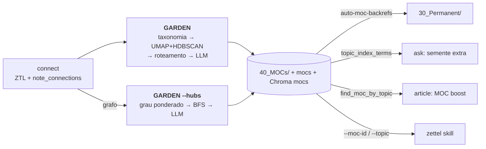
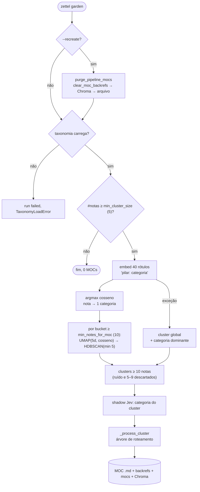
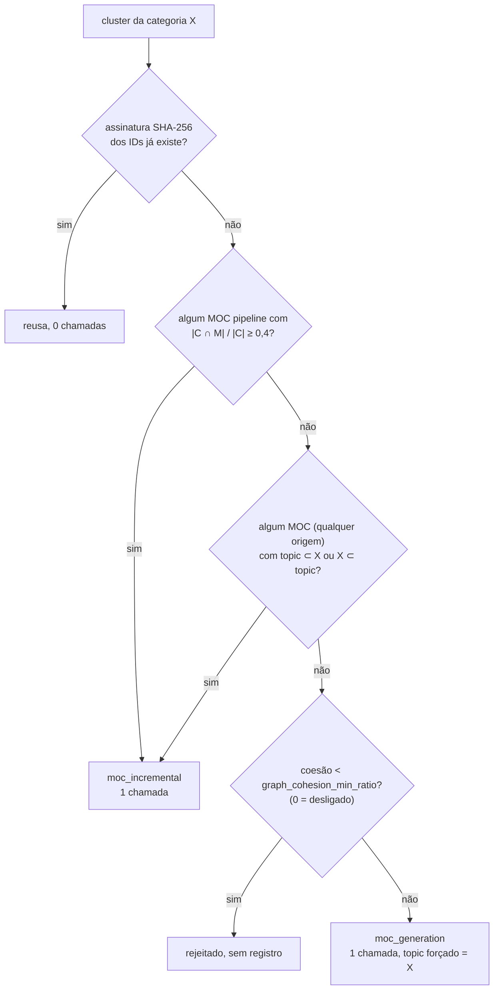
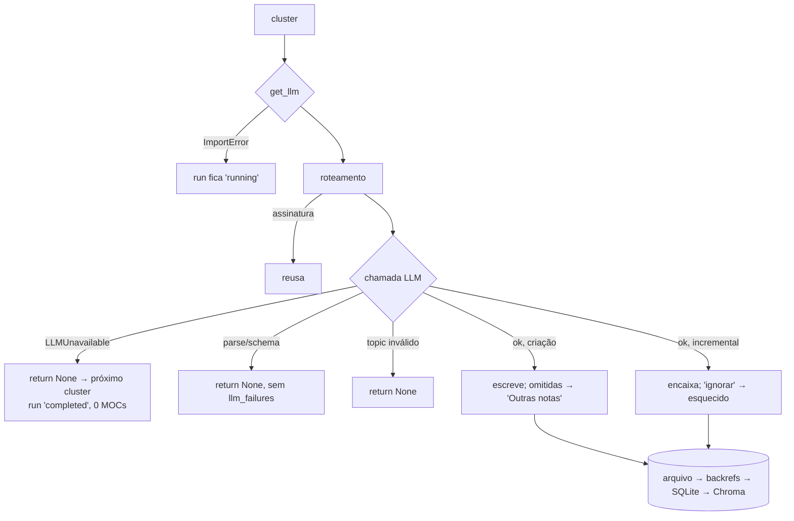
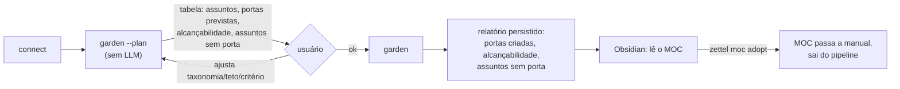

# Garden: um mapa desenhado por quem só leu os títulos — clusterização, taxonomia e LLM na geração de MOCs

> Artigo 5 de uma série sobre o `zettel_app`, um pipeline que transforma PDFs e Markdown em notas permanentes (Zettelkasten) compatíveis com o Obsidian.
> Esta parte cobre a fase **GARDEN** (MOCs taxonômicos e MOCs ancorados em hubs). Versão analisada: branch `epic/279-connect-audit` @ `4a0dd76` (2026-10-19).
> Corpus usado nas medições: 7 fontes, 781 notas permanentes, 2.305 arestas tipadas, 11 MOCs (todos do pipeline taxonômico; nenhum MOC hub), 4 execuções de `garden` entre 2026-09-22 e 2026-10-07.
> Os artigos anteriores estão em [`01-harvest.md`](01-harvest.md), [`02-extract.md`](02-extract.md), [`03-review.md`](03-review.md) e [`04-connect.md`](04-connect.md).
> **Revisão (2026-10-19):** a primeira versão tratava "nota fora de MOC" como defeito. O autor do projeto esclareceu a intenção de design: MOCs e hubs são **portas de entrada**, não índices completos. Os achados #1 e #3, a §4.10 e o plano foram reenquadrados, e a alcançabilidade a partir das portas passou a ser a métrica central. As tarefas estão no épico [#291](https://github.com/ricmed/zettel_app/issues/291).

---

## 0. Resumo (para quem tem pouco tempo)

O `garden` é a última fase do pipeline. Ele pega as notas permanentes que o `connect` escreveu e as organiza em **Mapas de Conteúdo** (MOCs): notas-índice que agrupam notas sobre um tema, divididas em subseções com um resumo no topo. Há dois caminhos:

1. **Pipeline taxonômico** (`zettel garden`): embeda os nomes das categorias de `config/moc_topics.yaml`, atribui cada nota à categoria mais parecida (cosseno), clusteriza **dentro** de cada categoria com UMAP + HDBSCAN e manda cada cluster por uma árvore de roteamento que gasta **no máximo uma chamada de LLM**: criar um MOC novo ou encaixar notas num MOC existente.
2. **Pipeline de hubs** (`zettel garden --hubs`): ranqueia as notas pelo grau ponderado no grafo de `note_connections`, expande a vizinhança de cada hub por BFS e pede ao LLM um MOC "radial" em torno dessa nota.

O desenho tem boas ideias: a taxonomia do usuário vem antes do algoritmo (ADR-019), o HDBSCAN pode deixar uma nota de fora em vez de forçá-la num grupo, o custo por cluster tem teto, e a camada de decisão tipada grava em *shadow* uma segunda opinião sobre a categoria de cada cluster, com uma opção "nenhuma". O custo é irrisório (US$ 0,03 na maior execução).

A intenção do projeto é que um MOC (ou hub) seja uma **porta de entrada**: poucas notas, as mais relevantes, conectadas ou primeiras de um assunto, a partir das quais o leitor navega pelo grafo até as demais. Muitas notas ficam fora dos MOCs por design. Medido assim, o modelo funciona: com só 10 notas de entrada por MOC, 92,4% do acervo fica a até dois saltos. Mas o código faz o contrário da intenção em pontos importantes: força toda nota do cluster a entrar no MOC, deixa assuntos inteiros sem porta e depende de um grafo que, depois do #279, quase não é percorrível sem revisão humana.

| # | Achado | Gravidade | Evidência |
|---|--------|-----------|-----------|
| 1 | **O código incha os MOCs à força, contra a intenção de porta de entrada.** Toda nota do cluster que o LLM não posicionou vai para "Outras notas do cluster": 226 das 465 entradas (48,6%). "Sistemas Autônomos" tem 124 notas, 104 delas numa lista sem comentário. Não há critério de seleção das notas de entrada, nem teto, nem ADR que registre a intenção. Os prompts recebem **só os títulos** e o resumo nunca é reescrito. | **Alta** | Corpo dos 11 MOCs + alcançabilidade |
| 2 | **A atribuição por cosseno ao rótulo da categoria erra de forma sistemática, e o *shadow* já mostra isso.** O rótulo embedado é só `"{pilar}: {categoria}"`, sem os tópicos-folha. "Prompt Engineering" é folha de "Aplicações de LLMs", mas as notas de *prompt engineering* caíram em "Processamento de Linguagem Natural"; notas sobre **autonomia kantiana** caíram em "Sistemas Autônomos" (agentes de IA, uso de ferramentas). O modelo tipado (Jev) concorda com o argmax em **9 de 22** clusters, e a categoria "Aplicações de LLMs" não tem MOC, embora o acervo tenha 184 notas de *prompt engineering*. | **Alta** | `decision_shadow` (22 linhas) + taxonomia |
| 3 | **O roteamento por categoria deixa assuntos sem porta e acumula outros num MOC só.** O primeiro cluster de uma categoria cria o MOC; os seguintes caem em `find_moc_by_topic` e viram atualização incremental de um MOC cujo resumo foi escrito para o primeiro. As notas marcadas `"ignorar"` não são registradas e voltam ao LLM a cada execução. Os clusters de *prompt engineering* foram rejeitados assim, e o assunto ficou sem porta: só 44 das 154 notas do livro estão a um salto de alguma nota de entrada. | **Alta** | Código + `decision_shadow` + alcançabilidade por fonte |
| 4 | **A clusterização não é reprodutível.** O UMAP roda sem `random_state`. Reexecutando o mesmo código sobre os mesmos vetores, o ARI entre execuções fica entre 0,36 e 0,69 e a fração de clusters idênticos entre 0% e 38%. A assinatura do cluster (SHA-256 dos IDs) é a primeira porta "custo zero" do roteamento e praticamente nunca casa: na execução de 2026-10-07, os 22 clusters geraram 22 chamadas. O ruído do HDBSCAN dentro de um bucket varia de 15% a 61% conforme a semente. | **Alta** | Reexecução de `_cluster_embeddings` (5×) |
| 5 | **Um MOC manual ou hub pode ser sequestrado pelo pipeline taxonômico e depois apagado.** `find_moc_by_topic` procura em **todos** os MOCs (manuais e hub incluídos) por substring nos dois sentidos. Se um casar, `_update_existing_moc` reescreve o arquivo inteiro (`safe_write_note`, sem blocos gerenciados) e grava `origin='pipeline'` no SQLite. O próximo `garden --recreate` apaga esse arquivo do disco. Latente: o acervo não tem MOC manual nem hub. | **Alta (latente)** | Leitura de código |
| 6 | **O `garden` engole a indisponibilidade do LLM.** Cada chamada está num `except Exception` que devolve `None`: com o provedor fora, todos os clusters falham, nenhum MOC é escrito e o `run` é gravado `completed`. É o oposto do ADR-059, que vale para harvest, extract, review, imagens e connect. Uma exceção fora desse `try` (por exemplo, `get_llm` sem o pacote) deixa o `run` em `running`. | Média–Alta | Leitura de código |
| 7 | **Depois do #279, as portas de entrada ficam sem caminho.** O `connect` agora grava arestas de LLM como `proposed`, e grau e travessia só contam arestas aceitas, derivadas ou manuais. Simulando `--hubs`: com o grafo atual, 15 hubs cobrindo 274 notas; só com as arestas que entram sem revisão (189 `corroborates`), 3 hubs e 26 notas. Para os MOCs, a alcançabilidade a dois saltos a partir de 10 entradas por MOC cai de 92,4% para 23,9%. | **Alta** | Simulação com `expand_notes` + alcançabilidade |
| 8 | **Métricas e portões sem calibração.** A "coesão de grafo" é documentada como escala 0..1 e não é (é a soma dos pesos internos dividida pelo número de notas: 0,33 a 2,15 no acervo). Os termos TF-IDF enviados ao LLM e ao *shadow* têm de 3 a 6 *stopwords* em 10 (`de`, `em`, `como`). A validação do `topic` aceita "IA" por estar contido em "Confiabilidade". `overlap_threshold` (0,4) e `min_notes_for_moc` (10) nunca foram medidos; o segundo descarta todo cluster de 5 a 9 notas que o HDBSCAN aceitou com `min_cluster_size=5`. | Média | Código + medição |
| 9 | **O que o `garden` grava ninguém lê, e o que importa não é gravado.** A coleção Chroma `mocs` é escrita a cada MOC e nunca consultada (o mesmo argumento que removeu `literature_notes`). Já as estatísticas da execução (incrementais, criados, assinaturas, rejeitados, notas ignoradas) vão só para o log, e nada calcula a métrica que importa: a alcançabilidade a partir das portas. A assinatura no *frontmatter* fica desatualizada em 5 dos 11 MOCs. | Baixa–Média | Código + `state.db` |
| 10 | **Os MOCs só crescem.** Uma nota que muda de cluster nunca sai do MOC antigo; 10 notas estão em dois MOCs ao mesmo tempo. Não há remoção, rebalanceamento nem detecção de MOC obsoleto: a única saída é `--recreate`. | Média | Corpo dos MOCs |

O que está **bem feito**: inverter a ordem clássica "clusteriza e depois rotula" para "a taxonomia do usuário primeiro"; aceitar ruído (nota fora de MOC) em vez de forçar pertencimento; separar pipelines por `origin` com purga independente; reconstruir os `auto-moc-backrefs` a partir do corpo do MOC (diferença entre o corpo antigo e o novo); resolver as referências do LLM por *alias* (`N1`, `N2`…) com correção de *typo* por distância de edição 1 e nunca aceitar um ID fora do cluster; o teto de vizinhos do MOC hub (`max_neighbors`), que já é uma porta de entrada enxuta; e, principalmente, medir a categoria em *shadow* com uma opção `none`, que o argmax não consegue expressar. Os MOCs também são, em termos de grafo, **coesos de verdade**: a coesão de cada um fica de 5,7 a 37,6 desvios-padrão acima de conjuntos aleatórios do mesmo tamanho.

---

## 1. O problema que o garden resolve — e por que ele é difícil

No arquivo de Luhmann, as entradas não ficavam soltas: havia notas de estrutura que listavam, com uma linha de comentário, as fichas que tratavam de um tema e as sequências que partiam dali. Nick Milo, no método *Linking Your Thinking*, chama esse papel de **Mapa de Conteúdo** e insiste num ponto: um MOC não é um índice, é um mapa. Quem o faz é um cartógrafo, não um bibliotecário. Ele surge quando as notas de um tema "apertam" e a pessoa precisa de um lugar para pensar sobre a relação entre elas.

Automatizar isso significa resolver, em cadeia, quatro problemas que a literatura trata separadamente:

1. **Particionar** um conjunto de textos sem saber quantos grupos existem (clusterização). Não há uma resposta certa: a "melhor" partição depende da escala que o leitor quer.
2. **Rotular** cada grupo com um nome que o leitor reconheça (*topic labeling*). Rótulos automáticos tendem a ser listas de palavras; rótulos de LLM tendem a ser genéricos.
3. **Estruturar** cada grupo em subtemas e escrever uma frase sobre o que une as notas. Isso exige ler as notas, não só os títulos.
4. **Manter** a organização estável enquanto o acervo cresce. Um MOC que muda de forma a cada execução não serve de mapa: o leitor perde a referência.

O quarto problema é o mais esquecido. Quase toda a literatura de *topic modeling* trata de um corpus fechado; um Zettelkasten é um corpus que cresce por anexação, e cada execução do `garden` é uma reclusterização de tudo.

### A intenção de design: porta de entrada, não índice completo

O `zettel_app` não quer que um MOC liste todas as notas de um assunto. A intenção, confirmada pelo autor, é que MOCs e hubs sejam **portas de entrada**: as notas mais relevantes, mais conectadas ou primeiras de um assunto, com base no que a taxonomia mapeia, a partir das quais o leitor navega pelo grafo. Muitas notas ficam de fora por design, e um assunto grande deve ser dividido em vez de virar uma lista enorme. Isso é coerente com Milo (o MOC é um mapa, não um índice) e com o próprio Zettelkasten, em que a navegação é feita pelas ligações.

Essa intenção muda a métrica. Não importa a **cobertura** (quantas notas estão listadas), e sim a **alcançabilidade**: dada a lista $P$ de notas de entrada e o grafo percorrível $G$ (não direcionado),

$$
R_k(P) = \frac{\left|\{\, n : d_G(n, P) \le k \,\}\right|}{N},
$$

a fração das $N$ notas a no máximo $k$ saltos de alguma porta. O complemento é o número de **assuntos sem porta**: assuntos com notas suficientes e nenhuma nota de entrada. Nenhuma dessas duas medidas é calculada hoje pelo sistema, e a intenção não está registrada em nenhum ADR: o que está documentado é só que o ruído do HDBSCAN fica fora dos MOCs.

### Onde o garden se encaixa

O MOC tem quatro consumidores: o leitor no Obsidian (corpo e *backrefs*), o `ask` (pelas linhas de `topic_index_terms` do escopo MOC, ADR-036), o `article` (que procura um MOC pelo tema e injeta as notas dele no contexto) e o `zettel skill` (que exporta um MOC como pacote de agente). A coleção Chroma `mocs` não tem consumidor.

---

## 2. Metodologia

- **Lido**: `zettel/gardener.py`, `zettel/gardener_assign.py`, `zettel/gardener_hub.py`, `zettel/moc_backrefs.py`, `zettel/graph.py`, `zettel/taxonomy.py`, `zettel/state/mocs.py`, `zettel/state/connections.py` (`edge_weight`, `edge_is_traversable`, `get_weighted_note_degrees`), `zettel/decision/shadow.py` e `sites.py` (`moc_category`), os quatro prompts `prompts/moc_*.md`, `zettel/schemas.py` (saídas de MOC), `zettel/sync.py` (`_sync_moc`), `zettel/rebuild.py`, `zettel/article_graph/search.py` (`apply_moc_boost`), `zettel/cli/synthesis.py`, `zettel/cli/pipeline.py`, os *handlers* de `garden` e `run_all` em `zettel/web_app.py`, `config/config.yaml`, `config/moc_topics.yaml`, os testes `tests/test_gardener*.py` e `tests/test_moc_backrefs.py`, `docs/pipeline.md`, o README e os ADRs 009, 019, 020, 021, 036, 045, 055 e 059.
- **Medido (somente leitura)**: `data/state.db` aberto com `mode=ro` — MOCs, notas, arestas, execuções e as 22 linhas `moc_category` de `decision_shadow`; uma **cópia** de `data/chroma/` no diretório temporário, de onde li os 781 vetores. Reexecutei `gardener_assign._cluster_embeddings` (o código do projeto, com a configuração do `config.yaml`) cinco vezes sobre os mesmos vetores. Simulei o pipeline de hubs com `graph.expand_notes` e `gardener_hub.dedup_hub_neighborhoods` sobre um adaptador somente leitura do grafo. Calculei Louvain, modularidade, silhueta, ARI e NMI com `networkx` e `scikit-learn`.
- **Não verificado**: não fiz chamada de LLM nem de embedding. Por isso **não reconstruí os buckets por categoria**: isso exigiria embedar os 40 rótulos. A estabilidade dentro de um bucket foi medida sobre os membros de cada MOC, que são um subconjunto do bucket real. As respostas do LLM do `garden` não são cacheadas (`call_llm`, não `cached_call_llm`), então não pude ler os prompts e respostas reais; os tamanhos de prompt são reconstruídos a partir dos *templates*.
- **Uma ressalva sobre o grafo**: o `state.db` medido é anterior à coluna `status` de `note_connections` (introduzida em `49d091a`, que exige `init --reset`). Todas as 2.116 arestas de LLM do acervo eram percorríveis quando os MOCs foram gerados. A §4.9 simula o que o código atual veria depois do *reset*.

> Nenhuma linha de código, configuração ou documentação existente do projeto foi alterada para produzir este artigo.

---

## 3. Visão geral da fase

### 3.1 O pipeline taxonômico de ponta a ponta

### 3.2 A árvore de roteamento (ADR-021)

A garantia de "no máximo uma chamada por cluster" é real. O que a medição mostra é que o primeiro ramo (custo zero) quase nunca é tomado (§4.3) e que o terceiro ramo transforma "um MOC por cluster" em "um MOC por categoria" (§4.5).

### 3.3 Ciclo de vida de um MOC

```mermaid
stateDiagram-v2
    direction LR
    [*] --> criado: moc_generation
    criado --> crescido: moc_incremental<br/>(só acrescenta)
    crescido --> crescido: nova execução
    criado --> apagado: --recreate
    crescido --> apagado: --recreate
    apagado --> [*]
    note right of crescido: notas nunca saem;<br/>resumo nunca é reescrito;<br/>"ignorar" não é lembrado
```

### 3.4 O que a fase custou

| Medida | Valor |
|---|---|
| Execuções de `garden` | 4 (todas `completed`); `garden --hubs` nunca executado |
| MOCs existentes | 11, todos `origin='pipeline'` |
| Maior execução (2026-10-07) | 22 clusters, 9 MOCs criados, 13 atualizações incrementais, 0 reaproveitados por assinatura |
| Custo dessa execução | US$ 0,028 (LLM) + US$ 0,0004 (embedding dos rótulos) |
| Tokens de entrada | 266 mil, dos quais **200,8 mil (75%) são do *shadow* Jev** (22 perguntas de ~8,5 mil tokens) |
| Prompt de geração | ~2 mil caracteres de instruções + 4,7 mil de taxonomia + lista de títulos (mediana de 61 caracteres por título) |
| Modelo | `gpt-6-luna`, `thinking: none`, sem cache SQLite |

Assim como no `connect`, o problema não é dinheiro. A medição de *shadow* custa três vezes mais tokens que a própria fase, o que é aceitável para uma medição e uma boa razão para que ela termine com uma decisão (§7).

---

## 4. Etapa por etapa

### 4.1 Entrada e guardas

`run_garden` abre um `run`, purga os MOCs se `--recreate`, e só **depois** confere a taxonomia (`resolve_allowed_topics` com `strict_topics: true`). A ordem importa: um YAML quebrado com `--recreate` apaga os MOCs e falha antes de gerar os novos. Depois, lê do Chroma todos os vetores de `permanent_notes` (781 × 1536, `gemini-embedding-2`, normalizados).

Os dois mínimos que governam o resto:

- `min_cluster_size: 5` — o `min_cluster_size` do HDBSCAN e o piso de notas para tentar clusterizar;
- `min_notes_for_moc: 10` — o piso para um bucket ser clusterizado e para um cluster virar MOC.

O `config.yaml` sobe o segundo para 10 (o default do schema é 3) e mantém o primeiro em 5. A consequência não está documentada: o HDBSCAN aceita clusters de 5 a 9 notas, e o código os descarta logo depois. O ramo `if len(emb) < min_cluster` de `cluster_notes_within_buckets` (bucket pequeno vira um cluster só) é inalcançável, porque buckets com menos de 10 notas já foram pulados.

### 4.2 Atribuição taxonomia-first

Cada categoria $c$ vira um texto pelo *template* `"{pilar}: {categoria}"` (por exemplo, `"IA Generativa, NLP e Agentes: Aplicações de LLMs"`), embedado com o mesmo modelo das notas. Cada nota $x$ vai para

$$
c^*(x) = \arg\max_{c \in C} \cos(\mathbf{e}_x, \mathbf{e}_c), \qquad |C| = 40.
$$

Três propriedades dessa regra explicam os erros medidos:

1. **Não há limiar.** Toda nota recebe uma categoria, mesmo que a melhor tenha cosseno baixo. O ADR-019 cita como vantagem "deixar notas ambíguas de fora", mas isso só vale para o HDBSCAN, um passo depois; a atribuição força pertencimento.
2. **O rótulo não carrega os tópicos-folha.** A taxonomia tem três níveis (pilar > categoria > tópicos), e os tópicos vão para o prompt do LLM, mas não para o texto embedado. "Prompt Engineering", "RAG" e "Chunking Strategies" são folhas de "Aplicações de LLMs"; o vetor dessa categoria não sabe disso.
3. **Rótulo curto contra documento longo.** Um rótulo de seis palavras e uma nota de vários parágrafos ocupam regiões diferentes do espaço de embedding (o problema clássico de assimetria consulta/documento; o Gemini tem lados diferentes para isso e o `embed_texts` usa o lado documento para os dois). O argmax passa a depender de coincidência lexical com o nome da categoria.

#### Achado #2 — o argmax confunde "autonomia" com "agente autônomo"

O MOC "Sistemas Autônomos" (categoria cujos tópicos são *Agentes de IA, Orquestração, Uso de Ferramentas, Memória*) tem 124 notas, e o resumo escrito pelo LLM fala de "interseção entre inteligência artificial e filosofia". As notas são sobre **autonomia kantiana**, mecanicismo cartesiano e "prisão da calculabilidade": 56% vêm de *Kant and Artificial Intelligence* (Kim, 2022). A palavra "autônomos" no rótulo atraiu um tema de filosofia moral. A taxonomia tem a categoria certa ("Agência, Autonomia e Decisão", no pilar "Problemas Transversais"), mas ela concorre com um rótulo que compartilha o radical.

O mesmo acontece com *prompt engineering*. As 184 notas dos dois livros sobre o tema (`@PromptEngineering`, `@IniciandoComPromptEngineering`) não têm MOC próprio; as que entraram estão em "Processamento de Linguagem Natural" e "Modelos de Linguagem". A categoria que as descreve, "Aplicações de LLMs", não tem MOC.

A camada de decisão tipada já mediu isso. O *shadow* `moc_category` pergunta ao Jev, para cada cluster, qual categoria (com os tópicos-folha no critério) melhor descreve o grupo, com três permutações da ordem das opções:

| Bucket do argmax | Clusters | Jev concorda | Escolha do Jev quando discorda (confiança) |
|---|---|---|---|
| Processamento de Linguagem Natural | 7 | 0 | Aplicações de LLMs (0,59–1,00) ×5; Modelos de Linguagem (0,46); Deploy e Serving (0,90) |
| Mente, Cognição e Representação | 3 | 1 | Epistemologia (0,60; 0,75) |
| Sistemas Autônomos | 2 | 1 | Mente, Cognição e Representação (0,91) |
| Epistemologia | 3 | 2 | Mente, Cognição e Representação (0,95) |
| Agência, Autonomia e Decisão | 2 | 1 | Ética Aplicada e Responsabilidade (0,61) |
| Modelos de Linguagem | 1 | 0 | Aplicações de LLMs (0,54) |
| Fundamentos Neurais, Avaliação de Modelos, Ética Normativa, Filosofia Política | 4 | 4 | — |
| **Total** | **22** | **9 (41%)** | |

Duas leituras cuidadosas. Primeiro, isso **não** prova que o Jev está certo: não há rótulo humano para `moc_category` (o exportador de planilha cega existe, mas não há rótulos nem resultado registrado em `evals/`). Segundo, a direção dos desacordos é consistente e plausível ao ler as notas: o Jev tem acesso aos tópicos-folha, o argmax não. A concordância de cópias (`copy_agreement`) foi 1,0 em todas as 22 perguntas, e a probabilidade de `none` nunca passou de 0,01, o que sugere que a taxonomia cobre o acervo e o problema está na atribuição, não no catálogo.

### 4.3 Clusterização: UMAP + HDBSCAN dentro de cada bucket

Dentro de cada bucket com pelo menos 10 notas, `_cluster_embeddings` faz:

1. **UMAP** com `metric="cosine"`, `n_neighbors = min(15, n-1)`, `n_components = min(5, n-2)` e `init="spectral"`. O UMAP constrói um grafo k-NN difuso em que a pertinência de $x_j$ à vizinhança de $x_i$ é
   $$w_{ij} = \exp\!\left(-\frac{\max(0,\, d(x_i,x_j) - \rho_i)}{\sigma_i}\right),$$
   com $\rho_i$ a distância ao vizinho mais próximo e $\sigma_i$ calibrado para que $\sum_j w_{ij} = \log_2 k$. As duas direções são unidas por $w = w_{ij} + w_{ji} - w_{ij}w_{ji}$, e a projeção em 5 dimensões minimiza a entropia cruzada entre esse grafo e o grafo equivalente no espaço reduzido, por descida de gradiente estocástica com amostragem negativa.
2. **HDBSCAN** euclidiano sobre a projeção, com `min_cluster_size=5`. A distância de alcance mútuo
   $$d_{\text{mreach}}(a,b) = \max\{\text{core}_k(a),\, \text{core}_k(b),\, d(a,b)\}$$
   (com $\text{core}_k$ a distância ao $k$-ésimo vizinho) define uma árvore geradora mínima; cortando-a em todos os níveis de densidade $\lambda = 1/d$ e condensando-a, o HDBSCAN escolhe os clusters de maior estabilidade $\sum_{p}(\lambda_p - \lambda_{\text{nasc}})$. Pontos que não pertencem a nenhum cluster estável recebem o rótulo $-1$ (ruído).
3. Sem `umap`/`hdbscan` instalados, ou se o UMAP falhar, **KMeans** com $k = \max(2, \lfloor n/5 \rfloor)$, que não tem ruído: força toda nota num cluster. O ADR-019 deixa em aberto se isso é aceitável; o código só registra um *warning*.

É a mesma receita do BERTopic (embedding → UMAP → HDBSCAN → representação), aplicada por categoria. A receita é boa. O problema está num parâmetro que falta.

#### Achado #4 — sem semente, cada execução é outra partição

A chamada `umap.UMAP(...)` não recebe `random_state`. A documentação do `umap-learn` é explícita: sem semente fixa (e com otimização multi-thread), o resultado não é reprodutível. Reexecutei o próprio `_cluster_embeddings` cinco vezes sobre os mesmos vetores:

| Conjunto | n | Clusters por execução | Ruído | ARI médio entre pares | Clusters idênticos entre pares |
|---|---|---|---|---|---|
| Acervo inteiro (caminho global) | 781 | 16, 32, 16, 16, 16 | 2–17% | 0,66 | 37,8% |
| Membros do MOC "Sistemas Autônomos" | 124 | 6, 6, 6, 6, 6 | 18–20% | 0,69 | 8,3% |
| Membros de "Ética Normativa e Metaética" | 81 | 3–4 | 15–31% | 0,54 | 10,8% |
| Membros de "Agência, Autonomia e Decisão" | 61 | 3–4 | 41–61% | 0,36 | 0% |
| Membros de "Processamento de Linguagem Natural" | 41 | 2–3 | 17–34% | 0,41 | 0% |

O ARI (*Adjusted Rand Index*) compara duas partições contando pares de pontos que ficam juntos ou separados nas duas, corrigido pelo acaso: 1 é identidade, 0 é o esperado ao acaso. Valores entre 0,36 e 0,69 significam partições parecidas, mas não iguais. A última coluna é a que importa para o roteamento: a assinatura de um cluster é $\text{SHA-256}(\text{IDs ordenados})$, e qualquer nota a mais ou a menos muda o *hash*. Dentro de um bucket, a chance de um cluster se repetir exatamente entre duas execuções sobre **o mesmo acervo** fica entre 0% e 11%. Com uma nota nova, cai a zero.

Na prática, o primeiro ramo da árvore de roteamento (custo zero) é decorativo, e a estabilidade dos MOCs depende inteiramente do terceiro ramo (categoria já tem MOC), com as consequências da §4.5. O ruído também oscila: numa execução, 41% das notas de um bucket ficam fora de qualquer MOC; na seguinte, 61%.

Há uma segunda consequência, mais sutil: o *shadow* `moc_category` usa a mesma assinatura como chave (`subject_id`) para reaproveitar respostas. Como os clusters mudam, o reaproveitamento também quase nunca acontece, e é isso que faz o *shadow* custar 75% dos tokens.

### 4.4 Termos representativos (TF-IDF)

`_extract_cluster_terms` monta um `TfidfVectorizer(max_features=10, stop_words=None)` sobre os **títulos** das notas do cluster e devolve o vocabulário. Três problemas, todos verificáveis reproduzindo a função:

1. **Sem *stopwords*.** O projeto tem uma lista PT-BR (`search_terms.PT_STOPWORDS`, usada no FTS5 e no índice de tópicos), mas ela não é passada aqui. Em todos os 11 MOCs, de 3 a 6 dos 10 termos são palavras funcionais. "Sistemas Autônomos": `artificial, cognitiva, como, da, de, do, em, entre, inteligência, kantiana`.
2. **`max_features` ordena por frequência, não por TF-IDF.** O parâmetro do scikit-learn mantém os termos mais frequentes do corpus, que num corpus de títulos são justamente as palavras funcionais.
3. **O IDF é calculado dentro do cluster.** Um termo que aparece em todas as notas do cluster recebe o menor IDF, que é o contrário do que um rótulo precisa. O que se quer é distintividade **entre** clusters, a ideia do c-TF-IDF do BERTopic:
   $$W_{t,c} = \text{tf}_{t,c} \cdot \log\!\left(1 + \frac{A}{f_t}\right),$$
   com $\text{tf}_{t,c}$ a frequência do termo no cluster (tratado como um documento), $f_t$ a frequência no corpus inteiro e $A$ o número médio de palavras por cluster.

Esses termos entram no prompt de geração ("Termos representativos do cluster") e no estado do *shadow* (`frequent_terms`). O efeito é pequeno, porque o LLM lê os títulos de qualquer forma, mas é ruído pago em tokens e enviado como se fosse sinal.

### 4.5 Roteamento: de "um MOC por cluster" a "um MOC por categoria"

#### Achado #3 — o terceiro ramo deixa assuntos sem porta

Siga um bucket com três clusters, $C_1, C_2, C_3$, numa execução sem MOCs:

1. $C_1$: nenhuma assinatura, nenhum *overlap*, nenhum MOC com o nome da categoria → `moc_generation`. O código **sobrescreve** o `topic` do LLM com o nome da categoria (`moc_output.topic = suggested`). Nasce o MOC "X", com resumo e subseções escritos para $C_1$.
2. $C_2$: `find_moc_by_topic("X")` encontra o MOC recém-criado → `moc_incremental`, que mostra ao LLM o resumo de $C_1$ e pede para encaixar as notas de $C_2$ nas subseções existentes, criar subseções novas ou responder `"ignorar"`.
3. $C_3$: idem.

A clusterização dentro da categoria, cujo propósito declarado no ADR-019 é "subdividir um bucket já relevante em subtemas coerentes", vira apenas uma forma de fatiar as chamadas incrementais. Pior: o prompt incremental orienta "NAO force notas em subseções inadequadas", então um sub-cluster que o argmax pôs na categoria errada (§4.2) é corretamente rejeitado pelo LLM, e as notas somem:

- As notas marcadas `"ignorar"` entram em `placed` e **não** vão para a subseção de reconciliação. Não ficam registradas em lugar nenhum.
- A assinatura do MOC é atualizada para a do cluster que acabou de passar, mesmo que nenhuma nota tenha entrado.
- Na próxima execução, essas notas continuam fora do MOC, então são `truly_new` de novo, e o LLM é perguntado de novo. Para sempre.

No acervo, o bucket "Processamento de Linguagem Natural" teve 7 clusters na execução de 2026-10-07, com tamanhos de pelo menos 20, 14, 20, 20, 10, 15 e 14 notas (o estado do *shadow* corta em 20). São pelo menos 113 notas; o MOC tem 41, parte delas da execução de 2026-10-05.

No modelo de porta de entrada (§1), deixar notas de fora não é o problema. O problema é **qual** assunto fica sem porta. A tabela compara, por fonte, as notas listadas em algum MOC hoje com as notas alcançáveis a um salto de uma seleção enxuta (as 10 notas de maior grau interno de cada MOC, 108 no total):

| Fonte | Notas | Listadas em algum MOC | A 1 salto das 10 entradas por MOC |
|---|---|---|---|
| Kim 2022 — *Kant and Artificial Intelligence* | 389 | 225 (58%) | 231 (59%) |
| Hui 2026 — *Kant Machine* | 159 | 142 (89%) | 133 (84%) |
| *Prompt Engineering* | 154 | 31 (20%) | **44 (29%)** |
| Huang 2021 — *Towards Reasoning* | 30 | 30 (100%) | 29 (97%) |
| *Iniciando com Prompt Engineering* | 30 | 8 (27%) | **21 (70%)** |
| Latorre 2021 — *Análise de séries temporais* | 18 | 18 (100%) | 18 (100%) |
| Mueller 2020 | 1 | 1 (100%) | 1 (100%) |
| **Total** | **781** | **455 (58,3%)** | **477 (61,1%)** |

Com um quarto das entradas, a seleção enxuta alcança, a um salto, mais notas do que as listas completas de hoje, e chega a 92,4% do acervo a dois saltos (§4.10). A exceção é o livro *Prompt Engineering*: 29% a um salto, porque o assunto dele ("Aplicações de LLMs") não tem MOC. Os dois livros do tema são justamente os que o argmax pôs na categoria errada (§4.2) e cujos clusters o incremental rejeitou. A documentação atribui as notas fora de MOC ao "ruído do HDBSCAN"; aqui, a maior parte são clusters que o HDBSCAN encontrou e o roteamento descartou, e o efeito que importa é um assunto inteiro sem porta.

O mesmo mecanismo produz o efeito oposto num assunto que cabe na categoria: os sub-clusters se acumulam num MOC só, que incha ("Sistemas Autônomos", §4.6). Num modelo de porta de entrada, um assunto grande deveria ser dividido em sub-MOCs (um MOC de MOCs), com poucas entradas em cada.

#### Achado #5 — `find_moc_by_topic` atravessa as origens

`StateDB.find_moc_by_topic` percorre `list_mocs()` (todas as origens, do mais novo para o mais antigo) e devolve o primeiro cujo tópico contém o nome da categoria ou está contido nele. Não filtra `origin`. Já `find_moc_by_note_overlap`, o ramo anterior, filtra `origin == 'pipeline'`. A assimetria abre um caminho de perda de dados:

1. O usuário cria um MOC manual chamado "Epistemologia" (`zettel new-note moc`, `sync-manual`), ou o pipeline de hubs gera um MOC de tópico livre, por exemplo "Epistemologia kantiana e os limites da IA".
2. O próximo `garden` tem um cluster no bucket "Epistemologia". `find_moc_by_topic` devolve o MOC manual (ou hub).
3. `_update_existing_moc` reconstrói o corpo a partir de `_parse_moc_structure` e chama `safe_write_note`, que **reescreve o arquivo inteiro**. Sobrevive o que o *parser* reconhece: o resumo entre o H1 e o primeiro H2, os títulos de subseção, as linhas de descrição e as linhas `[[ZTL - …]]`. Listas com outros links (LIT, SRC, outros MOCs), *callouts* e imagens somem.
4. `db.upsert_moc(..., origin="pipeline")` muda a origem no SQLite. O *frontmatter* do arquivo continua dizendo `origin: manual`.
5. O próximo `garden --recreate` chama `delete_pipeline_mocs()`, que seleciona por `origin` no SQLite, e apaga o arquivo do disco.

O substring nos dois sentidos amplia a superfície: "Ética" casa com "Ética Normativa e Metaética" e com "Ética Aplicada e Responsabilidade". O mesmo `find_moc_by_topic` é usado pelo `article` para o "MOC boost", com o tema livre que o usuário digitou: um artigo sobre "IA" casa com qualquer MOC cujo nome contenha "ia" (*Avaliação*, *Agência*, *Epistemologia*…). Nenhum teste cobre um MOC não-pipeline nesse caminho. O acervo não tem MOC manual nem hub, por isso o achado é latente.

O ADR-021 lista como *driver* "atualizações incrementais devem preservar edições do usuário". O código preserva a estrutura que ele mesmo gera, não as edições.

#### A coesão de grafo: um portão desligado e mal escalado

O quarto ramo calcula

$$
\text{coesão}(C) = \frac{1}{|C|} \sum_{\{u,v\} \subseteq C,\ (u,v)\in E} w_{r(u,v)},
$$

com $w_r$ o peso da relação (`contradicts` 1,0, `extends`/`depends_on` 0,9, `supports` 0,8, `exemplifies` 0,7, `related` 0,5, `corroborates` 0,45), contando cada par uma vez. A docstring e o `config.yaml` falam em escala 0..1; a fórmula é metade do grau ponderado interno médio e não tem teto. No acervo, os 11 MOCs vão de 0,33 a 2,15. Com `graph_cohesion_min_ratio: 0`, o portão está desligado, então a escala errada não fez estrago ainda. Quem ligar o portão com 0,5 achando que é uma fração rejeita "Fundamentos Neurais" (0,33) sem saber por quê, e a rejeição não deixa registro fora do log.

Dois detalhes adicionais: a coesão só é avaliada para MOCs **novos** (atualizações incrementais passam direto), e ela usa `DEFAULT_RELATION_WEIGHTS`, a constante do código, e não `retrieval.graph_expansion.relation_weights` do `config.yaml`, que o comentário do próprio `config.py` chama de "override operacional". Hoje os valores coincidem.

### 4.6 Geração de um MOC novo

O prompt `moc_generation.md` recebe o domínio, a lista de 40 categorias, a taxonomia completa (4,7 mil caracteres), a lista de notas do cluster como `- **N1**: <título>`, os termos TF-IDF e a categoria sugerida. Pede `topic`, `summary` (2–3 frases), `topic_justification` e subseções com `note_ids`.

O que está bem feito:

- **Aliases curtos** (`N1`, `N2`…) em vez de ULIDs. `_resolve_note_ref` aceita o *alias*, o ULID exato ou um ULID a uma edição de distância (e só se for o único candidato), e descarta qualquer referência fora do cluster. O LLM não consegue inventar uma nota.
- **Wikilinks vêm do código** (`permanent_wikilink` com o nome real do arquivo), nunca do LLM.

O que não está:

1. **Não há seleção de notas de entrada nem teto.** O prompt recebe o cluster inteiro e exige que "**toda** nota listada" apareça numa subseção, e o código reconcilia em "Outras notas do cluster" as que o LLM omitir. É a regra de um índice completo, o oposto da porta de entrada (achado #1, abaixo).
2. **O LLM vê só os títulos.** Para escrever "como estas notas se relacionam neste subtema", ele não recebe tese, definição nem limites. O projeto tem a função certa para isso, `note_content` (usada por todo outro prompt desde o #211); o `garden` não a usa. O prompt de hub usa `body[:800]` cru, o que inclui blocos gerenciados e `## Conexões`, exatamente o que o #211 tirou dos outros prompts.
3. **O `topic` do LLM é descartado.** Com uma categoria sugerida válida, o código a impõe. O prompt ainda pede `topic_justification`, que vai para o lixo. É um campo pago e não lido.
4. **O prompt pede algo que o *schema* não tem.** "Para cada nota listada, inclua uma breve orientação de como ela se encaixa no tema", mas `MOCSubsection` só tem `title`, `note_ids` e `description`. Não há onde pôr a orientação por nota, que é justamente o que distingue um MOC de um índice na definição de Milo.
5. **A validação de tópico é uma substring nos dois sentidos.** Quando o tópico não foi imposto (caminho global, `_unassigned`), `_validate_moc_topic` aceita qualquer resposta contida num nome de categoria ou que contenha um. "IA" passa por seis categorias, porque "Confiabilidade", "Avaliação" e "Metafísica", entre outras, contêm a sequência "ia"; "Dados" passa por três; "Linguagem" por três. E o tópico aceito não é normalizado para o nome canônico, então o MOC pode se chamar "Dados" e ser contado como dentro da taxonomia.

#### Achado #1 — o código incha os MOCs à força

A reconciliação foi escrita para que nenhuma nota do cluster "suma" do MOC. Num índice completo, isso seria uma rede de segurança; numa porta de entrada, é a causa do inchaço. Contando as entradas por MOC:

| MOC | Notas | Em "Outras notas do cluster" |
|---|---|---|
| Sistemas Autônomos | 124 | **104 (84%)** |
| Ética Normativa e Metaética | 81 | **61 (75%)** |
| Agência, Autonomia e Decisão | 61 | **37 (61%)** |
| Epistemologia | 49 | 13 (27%) |
| Processamento de Linguagem Natural | 41 | 6 (15%) |
| Modelos de Linguagem | 20 | 3 (15%) |
| Avaliação de Modelos | 17 | 1 |
| Filosofia Política e Justiça | 10 | 1 |
| Análise Aplicada, Fundamentos Neurais, Mente/Cognição | 62 | 0 |
| **Total** | **465** | **226 (48,6%)** |

O padrão é nítido: os três MOCs mais desestruturados são os que cresceram por atualização incremental (criados e atualizados com segundos de diferença na mesma execução). "Sistemas Autônomos" tem quatro subseções de cinco notas e depois uma lista de 104 títulos sem comentário. O resumo no topo descreve as 20 primeiras. As 20 notas estruturadas funcionam, na prática, como a porta de entrada, mas são uma porta ruim: das 104 restantes, só 29% estão a um salto delas e 66% a dois. Essas 20 foram escolhidas pelo LLM a partir dos títulos, não por centralidade. Nos MOCs de ética e de epistemologia, onde as notas estruturadas são mais conectadas, de 92% a 100% das notas reconciliadas estão a dois saltos delas, ou seja, listá-las não acrescenta caminho.

O que falta não é organizar melhor as 104 notas, e sim **escolher** as entradas e parar de listar o resto. O projeto já tem os sinais para isso, todos sem LLM: grau ponderado dentro do cluster, proximidade ao medoide (a nota mais representativa), a primeira nota do assunto (menor `chunk_index` na fonte ou `created_at` mais antigo, muitas vezes a definição fundamental que o extract preserva), a corroboração entre fontes e o `relevance_score` do conceito. O `zettel skill` já ranqueia por `relevance_score` + grau ponderado (ADR-035); o garden não usa nada disso. Com um teto por MOC, o LLM recebe só as entradas selecionadas e escreve uma linha de orientação para cada uma.

O código só registra `"MOC incremental: %d nota(s) reconciliada(s)"` no log. Nenhuma métrica persiste e o usuário só descobre o inchaço ao abrir o arquivo.

### 4.7 Atualização incremental

`_update_existing_moc` relê o arquivo do disco (não o SQLite), extrai a estrutura, filtra as notas do cluster que ainda não estão no MOC e chama `moc_incremental.md` com o tópico, o resumo atual, as subseções (com os links das notas que já estão lá) e os títulos das notas novas. A saída é uma lista de `placements` (nota → título exato de subseção, ou `"ignorar"`) e de `new_subsections`.

Propriedades que importam:

- **O resumo nunca é reescrito.** O MOC cresce de 20 para 124 notas e o parágrafo do topo continua o mesmo. O texto embedado no Chroma (`topic + summary`) também.
- **As notas nunca saem.** Uma nota que, numa execução futura, cai noutro bucket ou noutro cluster é acrescentada ao MOC novo e continua no antigo. Há 10 notas em dois MOCs, 6 delas em "Processamento de Linguagem Natural" e "Modelos de Linguagem" ao mesmo tempo. O ADR-019 diz "uma categoria por nota", o resultado acumulado não respeita isso.
- **Título "exato" é exato.** Uma subseção devolvida com outra caixa ou um espaço a mais é descartada em silêncio e a nota vai para a reconciliação. Contribui para o inchaço da tabela acima.
- **A assinatura do *frontmatter* fica velha.** O SQLite recebe a nova `cluster_signature`; o *frontmatter* só ganha `updated_at`. Em 5 dos 11 MOCs, as duas divergem.

### 4.8 Escrita e efeitos colaterais

A ordem de escrita de um MOC novo é: arquivo (`safe_write_note`) → `sync_moc_backrefs` (que escreve um bloco `auto-moc-backrefs` em cada nota listada e reescreve as linhas de `topic_index_terms` do escopo MOC) → `upsert_moc` no SQLite → `upsert_moc` no Chroma. Não há transação, e uma falha no meio deixa o arquivo sem linha no banco (o próximo `garden` não o encontra por assinatura, *overlap* nem tópico, e cria outro MOC com o mesmo tópico e outro ULID).

`sync_moc_backrefs` é uma das melhores peças da fase: compara o conjunto de IDs do corpo antigo com o do novo, adiciona o link do MOC nas notas que entraram e remove das que saíram, sem tocar no resto da nota (`safe_update_managed_blocks`). No acervo, 455 notas têm o bloco, exatamente as 455 que estão em algum MOC.

Os dois efeitos de leitura são desiguais:

- **`topic_index_terms`** é consultado pelo `ask` (ADR-036) e só aceita alvos que são notas permanentes. É o único caminho pelo qual um MOC melhora uma resposta.
- **A coleção Chroma `mocs`** recebe um embedding por MOC criado ou atualizado, e nenhuma linha do projeto a consulta (`index.py` não tem `query_mocs`; o `article` acha MOCs por substring no SQLite). É o mesmo caso que levou à remoção de `literature_notes`.

Edições manuais num MOC do pipeline também caem num vão: `sync-manual` pula arquivos com `origin: pipeline`, então a edição não é reindexada nem reflete nos *backrefs*; a próxima atualização incremental a reescreve parcialmente (§4.5); e `--recreate` a apaga.

### 4.9 O pipeline de hubs

O caminho `--hubs` (ADR-020) é independente da taxonomia:

1. **Grau ponderado** de cada nota: $k_v = \sum_{e \ni v} w(e)$, sobre as arestas percorríveis, com `edge_weight` (relação, ou 0,95 para `origin='manual'`).
2. **Seleção** por percentil: o limiar é o grau na posição $\lfloor (1-0{,}90)(n-1) \rfloor$ do ranking; ficam no máximo `top_n_hubs` (15), mais os hubs que já têm MOC.
3. **Vizinhança** por `expand_notes` (BFS não direcionada, 2 saltos), com peso de caminho $\omega_H = \prod_{h=1}^{H} w_{r_h}\,\text{decay}^{\,h-1}$ (com 2 saltos e decaimento 0,5, $\omega_2 = 0{,}5\, w_{r_1} w_{r_2}$), filtrada por $\omega \geq 0{,}3$ e cortada em 24 vizinhos.
4. **Deduplicação**: do hub de maior grau para o menor, descarta o hub cuja vizinhança $V$ satisfaz $|V \cap V'|/|V| \geq 0{,}8$ para algum hub já aceito $V'$.
5. **Roteamento**: se o hub já tem MOC, incremental; senão, `moc_hub_generation` com tópico livre (sem validação contra a taxonomia).

Nunca foi executado neste acervo, então simulei os passos 1 a 4 com o código do projeto:

| Cenário | Arestas percorríveis | Limiar p90 | Hubs aceitos | Notas cobertas |
|---|---|---|---|---|
| Grafo como está gravado (todas as arestas) | 2.305 | 8,05 | 15 (a dedup não descartou nenhum) | 274 (35%) |
| Código atual após `init --reset`, sem revisar arestas | 189 (`corroborates`) | 1,35 | 3 | 26 (3%) |

No primeiro cenário, todas as 15 vizinhanças batem no teto de 25 notas e são quase só de 1 salto (o hub de maior grau tem 24 vizinhos diretos com peso ≥ 0,3), então `max_hops: 2` e `decay` não têm efeito. A deduplicação, com limiar de 80% de contenção, não pegou dois hubs quase homônimos ("Unificação sintética como condição da cognição em Kant" e "Síntese como condição necessária da cognição em Kant"). O grau é concentrado em Kant: 11 dos 15 hubs vêm do mesmo par de livros (6 de Hui, 5 de Kim).

#### Achado #7 — o #279 tirou o chão do `--hubs`

O épico #279 fez as arestas de LLM entrarem como `proposed` (`linking.llm_edges: propose`), e `edge_is_traversable` exclui arestas propostas do grau e da BFS. É a decisão certa para o `ask` e para o `connect` (o artigo anterior mostrou que essas arestas têm precisão de ~30%). Mas ela muda a semântica do `garden` sem que o `garden` tenha sido revisto:

- o `--hubs` passa a ranquear notas pelo número de `corroborates`, que é um sinal de **convergência entre autores**, não de centralidade argumentativa;
- a coesão de grafo dos MOCs taxonômicos, recalculada só com arestas derivadas, cai para 0,00–0,14, então qualquer `graph_cohesion_min_ratio > 0` rejeitaria quase tudo.

Enquanto a fila de arestas (`zettel links`, `/review?queue=links`) não for usada, o pipeline de hubs não tem grafo para trabalhar. Isso precisa estar no documento do usuário (e no `doctor`), não só implícito em duas funções.

### 4.10 O que os MOCs resultantes são

Juntando as medições:

**Em termos de grafo, os MOCs são coesos.** Comparando a coesão de cada MOC com 300 conjuntos aleatórios do mesmo tamanho, todos ficam muito acima do acaso ($z$ de 5,7 a 37,6), e também acima de conjuntos aleatórios tirados da mesma fonte dominante (por exemplo, "Filosofia Política e Justiça": 1,11 contra 0,10). As notas de um MOC estão de fato ligadas entre si.

**Em termos de embedding, não há separação.** A silhueta (cosseno) da partição por MOC é **0,034**; a da partição por **fonte**, sobre as mesmas notas, é 0,072. A silhueta mede, para cada ponto, $s(i) = (b_i - a_i)/\max(a_i, b_i)$, com $a_i$ a distância média ao próprio grupo e $b_i$ ao grupo vizinho mais próximo; valores perto de zero indicam grupos sobrepostos. O espaço de embedding separa melhor os livros do que os MOCs.

**Comparando com uma partição feita só pelo grafo.** Louvain sobre o grafo ponderado (semente fixa) encontra 13 comunidades com modularidade $Q = 0{,}731$. A modularidade

$$
Q = \frac{1}{2m}\sum_{ij}\left(A_{ij} - \frac{k_i k_j}{2m}\right)\delta(c_i, c_j)
$$

mede quanto peso de aresta fica dentro das comunidades além do esperado num grafo aleatório com os mesmos graus. A partição por MOC (com as notas fora de MOC como singletons) tem $Q = 0{,}231$; a partição por fonte, 0,489. A concordância entre Louvain e os MOCs (NMI 0,45) é parecida com a entre Louvain e as fontes (0,44), e as comunidades de Louvain com 10 ou mais notas têm, em média, 78% das notas de uma única fonte.

A leitura honesta: o grafo do `connect` é fortemente organizado por livro (achado #5 do artigo anterior), e qualquer partição que respeite o grafo vai reproduzir isso. Os MOCs taxonômicos misturam mais as fontes (de 2 a 4 fontes por MOC, salvo "Análise Aplicada", 100% Latorre), o que é exatamente o que um MOC deveria fazer. O preço é que a mistura vem da atribuição por cosseno ao rótulo, com os erros da §4.2, e não de um julgamento sobre as notas.

**Alcançabilidade: a métrica do modelo de porta de entrada.** Medi $R_1$ e $R_2$ (§1) para três conjuntos de portas e dois grafos: o grafo como está gravado (todas as 2.305 arestas percorríveis) e o grafo que o código atual percorre depois de `init --reset` sem revisar a fila de arestas do #279 (só as 189 arestas derivadas):

| Notas de entrada | Quantas | Grafo gravado: 1 salto | 2 saltos | Só derivadas: 1 salto | 2 saltos |
|---|---|---|---|---|---|
| Todas as notas listadas hoje | 455 | 85,5% | 98,1% | 62,9% | 66,1% |
| 10 por MOC (maior grau ponderado interno) | 108 | 61,1% | **92,4%** | 19,8% | **23,9%** |
| 5 por MOC | 55 | 47,2% | 87,7% | 11,5% | 16,0% |

Três conclusões:

1. **O modelo de porta de entrada funciona neste acervo.** Com 10 entradas por MOC, um quarto das listas atuais, 92,4% das notas ficam a até dois saltos. MOCs enxutos não perdem alcance; perdem só a lista.
2. **A seleção importa.** As entradas por grau interno alcançam mais do que as notas que o LLM estruturou a partir dos títulos (ver "Sistemas Autônomos" na §4.6). O critério de seleção é uma decisão de design que precisa ser medida, não um detalhe.
3. **A porta de entrada depende do grafo, e o grafo agora depende da revisão humana.** Sem aceitar as arestas propostas (#287), as mesmas 108 portas alcançam 23,9% do acervo. É a mesma dependência do achado #7, agora para os MOCs taxonômicos: depois do #279, o `garden` e a fila de arestas formam um sistema só.

---

## 5. Tratamento de erros e fluxos de exceção

| Situação | O que acontece | Estado depois | Avaliação |
|---|---|---|---|
| Taxonomia ausente ou inválida (`strict_topics: true`) | `TaxonomyLoadError`, `run` = `failed` | Nada escrito | Correto, mas roda **depois** do `--recreate` |
| Menos notas que `min_cluster_size` | `run` = `completed`, lista vazia | Nada escrito | Correto |
| Embedding dos rótulos falha | `warning`, cai para cluster global + categoria dominante | MOCs com outra lógica, sem aviso ao usuário | Fraco: provedor de embedding fora deveria parar a fase |
| `umap`/`hdbscan` ausentes ou UMAP falha | `warning`, KMeans | Toda nota forçada num cluster; nenhuma marca no MOC | Fraco (ADR-019 deixa em aberto) |
| HDBSCAN não acha cluster | Bucket inteiro vira um cluster se ≥ `min_cluster_size` | Um MOC "tudo" para a categoria | Discutível: contradiz "ruído fica de fora" |
| LLM indisponível (transporte, auth, cota) | `except Exception` → `logger.error`, `return None`, próximo cluster | Nenhum MOC; `run` = `completed` | **Ruim**: viola o espírito do ADR-059; o usuário vê "Nenhum MOC" |
| `get_llm` falha (pacote ausente) | Exceção sobe sem `finish_pipeline_run` | `run` fica `running` | Ruim: o mesmo defeito que o ADR-059 corrigiu nas outras fases |
| JSON inválido ou fora do *schema* | `return None` | Cluster ignorado; nada em `llm_failures`; sem cache | Fraco: invisível, e a próxima execução paga de novo |
| Tópico fora da taxonomia (`strict`) | `warning`, `return None` | Sem MOC | Correto, mas a substring deixa passar quase tudo |
| LLM omite notas na criação | Reconciliadas em "Outras notas do cluster" | Nota no MOC, sem estrutura | Ruim: contradiz a intenção de porta de entrada e incha o MOC |
| LLM responde `"ignorar"` no incremental | Nota fora do MOC, assinatura atualizada | Perguntado de novo a cada execução | Deixar de fora é legítimo; o defeito é não registrar a decisão (custo recorrente) e não checar se o assunto ficou sem porta |
| Subseção com título não exato | Nota reconciliada | Idem | Aceitável |
| Arquivo do MOC sumiu | `warning`, incremental pulado | Linha órfã no SQLite; o cluster não gera MOC novo enquanto o tópico casar | Fraco |
| Nota referenciada apagada | Link omitido com `warning` | MOC sem a nota a partir da próxima reescrita | Aceitável |
| Falha entre arquivo e SQLite | Exceção | Arquivo sem linha; MOC duplicado na próxima execução | Fraco: sem transação nem reparo |
| Coesão abaixo do mínimo (se ligado) | `warning`, `return None` | Sem registro | Fraco (ADR-021 pergunta se é aceitável; não é) |

---

## 6. O fluxo do usuário: faz sentido?

O fluxo documentado é: `connect` e depois `garden`, rodado "quando houver notas novas"; `garden --recreate -y` depois de mudar a taxonomia ou o *template* de rótulo; `garden --hubs` como complemento. O `run-all` (CLI e web) chama `garden` no fim, sempre sobre o acervo inteiro.

O que faz sentido:

- **Separar a fase.** O `garden` é barato e idempotente o bastante para ser rodado a qualquer momento, e não interfere nas notas (só no bloco `auto-moc-backrefs`).
- **Purga por origem.** `--recreate` e `--hubs --recreate` não se tocam (salvo o achado #5).
- **A taxonomia como contrato do usuário.** Editar `moc_topics.yaml` é a forma de dizer ao sistema como o acervo deve ser lido.

O que não faz:

0. **A intenção não está escrita.** O usuário (e quem mantém o código) não encontra em lugar nenhum que o MOC é uma porta de entrada e que notas fora dele são esperadas. Sem isso, cada correção tende a empurrar o sistema para o índice completo, que é o que a reconciliação já faz.
1. **Não há como ver o que vai acontecer.** Nenhum `--dry-run`: o usuário não vê a distribuição de notas por categoria, os clusters, o ruído, nem quais clusters seriam criados ou incrementais antes de gastar e escrever. A web não oferece `--recreate`.
2. **O resultado é opaco.** A CLI imprime "MOCs gerados/atualizados: N" e uma lista de ULIDs. O que importa num modelo de porta de entrada (quanto do acervo as portas alcançam, que assunto ficou sem porta) não é calculado; o que existe (notas ignoradas, ruído, clusters descartados por tamanho) fica em memória e morre no log.
3. **"Rode `--recreate` depois de mudar a taxonomia" é a única ferramenta de manutenção**, e ela apaga também as edições manuais nos MOCs do pipeline. Como os MOCs só crescem e nunca rebalanceiam, o usuário acaba precisando dela também quando nada mudou na taxonomia: basta o acervo crescer.
4. **O MOC automático disputa o lugar do MOC do usuário.** Na definição de Milo, o MOC é onde a pessoa pensa sobre o tema. Um MOC gerado é útil como **rascunho** ou como **índice navegável**, mas o sistema não oferece um caminho de "adotar" um MOC gerado (passar a `origin: manual`, sair do controle do pipeline, manter os *backrefs*). Hoje, editar um MOC gerado é perder a edição.
5. **O `--hubs` depende de um estado que o usuário não sabe que precisa produzir** (arestas aceitas na fila do #279). O comentário do `config.yaml` ainda diz "pré-requisito: grafo populado (connect + sync-manual --rebuild-graph)".
6. **O README está desatualizado**: ainda promete um bloco `auto-topic-index` em cada MOC, que a emenda de 2026-09-22 ao ADR-036 removeu.

**Fluxo sugerido** (detalhado em §9):

---

## 7. A ciência por trás das decisões

### 7.1 O que o projeto acertou

- **Taxonomia antes do algoritmo.** O argumento do ADR-019 é sólido: proximidade no espaço de embedding não garante significado taxonômico, e um MOC cujo nome o usuário não reconhece não ajuda a navegar. É a mesma intuição do *zero-shot topic modeling* do BERTopic e do *seeded/guided topic modeling*.
- **Ruído como resposta válida.** HDBSCAN em vez de k-médias fixo é a escolha certa para um acervo em que boa parte das notas é periférica a qualquer tema.
- **O *shadow* com `none`.** Perguntar a um segundo modelo, com probabilidades e permutações de ordem, e incluir uma opção que o argmax não tem, é exatamente o desenho de uma medição que pode mudar uma decisão. O ADR-055 também acerta ao escolher o argmax, e não o `topic` do LLM, como linha de base, porque o código sobrescreve o `topic`.
- **Rede de segurança na saída do LLM.** *Aliases*, correção de *typo* restrita a um único candidato e descarte de IDs fora do cluster garantem que o LLM nunca inventa uma nota. (A reconciliação, que garante que ele não "perde" nenhuma, é justamente o que contradiz a intenção de porta de entrada.)

### 7.2 Onde a mesma ciência ainda não chegou

Nas fases anteriores, o projeto mediu o extract contra um gabarito humano (ADR-050), o review com uma tabela de alcançabilidade (#152), a dedupe e o `corroborates` com planilhas cegas e McNemar (#209, #218, #226). O `garden` não tem nenhuma medição de qualidade:

- **Nenhum rótulo humano.** O exportador cego de `moc_category` existe desde o ADR-055, mas não há rótulos, gabarito nem resultado registrado em `evals/`. As 22 linhas do *shadow* mostram 41% de concordância e ninguém sabe qual lado está certo.
- **Nenhuma métrica de cluster.** Nem silhueta, nem DBCV (o índice de validade para clusterização por densidade de Moulavi et al., 2014, que o pacote `hdbscan` implementa), nem estabilidade entre execuções.
- **Nenhum limiar medido.** `overlap_threshold: 0,4`, `min_notes_for_moc: 10`, `hub_percentile: 0,90`, `min_neighbor_weight: 0,3` e `dedup_subset_threshold: 0,8` são escolhas de projeto, e nenhum ADR registra de onde vieram. O ADR-020 pergunta explicitamente se o `decay` foi medido para hubs; não foi.
- **Nenhuma medição do produto.** As notas de entrada são boas portas para o assunto? Que fração do acervo elas alcançam? Algum assunto ficou sem porta? O resumo descreve o MOC? A primeira e a segunda perguntas são rotuláveis com o mesmo protocolo do #175; a alcançabilidade é uma conta sobre o grafo, sem LLM (§4.10).

O *shadow* tem um custo que só se justifica se terminar numa decisão. Hoje ele consome 75% dos tokens da fase e não tem regra pré-registrada para virar portão. O caminho é o mesmo do #208/#226: gerar a planilha cega (o exportador já estratifica por concordância modelo × argmax), rotular, pré-registrar a regra e decidir.

### 7.3 Por que a ordem "taxonomia → cluster" precisa de uma correção, não de uma reversão

As medições não pedem voltar ao *cluster-then-label*. Elas pedem três ajustes na atribuição:

1. **Representar a categoria pelo que ela contém**, não só pelo nome: embedar `pilar: categoria — tópico1, tópico2, tópico3`, ou embedar cada tópico-folha e tomar o máximo (é a ideia do Lbl2Vec: uma categoria é descrita por várias palavras-chave, não por uma).
2. **Ter limiar**, como o `zeroshot_min_similarity` do BERTopic: nota abaixo do limiar não é atribuída a nenhuma categoria e vai para clusterização livre, cujo MOC recebe um tópico pelo LLM (com validação de verdade) ou fica como "tema emergente" para o usuário decidir.
3. **Permitir pertencimento múltiplo explícito** quando a nota está perto de duas categorias (como faz o *soft clustering* do RAPTOR), em vez de pertencimento múltiplo acidental por acúmulo.

---

## 8. Comparação com abordagens alternativas

| Abordagem | Como agrupa e rotula | O que ofereceria ao `zettel_app` | Custo / risco |
|---|---|---|---|
| **Atual** | argmax cosseno ao rótulo → UMAP+HDBSCAN por bucket → LLM só com títulos | — | Atribuição sem folhas nem limiar; não reprodutível; sub-clusters colapsados; sem seleção de notas de entrada |
| **Seleção por centralidade** (grau, PageRank ou proximidade ao medoide dentro do cluster) | O cluster continua o mesmo; o MOC lista só as $k$ notas mais centrais | É o modelo de porta de entrada: 10 entradas por MOC alcançam 92,4% do acervo a dois saltos (§4.10) | Escolher e medir o critério; depende do grafo percorrível |
| **BERTopic zero-shot** (Grootendorst) | Documento recebe o tópico pré-definido se o cosseno passa de um limiar; o resto é clusterizado normalmente; representação por c-TF-IDF com `CountVectorizer(stop_words=…)` aplicado depois da clusterização | Limiar na atribuição; temas emergentes ao lado dos taxonômicos; termos distintivos sem *stopwords*; `reduce_outliers` para reduzir ruído quando desejado | Biblioteca madura; o limiar precisa ser medido no embedding atual |
| **Predição incremental do HDBSCAN** (`prediction_data=True`, `approximate_predict`, `membership_vector`) | Ajusta uma vez; notas novas são atribuídas aos clusters existentes sem refazer a partição | **Estabilidade**: o MOC deixa de depender de reclusterizar tudo; `membership_vector` dá pertencimento suave | Persistir o modelo (UMAP + HDBSCAN) entre execuções; reajustar só sob comando |
| **Leiden** (Traag, Waltman & van Eck, 2019), hierárquico como no GraphRAG | Comunidades no grafo, com garantia de conectividade (Louvain pode gerar comunidades desconexas); hierarquia de níveis com um resumo por comunidade | Substituto mais robusto do grau + BFS no `--hubs`: comunidades em vez de vizinhanças radiais; níveis = MOC de MOCs | Depende de um grafo confiável, o que, após o #279, exige arestas aceitas |
| **RAPTOR** (Sarthi et al., ICLR 2024) | UMAP + mistura de gaussianas com pertencimento suave; clusteriza recursivamente e resume cada nível | Pertencimento múltiplo explícito; árvore de resumos (MOC de MOCs) | Mais chamadas de LLM; resumos são artefatos de roteamento, não evidência (ADR-047 já tem esse vocabulário) |
| **TopicGPT** (Pham et al., NAACL 2024) | LLM gera tópicos de alto e baixo nível, refina e atribui cada documento com justificativa | Atribuição pelo **conteúdo** (não só pelo título), com tópicos ancorados na taxonomia dada como semente | Uma chamada por nota na atribuição; com 781 notas e um modelo barato, ainda é centavos |
| **LLooM** (Lam et al., CHI 2024) | LLM sintetiza conceitos com critério explícito de inclusão e depois classifica | Subseções com **critério escrito**, que é o que falta para um MOC deixar de ser lista | Mais caro; desenho para análise, não para manutenção contínua |
| **Lbl2Vec** (Schopf et al., 2021) | Categoria representada por várias palavras-chave, documentos atribuídos por similaridade | Usar os tópicos-folha da taxonomia como palavras-chave da categoria | Trivial de adaptar ao embedding atual |
| **MOC manual assistido** (Milo) | O usuário cria o MOC quando sente a necessidade; o sistema sugere notas | Inverter o papel: `garden` propõe candidatos e o usuário adota; o MOC adotado sai do pipeline | Menos automação; mais coerente com o Zettelkasten |

A lição comum: **separar o que é estável do que é julgamento**. A partição deve ser estável (semente, modelo persistido, atribuição incremental); a atribuição de categoria deve ser medida (limiar, folhas, rótulo humano); o MOC deve ser uma **seleção** medida pela alcançabilidade, não uma lista; e a escrita do MOC deve ler as notas, não os títulos.

---

## 9. Plano de correção sugerido

Cada linha corresponde a uma sub-issue do épico [#291](https://github.com/ricmed/zettel_app/issues/291).

| Prioridade | Mudança | Como verificar | Issue |
|---|---|---|---|
| **P0** | `find_moc_by_topic` só para `origin='pipeline'` e por igualdade com o nome canônico da categoria (não substring); `_update_existing_moc` nunca troca a origem de um MOC; o `article` deixa de usar substring livre | Teste: MOC manual "Epistemologia" + cluster da categoria → arquivo intacto, origem intacta, `--recreate` não apaga | [#292](https://github.com/ricmed/zettel_app/issues/292) |
| **P0** | Fail-fast do ADR-059 no `garden` e no `--hubs`: `LLMUnavailableError` (e falha de embedding dos rótulos) sobe, `run` = `failed`; todo o corpo de `run_garden` dentro de `try/finally` que fecha o `run`; conferir a taxonomia **antes** do `--recreate` | Teste com `call_llm` levantando `LLMUnavailableError`: `run` = `failed`, CLI sai com 1 | [#293](https://github.com/ricmed/zettel_app/issues/293) |
| **P0** | `random_state` fixo no UMAP (configurável), backend registrado, `min_cluster_size` alinhado a `min_notes_for_moc`; medir a estabilidade com o protocolo da §4.3 | ARI = 1 entre duas execuções sobre o mesmo acervo | [#294](https://github.com/ricmed/zettel_app/issues/294) |
| **P1 (primeiro)** | **ADR "MOCs e hubs são portas de entrada, não índices completos"**; critério de seleção das notas de entrada (grau interno, medoide, primeira do assunto, corroboração, `relevance_score`), teto por MOC e por subseção, fim da reconciliação forçada, orientação por nota de entrada e reescrita do resumo | Alcançabilidade $R_1$/$R_2$ e assuntos sem porta por critério e teto, pré-registrados; julgamento cego "é uma boa porta?" | [#297](https://github.com/ricmed/zettel_app/issues/297) |
| **P1** | Uma porta por assunto: o roteamento por tópico deixa de colapsar sub-clusters; assunto acima do teto vira MOC de MOCs (sub-MOCs por subtema); descartes `"ignorar"` persistidos como informação | Nenhum assunto com notas suficientes sem porta; `"ignorar"` não reenviado | [#296](https://github.com/ricmed/zettel_app/issues/296) |
| **P1** | Atribuição com tópicos-folha no rótulo (ou máximo sobre as folhas) e com limiar; abaixo do limiar, cluster livre. Antes de mudar, rotular a planilha cega de `moc_category` e pré-registrar a regra (argmax atual × com folhas × Jev) | Acerto contra rótulos humanos; assuntos sem porta (ex.: "Aplicações de LLMs") | [#295](https://github.com/ricmed/zettel_app/issues/295) |
| **P1** | Prompts com `note_content` (tese + definição, com orçamento) em vez de só títulos, no taxonômico e no hub (removendo `body[:800]`) | Avaliação cega de amostras de MOC | [#214](https://github.com/ricmed/zettel_app/issues/214) |
| **P1** | Relatório persistido de cada execução com **alcançabilidade** e **assuntos sem porta** (notas fora só como contagem); `garden --plan` sem LLM com portas previstas | Teste de alcançabilidade num grafo conhecido; `--plan` não chama LLM nem escreve | [#298](https://github.com/ricmed/zettel_app/issues/298) |
| **P1** | Revisar o `--hubs` e a coesão para o regime `propose` do #279: política para arestas propostas, aviso no `garden` e no `doctor` quando a alcançabilidade cai, vizinhos do hub escolhidos pelo critério de entrada, coesão em escala documentada | Simulação da §4.9 e alcançabilidade da §4.10 nos dois regimes | [#299](https://github.com/ricmed/zettel_app/issues/299) |
| **P2** | Atribuição incremental estável: persistir o modelo (UMAP + HDBSCAN com `prediction_data`) e usar `approximate_predict` para notas novas; rebalanceamento sob comando; `zettel moc adopt` | MOCs inalterados quando nenhuma nota nova chega; MOC adotado não é tocado pelo pipeline | [#300](https://github.com/ricmed/zettel_app/issues/300) |
| **P3** | c-TF-IDF com `PT_STOPWORDS` (ou retirar os termos); validação de tópico por igualdade; remover `topic_justification` ou usá-lo; remover a coleção Chroma `mocs` (ou criar o consumidor); assinatura no *frontmatter*; README, RUNBOOK e ADRs 019–021 | Testes de unidade; revisão de documentação | [#301](https://github.com/ricmed/zettel_app/issues/301) |

---

## 10. Conclusão

O `garden` é a fase em que o `zettel_app` tenta fazer o que, num Zettelkasten, costuma ser o trabalho mais pessoal: desenhar o mapa. A arquitetura está certa no essencial. A taxonomia do usuário vem antes do algoritmo, o algoritmo pode deixar notas de fora, o LLM é chamado uma vez por cluster e nunca consegue inventar uma nota, e o projeto já tem uma segunda opinião gravada, com probabilidades, sobre a decisão mais frágil da fase. A intenção de que o MOC seja uma porta de entrada, e não um índice completo, também é a certa, e a medição confirma que ela funciona: dez portas por MOC alcançam 92% do acervo a dois saltos.

O que a medição mostra é uma cadeia de pequenas escolhas que se compõem. Um rótulo de categoria sem os tópicos-folha põe livros inteiros na categoria errada. Um UMAP sem semente faz cada execução produzir outra partição, e a assinatura que deveria reconhecer clusters conhecidos nunca reconhece. O roteamento por nome de categoria junta todos os sub-clusters no primeiro MOC criado, e o LLM, que só vê títulos, rejeita corretamente os que não cabem, sem que essa rejeição fique registrada, e um assunto inteiro fica sem porta. E a reconciliação, escrita para que nenhuma nota "suma", transforma a porta de entrada no que ela não deveria ser: um MOC cujo resumo descreve as 20 primeiras notas e cuja maior seção é uma lista de 104 títulos sem comentário. Nenhum desses passos é um erro grosseiro; juntos, produzem portas no lugar errado, portas inchadas e assuntos sem porta.

Há ainda uma dependência nova. Uma porta de entrada só vale pelo caminho que sai dela, e esse caminho é o grafo do `connect`. Depois do #279, as arestas do LLM só entram no grafo quando um humano as aceita; sem essa revisão, as mesmas portas alcançam 24% do acervo, não 92%. O `garden` e a fila de arestas passaram a ser um sistema só.

O padrão é parecido com o do `connect`, mas com outra causa. Lá, o problema era tempo: o grafo acumula e nada volta atrás. Aqui, é **medição**. O `garden` é a única fase com decisões de aprendizado de máquina (atribuição, clusterização, rótulo, limiar de hub) sem nenhuma medição de qualidade, e a única medição existente (o *shadow*) ainda não foi lida. O projeto já sabe fazer isso: planilha cega, regra pré-registrada, teste pareado. Falta apontar esse instrumento para cá.

A lição para quem constrói sistemas parecidos: **clusterização em produção é um problema de estado, não de algoritmo.** O UMAP e o HDBSCAN fazem o que prometem; o que quebra é tratar cada execução como um corpus novo. Um mapa precisa de semente fixa, de atribuição incremental, de um registro do que foi decidido (inclusive do que foi descartado) e de uma forma de o usuário assumir o mapa quando ele passa a ser dele.

Fica para uma próxima rodada a análise das fases de consulta (`ask`, `catalog` e `article`), que são as que leem tudo isso.

---

## Apêndice A — Como reproduzir as medições

Tudo em modo somente leitura (`sqlite3` com `?mode=ro`), sem chamadas de LLM nem de embedding.

1. **MOCs e execuções**: `mocs` por `origin`; `runs` com `pipeline_signature LIKE 'garden%'` (custo, tokens, `llm_calls`); `SUM(input_tokens)` de `decision_shadow` com `site='moc_category'` para separar o custo do *shadow*.
2. **Cobertura e reconciliação**: extrair os IDs de cada `mocs.body` com a regex `\[\[ZTL\s*-\s*(\S+)\s*-\s*[^\]]*\]\]` (a mesma de `gardener_assign.NOTE_ID_RE`); contar os IDs depois do cabeçalho `## Outras notas do cluster`; cruzar com `notes.source_id`; comparar `mocs.cluster_signature` com o `cluster_signature` de `frontmatter_json`.
3. ***Shadow* de categoria**: `baseline_json.category` × `jev_json.category.choice`, com `confidence`, `copy_agreement` e `probabilities.none`; tamanho do cluster por `len(state_json.notes)` (cortado em 20).
4. **Estabilidade**: copiar `data/chroma/` para um diretório temporário, ler `permanent_notes` com `get(include=["embeddings"])`, e chamar `gardener_assign._cluster_embeddings(E, ids, GardenerConfig(min_cluster_size=5, min_notes_for_moc=10))` cinco vezes; ARI entre pares (`sklearn.metrics.adjusted_rand_score`, ruído como rótulo próprio) e fração de clusters com conjunto idêntico.
5. **Silhueta**: `silhouette_score(..., metric="cosine")` com rótulos de MOC (só notas em um único MOC) e de fonte.
6. **Coesão**: a fórmula de `graph_cohesion` sobre `note_connections`; modelo nulo com 300 amostras aleatórias do mesmo tamanho (do acervo inteiro e da fonte dominante do MOC); repetir só com `origin IN ('manual','derived')`.
7. **Hubs**: grau ponderado com `state.connections.edge_weight`; limiar p90; `graph.expand_notes` e `gardener_hub.dedup_hub_neighborhoods` com um objeto que implementa `get_connections_for_notes` sobre a lista de arestas lida em modo somente leitura; os dois cenários (todas as arestas; só derivadas e manuais).
8. **Louvain e modularidade**: `networkx.algorithms.community.louvain_communities(G, weight="weight", seed=42)`, `modularity` para Louvain, partição por MOC (notas fora de MOC como singletons) e partição por fonte; NMI com `sklearn.metrics.normalized_mutual_info_score`.
9. **Termos TF-IDF**: `TfidfVectorizer(max_features=10, stop_words=None)` sobre os títulos de cada MOC, como em `_extract_cluster_terms`.
10. **Alcançabilidade**: grafo não direcionado de `note_connections` (todas as arestas, e só `origin IN ('manual','derived')`); portas = (a) todas as notas listadas nos MOCs, (b) as $k \in \{5, 10\}$ notas de cada MOC com maior grau ponderado interno (`edge_weight`, só arestas com as duas pontas no MOC); BFS de 1 e 2 saltos a partir das portas e fração das 781 notas alcançadas, total e por `source_id`. Para "Sistemas Autônomos" e os outros MOCs com reconciliação, a fração das notas de "Outras notas do cluster" a 1 e 2 saltos das notas estruturadas.

## Apêndice B — Fontes externas consultadas

- Grootendorst, *BERTopic*, documentação de *zero-shot topic modeling* (cópia da documentação oficial): <https://huggingface.co/kisejin/TopicModelingRepo/blob/main/BERTopic/docs/getting_started/zeroshot/zeroshot.md>; e *BERTopic: What Is So Special About v0.16?*: <https://newsletter.maartengrootendorst.com/p/bertopic-what-is-so-special-about>
- BERTopic, *Best practices* e *Outlier reduction* (cópias da documentação oficial): <https://huggingface.co/kisejin/TopicModelingRepo/blob/main/BERTopic/docs/getting_started/best_practices/best_practices.md>, <https://huggingface.co/kisejin/TopicModelingRepo/blob/main/BERTopic/docs/getting_started/outlier_reduction/outlier_reduction.md>; repositório: <https://github.com/maartengr/bertopic>
- McInnes et al., *UMAP Reproducibility* (documentação do `umap-learn`): <https://umap-learn.readthedocs.io/en/latest/reproducibility.html>
- `hdbscan`, módulo de predição (`approximate_predict`, `membership_vector`): <https://hdbscan.readthedocs.io/en/latest/_modules/hdbscan/prediction.html>; referência da API: <https://hdbscan.readthedocs.io/en/0.8.9/api.html>
- Moulavi, Jaskowiak, Campello, Zimek & Sander, *Density-Based Clustering Validation*, SIAM SDM 2014: <https://www.dbs.ifi.lmu.de/~zimek/publications/SDM2014/DBCV.pdf>
- Traag, Waltman & van Eck, *From Louvain to Leiden: guaranteeing well-connected communities*, Scientific Reports 9, 2019: <https://arxiv.org/abs/1810.08473v2>, <https://pmc.ncbi.nlm.nih.gov/articles/PMC6435756>
- Edge et al., *From Local to Global: A Graph RAG Approach to Query-Focused Summarization*, 2024, e a documentação de detecção de comunidades do GraphRAG (explicação secundária): <https://www.mintlify.com/microsoft/graphrag/concepts/community-detection>
- Sarthi et al., *RAPTOR: Recursive Abstractive Processing for Tree-Organized Retrieval*, 2024: <https://arxiv.org/pdf/2401.18059>
- Pham, Hoyle, Sun, Resnik & Iyyer, *TopicGPT: A Prompt-based Topic Modeling Framework*, NAACL 2024: <https://arxiv.org/abs/2311.01449v2>
- Lam, Teoh, Landay, Heer & Bernstein, *Concept Induction: Analyzing Unstructured Text with High-Level Concepts Using LLooM*, CHI 2024: <https://arxiv.org/abs/2404.12259v1>
- Schopf, Braun & Matthes, *Lbl2Vec: An Embedding-based Approach for Unsupervised Document Retrieval on Predefined Topics*, WEBIST 2021: <https://www.scitepress.org/Papers/2021/107103/107103.pdf>; pacote: <https://pypi.org/project/lbl2vec>
- Milo, *MOCs (definição)* e *MOCs Overview*, Linking Your Thinking: <https://notes.linkingyourthinking.com/Cards/MOCs+(defn)>, <https://notes.linkingyourthinking.com/Cards/MOCs+Overview>

> Observação: para BERTopic, as citações de documentação vêm de cópias públicas da documentação oficial; para RAPTOR, TopicGPT, LLooM e GraphRAG, as afirmações se apoiam nos resumos publicados, não numa reprodução dos experimentos. As medições deste artigo não dependem dessas referências; elas servem para situar as alternativas.
