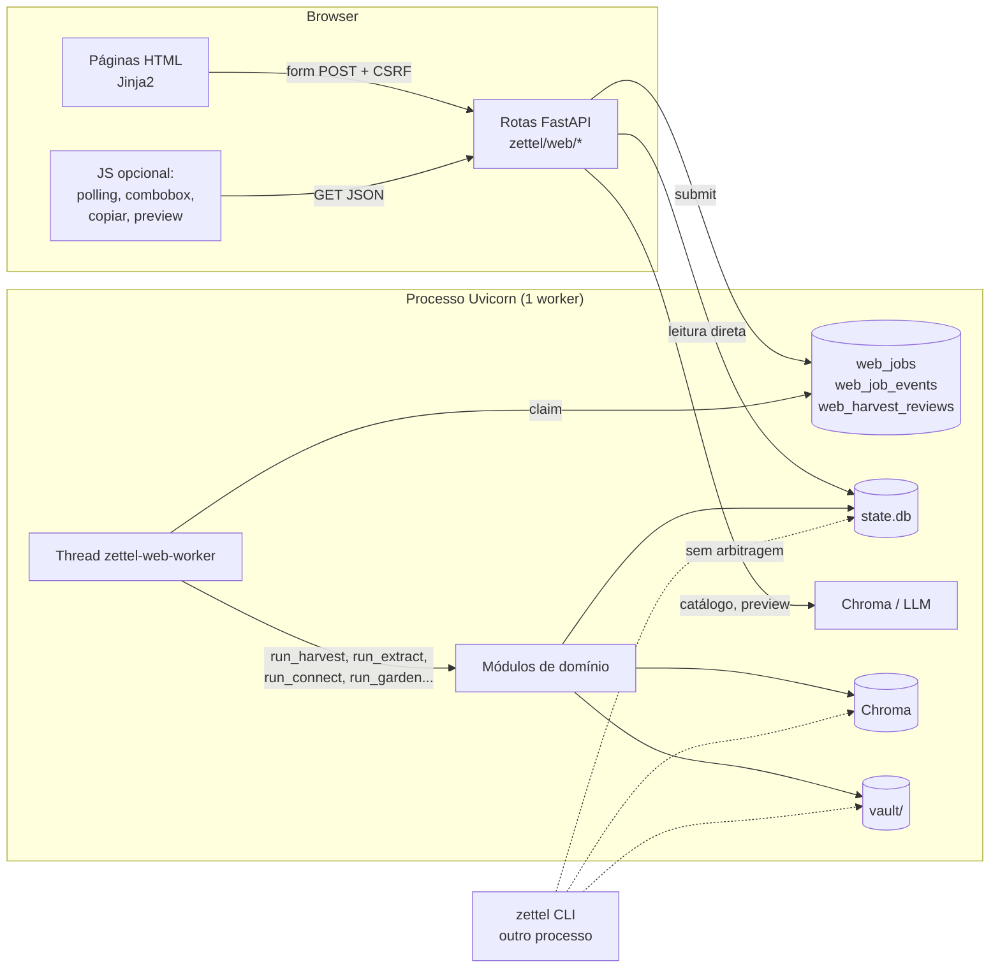
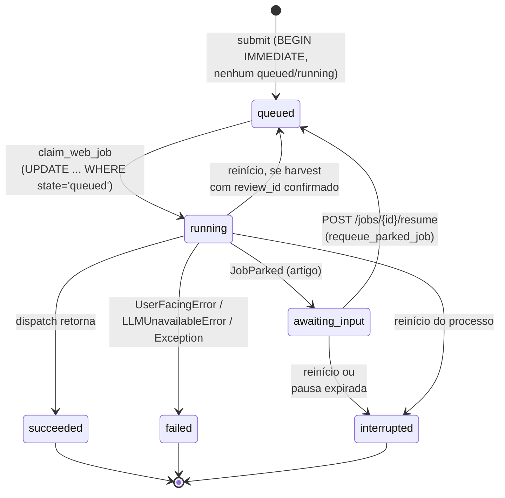
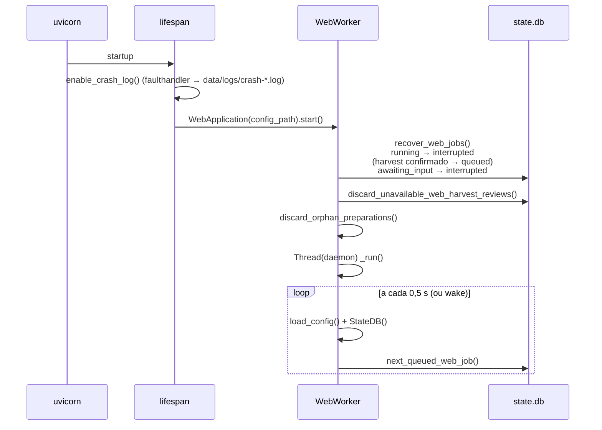
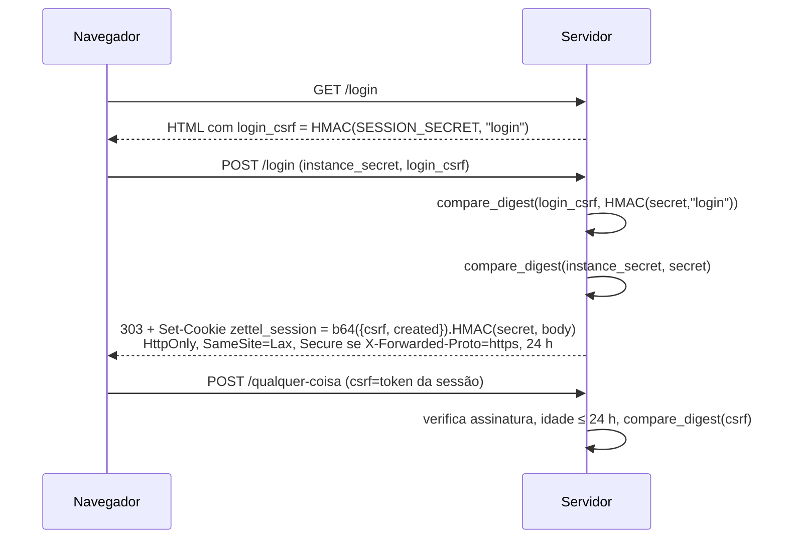
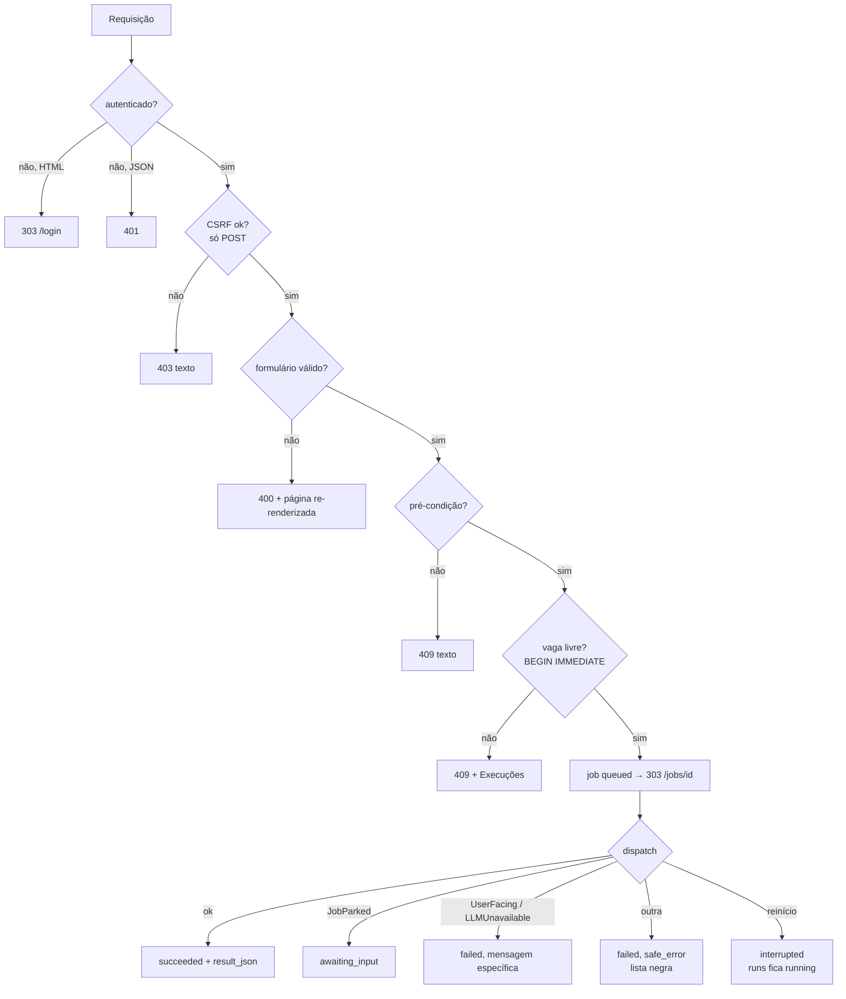
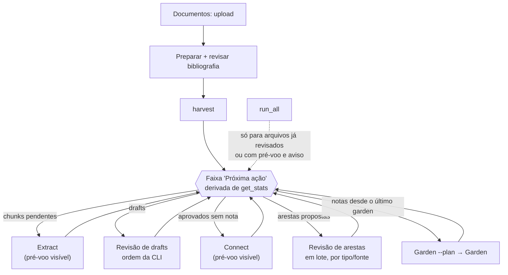

# Interface web: um painel síncrono sobre um pipeline lento — FastAPI, fila em SQLite e revisão humana no navegador

> Artigo 6 de uma série sobre o `zettel_app`, um pipeline que transforma PDFs e Markdown em notas permanentes (Zettelkasten) compatíveis com o Obsidian.
> Esta parte cobre a **interface web** (`zettel/web/`, `zettel/web_app.py`, `zettel/state/web.py`, `zettel/templates/`, `zettel/static/`). Versão analisada: `main` @ `30f4403` (2026-10-20).
> Corpus usado nas medições: o mesmo dos artigos anteriores — 7 fontes, 781 notas permanentes, 2.305 arestas, 30 *drafts* aguardando revisão, 374 chunks rejeitados — mais o histórico real da fila web: 20 jobs entre 2026-09-22 e 2026-10-08.
> Os artigos anteriores estão em [`01-harvest.md`](01-harvest.md), [`02-extract.md`](02-extract.md), [`03-review.md`](03-review.md), [`04-connect.md`](04-connect.md) e [`05-garden.md`](05-garden.md).

---

## 0. Resumo (para quem tem pouco tempo)

As cinco fases do pipeline (harvest, extract, review, connect, garden) nasceram como comandos de terminal. A interface web as expõe para quem não quer abrir um terminal: subir um PDF, revisar a bibliografia que o modelo inferiu, aprovar *drafts*, aceitar arestas, disparar o `connect` e o `garden`, perguntar ao acervo e escrever um artigo com duas pausas de revisão.

O desenho é deliberadamente conservador e, no essencial, correto:

1. **Renderização no servidor** (FastAPI + Jinja2, sem Node, sem *bundler*, ADR-022). Cada página é HTML completo; o JavaScript só melhora o que já funciona sem ele (ADR-040).
2. **Uma fila durável em SQLite com um único *worker*** (ADR-023). Tudo o que demora ou escreve vira um *job* em `web_jobs`, executado por uma *thread* *daemon* no mesmo processo. No máximo um *job* mutante por vez; o segundo pedido recebe **409**. A vaga é tomada com `BEGIN IMMEDIATE`, então não há corrida entre dois cliques.
3. **A web chama os mesmos módulos que a CLI.** Não existe uma "versão web" do harvest ou do connect: `web_app.py` monta `StateDB` e `VectorIndex` como a CLI e chama `run_harvest`, `run_extract`, `run_connect`, `run_garden`.
4. **Revisão humana como primeira classe.** A bibliografia de um upload é preparada num *job* curto, revisada num formulário e só então vira harvest; o artigo pausa em `awaiting_input` sem ocupar a fila.

A leitura do código e as medições sobre uma cópia dos dados mostram, porém, que a interface tem um problema de **arquitetura de execução** que o desenho da fila não resolve: a fila protege o *worker*, mas ninguém protege o *event loop*.

| #   | Achado                                                                                                                                                                                                                                                                                                                                                                                                                                                                                                                                                      | Gravidade                       | Evidência                                           |
| --- | ----------------------------------------------------------------------------------------------------------------------------------------------------------------------------------------------------------------------------------------------------------------------------------------------------------------------------------------------------------------------------------------------------------------------------------------------------------------------------------------------------------------------------------------------------------- | ------------------------------- | --------------------------------------------------- |
| 1   | **Todo *handler* é** `async def` **e faz I/O bloqueante.** SQLite, leitura do YAML, *hash* de arquivos do inbox, Chroma, e até chamadas de rede (embedding no catálogo, LLM no *preview* bibliográfico) rodam dentro do *event loop*. Com um único *worker* Uvicorn, uma página lenta congela o servidor inteiro: o `favicon.ico`, que responde em 27 ms, leva **1.572 ms** quando pedido durante a fila de arestas.                                                                                                                                        | **Alta**                        | Medição com Uvicorn real (§5.2)                     |
| 2   | **A página de login publica um oráculo de força bruta offline.** O token CSRF do login é `HMAC-SHA256(SESSION_SECRET, "login")`, entregue a qualquer visitante não autenticado. Com ele, o segredo pode ser testado fora do servidor, sem limite de tentativas. O mesmo segredo é a senha e a chave que assina os *cookies*; não há limitação de tentativas, revogação de sessão nem rotação. Um segredo com acento derruba o login com **500**.                                                                                                            | **Alta** (em instância exposta) | `auth.py:36`, `security.py`, teste com `TestClient` |
| 3   | **O custo fixo de uma requisição é recarregar a configuração.** `WebApplication.cfg` chama `load_config` (54 ms: YAML + Pydantic) a cada acesso, e uma página acessa várias vezes. Resultado: nenhuma página autenticada responde em menos de ~100 ms; o *polling* de 1 Hz de uma execução aberta custa 120 ms de CPU por segundo; o *worker* ocioso consome **10,7% de um núcleo** só para olhar a fila. `/studio` leva 2,6 s (mediana) e até 9,6 s, porque recalcula preços via LiteLLM a cada renderização.                                              | **Média–Alta**                  | Medição (§5.1)                                      |
| 4   | **"Um *job* mutante por vez" só vale dentro da web.** A CLI não consulta a fila (o ADR-023 admite), o Chroma não é seguro entre processos, e dentro da própria web três caminhos escrevem fora da fila: decidir uma aresta (`POST /review/links`, síncrono, inclusive durante um `connect`), criar notas manuais e o catálogo.                                                                                                                                                                                                                              | **Média–Alta**                  | Leitura de código + documentação do Chroma          |
| 5   | **O "pipeline completo" da web faz o que a documentação diz que ela não faz.** `run_all` processa o inbox inteiro (o README e o `CLAUDE.md` listam *harvest-all-inbox* como exclusivo da CLI), sem a revisão bibliográfica que o caminho de um arquivo exige e sem o pré-voo de custo que a CLI mostra antes do `connect`. `extract` e `connect` pelo botão também não mostram estimativa.                                                                                                                                                                  | **Média–Alta**                  | `web_app.py` (`run_all`), `docs/interface-web.md`   |
| 6   | **A fila de revisão da web não é a mesma da CLI.** Na CLI, os *drafts* vêm com defeitos primeiro e confiança crescente (`review_queue_key`); na web, em ordem de documento. A fila de arestas carrega **todas** as arestas propostas, faz duas consultas e um *parse* de Markdown por aresta (4.234 consultas no cenário pós-#279) e só então pagina em Python: **1,7 s** por página.                                                                                                                                                                       | **Média**                       | `web/review.py`, medição                            |
| 7   | **A observabilidade mente em pontos específicos.** Reenfileirar, forçar e apagar rejeitados emitem todos os eventos de progresso **antes** de fazer o trabalho. O *endpoint* SSE `/api/jobs/{id}/events` não tem consumidor (a página faz *polling*), embora o ADR-022 diga que o progresso é transmitido por SSE. `run_id` é inferido como "o último *run* que mudou", o que liga o `run_all` (cinco *runs*) a um só e confunde *runs* da CLI com os da web. Um reinício marca o *job* como `interrupted`, mas deixa o `runs` correspondente em `running`. | **Média**                       | Leitura de código + `web_jobs` real                 |
| 8   | **O contrato de rotas está vermelho na** `main`**.** `tests/test_web_package.py` falha desde `49d091a`/`0983bd8`: `POST /review/links` e `POST /mocs/{id}/adopt` não constam de `EXPECTED_ROUTES`. O repositório não tem *workflow* de CI, então dois épicos foram integrados com o teste quebrado.                                                                                                                                                                                                                                                         | **Média**                       | `pytest` (3 falhas em 106)                          |
| 9   | **A busca de notas ignora o FTS5 que o resto do sistema usa.** `/notes?q=` aplica `zfold(body) LIKE '%q%'` (função Python por linha) duas vezes, contagem e página: **1,75 s** para 781 notas, sem ranqueamento por relevância.                                                                                                                                                                                                                                                                                                                             | **Média**                       | `state/notes.py:252`, medição                       |
| 10  | **Pré-condições inconsistentes.** O botão de `extract` exige credencial de **todas** as fases de LLM (inclusive `article`); `connect` e `ask` não verificam a credencial de embedding; o *template* habilita o `connect` por `chunks_approved` e o servidor recusa por conceitos sem nota.                                                                                                                                                                                                                                                                  | Baixa–Média                     | `web/health.py:21`, `pipeline.html`                 |
| 11  | **Endurecimento incompleto.** Nenhum cabeçalho de segurança (CSP, `frame-ancestors`, `nosniff` no HTML); `bleach`, depreciado desde 2023, como segunda barreira de sanitização; `safe_error` por lista negra, que vaza caminhos Windows; o limite de 25 MB só é checado depois que o corpo inteiro já foi recebido; `GET /studio?subject=` gasta embedding num GET; a revisão bibliográfica é presa ao *hash* do token CSRF e se perde num novo login.                                                                                                      | Baixa–Média                     | Leitura de código + resposta HTTP                   |

O que está **bem feito**: a separação entre HTTP (`zettel/web/`) e aplicação (`web_app.py`), com a regra de importar os módulos de domínio dentro dos *handlers* para que `GET /` não carregue chromadb, docling e langchain; a tomada atômica da vaga com `BEGIN IMMEDIATE`; a revisão bibliográfica "consumida exatamente uma vez", amarrada ao *checksum* do arquivo e com *snapshot* que evita refazer a extração do Docling; a dupla sanitização do Markdown (*parser* sem HTML **e** limpeza depois); a proteção contra *path traversal* em upload, harvest, exportação de Markdown e notas manuais; os *pickers* JSON que nunca devolvem `chunks.text`; e a pausa do artigo fora da vaga da fila, com a ordem de reivindicação (`ORDER BY created_at, rowid`) escolhida para que um artigo retomado não fique escondido.

---

## 1. O problema que a interface resolve — e por que ele é difícil

Um pipeline como o `zettel_app` tem um formato pouco comum para uma aplicação web. As operações são **lentas** (um PDF leva de 2 a 4 minutos no Docling; um `connect` com 20 conceitos, 3,5 minutos), **caras** (cada fase chama um LLM pago), **com estado** (o SQLite, o Chroma e o *vault* precisam andar juntos) e **intercaladas com decisões humanas** (a bibliografia, os *drafts*, as duplicatas, as arestas, o contexto e o *outline* de um artigo).

A interface precisa, ao mesmo tempo:

1. **Não deixar duas operações escreverem juntas.** O SQLite tolera concorrência; o *vault* e o Chroma, nem tanto.
2. **Sobreviver a um reinício.** Um usuário que fecha a aba não pode perder o harvest de quatro minutos; um servidor que reinicia não pode deixar *jobs* fantasmas.
3. **Mostrar progresso** sem um canal bidirecional e sem *framework* de cliente.
4. **Pausar para uma decisão humana** sem prender a fila.
5. **Proteger um acervo pessoal** exposto, às vezes, numa hospedagem pública (o projeto documenta o Replit).

Os quatro primeiros são o problema clássico de "*background jobs*" em aplicações web. A resposta mais comum (Celery ou RQ com Redis, ou Procrastinate com Postgres) traz um *broker* e um processo de *worker* separado. O `zettel_app` escolheu o oposto: **um processo, um SQLite, uma *thread***. Para um usuário único, é a escolha certa. O que este artigo examina é se a implementação cumpre o que essa escolha promete — e onde ela esqueceu que o servidor HTTP também é uma fila de um *worker* só.

### Onde a web se encaixa



O tracejado é o achado #4: a fila arbitra a web consigo mesma, não a web com a CLI.

---

## 2. Metodologia

- **Lido**: todo o pacote `zettel/web/` (19 módulos, 3.072 linhas, 40 rotas), `zettel/web_app.py` (1.249 linhas), `zettel/state/web.py` e o DDL de `web_jobs`/`web_job_events`/`web_harvest_reviews` em `state/schema.py`, `zettel/progress.py`, `zettel/markdown.py`, os 18 *templates* e os 13 arquivos de `zettel/static/` (scripts, folhas de estilo e ícone), os testes `tests/test_web*.py` (3.597 linhas), `docs/interface-web.md`, o README, o `CLAUDE.md` e os ADRs 018, 022, 023, 039, 040 e 056. Para os fluxos que a web dispara, reli os pontos de entrada de `review.py` (`review_queue_key`, `decide_concepts`), `harvester/pipeline.py` (`selected_file`) e `state/notes.py` (`search_catalog`).
- **Executado**: a suíte de testes da web (`test_web.py`, `test_web_state.py`, `test_web_package.py`, `test_web_studio.py`).
- **Medido (somente leitura sobre os dados reais)**: `data/state.db` aberto com `mode=ro` — histórico de `web_jobs` e `web_job_events`, estados de *chunks*, conceitos e arestas.
- **Medido (sobre uma cópia)**: copiei `data/state.db`, `data/chroma/`, `data/inbox/` e `vault/` para um diretório temporário e apontei `ZETTEL_CONFIG` para uma cópia do `config.yaml` com esses caminhos. O banco medido é anterior à coluna `note_connections.status` (#279); na cópia, adicionei a coluna e marquei as 2.116 arestas de LLM como `proposed`, que é o que o código atual produz depois de um `init --reset`. Medi a latência de 20 páginas com `TestClient` (cinco repetições, mediana), o bloqueio do *event loop* com o Uvicorn real e requisições concorrentes, e a CPU do processo ocioso com `psutil`.
- **Não verificado**: não fiz chamada de LLM nem de embedding. Por isso não medi o catálogo (`GET /studio?subject=`), o *preview* bibliográfico com LLM nem a duração das fases; essas latências vêm do histórico real de `web_jobs`. Não testei a interface em navegador, nem acessibilidade com leitor de tela.

> Nenhuma linha de código, configuração ou documentação existente do projeto foi alterada para produzir este artigo.

---

## 3. Visão geral

### 3.1 Arquitetura em camadas

A interface tem três camadas com fronteiras explícitas, e as fronteiras são testadas por AST em `tests/test_web_package.py` (ADR-039):

| Camada | Arquivos | Responsabilidade | Regra que a protege |
|---|---|---|---|
| **Montagem** | `web/__init__.py`, `web/server.py` | `create_app`, `lifespan`, ordem de registro das rotas | `server.py` não importa nada do pacote (anti-ciclo); a ordem dos `import` é a ordem de casamento das rotas; `details.py` por último, senão `/notes/new` cai em `/notes/{note_id}` |
| **HTTP** | `web/auth.py`, `security.py`, `rendering.py`, `enqueue.py` e um módulo por página | Sessão, CSRF, validação de formulário, pré-condições (409), renderização | Módulos de domínio importados **dentro** do *handler*; *allowlist* no topo: `zettel.web_app`, `zettel.markdown`, `zettel.hashing` |
| **Aplicação** | `web_app.py` | Fila, *worker*, *dispatch* das operações, progresso, erros seguros para o navegador | Nenhuma preocupação HTTP; chama os mesmos `run_`* da CLI |
| **Persistência da fila** | `state/web.py` | `web_jobs`, `web_job_events`, `web_harvest_reviews`, agregados do painel | Transições de estado em SQL atômico (`BEGIN IMMEDIATE`) |

A regra de importar dentro do *handler* tem um efeito mensurável: `GET /favicon.ico` responde em 4,6 ms no `TestClient` porque nada pesado foi carregado. É a mesma disciplina da CLI (ADR-032) e funciona.

### 3.2 Mapa de rotas

| Página       | Rotas                                                                                                                                                   | Executa em                                                                                      | Escreve?                                |
| ------------ | ------------------------------------------------------------------------------------------------------------------------------------------------------- | ----------------------------------------------------------------------------------------------- | --------------------------------------- |
| Login        | `GET/POST /login`, `POST /logout`                                                                                                                       | Requisição                                                                                      | *Cookie*                                |
| Visão geral  | `GET /`                                                                                                                                                 | Requisição                                                                                      | Não                                     |
| Documentos   | `GET /documents`, `POST /documents/upload`, `POST /documents/harvest`, `GET/POST /documents/review/{id}`, `POST .../preview`, `POST /documents/run-all` | Upload na requisição; preparação, harvest e `run_all` como *jobs*                               | Upload grava no inbox **na requisição** |
| Pipeline     | `GET /pipeline`, `POST /pipeline/{op}`                                                                                                                  | *Job*                                                                                           | Sim                                     |
| Revisão      | `GET /review?queue=drafts|duplicates|rejected|links`, `POST /review/action`, `POST /review/links`                                                       | `action` como *job*; `links` **na requisição**                                                  | Sim                                     |
| Notas / MOCs | `GET /notes`, `/notes/{id}`, `/mocs/{id}`, `/sources/{id}`, `.../markdown`, `POST /mocs/{id}/adopt`                                                     | Leitura na requisição; adoção como *job*                                                        | Adoção                                  |
| Criar notas  | `GET/POST /notes/new`, `POST /notes/new/biblio-preview`                                                                                                 | **Andaimes SRC/LIT/ZTL na requisição**; LIT→ZTL como *job*; *preview* com LLM **na requisição** | Sim (*vault*)                           |
| Acervo       | `GET /studio[?subject=]`, `POST /studio/{ask,summarize,skill,article}`                                                                                  | **Catálogo na requisição** (embedding); o resto como *job*                                      | Sim                                     |
| Execuções    | `GET /runs`, `/jobs/{id}`, `/api/jobs/{id}`, `/api/jobs/{id}/events`, `POST /jobs/{id}/resume`                                                          | Requisição                                                                                      | Retomada                                |
| Configuração | `GET /settings`                                                                                                                                         | Requisição                                                                                      | Não                                     |
| *Pickers*    | `GET /api/pickers/{sources,literature}`                                                                                                                 | Requisição                                                                                      | Não                                     |

As linhas em negrito são as exceções à regra "o que escreve ou demora vai para a fila". Cada uma tem uma justificativa local (o catálogo "não usa LLM", decidir uma aresta "é rápido", um andaime "só escreve um arquivo"), mas juntas formam o achado #4.

### 3.3 Máquina de estados de um *job*



Duas decisões merecem destaque. **(a)** `awaiting_input` não conta como vaga ocupada (`has_active_web_job` só olha `queued` e `running`), então um artigo esperando revisão não bloqueia um `extract`. **(b)** Um harvest cuja bibliografia o usuário já confirmou volta para `queued` depois de um reinício, em vez de `interrupted`, porque a confirmação não pode ser dada de novo. As duas são cuidadosas e estão testadas.

O que falta no diagrama é o outro lado: o `runs` que o *job* abriu. `recover_web_jobs` atualiza `web_jobs` e não toca em `runs`; um `extract` interrompido deixa seu *run* em `running` para sempre (o acervo medido não tem nenhum, porque nenhum reinício pegou um *job* no meio).

### 3.4 O que a interface custou e quanto ela é usada

O histórico real tem 20 *jobs* em 16 dias: 6 `review`, 3 `article`, 2 `extract`, 2 `harvest`, 2 `sync`, 1 de cada para `prepare_harvest`, `connect`, `garden`, `ask` e `manual-ztl-from-lit`. Dois falharam: um harvest, depois de **249 s**, com a mensagem genérica "Nenhuma fonte foi criada. Verifique se o documento contém texto extraível, se não é uma duplicata e se as opções bibliográficas estão corretas", e um artigo, em 2 s, com "LLM indisponível: autenticação recusada" (a mensagem do ADR-059, clara e acionável).

| Operação | Duração observada | Observação |
|---|---|---|
| `prepare_harvest` (Docling + bibliografia) | 137 s | Extração completa do PDF |
| `harvest` depois da revisão | 16 s | Reusa o *snapshot*: a extração não é refeita |
| `extract` | 14–136 s | |
| `review` (20 aprovações) | 24–52 s | Inclui a dedupe com LLM |
| `connect` | 207 s | |
| `garden` | 78 s | |
| `ask` | 27 s | Resultado de 20 KB gravado em `result_json` |
| `article` com duas revisões | 204–314 s de execução + 101–150 s de pausa humana | |

A diferença entre `prepare_harvest` (137 s) e `harvest` (16 s) é a melhor decisão de engenharia da interface: o *snapshot* em `harvester/prepared.py` transforma "revisar a bibliografia" de um custo de dois minutos em um custo de zero.

---

## 4. Etapa por etapa

### 4.1 Subida do processo



O `enable_crash_log` no `lifespan` é um detalhe que mostra maturidade: o *worker* roda Docling, torch e onnxruntime no mesmo processo, e uma falha nativa ali derruba o servidor sem *traceback* Python. Com o `faulthandler` apontado para um arquivo, sobra ao menos a pilha de cada *thread*.

O laço do *worker* é onde aparece o primeiro custo escondido. `_run` chama `self._db()`, que chama `load_config(self.config_path)`, **duas vezes por segundo**, mesmo sem nada na fila. Cada `load_config` custa 54 ms (YAML de 400 linhas + validação Pydantic) e cada `StateDB()` mais 6 ms (conexão + `executescript` do DDL inteiro). Medido com `psutil` sobre o Uvicorn real, sem nenhuma requisição: **10,7% de um núcleo** só para descobrir que a fila está vazia. O `self._wake` (um `threading.Event`) já existe e é sinalizado em todo `submit`; o *polling* de 0,5 s é redundante para *jobs* criados pela própria web.

### 4.2 Autenticação e sessão

O modelo é de **instância única com segredo compartilhado**: não há usuários, há um `SESSION_SECRET` lido do ambiente.



O que está certo: comparações em tempo constante, *cookie* `HttpOnly` e `SameSite=Lax`, CSRF por sessão em todo POST (o *token* vive dentro do *cookie* assinado e é ecoado no formulário — o padrão *double submit* com assinatura), sessão sem estado no servidor e expiração de 24 h verificada no servidor, não só no navegador.

#### Achado #2 — o *token* do login é um oráculo

O *token* CSRF do formulário de login é `sign("login")`, ou seja, `HMAC-SHA256(SESSION_SECRET, "login")`, e é entregue a **qualquer visitante não autenticado** em `GET /login` (`auth.py:36`). Isso transforma a página de login num oráculo de *known-plaintext*: quem baixa a página uma vez tem um par (mensagem conhecida, *tag*) e pode testar candidatos a segredo offline, na velocidade de um HMAC-SHA256 numa GPU (bilhões por segundo), sem nunca mais tocar no servidor. Nenhum limite de tentativas protege um ataque que não faz tentativas.

A gravidade depende da entropia do segredo. Um `secrets.token_urlsafe(32)` (256 bits) torna o ataque inviável. Um segredo memorizável ("minhasenha2026"), que é o que se espera de algo chamado "Segredo da instância" num campo de senha, cai em minutos. A documentação não exige entropia mínima, e o servidor não verifica.

Três agravantes:

1. **O mesmo segredo é a senha e a chave de assinatura.** Quem descobre a senha forja *cookies*; quem captura um *cookie* também ganha um par (corpo, HMAC) para atacar a senha offline. O padrão é derivar chaves distintas para cada propósito (HKDF, RFC 5869) ou, no mínimo, separar `SESSION_SECRET` (chave) de uma senha com *hash* lento (Argon2/scrypt).
2. **Não há limitação de tentativas online** (o OWASP ASVS pede atraso progressivo ou bloqueio suave) nem registro de falhas.
3. **Não há revogação.** `POST /logout` apaga o *cookie* do navegador, mas um *cookie* copiado continua válido por 24 h; a única forma de invalidar sessões é trocar o segredo e reiniciar.

E um defeito pequeno, mas revelador: `hmac.compare_digest` com `str` só aceita ASCII. Um segredo digitado com acento ("senhação") levanta `TypeError: comparing strings with non-ASCII characters is not supported` e a resposta é **500** — verifiquei com o `TestClient`. Num formulário em português, é questão de tempo.

**Correção mínima**: um *token* de login aleatório por requisição, guardado num *cookie* assinado de curta duração (não derivado só do segredo); comparar `instance_secret.encode()` com `secret().encode()`; separar a chave de assinatura da senha por HKDF com rótulos distintos; atraso progressivo por IP no `POST /login`; e um aviso no `/settings` (e no `doctor`) quando o segredo tem menos de ~128 bits estimados.

### 4.3 Enviar um *job*: do clique ao *worker*

```mermaid
sequenceDiagram
    participant B as Navegador
    participant H as Handler (async def)
    participant DB as state.db
    participant W as Worker thread
    B->>H: POST /pipeline/extract (csrf)
    H->>H: authenticated? csrf_ok?
    H->>DB: pré-condições (get_stats, credenciais)
    alt pré-condição falha
        H-->>B: 409 texto puro
    end
    H->>DB: BEGIN IMMEDIATE; existe queued/running?
    alt ocupado
        H-->>B: 409 (página Execuções + aviso)
    else livre
        H->>DB: INSERT web_jobs (queued); COMMIT
        H->>W: _wake.set()
        H-->>B: 303 → /jobs/{id}
    end
    W->>DB: claim (UPDATE ... WHERE state='queued')
    W->>W: _dispatch(operation, payload)
    loop checkpoints
        W->>DB: update_web_job + add_web_job_event (2 commits)
    end
    W->>DB: succeeded/failed/awaiting_input + run_id inferido
    loop 1 Hz
        B->>H: GET /api/jobs/{id}?after=N
        H-->>B: job + eventos novos
    end
```

A tomada da vaga é o ponto alto do desenho. `create_web_job` abre `BEGIN IMMEDIATE`, que adquire o *lock* de escrita do SQLite **antes** de ler, então "verificar se há um *job* ativo" e "inserir o meu" são uma única operação atômica, mesmo com dois cliques simultâneos. `claim_web_job` faz o mesmo com um `UPDATE ... WHERE state='queued'` e confere `rowcount == 1`. É o padrão correto de fila em SQLite, o mesmo que bibliotecas como `litequeue` e o `SqliteHuey` usam.

O *dispatch* é um `if operation == ...` de 400 linhas em `WebWorker._dispatch`. Ele funciona, mas cresce linearmente com as operações (são 18) e mistura três níveis de abstração: algumas operações delegam a uma função (`_dispatch_ask`), outras têm a lógica inteira inline (o `review` por *chunk*, com contagem e *refresh* do índice de literatura). Um registro `OPERATIONS = {"extract": handle_extract, ...}` deixaria cada operação testável isoladamente e o conjunto de operações enumerável (hoje, a lista de operações válidas existe em quatro lugares: `_OPERATIONS` do pipeline, o conjunto de ações da revisão, o `_dispatch` e a documentação).

#### Achado #7a — progresso que não mede nada

Em `_requeue_extract_review`, `_force_extract_review` e `_discard_extract_review` (`web_app.py:139`, `228`, `276`), o laço que emite "Reenfileirando item k/N" roda **inteiro antes** da chamada que faz o trabalho em lote. A barra chega a 100% e só então o trabalho começa. Para as operações rápidas é inofensivo; para `discard` (que abre o Chroma e apaga vetores), a barra mente durante a parte que demora. São também 2·N *commits* no SQLite sem informação. Ou o progresso acompanha o trabalho (a função de lote recebe o `observer`), ou é um evento só.

#### Achado #7b — o `run_id` é um palpite

O *job* descobre qual linha de `runs` produziu comparando `get_last_run()` antes e depois (`web_app.py:639–653`). Isso falha de três formas: (1) o `run_all` abre cinco *runs* (harvest, extract, review, connect, garden) e o *job* fica ligado só ao último; (2) um comando da CLI que abra um *run* durante o *job* é atribuído à web; (3) `sync` e `article` não abrem *run* (no histórico, os dois aparecem com `run_id` nulo), e o custo de um artigo — a operação mais cara da interface — não aparece em lugar nenhum da página de execuções. O `CostTracker` já usa *contextvars*; passar o `job_id` para `begin_run` (uma coluna `web_job_id` em `runs`) resolveria as três.

### 4.4 Documentos: do upload ao harvest revisado

Este é o fluxo mais elaborado da interface, e o mais bem pensado.

```mermaid
sequenceDiagram
    participant B as Navegador
    participant H as Handlers
    participant W as Worker
    participant FS as inbox / cache
    B->>H: POST /documents/upload (≤ 25 MB, nome validado)
    H->>FS: write_bytes (recusa se já existe)
    B->>H: POST /documents/harvest (arquivo, paginação, duplicatas, dumps)
    H->>H: valida combinações (paginação manual só p/ PDF etc.)
    H->>H: payload com checksum SHA-256 + session_hash
    H-->>B: 303 → /jobs/{prepare}
    W->>FS: extract_text (Docling) em área de staging
    W->>W: build_bibliographic_metadata (LLM)
    W->>FS: confere checksum de novo; save_snapshot
    W->>W: create_web_harvest_review(state=ready)
    B->>H: GET /documents/review/{id} ("Continuar")
    H->>H: sessão confere? arquivo intacto? snapshot existe?
    B->>H: POST .../preview (JS) → referência ABNT recalculada
    B->>H: POST /documents/review/{id} decision=confirm
    H->>H: valida campos obrigatórios / incomplete_ack
    H->>W: queue_web_harvest_review (BEGIN IMMEDIATE:<br/>review ready → submitted + INSERT harvest)
    W->>W: harvest com prepared=snapshot, biblio do usuário
    W->>FS: remove_preparation (só se succeeded)
```

O que torna este fluxo bom:

- **Integridade ponta a ponta.** O *checksum* SHA-256 do arquivo é fixado no envio, conferido antes e depois da extração, de novo ao abrir a revisão e de novo no harvest. Se alguém troca o PDF no inbox no meio do caminho, a operação recusa com uma mensagem clara em vez de gravar a bibliografia de um arquivo no texto de outro.
- **Consumo exatamente uma vez.** `queue_web_harvest_review` move a revisão de `ready` para `submitted` e insere o *job* de harvest na mesma transação `BEGIN IMMEDIATE`. Dois cliques em "Confirmar" geram um harvest.
- **Retomada depois de falha sem pagar de novo.** Se o harvest falha ou é interrompido, a revisão pode ser reaberta com os valores que o usuário já tinha digitado (lidos do *payload* do *job* que falhou) e reenviada, sem refazer a extração nem a inferência.
- **Proveniência por campo.** Todo campo editado passa a `provenance="user"` (ADR-057), e um campo apagado perde a proveniência anterior.
- **Sinal de texto escondido.** O resultado da preparação carrega `render_hidden` (texto branco sobre branco, corpo ≤ 2 pt; #248) e a revisão o mostra antes de o texto entrar no acervo — uma defesa visível contra injeção de *prompt* por documento.

O que não está bom:

1. **A revisão é presa à sessão.** `_session_hash` é o SHA-256 do *token* CSRF da sessão (`documents.py:226`). A documentação promete que "a preparação permanece disponível após recarregar a página", e permanece — mas não depois de um novo login nem da expiração de 24 h: a revisão vira "Revisão não encontrada para esta sessão" e a preparação de dois minutos se perde. Numa instância de usuário único, amarrar a revisão à sessão não protege ninguém de ninguém; amarrá-la à instância (autenticação já exigida) basta.
2. `GET /documents` **calcula o SHA-256 de cada arquivo do inbox já ingerido**, a cada carregamento (`_file_needs_harvest`, `documents.py:39`), dentro do *event loop*. Com 4,2 MB no inbox, a página custa 206 ms; o custo cresce linearmente com o tamanho do inbox, e um inbox de livros (centenas de MB) congela o servidor a cada visita. Comparar `mtime` e tamanho antes de calcular o *hash* resolveria o caso comum.
3. **O limite de 25 MB é checado tarde.** `await file.read(MAX_UPLOAD_BYTES + 1)` lê do `UploadFile`, mas o *parser* multipart do Starlette já recebeu e guardou o corpo inteiro (em memória até 1 MB, depois em arquivo temporário) antes de o *handler* rodar. O limite protege o inbox, não o servidor. Um `Content-Length` checado num *middleware* (ou no *proxy*) é a forma usual.
4. **A gravação no inbox não é atômica** (`write_bytes` direto no destino). Uma queda no meio deixa um PDF truncado que aparece como "pendente" e falha no Docling. Escrever em `name.part` e renomear é uma linha.
5. **O harvest que falha diz pouco.** O único harvest que falhou no histórico levou 249 s e terminou com uma mensagem que enumera três causas possíveis. O `HarvestOutcome.skipped` já carrega o motivo específico quando há um; quando não há fonte nem `skipped`, o *job* deveria mostrar a última linha de log do harvest, não um palpite.

#### Achado #5 — o "pipeline completo" contradiz a própria documentação

`POST /documents/run-all` enfileira `run_all`, que chama `run_harvest(...)` **sem** `selected_file` — ou seja, processa o inbox inteiro (`harvester/pipeline.py`, ramo `inbox.rglob("*")`). O `CLAUDE.md` lista "harvest-all-inbox" entre as operações **não** expostas na web, e o `docs/interface-web.md` diz que "sem seleção não há harvest do inbox inteiro nesta ação". As duas frases são verdadeiras para o botão "Processar" e falsas para o botão ao lado.

A diferença não é cosmética. O caminho de um arquivo obriga a revisão bibliográfica; o `run_all` usa `skip_biblio=False` e `interactive=False`, então um arquivo cujos campos obrigatórios vieram todos do LLM é recusado pelo harvest não interativo, e o usuário só descobre isso no resultado do *job*. Além disso, o `run_all` da web não tem o pré-voo de custo que a CLI mostra antes do `connect` (`cli.deps.preflight_gate`), nem os botões `extract` e `connect` do Pipeline. O ADR-037 diz que "o *worker* web não pergunta"; a Acervo resolveu isso para `summarize` e `article` mostrando a estimativa no formulário ("enviar é a confirmação"). O Pipeline e o `run_all` ficaram de fora. São exatamente as fases mais caras.

### 4.5 Pipeline: botões e pré-condições

Cada botão passa por três barreiras: o *template* desabilita o botão quando a pré-condição falha, o *handler* recusa com 409, e o *worker* executa. A ideia é boa (o usuário vê "Pré-requisito indisponível" antes de clicar), mas as barreiras não concordam entre si:

| Operação | *Template* desabilita se | *Handler* recusa se | Problema |
|---|---|---|---|
| `extract` | sem `chunks_pending` **ou** `not llm_ready` | idem | `llm_ready` exige credencial de **todas** as 9 fases (`health.py:21`); sem a chave da fase `article`, não se extrai nada |
| `connect` | sem `chunks_approved` | sem conceito `approved` sem nota | Botão habilitado e 409 quando todos os aprovados já viraram notas; nenhuma das duas verifica a credencial de **embedding**, que o `connect` usa em modo estrito |
| `garden`/`garden_hubs` | sem notas | idem | `garden_hubs` não usa embedding nem a taxonomia, mas herda o `llm_ready` global |
| `retry_assets` | nunca | nunca | Sem pré-condição: com zero assets falhos, o *job* roda e devolve "sucesso" com `assets_reset: 0` (o `retry_chunks` recusa o caso equivalente com 409) |

A Acervo já faz certo (`llm_phase_ready(cfg, "ask")`, por fase). O Pipeline deveria usar a mesma função com a fase de cada operação, mais `embedding_ready` onde houver busca.

### 4.6 Revisão: quatro filas, uma página

A página `/review` concentra quatro decisões humanas do pipeline:

| Fila | Conteúdo | Ação | Executa em |
|---|---|---|---|
| `drafts` | *Chunks* `awaiting_review`, cada candidato com tese, definição, intuição, limites, relevância e âncora destacada no trecho completo | Aprovar/rejeitar candidatos marcados | *Job* `review` |
| `duplicates` | Conceitos `dedupe_pending`, com o mesmo cartão do review interativo | Manter/descartar (grava o rótulo humano em `decision_shadow`) | *Job* |
| `rejected` | *Chunks* rejeitados pelo extract, origem modelo ou filtro | Reenfileirar, forçar extração, apagar | *Job* |
| `links` | Arestas de LLM `proposed` (#279), com as duas teses | Aceitar, rejeitar, trocar o tipo | **Requisição** |

A aprovação por candidato (e não por *chunk*) e o registro de cada decisão em `review_events` com `mode=web_batch, surface=web` (#270) estão corretos, assim como a decisão do ADR-018 (adendo de 2026-10-19) de que o limiar de confiança vale só para a aprovação **automática**: o próprio projeto mediu que a confiança não separa manter de descartar (AUC 0,49), então ela não deve barrar uma pessoa que leu o *draft*.

#### Achado #6 — a web não ordena como a CLI, e não pagina no banco

**Ordem.** A CLI ordena a fila por `review_queue_key`: *chunks* com defeito primeiro (sem intuição ou limites), depois confiança crescente (`review.py:328`). É uma decisão de produto registrada (#268/#269): o revisor vê primeiro o que mais precisa de olho humano. A web usa `get_chunks_by_status`, que ordena por fonte e `chunk_index`. A mesma fila tem duas prioridades conforme a superfície.

**Paginação.** As quatro filas carregam **todos** os itens, enriquecem todos (para os *drafts*: decodificar JSON e calcular os *spans* da âncora em cada trecho; para as arestas: duas consultas `get_note` e um `note_sections` por aresta) e só então fatiam 20 em Python. A contagem de arestas do topo da página (`link_count`) faz a lista completa de novo, em toda visita a qualquer fila. No cenário que o código atual produz depois de um `connect` (2.116 arestas propostas):

$$
\text{consultas por página de arestas} = 1 + 1 + 2 \cdot 2116 = 4234,
$$

e a página leva **1,7 s** (mediana de cinco), para mostrar 20 arestas. O custo é $O(N)$ no tamanho da fila, não no tamanho da página. Um `LIMIT/OFFSET` (ou paginação por chave) no SQL, com as teses buscadas só para as 20 arestas visíveis num único `IN (...)`, reduz para $O(\text{página})$.

**Escrita fora da fila.** `POST /review/links` chama `decide_link` na própria requisição (`web/review.py:199`). Aceitar uma aresta muda o grafo que o `connect` e o `garden` percorrem — exatamente as fases que podem estar rodando no *worker* naquele momento. A regra "um *job* mutante por vez" existe para isso, e esta rota a contorna. Além disso, um CSRF inválido devolve 400 "Ação inválida" em vez do 403 que todas as outras rotas usam.

**Volume de decisão.** A fila de arestas decide uma aresta por POST, com recarga de página. Com 2.116 arestas, é um trabalho de horas de cliques. A fila de *drafts* já tem seleção em lote; a de arestas precisa do mesmo (e, idealmente, de filtros por tipo de relação e por fonte, já que o #279 mostrou que o valor da revisão está concentrado em poucos tipos).

### 4.7 Notas, MOCs e fontes

A listagem `/notes` tem busca, filtros (tipo, origem, fonte, autor), ordenação e paginação de 12 itens; as páginas de detalhe renderizam o Markdown com *wikilinks* `[[ZTL - …]]` convertidos em links internos, e os botões "Copiar" e "Baixar .md" leem o **arquivo atual do *vault*** (com *frontmatter*), não a cópia no banco — e recusam um caminho fora da pasta esperada (`_markdown_path` resolve o caminho com `strict=True` e exige `is_relative_to(vault / folder)`, o que barra *symlinks* para fora).

A renderização é segura em duas camadas: o `markdown-it` roda com `html: False` (HTML bruto vira texto) e o resultado passa pelo `bleach.clean` com lista de *tags*, atributos e protocolos permitidos (`http`, `https`, `mailto`). O comentário em `markdown.py` explica por quê: a segunda camada protege se o *parser* ou sua configuração mudarem. É a postura certa. O ponto fraco é a biblioteca: o `bleach` foi declarado **depreciado** pelos mantenedores da Mozilla em janeiro de 2023 (recebe só correções de segurança, porque depende do `html5lib`, que não é mais mantido). O substituto que o ecossistema adotou é o `nh3` (*bindings* Python do `ammonia`, em Rust), com API equivalente para *tags*, atributos e esquemas de URL.

#### Achado #9 — a busca que não usa a busca

A busca da listagem aplica `zfold(title) LIKE ? OR zfold(body) LIKE ?` sobre a união de notas e MOCs (`state/notes.py:252`), onde `zfold` é uma função Python registrada no SQLite. Isso significa chamar Python para cada linha, duas vezes por requisição (contagem e página), sem índice possível. Medido: **1,75 s** para `q=kant` em 781 notas, contra 160 ms da listagem sem busca. O custo é linear no volume de texto do acervo.

O resto do sistema faz o contrário: `fts_notes` existe, é mantido em sincronia em `upsert_note`, usa `unicode61 remove_diacritics` (o mesmo efeito do `zfold`) e o `Retriever` já ranqueia por BM25. A listagem web é o único lugar onde o usuário digita uma busca e recebe resultados por ordem de data, não de relevância.

#### Adoção de MOC

`POST /mocs/{id}/adopt` é o caminho do #300 para o usuário assumir um MOC gerado (`origin: manual`, assinatura limpa, *backrefs* mantidos). Ele roda como *job*, de propósito, para não colidir com um `garden` — exatamente o raciocínio que falta à fila de arestas.

### 4.8 Criar notas

`/notes/new` monta andaimes SRC, LIT (índice ou granular) e ZTL, com *comboboxes* que buscam fonte e LIT a partir de três letras (ADR-040) e degradam para um `<select>` das 50 mais recentes sem JavaScript. O ADR-040 é um bom exemplo de exceção bem delimitada: JSON só para GET de leitura, nunca para mutação, nunca devolvendo `chunks.text`, com `LIKE` escapado e termos FTS citados.

Dois pontos:

- **O *preview* bibliográfico chama o LLM dentro da requisição** (`POST /notes/new/biblio-preview`, com `enrich`), num `async def`. Uma chamada de LLM de 3 a 10 s congela o servidor inteiro pelo mesmo tempo (achado #1).
- **Os andaimes escrevem no *vault* na requisição**, fora da fila. Como `new-note` não toca no SQLite nem no Chroma (por desenho), o risco de colisão é baixo — mas não nulo: um `sync` em execução no *worker* lê o mesmo diretório.
- `_source_label` e `_lit_label` existem duplicados em `web/manual.py` e `web/pickers.py`. O projeto tem uma regra explícita contra isso (a nota sobre `index_kwargs` em `docs/interface-web.md` conta o que aconteceu da última vez).

### 4.9 Acervo: consultar e produzir (ADR-056)

```mermaid
sequenceDiagram
    participant B as Navegador
    participant H as Handler
    participant W as Worker
    participant G as ArticleDrive (LangGraph)
    B->>H: POST /studio/article (review_context, review_outline)
    H-->>B: 303 → /jobs/{id}
    W->>G: drive.start()
    G-->>W: interrupt (context_review)
    W->>W: sessions[job_id] = drive<br/>JobParked → awaiting_input (vaga livre)
    B->>H: GET /jobs/{id} → formulário da pausa
    B->>H: POST /jobs/{id}/resume (approve | enrich | abort)
    H->>H: drive ainda em memória?
    alt não (reinício)
        H->>H: job → interrupted
        H-->>B: 409 "A pausa expirou"
    else sim
        H->>H: requeue_parked_job (BEGIN IMMEDIATE; vaga livre?)
        H-->>B: 303
        W->>G: drive.resume(decision)
        G-->>W: interrupt (outline_review) ou resultado
    end
```

O desenho do artigo é a peça mais sofisticada da interface: o mesmo `ArticleDrive` serve à CLI (que o dirige até o fim) e à web (que o estaciona na memória), então as duas superfícies compartilham um laço de interrupções. O custo, assumido no ADR-056, é que a pausa vive só no processo: um reinício perde o artigo e o gasto feito até ali. Há uma terceira consequência que o ADR não registra: **uma pausa nunca abandonada nunca expira**. O `drive` segura uma conexão SQLite e o grafo compilado até o processo parar. Um TTL (por exemplo, 24 h, alinhado à sessão) e o `MemorySaver` trocado por um *checkpointer* persistente do LangGraph (o pacote `langgraph-checkpoint-sqlite`, que hoje não está instalado) resolveriam as duas coisas: a pausa sobreviveria ao reinício e teria prazo.

O catálogo roda na requisição (`GET /studio?subject=`), recusa com 409 se houver *job* ativo e abre o Chroma. O ADR-056 justifica: o catálogo não chama LLM. Mas chama o **embedding** da pergunta, que é uma chamada de rede paga, dentro do *event loop* (achado #1), e num GET, que o navegador pode pré-carregar e que um link externo pode disparar (o *cookie* `SameSite=Lax` acompanha navegações de primeiro nível). Não é grave para um usuário único, mas é a combinação errada de verbo HTTP e efeito.

`/studio` sem nenhum parâmetro leva **2,6 s** (mediana) e chegou a **9,6 s** na primeira carga: a página calcula `estimate_summarize` e `estimate_article` a cada renderização, e o preço vem do mapa do LiteLLM, cuja primeira consulta inicializa a biblioteca e imprime avisos de "*Provider List*" no *log*. Estimativas que só mudam quando o acervo muda poderiam ser calculadas sob demanda (num `<details>`) ou memorizadas por *checksum* do estado.

### 4.10 Execuções e progresso

A página de um *job* faz `fetch("/api/jobs/{id}?after=N")` a cada segundo, acrescenta os eventos novos e recarrega a página quando o estado muda para terminal ou `awaiting_input`. Funciona sem JavaScript (a página renderizada já mostra o estado), o que respeita o ADR-022.

Dois problemas:

- **O SSE é código morto.** `GET /api/jobs/{id}/events` existe, está no contrato de rotas, e nenhum *template* ou script o usa. Ele faz no máximo 20 iterações de 0,5 s (10 s) e termina, chama o banco de forma síncrona dentro de um gerador assíncrono e não verifica se o *job* existe. Enquanto isso, o ADR-022 afirma que o progresso "é transmitido ao navegador por *Server-Sent Events*" e o usa como argumento contra um SPA. Ou o SSE vira o mecanismo (o que reduziria o custo do *polling*), ou sai do código e do ADR.
- **O *polling* custa caro pelo motivo errado.** Cada `GET /api/jobs/{id}` custa ~120 ms no servidor, quase tudo em dois `load_config` (achado #3). Com uma aba aberta, são 12% do *event loop* ocupados; com três abas, 36%. O custo útil (duas consultas indexadas) é de poucos milissegundos.

E três de retenção: `web_jobs` e `web_job_events` crescem sem limite (não há expurgo); `web_job_events` não tem índice em `job_id` (a consulta por `job_id AND event_id > ?` usa a chave primária e filtra o resto); e o resultado de um `ask` (20 KB) e de um artigo (30 KB) é gravado inteiro em `result_json` e reimpresso como JSON bruto na página de detalhe, que chega a **97 KB** para uma pergunta.

### 4.11 Visão geral e configuração

O painel (`GET /`, 345 ms) agrega contagens, faixas de confiança dos *drafts* (com os mesmos cortes da CLI), relações, origens, custo por fonte, os 10 *hubs* por grau ponderado (com os pesos configurados, não a constante) e as 10 últimas execuções — tudo por SQL agregado, sem carregar corpos de nota. É a parte da interface que melhor cumpre a promessa de "painel".

`/settings` mostra a saúde (FTS5, diretórios, credenciais) e a identidade do embedding gravado contra o configurado, com aviso de *drift*. Nunca mostra segredos. O que falta é o que o `doctor` da CLI já sabe: MOCs órfãos, *crash logs* deixados em `data/logs/`, a alcançabilidade do grafo (§ achado #7 do artigo do garden), *runs* presos em `running`. A web tem uma página de saúde que sabe menos que o comando de saúde.

---

## 5. Desempenho e o *event loop*

### 5.1 Latência por página

Mediana de cinco requisições com `TestClient`, sobre a cópia dos dados (§2):

| Rota | Mediana | Máximo | Bytes | Onde vai o tempo |
|---|---:|---:|---:|---|
| `/favicon.ico` | 4,6 ms | 40 ms | 457 | Nenhum import pesado |
| `/api/pickers/sources?q=ka` | 91 ms | 94 ms | 588 | `load_config` + consulta |
| `/runs` | 107 ms | 141 ms | 7.184 | 2× `load_config` |
| `/api/jobs/{id}` | 111 ms | 149 ms | 32.146 | 2× `load_config` |
| `/notes` | 161 ms | 195 ms | 19.582 | |
| `/documents` | 206 ms | 278 ms | 11.866 | SHA-256 do inbox |
| `/review` (*drafts*) | 335 ms | 430 ms | 93.909 | Enriquecimento de todos os *drafts* |
| `/` | 345 ms | 351 ms | 9.980 | Agregados + grau ponderado |
| `/review?queue=links` | **1.678 ms** | 1.761 ms | 38.266 | N+1 sobre 2.116 arestas |
| `/notes?q=kant` | **1.745 ms** | 1.776 ms | 20.419 | `zfold(body) LIKE` |
| `/studio` | **2.658 ms** | 9.559 ms | 13.181 | Pré-voo via LiteLLM |

Microcustos: `load_config` = **54 ms**; abrir e fechar um `StateDB` = 6 ms (conexão + `executescript` do DDL completo + FTS).

A linha de base de ~100 ms para qualquer página autenticada não vem do banco nem do *template*: vem de reler e revalidar o `config.yaml` a cada acesso a `WebApplication.cfg` (`web_app.py:1164`). A justificativa provável é "editar o YAML sem reiniciar o servidor". O custo é pago em todas as requisições, e o benefício é parcial (o *worker* relê a configuração a cada *job*, mas um *job* em andamento usa a que leu no início). Ler a configuração uma vez, com recarga explícita quando o `mtime` do arquivo muda, mantém o benefício e elimina o custo.

### 5.2 Achado #1 — o servidor tem uma fila de um *worker* que ninguém vê

Todos os *handlers* são `async def`. No FastAPI, uma função `async def` roda **no próprio *event loop***; uma função `def` comum roda num *threadpool* e é aguardada. A documentação do FastAPI é explícita: se a função usa uma biblioteca que bloqueia (banco, arquivo, rede) e não suporta `await`, declare-a com `def`, senão ela bloqueia o servidor. Todas as chamadas desta interface são bloqueantes: `sqlite3`, `yaml`, `hashlib` sobre arquivos, `chromadb`, LangChain.

Medi o efeito com o Uvicorn real (um *worker*, como a documentação exige) e dois clientes:

| Cenário | `GET /favicon.ico` |
|---|---:|
| Sozinho | 25–29 ms |
| Durante `GET /review?queue=links` (1,72 s) | **1.572 ms** |
| Durante `GET /notes?q=kant` (1,77 s) | **1.621 ms** |

Um arquivo estático esperou a página lenta terminar. É o comportamento esperado de um *event loop* bloqueado: o servidor HTTP vira uma fila M/D/1 de um servidor só. Com taxa de chegada $\lambda$ e tempo de serviço $S$, a utilização é $\rho = \sum_i \lambda_i S_i$, e a espera média de uma requisição qualquer cresce como

$$
W_q \approx \frac{\rho\, \bar S}{2(1-\rho)}.
$$

Só o *polling* de uma aba aberta contribui $\lambda S = 1\ \text{s}^{-1} \times 0{,}12\ \text{s} = 0{,}12$. Três abas e um painel aberto já levam $\rho$ para perto de 0,5, e qualquer página de 1,7 s passa a ser sentida por todas as outras. Para piorar, o *worker* roda na mesma CPython, e seus trechos em Python puro (o próprio `load_config` duas vezes por segundo, o laço de eventos) disputam o GIL com o *event loop*.

Os piores casos não são os medidos: são as chamadas de rede que rodam no *event loop* — o embedding do catálogo (`studio.py:213`) e o LLM do *preview* bibliográfico (`manual.py`, `preview_manual_bibliography`). Um provedor lento ou um *timeout* de 30 s congela a interface inteira por 30 s, inclusive o *polling* que mostraria ao usuário que um *job* terminou.

**Correção**: trocar `async def` por `def` em todos os *handlers* que fazem I/O síncrono (praticamente todos). O FastAPI os executa num *threadpool* (40 *threads* por padrão no AnyIO), e o *event loop* fica livre. Nenhuma outra mudança é necessária, porque cada *handler* já abre e fecha sua própria conexão `StateDB` (e o `sqlite3` com `check_same_thread=True` não é problema quando a conexão nasce e morre na mesma *thread*). Os dois *handlers* que leem `await request.form()` podem continuar `async` e delegar o trabalho com `run_in_threadpool`.

---

## 6. Concorrência e consistência

### 6.1 Achado #4 — a vaga única é local

O ADR-023 é honesto sobre o limite: "o uso concorrente da CLI e da web não é arbitrado por este desenho". O que ele não registra é o custo de cada colisão:

| Recurso | Comportamento sob dois escritores | Resultado provável |
|---|---|---|
| SQLite (WAL) | Um escritor por vez; o outro espera `timeout` (5 s, padrão do `sqlite3`) | `database is locked` num `commit` longo; o *job* falha com mensagem genérica |
| Chroma `PersistentClient` | A documentação do Chroma: *thread-safe*, **não *process-safe*** para escritores no mesmo caminho | Corrupção ou erros de "*readonly database*"; recomendação oficial: modo servidor (`HttpClient`) |
| *Vault* | Gravações sem *lock*; `safe_write_note` preserva edições manuais, não edições concorrentes | Última escrita vence num MOC ou num bloco gerenciado |

Dentro da própria web, três rotas escrevem fora da fila: `POST /review/links` (grafo), `POST /notes/new` (andaimes no *vault*) e `POST /documents/upload` (inbox). E o catálogo lê o Chroma na requisição, protegido por um "há *job* ativo?" que não é atômico com a abertura do índice.

Para um usuário único que alterna entre terminal e navegador, a correção proporcional não é um *broker*: é um **lock de processo** (um arquivo em `data/` com `msvcrt.locking`/`fcntl.flock`, ou uma linha em `web_jobs` que a CLI também reivindica) adquirido por toda operação mutante, da CLI e da web, e consultado pela página de execuções ("a CLI está rodando `connect` desde 14:02"). As rotas que escrevem na requisição passam a ser *jobs* — a adoção de MOC já mostra o padrão.

### 6.2 Recuperação depois de um reinício

| Estado no momento da queda | Depois do reinício | `runs` | Avaliação |
|---|---|---|---|
| `queued` | Continua `queued`, é executado | — | Correto |
| `running` (harvest confirmado) | Volta a `queued`, é refeito com o *snapshot* | *Run* antigo fica `running` | Correto para o *job*; *run* órfão |
| `running` (outros) | `interrupted` | *Run* fica `running` | Fraco: o custo parcial some das estatísticas e o *run* aparece "em andamento" para sempre |
| `awaiting_input` (artigo) | `interrupted` | Artigo não abre *run* | Assumido no ADR-056 |
| Preparação bibliográfica pronta | Mantida se o *job* foi `succeeded`; descartada se `failed`/`interrupted` | — | Correto |
| Chamada de LLM em curso | Perdida; a fase recomeça do último *checkpoint* (o *cache* SQLite evita pagar de novo o que já tinha voltado) | — | Correto, e é o que torna o modelo "um processo" viável |

---

## 7. Tratamento de erros e fluxos de exceção

| Situação | O que acontece | O que o usuário vê | Avaliação |
|---|---|---|---|
| Sem sessão em página HTML | 303 → `/login` | Login | Correto |
| Sem sessão em API JSON | 401 `{"error":"unauthorized"}` | — | Correto (ADR-040) |
| CSRF inválido | 403 "CSRF inválido" (texto puro) | Página em branco com a frase | Correto na semântica; **400** em `/review/links`; sem layout nem link de volta |
| Segredo com caractere não ASCII | `TypeError` em `compare_digest` | **500** | Defeito |
| `SESSION_SECRET` ausente | Login mostra o erro, nenhuma sessão é emitida | Mensagem clara | Correto |
| Segundo *job* mutante | 409, página de execuções com aviso | Aviso | Correto, mas não diz **qual** *job* ocupa a vaga nem oferece enfileirar |
| Pré-condição falha (sem *chunks*, sem credencial) | 409 texto puro | Página em branco | Mensagem boa, apresentação ruim |
| Formulário inválido (Acervo, Criar notas, revisão bibliográfica) | 400 com a página re-renderizada e os valores preservados | Formulário com erro | Correto (o melhor caso da interface) |
| `UserFacingError` / `LLMUnavailableError` no *job* | `failed`, mensagem até 300 caracteres | Mensagem específica | Correto (ADR-059) |
| Outra exceção no *job* | `failed`, `safe_error`: oculta se contiver `api_key`, `secret`, `token`, `/home/`, `\users\` | Mensagem genérica ou o texto da exceção | **Lista negra**: um caminho `D:\projetos\...` ou o corpo de erro de um provedor sem essas palavras passa |
| Exceção no *handler* HTTP | Sem tratador global | 500 do Starlette | Fraco: sem página de erro, sem *log* estruturado com id de correlação |
| *Job* não encontrado | 404 texto puro | Página em branco | Aceitável |
| Arquivo mudou entre preparar e confirmar | 409 com instrução ("prepare novamente") | Mensagem acionável | Correto |
| Pausa do artigo expirou | `interrupted` + 409 | Mensagem clara | Correto; a pausa não tem TTL |
| Harvest não cria fonte | `failed` com três causas possíveis | Palpite | Fraco (§4.4) |
| Queda nativa (Docling, torch) | `faulthandler` grava a pilha | Servidor cai | Correto dentro do possível |



A assimetria visível na tabela é de **apresentação**: os erros de formulário (400) voltam dentro da página com os valores preservados, enquanto os erros de pré-condição (409) e de autorização (403) são uma linha de texto numa página em branco. Um tratador de exceções que renderize `error.html` com a mensagem, o código e um link de volta resolve todos de uma vez.

---

## 8. Modelo de ameaça

A interface é de usuário único e pode ser exposta na internet (o projeto documenta o Replit). O ativo é o acervo (notas, fontes com direitos autorais, custos de API) e as chaves de LLM no ambiente do processo.

| Ameaça | Controle existente | Lacuna | Prioridade |
|---|---|---|---|
| Adivinhar o segredo | `compare_digest` | **Oráculo offline no login (#2)**; sem limitação de tentativas; sem exigência de entropia | **P0** |
| Roubo de *cookie* | `HttpOnly`, `SameSite=Lax`, `Secure` atrás de HTTPS, 24 h | Sem revogação; `Secure` depende de `X-Forwarded-Proto` (confiado sem lista de *proxies*) | P1 |
| CSRF | *Token* por sessão em todo POST | `GET /studio?subject=` tem efeito de custo | P2 |
| XSS | Autoescape do Jinja2; Markdown sem HTML + `bleach`; `tojson` | Sem CSP; `bleach` depreciado | P2 |
| *Clickjacking* | — | Sem `frame-ancestors`/`X-Frame-Options` | P2 |
| *Path traversal* | Validação de nome, `resolve()` + `is_relative_to` em upload, harvest, exportação, LIT | — | Coberto |
| Injeção de *prompt* por documento | Sanitização Unicode (ADR-033) + aviso de texto escondido na revisão | — | Coberto na entrada |
| Vazamento em mensagens de erro | `safe_error` | Lista negra (§7) | P2 |
| Esgotamento de recursos | Limite de 25 MB, limites de tamanho por campo, `limit` dos *pickers* | Limite checado depois do *upload*; uma página lenta trava o servidor (#1) | P1 |
| Abuso de custo | Pré-voo visível em `summarize`/`article` | Sem pré-voo em `extract`/`connect`/`run_all`; `max_judge_iterations` até 20 | P1 |

As dependências estão atualizadas: Starlette 1.6.0 (fora da faixa do CVE-2026-54283, que deixava formulários *url-encoded* sem os limites de `max_fields`/`max_part_size` até a 1.3.1), FastAPI 0.141.1, Jinja2 3.1.6.

As respostas não têm nenhum cabeçalho de segurança — a resposta de `/login` traz só `server` e `content-type`. O OWASP recomenda, no mínimo, `Content-Security-Policy` com `frame-ancestors 'none'` (que substitui o `X-Frame-Options`), `X-Content-Type-Options: nosniff` e `Referrer-Policy`. Uma CSP estrita exige mover os seis blocos `<script>` *inline* (dois no `base.html`, para o tema, e um em cada um de `job_detail.html`, `manual_notes.html`, `review.html` e `studio.html`) para arquivos em `/static`, ou usar *nonce*; é um trabalho de uma tarde.

---

## 9. O fluxo do usuário: faz sentido?

A jornada documentada para uma fonte nova é:


O que faz sentido:

- **As pausas humanas estão onde o pipeline é fraco.** A bibliografia (onde o LLM inventa campos), os *drafts* (onde o extract erra), as duplicatas (onde a dedupe não tem gabarito), as arestas (onde o #279 decidiu não confiar no LLM) e o *outline* de um artigo. A interface não esconde essas decisões atrás de um "processar tudo".
- **O resultado de cada fase leva à próxima.** O botão "Continuar" depois da preparação, a contagem de pendências no topo da revisão, o painel com faixas de confiança.
- **O que é destrutivo ficou na CLI.** `init --reset`, `delete-source`, `purge-rejected`, `garden --recreate`. É uma linha clara e correta.

O que não faz:

1. **O usuário é o orquestrador.** Depois do harvest, nada diz algo como "há 312 *chunks* pendentes: rode o extract". O usuário precisa saber a ordem das fases e navegar entre Documentos, Pipeline e Revisão. O painel tem os números, mas não o **próximo passo**. Uma faixa "Próxima ação" no topo de cada página, derivada do mesmo `get_stats` (pendentes → extract; *drafts* → revisão; aprovados sem nota → connect; arestas propostas → revisão de arestas; notas novas desde o último garden → garden), transformaria um painel de controle num fluxo guiado sem mudar nenhuma regra.
2. **Há dois caminhos de ingestão com regras diferentes.** "Processar" (um arquivo, revisão bibliográfica obrigatória) e "Executar pipeline completo" (inbox inteiro, sem revisão, sem pré-voo). O segundo é o atalho que um usuário novo escolhe, e é o que menos protege (achado #5).
3. **A revisão de arestas não escala com o que o** `connect` **produz.** O Prompt 2 propõe até quatro arestas por nota — 2.116 no acervo medido —, e a fila decide uma por clique. Sem lote e sem filtro, o usuário ou abandona a fila (e o grafo fica sem caminhos, como mostrou o artigo do garden) ou passa a aceitar tudo sem ler.
4. **A interface não diz quando a CLI está mexendo nos mesmos dados.**
5. **A busca de notas não é a busca do sistema.** O usuário que digita "kant" em Notas recebe resultados por data; o mesmo termo no Acervo passa pelo `Retriever` híbrido. Duas caixas de busca, dois significados.

**Fluxo sugerido**:



---

## 10. Decisões arquiteturais: o que os ADRs dizem e o que o código faz

| ADR | Decisão | Avaliação |
|---|---|---|
| **022** — renderização no servidor, sem SPA | Jinja2, formulários HTML, sem *bundler* | **Certa** para o problema: a interface é um conjunto de formulários e monitores de *job*. O texto está desatualizado: título "ADR-XXX", três `[NEEDS INPUT]` sem resposta, "23 *endpoints* e 14 *templates*" (hoje 40 rotas e 18 *templates*) e a afirmação de que o progresso usa SSE (usa *polling*). |
| **023** — fila em SQLite, um *worker* | Sem *broker*; 409 no segundo *job* | **Certa** para usuário único. A tomada atômica está correta. Lacunas: não registra que a CLI e o Chroma ficam fora da arbitragem como risco a mitigar (só como fato); não fala do custo de *polling* do *worker*; `[NEEDS INPUT]` sem resposta. |
| **039** — web como pacote | Ordem de registro, *imports* tardios, contrato de rotas testado | **Certa e bem executada.** O contrato está quebrado na `main` (achado #8), o que mostra que um teste sem CI é uma intenção, não uma garantia. |
| **040** — *pickers* JSON | Exceção estreita ao ADR-022 | **Certa.** Bom exemplo de como abrir uma exceção sem abrir a porta. |
| **056** — Acervo | Catálogo síncrono, o resto na fila, artigo estacionado em memória | **Certa no desenho, com duas consequências não registradas**: o catálogo chama um embedding pago no *event loop* e num GET; a pausa não tem prazo. |
| **018** (adendos de 2026-10-19) | Limiar só para aprovação automática; `run_all` restrito às fontes do harvest | **Certa**, e apoiada em medição (AUC 0,49). |

Uma decisão que **não** está em nenhum ADR e deveria estar: **o modelo de execução HTTP**. "Um *worker* Uvicorn, *handlers* `async def` com I/O síncrono" é uma escolha com consequências maiores que qualquer uma das listadas, e foi tomada por omissão.

---

## 11. Comparação com abordagens alternativas

| Problema | Como o `zettel_app` resolve | Alternativa estabelecida | Quando valeria trocar |
|---|---|---|---|
| Execução dos *handlers* | `async def` com I/O síncrono | `def` (o FastAPI usa *threadpool*), ou bibliotecas assíncronas (`aiosqlite`) | **Agora**: `def` é uma troca mecânica e resolve o achado #1 |
| Fila de *jobs* | Tabela SQLite + *thread* + `BEGIN IMMEDIATE` | `SqliteHuey` (Huey sobre SQLite: prioridades, *retries*, agendamento, *worker* separado); `litequeue`; Celery/RQ com Redis; Procrastinate com Postgres | Huey se precisar de *retries*/agendamento ou de *worker* em outro processo (isolaria quedas nativas do Docling); *broker* só com vários usuários |
| Progresso | *Polling* 1 Hz de JSON | SSE (`sse-starlette`) ou htmx com a extensão SSE trocando fragmentos HTML | Quando o custo do *polling* importar; o htmx mantém o ADR-022 (HTML do servidor, sem *bundler*) |
| Interatividade parcial (revisão em lote, filtros) | Recarga de página completa | htmx (`hx-post`, `hx-swap`) | A fila de arestas é o caso de uso; o htmx é um *script* de ~15 KB, sem *build* |
| Sessão | *Cookie* assinado próprio | `itsdangerous`/`SessionMiddleware` do Starlette com chave separada; senha com Argon2 | Para fechar o achado #2 sem escrever criptografia própria |
| Sanitização de HTML | `markdown-it` sem HTML + `bleach` | `markdown-it` + `nh3` | Na próxima atualização de dependências (o `bleach` está depreciado) |
| Vetores com dois processos | `PersistentClient` nos dois | Chroma em modo servidor (`HttpClient`) | Se a CLI e a web forem usadas ao mesmo tempo com frequência; um *lock* de processo é mais barato |
| Busca na listagem | `LIKE` com UDF Python | FTS5 (`fts_notes`) com BM25, já mantido pelo projeto | **Agora** |

A lição comum: a interface acertou nas decisões **estruturais** (servidor como fonte da verdade, fila durável, reuso do domínio, revisão humana explícita) e errou nas decisões **de execução** que nenhum ADR tratou (onde o código roda, quantas vezes a configuração é lida, onde a paginação acontece). As primeiras são difíceis de mudar; as segundas, quase todas, são trocas locais.

---

## 12. Plano de correção sugerido

| Prioridade | Mudança | Como verificar |
|---|---|---|
| **P0** | *Handlers* `def` (ou `run_in_threadpool`) em toda rota que faz I/O síncrono; ADR sobre o modelo de execução HTTP | Teste com dois clientes: `favicon.ico` < 100 ms durante `/review?queue=links` |
| **P0** | Login sem oráculo: *token* aleatório por requisição; comparação em bytes; HKDF para separar chave de assinatura e verificação da senha; atraso progressivo por IP; aviso de entropia no `/settings` e no `doctor` | Teste: duas cargas de `/login` dão *tokens* diferentes; segredo com acento → 401; 10 falhas → atraso |
| **P0** | Corrigir `EXPECTED_ROUTES` e criar um *workflow* de CI que rode `pytest` (marcando o teste de *symlink* como `skipif` sem privilégio no Windows) | CI verde na `main` |
| **P1** | Configuração lida uma vez, recarregada por `mtime`; *worker* acordado só pelo `_wake` (com *timeout* longo de segurança) | `GET /runs` < 20 ms; CPU ociosa < 1% |
| **P1** | Lock de processo compartilhado entre CLI e web para operações mutantes; `/review/links`, andaimes e upload como *jobs* (ou sob o mesmo *lock*); a página de execuções mostra quem tem o *lock* | Teste: `zettel extract` em andamento → web responde 409 com o nome da operação |
| **P1** | Revisão com a ordem da CLI (`review_queue_key`), paginação no SQL e teses só da página visível; decisão de arestas em lote, com filtros por tipo e fonte | `/review?queue=links` < 200 ms com 2.116 arestas; mesma ordem de *drafts* nas duas superfícies |
| **P1** | `run_all` só para arquivos com bibliografia revisada (ou com aviso explícito); pré-voo visível em `extract`, `connect` e `run_all`; corrigir a documentação | Formulário mostra a estimativa; documentação e código dizem a mesma coisa |
| **P1** | `job_id` em `runs` (via `begin_run`); `recover_web_jobs` fecha os *runs* órfãos; `article` e `sync` abrem *run* | Custo do artigo visível na página de execuções; nenhum *run* em `running` depois de um reinício |
| **P2** | Busca da listagem por FTS5/BM25 | `/notes?q=kant` < 100 ms, ordenada por relevância |
| **P2** | Progresso real (ou um evento só) em reenfileirar/forçar/apagar; remover o SSE morto ou adotá-lo; índice em `web_job_events(job_id, event_id)`; retenção de `web_jobs` | Teste de progresso; `EXPLAIN QUERY PLAN` |
| **P2** | Pré-condições por fase (`llm_phase_ready` + `embedding_ready`) no Pipeline; *template* e servidor com a mesma regra | Teste: sem chave de `article`, `extract` continua disponível |
| **P2** | Cabeçalhos de segurança + *scripts* *inline* para `/static`; `nh3` no lugar do `bleach`; `safe_error` por lista branca (só mensagens de exceções conhecidas); limite de corpo antes do *parser*; catálogo como POST ou *job*; revisão bibliográfica amarrada à instância, não à sessão | Testes de cabeçalho e de sanitização; revisão sobrevive a novo login |
| **P3** | Página de erro com layout; faixa "Próxima ação"; TTL e *checkpointer* SQLite para a pausa do artigo; deduplicar `_source_label`/`_lit_label`; atualizar os ADRs 022 e 023 (responder os `[NEEDS INPUT]`) | Revisão de UX; testes de unidade |

---

## 13. Conclusão

A interface web do `zettel_app` resolve o problema certo com a arquitetura certa. Um pipeline lento, caro, com estado e entremeado de decisões humanas não precisa de um SPA nem de um *broker*: precisa de uma fila durável, de uma regra simples sobre quem escreve, de páginas que funcionem sem JavaScript e de pausas explícitas onde o modelo é fraco. Tudo isso está lá, e alguns trechos — a revisão bibliográfica consumida exatamente uma vez, o *snapshot* que evita refazer dois minutos de Docling, o artigo estacionado fora da vaga da fila — são engenharia cuidadosa.

O que a medição mostra é que a fila protege a parte errada do processo. Ela garante que dois *jobs* não escrevam juntos, mas o servidor HTTP também é uma fila de um *worker* só, e ninguém a protegeu: cada *handler* roda dentro do *event loop*, relê a configuração do disco, carrega filas inteiras para mostrar vinte itens e, em dois casos, espera uma resposta de rede. Nenhuma dessas escolhas está num ADR; todas vieram por omissão. Somadas, fazem um arquivo estático esperar um segundo e meio.

A segunda lição é sobre segurança em sistemas pequenos. "Usuário único com segredo compartilhado" é um modelo legítimo, mas ele concentra toda a proteção num segredo, e a página de login entrega a qualquer visitante o material para atacá-lo sem fazer uma única tentativa. É o tipo de defeito que só aparece quando se pergunta "o que esta página revela para quem ainda não entrou?".

A terceira é sobre contratos. O projeto escreveu um teste que fixa as rotas e a ordem de registro — uma ideia excelente — e dois épicos foram integrados com esse teste vermelho, porque nada o roda automaticamente. Um contrato sem CI é documentação com sintaxe de teste.

O padrão desta fase é diferente das anteriores. No extract e no review, o problema era medir; no connect, era tempo; no garden, era estado. Na web, é **o lugar onde o código roda**. A boa notícia é que é o mais barato de corrigir: trocar `async def` por `def`, ler a configuração uma vez, paginar no SQL e pôr um *lock* que a CLI também respeite são mudanças de dias, não de semanas, e nenhuma toca nas decisões estruturais que a interface acertou.

---

## Apêndice A — Como reproduzir as medições

1. **Histórico da fila** (somente leitura): `sqlite3 "file:data/state.db?mode=ro"`; `SELECT operation, state, started_at, finished_at, run_id, error_message, length(result_json) FROM web_jobs ORDER BY created_at`; duração = `finished_at − started_at`.
2. **Cópia de trabalho**: copiar `data/state.db`, `data/chroma/`, `data/inbox/` e `vault/` para um diretório temporário; copiar `config/config.yaml` trocando `vault_path`, `inbox_path`, `chroma_path`, `state_db_path` e `cache_path` por caminhos absolutos da cópia (os caminhos de taxonomia, exemplos e personalidades são relativos ao arquivo de configuração; para a Acervo completa, copie também `config/`). Na cópia: `ALTER TABLE note_connections ADD COLUMN status TEXT NOT NULL DEFAULT 'accepted'; UPDATE note_connections SET status='proposed' WHERE origin='llm';`.
3. **Latência por página**: `SESSION_SECRET=... ZETTEL_CONFIG=<cópia>`; `TestClient(create_app(<cópia>))`; `POST /login` com `login_csrf=zettel.web.security.sign("login")`; cinco `GET` por rota, mediana e máximo com `time.perf_counter`.
4. **Microcustos**: 20× `load_config(<cópia>)` e 20× `StateDB(path).close()`.
5. **Bloqueio do *event loop***: `python -m uvicorn zettel.web:app --port 5077` com o mesmo ambiente; uma *thread* faz `GET /review?queue=links` (ou `/notes?q=kant`) com o *cookie* de sessão; 150 ms depois, outra mede `GET /favicon.ico`.
6. **CPU ociosa**: Uvicorn sem requisições; `psutil.Process(pid)` (mais filhos), soma de `cpu_times().user + .system` em 20 s.
7. **Login com acento**: `POST /login` com `instance_secret="senhação"` → `TypeError` no `TestClient` (500 no servidor).
8. **Cabeçalhos**: `httpx.get("http://127.0.0.1:5078/login").headers`.
9. **Testes**: `pytest tests/test_web.py tests/test_web_state.py tests/test_web_package.py tests/test_web_studio.py` — 3 falhas em 106: duas em `test_web_package.py` (rotas `POST /review/links` e `POST /mocs/{moc_id}/adopt` ausentes de `EXPECTED_ROUTES`) e uma em `test_note_markdown_copy_and_download_use_vault_files_only` (`os.symlink` sem privilégio no Windows, ambiental).

## Apêndice B — Fontes externas consultadas

- FastAPI, *Concurrency and async / await* e *Stream data — Files and async* (via Context7): <https://fastapi.tiangolo.com/async/>, <https://fastapi.tiangolo.com/advanced/stream-data/>
- Mozilla `bleach`, *Bleach is deprecated* (issue #698, 2023-01-23): <https://github.com/mozilla/bleach/issues/698>; exemplo de migração para `nh3`: <https://git.invenhost.com/inventree/InvenTree/commit/5d1cbf4e9a8cf068742b9666978d462d9cbc8daa?files=src>; recomendação de `nh3` em projeto da Red Hat: <https://issues.redhat.com/browse/AAH-2221>
- Chroma Cookbook, *System constraints* e *Deployment patterns* (thread-safe, não process-safe; modo servidor para acesso concorrente): <https://cookbook.chromadb.dev/core/system_constraints/>, <https://cookbook.chromadb.dev/running/deployment-patterns/>
- Huey, API e *storage* SQLite (`SqliteHuey`): <https://huey.readthedocs.io/en/stable/api.html>; `litequeue`: <https://pypi.org/project/litequeue>
- htmx, extensão SSE (documentação do htmx 4, em construção): <https://four.htmx.org/docs/extensions/sse>
- OWASP, *HTTP Security Response Headers Cheat Sheet*: <https://cheatsheetseries.owasp.org/cheatsheets/HTTP_Headers_Cheat_Sheet>; *OWASP Secure Headers Project*: <https://owasp.org/index.php/OWASP_Secure_Headers_Project>
- OWASP ASVS, *Protects against brute force attacks* (2.20): <https://owasp-aasvs4.readthedocs.io/en/latest/requirement-2.20.html>
- CVE-2026-54283 (Starlette, limites de formulário *url-encoded*, corrigido na 1.3.1): <https://security-tracker.debian.org/tracker/CVE-2026-54283>, <https://osv.dev/GHSA-82w8-qh3p-5jfq>
- Krawczyk & Eronen, *HMAC-based Extract-and-Expand Key Derivation Function (HKDF)*, RFC 5869: <https://www.rfc-editor.org/rfc/rfc5869>

> Observação: as afirmações sobre htmx e Huey vêm da documentação e de resumos publicados, não de uma implementação neste projeto. A recomendação de HKDF segue a RFC 5869; a de `def` em vez de `async def` segue a documentação do FastAPI e foi confirmada pela medição da §5.2. As medições deste artigo não dependem dessas referências.
