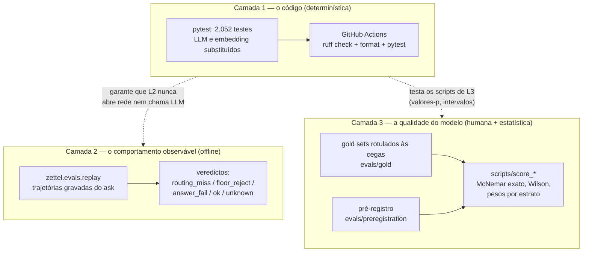
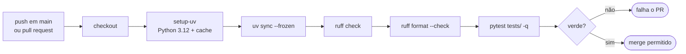
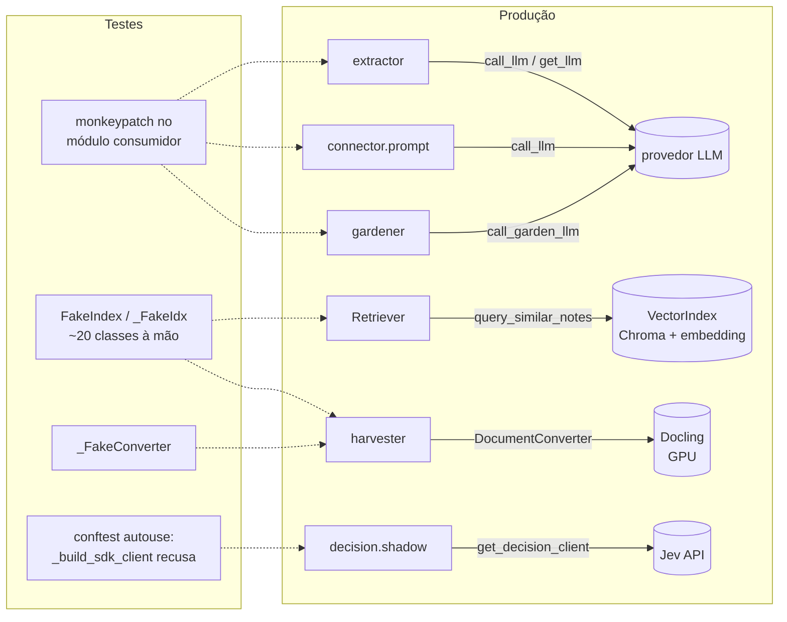
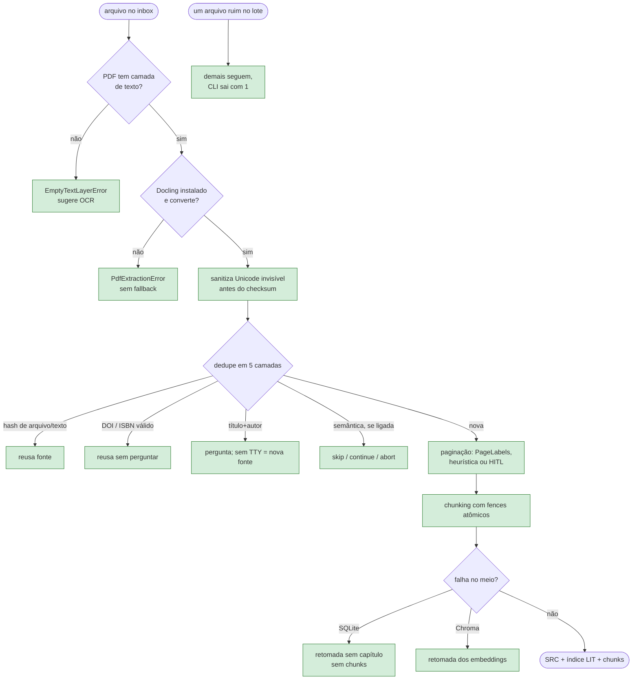
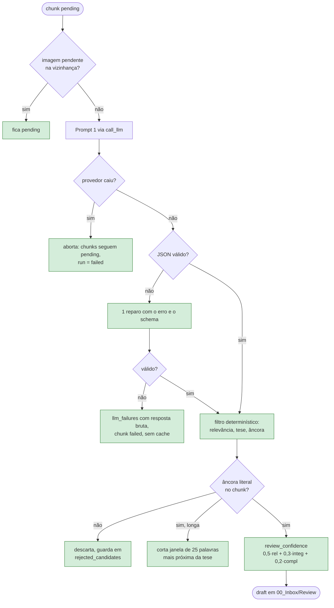
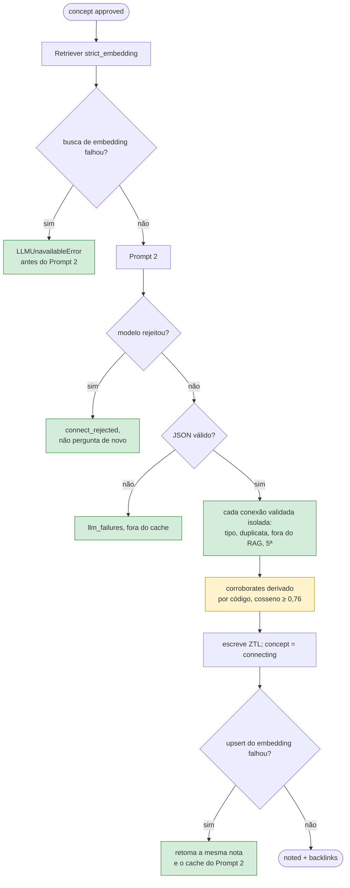
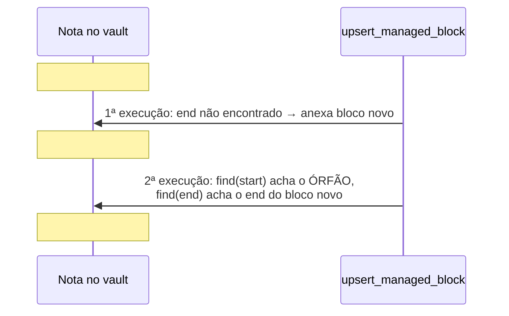
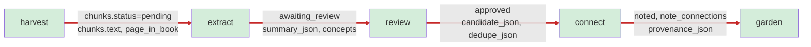
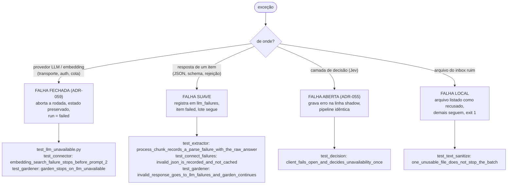
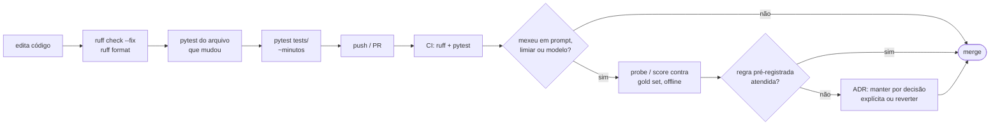

# Testes: 2.052 contratos sobre um pipeline com LLM — o que a suíte do `zettel_app` garante, o que ela não vê e por quê

> Artigo 7 de uma série sobre o `zettel_app`, um pipeline que transforma PDFs e Markdown em notas permanentes (Zettelkasten) compatíveis com o Obsidian.
> Esta parte cobre a **suíte de testes** (`tests/`, `tests/evals/`, `.github/workflows/tests.yml`) e, por extensão, a infraestrutura de **avaliação** (`zettel/evals/`, `evals/`, `scripts/`). Versão analisada: `main` @ `1beaa7b` (2026-10-21).
> Os artigos anteriores estão em [`01-harvest.md`](01-harvest.md), [`02-extract.md`](02-extract.md), [`03-review.md`](03-review.md), [`04-connect.md`](04-connect.md), [`05-garden.md`](05-garden.md) e [`06-web.md`](06-web.md).

---

## 0. Resumo (para quem tem pouco tempo)

Um pipeline que chama LLMs tem três tipos de "correção", e cada um pede um instrumento diferente:

1. **O código faz o que diz?** (determinístico, barato, roda a cada *commit*) → testes `pytest`.
2. **O modelo faz o que queremos?** (estocástico, caro, depende de rótulos humanos) → avaliação com *gold set*, pré-registro e teste estatístico.
3. **A decisão humana está bem informada?** (revisão, aprovação de arestas) → o produto precisa mostrar a evidência, e o teste verifica que mostra.

O `zettel_app` separa essas três camadas com uma disciplina que raramente vejo em projetos individuais: **2.052 testes** (1.641 funções, 102 arquivos, 34 mil linhas — 0,72 linha de teste por linha de produção) que nunca chamam um provedor de LLM; um *harness* de *replay* offline que **prova por asserção** que não abre *socket* nem chama o modelo; e scripts de pesquisa com McNemar exato, intervalos de Wilson e pesos por estrato, eles mesmos testados. Há ainda uma classe de testes que não testa comportamento, e sim **arquitetura**: oito arquivos leem o código-fonte com `ast` e falham se um módulo importar o que não deve, se um *handler* web for `async def`, se uma função for copiada entre módulos.

Rodei a suíte inteira com cobertura de ramos, li os testes das fases críticas e procurei o que eles **não** afirmam. O resumo honesto:

| #   | Achado | Gravidade | Evidência |
| --- | ------ | --------- | --------- |
| 1 | **A promessa central do projeto — "atualizações automáticas não destroem edições manuais" — não tem teste do seu invariante, e o invariante quebra.** Se o marcador `:end` de um bloco gerenciado some (edição no Obsidian, conflito de sincronização), `upsert_managed_block` anexa um bloco novo; na execução seguinte, substitui tudo entre o `:start` órfão e o novo `:end` — **apagando o texto manual que estava no meio**. O único teste de substituição não verifica nada fora do bloco. | **Alta** (perda silenciosa de dado do usuário) | Reproduzido em memória com a função real (§6.1) |
| 2 | **Não existe teste que encadeie as fases reais.** Cada fase é testada a partir de um banco "semeado à mão" com o estado que a fase anterior *deveria* deixar. Os testes de `run-all` (CLI e web) substituem **todas** as cinco fases por *stubs*. O contrato entre fases — `awaiting_review → approved → connecting → noted`, os campos de `summary_json`, o `chunk_id` que vira `literature_ref` — é verificado só por convenção. | **Alta** | `test_review.py:1527`, `test_web_state.py:169` |
| 3 | **O classificador de "provedor fora do ar" casa números na mensagem.** `is_llm_unavailable` procura `"404"`, `"429"`, `"503"`… em `str(exc)`. Um `ValidationError` do Pydantic inclui o valor recebido; se a resposta do modelo citar "p. 429", o erro de *parse* vira "indisponibilidade" e **aborta a rodada** em vez de registrar uma falha daquele item. O teste negativo usa uma entrada sem números. | **Média** | Reproduzido com a função real (§6.3) |
| 4 | **A suíte não é hermética, ao contrário do que o *workflow* afirma.** `import litellm` baixa o mapa de preços do GitHub (timeout de 5 s, com *fallback* local); 16 construções de `VectorIndex(..., allow_fallback=True)` usam o embedding padrão do Chroma, um modelo ONNX de **83 MB** baixado na primeira execução. O único bloqueio global é o do cliente do Jev. | **Média** | Código do LiteLLM e do `index.py`; cache local (§6.4) |
| 5 | **Os testes de fronteira numérica ficaram para trás da ADR-058.** Comentários ainda dizem "distância 0,7 → similaridade 0,65, abaixo do piso 0,70" (escala `(1+cos)/2`); hoje é cosseno 0,30 contra piso 0,40. Os testes passam por **margem larga**, não por estarem na fronteira — subir o piso para 0,75 não quebra nenhum teste de comportamento do `Retriever`. | **Média** | `test_retrieval.py:13,192,349`, `test_topic_index.py:196,207`, `test_connector.py:88` |
| 6 | **A fusão RRF não tem o seu cálculo afirmado.** Os testes verificam que a nota "aparece", não em que ordem nem com que pontuação. Trocar `1/(k+r)` por `1/r`, ou ignorar `rrf_k`, passaria. | Média–Baixa | `test_retrieval.py:60` |
| 7 | **Cerca de 20 *fakes* de `VectorIndex` escritos à mão, sem `spec`.** Nenhum teste garante que eles têm a assinatura do objeto real; quando o `VectorIndex` mudar, os *fakes* continuam verdes. Dois arquivos importam *fakes* de outro arquivo de teste (`from tests.test_harvester_dedup import FakeVectorIndex`). | Média–Baixa | `grep` (§5.2) |
| 8 | **Sem configuração do `pytest`.** Não há `[tool.pytest.ini_options]`: nem `--strict-markers`, nem `filterwarnings = error`, nem *timeout*, nem ordem aleatória, nem cobertura no CI. Há asserções de relógio de parede (`< 2,0 s`) e *polling* com orçamento de 1,5 s. | Baixa–Média | `pyproject.toml`, `test_paging.py:235`, `test_web.py:898` |
| 9 | **A cobertura é alta onde há lógica de domínio e baixa nas bordas.** 82% das linhas e 68,5% dos ramos no total, mas a CLI tem **28%** (14% dos ramos), a revisão bibliográfica interativa 15%, a criação de MOC por *hub* nunca é executada, e o lado tolerante da decisão de queda do embedding — o `ask` seguir só com o BM25 — **não roda em nenhum teste** (o lado estrito, do `connect`, é testado). | Média | `pytest-cov` (§3.3) |
| 10 | **A documentação do fluxo de testes diverge.** `docs/instalacao.md` lista 2 dos 9 arquivos web; o `CLAUDE.md`, 4. O diagrama do README ainda diz "literature_notes no Chroma" (a coleção não existe mais). | Baixa | Leitura |

A execução completa: **2.052 testes, todos verdes**, em 10 min 45 s com cobertura de ramos ligada; 91 avisos, 78 deles uma `DeprecationWarning` do `joblib` sob NumPy 2.5 — no caminho que persiste os modelos de *cluster* do `garden` (ADR-061).

O que está **muito bem feito**, e merece ser dito com a mesma ênfase:

- **Nenhum teste paga um provedor.** As costuras (`call_llm`, `get_llm`, `get_decision_client`, o `VectorIndex`) são *monkeypatchadas* no módulo consumidor, e o projeto documenta exatamente onde (`zettel.connector.prompt.call_llm`, não `zettel.llm.call_llm`).
- **Fluxos de exceção são primeira classe.** Há testes para queda do LLM no meio do `extract` (os *chunks* continuam `pending`, o *run* fica `failed`), falha do Chroma depois do SQLite (o `harvest` retoma sem capítulo órfão), falha do SQLite depois do arquivo (o *draft* não é apagado), resposta inválida (vai para `llm_failures` e **não** para o cache).
- **Testes de arquitetura como *fitness functions*.** Oito arquivos usam `ast` para impedir ciclos de importação, cópia de funções entre módulos, `async def` em *handlers*, *script* *inline* em *template*, e para garantir que `zettel.evals` nunca é importado pelo caminho de produção.
- **A pesquisa é testada como software.** O valor-p do McNemar exato é verificado contra um cálculo manual (`17 vs 6 → 0,0347`, confere); o intervalo de Wilson é testado nos extremos `0/0`, `0/30`, `30/30`; a ponderação por estrato tem teste próprio.
- **Os nomes dos testes são especificações.** `test_approve_chunk_keeps_the_draft_when_sqlite_update_fails`, `test_routed_note_still_faces_the_floor`, `test_dedupe_skips_llm_when_nearest_note_is_from_another_source`. Lidos em sequência, contam o comportamento do sistema — e as *docstrings* contam a *issue* que motivou cada um.

---

## 1. Por que testar um pipeline com LLM é diferente

Testar um sistema tradicional é verificar uma função: para esta entrada, esta saída. Num pipeline com LLM, a função mais importante — "este trecho contém uma ideia que merece virar nota?" — **não tem saída correta conhecida**, custa dinheiro a cada chamada e devolve respostas diferentes para a mesma pergunta. Isso cria uma tentação dupla: testar só o "encanamento" e chamar de suíte completa, ou chamar o modelo de verdade nos testes e aceitar uma suíte lenta, cara e instável.

O `zettel_app` recusa as duas saídas ao separar explicitamente **três camadas de verificação**, cada uma com seu instrumento, sua cadência e seu critério de aprovação:



A primeira camada roda a cada *push* e não sabe nada sobre qualidade de notas. A segunda roda offline sobre respostas já gravadas e separa **onde** uma pergunta falhou (a nota-alvo nunca foi recuperada? foi recuperada e barrada pelo piso? foi usada e a resposta errou?). A terceira é pesquisa: compara configurações (prompt atual vs. novo, `gpt-4o-mini` vs. outro modelo, limiar de cosseno vs. classificador tipado) contra rótulos humanos, com uma regra de decisão escrita **antes** de ver o resultado.

Este artigo trata principalmente da primeira camada, mas olha as outras duas sempre que elas dependem da primeira — e dependem: a credibilidade de um valor-p calculado por um script não testado é zero.

---

## 2. Metodologia: o que eu li, o que eu medi, o que eu não verifiquei

- **Lido**: `tests/conftest.py`, o *workflow* de CI, `pyproject.toml`; os testes de todas as fases com atenção a `test_extractor.py`, `test_review.py`, `test_connector.py`, `test_connect_failures.py`, `test_llm_unavailable.py`, `test_harvest_resume.py`, `test_harvester_dedup.py`, `test_paging.py`, `test_retrieval.py`, `test_topic_index.py`, `test_vault.py`, `test_web_preconditions.py`, `test_oplock.py`, `tests/evals/*`; os nomes de todas as 1.641 funções de teste; as funções de produção correspondentes quando um teste parecia fraco. Também o `CLAUDE.md`, o README, o índice de ADRs e os seis artigos anteriores.
- **Medido**: execução completa da suíte com `pytest-cov` (cobertura de linhas e ramos) e `--durations`, numa máquina Windows 11, Python 3.12, em ambiente efêmero (`uv run --no-sync --with pytest-cov`, sem alterar o `.venv`). Contagens estáticas com `grep`/`awk` sobre `tests/`.
- **Reproduzido**: os achados #1 e #3 chamando as funções reais em memória, sem tocar arquivo algum do projeto.
- **Não verificado**: não rodei *mutation testing* (a recomendação da §10 é exatamente essa, e os números de "mutante sobrevivente" que cito na §6.5 são raciocínio, não execução). Não rodei a suíte no Linux do CI, só localmente. Não reexecutei nenhuma medição de qualidade de modelo — os números de *gold set* citados vêm dos ADRs e do `CLAUDE.md`.

> Nenhuma linha de código ou de documentação do projeto foi alterada para produzir este artigo. Os comandos de reprodução estão no Apêndice A.

---

## 3. Visão geral da suíte

### 3.1 Os números

| Métrica | Valor |
| --- | --- |
| Testes coletados (com parametrização) | **2.052** |
| Funções `test_*` | 1.641 |
| Arquivos de teste | 102 (98 em `tests/`, 4 em `tests/evals/`) |
| Linhas de teste / linhas de produção | 34.257 / 47.393 = **0,72** |
| Decoradores `@pytest.mark.parametrize` | 39 |
| *Fixtures* declaradas | 42 (uma *autouse* global) |
| `monkeypatch.setattr` | 304 |
| Usos de `MagicMock` | 91 |
| Arquivos que usam `ast` para testar arquitetura | 8 |
| `skip` condicionais | 28 (15 "SQLite sem FTS5", 11 `importorskip` de provedores, 2 arquivos ausentes) |
| Coleta | 9,2 s |
| Execução completa (com cobertura de ramos) | 645 s — 2.052 verdes, 0 falhas, 91 avisos |

O tempo não está distribuído: **cinco testes somam 313 s, quase metade da execução**. Nenhum deles é lento pelo que testa; são lentos porque são os primeiros a tocar uma dependência pesada:

| Teste | Tempo (com cobertura) | Causa |
| --- | ---: | --- |
| `test_gardener_assign::test_cluster_embeddings_is_deterministic_with_seed` | 97,7 s | compilação JIT do `numba` na primeira chamada do UMAP (47 s mesmo sem cobertura) |
| `test_bibliography::test_process_file_persists_biblio_with_complete_frontmatter` | 85,6 s | primeiro a importar a cadeia do harvest; 5,3 s isolado e sem cobertura |
| `test_pdf_extraction::test_extract_pdf_docling_conversion_failure_…` | 61,4 s | `import docling.document_converter` (17 s de importação medidos com `-X importtime`, sem cobertura) |
| `test_garden_report::test_estimate_garden_counts_one_call_per_create_or_update` | 35,6 s | UMAP/HDBSCAN |
| `test_calibrate_pre_llm_gate::test_cross_val_proba_requires_three_sources` | 32,6 s | `scikit-learn` |

Isso tem uma consequência prática para quem desenvolve: rodar "só os testes rápidos" não é possível sem *markers*, e o custo de importação aparece no arquivo que por acaso roda primeiro, o que torna `--durations` enganoso. Um *marker* `slow` (ou `heavy`) para os testes que tocam Docling, UMAP e scikit-learn tornaria o ciclo de edição de minutos para segundos.

A distribuição por área diz onde o projeto investiu atenção (agrupamento meu, por nome de arquivo; aproximado):

| Área | Testes | Arquivos |
| --- | ---: | ---: |
| Estado, índice, config, CLI, vault, sync, infraestrutura | 433 | 19 |
| Harvest (ingestão, paginação, dedupe, sanitização) | 288 | 15 |
| LLM, prompts, custo, pré-voo, camada de decisão | 268 | 10 |
| Web | 230 | 8 |
| Avaliação e scripts de pesquisa | 195 | 17 |
| Garden (MOCs, hubs, índice de tópicos) | 141 | 8 |
| Recuperação, `ask`, `catalog`, `article`, `skill`, `summarize` | 139 | 8 |
| Extract | 138 | 6 |
| Review | 138 | 4 |
| Connect | **82** | 7 |

O `connect` é a fase com mais lógica de decisão (RAG, tipos de relação, corroboração, citação, retomada) e a mais cara em LLM, e é a que tem menos testes. Não é por si um defeito — os 82 são densos e cobrem os fluxos de exceção mais importantes (§4.4) —, mas é o primeiro lugar onde eu procuraria a próxima regressão.

### 3.2 O CI

O *workflow* existe desde **2026-10-20** (`4b4f0c5`). Antes disso, por cerca de oito meses e meio, a suíte só rodava quando alguém lembrava — o artigo 6 encontrou o contrato de rotas da web vermelho na `main` por dois épicos seguidos. O *workflow* atual é curto e correto:



Três observações: `concurrency` com `cancel-in-progress` evita filas de execuções obsoletas; `uv sync --frozen` garante que o CI testa exatamente o `uv.lock`; e o comentário do passo de testes — *"No secrets: tests stub the LLM per test and tests/conftest.py refuses the decision-model client, so a test that reaches the network fails here"* — é **parcialmente falso** (achado #4, §6.4): sem segredos, um teste que chama um provedor falha, mas um teste que baixa um arquivo público passa.

### 3.3 Cobertura

O projeto nunca tinha medido cobertura. Medi com `pytest-cov`, linhas e ramos, sobre o pacote `zettel/`:

| Métrica | Valor |
| --- | ---: |
| Linhas | **82,1%** (16.906 de 20.599) |
| Ramos | **68,5%** (4.562 de 6.662) |
| Combinado (como o `coverage.py` reporta) | 78,7% |

A diferença de 14 pontos entre linhas e ramos é o número mais informativo da tabela: as linhas rodam, mas muitos `if` só são exercitados num dos lados. Em código que trata exceções, o lado não exercitado costuma ser o de erro.

Por área (só as maiores):

| Pacote/módulo | Instruções | Linhas | Ramos |
| --- | ---: | ---: | ---: |
| `zettel/evals/` | 456 | 94,5% | 86,7% |
| `skill_export.py` | 314 | 96,2% | 87,0% |
| `decision/` | 280 | 93,2% | 77,4% |
| `state/` | 1.004 | 90,1% | 68,8% |
| `gardener.py` | 898 | 89,5% | 79,8% |
| `web/` | 1.830 | 88,7% | 71,1% |
| `connector/` | 1.151 | 87,1% | 74,4% |
| `extractor.py` | 597 | 87,1% | 76,2% |
| `review.py` | 898 | 86,7% | 76,3% |
| `harvester/` | 1.747 | 81,3% | 68,6% |
| `retrieval.py` | 363 | 73,3% | 61,3% |
| `index.py` | 541 | 72,3% | 51,2% |
| `gardener_hub.py` | 272 | 57,4% | 38,2% |
| `cli/` | 1.547 | **27,9%** | **14,1%** |

Três buracos merecem nome, porque estão em caminhos que os ADRs tratam como críticos:

1. **Metade da decisão de queda do embedding nunca roda** (`retrieval.py:192-205`, `Retriever._raise_if_strict`). O método implementa "o `connect` falha fechado quando o embedding cai; o `ask` segue só com o BM25". O lado estrito é bem testado: `test_embedding_search_failure_stops_before_prompt_2` usa um índice cujo `query_similar_notes` levanta `ConnectionError` e verifica que o `connect` para antes do Prompt 2, com o conceito ainda `approved` e o *run* `failed`. Mas as linhas 200 (modo tolerante, o `return` do `ask`) e 205 (modo estrito com um erro que não é de transporte, relançado como está) não são executadas por nenhum teste. A promessa de que o `ask` continua respondendo pelo BM25 com o embedding fora do ar está só no código e na *docstring*.
2. **A criação de um MOC de *hub* nunca roda** (`gardener_hub.py:434-527`, `_create_new_hub_moc`, e `plan_garden_hubs`). Os testes cobrem ranqueamento de *hubs*, vizinhança e a rota incremental; o caminho que escreve um MOC novo, com o *prompt* e o *parse* da saída, não.
3. **A CLI é quase toda não testada.** Fora `pipeline.py` (68%) e `deps.py` (64%), os módulos de comando ficam entre 8% e 28%. O `diagnostics.py` (`status`, `doctor`) tem 323 instruções e 17% de cobertura — e é ele que o usuário consulta quando algo dá errado. A revisão bibliográfica interativa do harvest (`harvester/biblio_hitl.py`) tem 15%.

Cobertura não é qualidade — a §6.5 mostra linhas 100% cobertas por testes que não perceberiam um limiar errado —, mas cobertura zero é ausência certa de verificação. Os três itens acima são isso.

---

## 4. Como a suíte isola o que é caro: as costuras

A decisão de arquitetura que torna a suíte possível não está em nenhum arquivo de teste: está na **forma do código de produção**. Toda chamada cara passa por uma porta única, e cada porta é substituível.



O detalhe que separa uma suíte frágil de uma robusta está em **onde** o *patch* é aplicado. Se `zettel/connector/prompt.py` faz `from zettel.llm import call_llm`, substituir `zettel.llm.call_llm` não afeta a referência já copiada para o módulo do conector. O projeto resolveu isso com regras explícitas e testadas:

- `tests/test_connector_package.py` proíbe que submódulos do conector importem símbolos de `zettel.connector.__init__` — o lugar de *patch* é sempre o submódulo consumidor.
- O pacote `article_graph` tem a regra inversa: **todo** LLM passa pelos globais de `zettel/article.py`, porque é lá que os testes fazem o *patch*. O `CLAUDE.md` chama isso de "duas costuras que uma mudança precisa preservar".
- A camada de decisão (Jev) tem uma *fixture* `autouse` em `tests/conftest.py` que substitui o construtor do SDK por uma recusa. Um teste que esqueça de injetar um *fake* **falha aberto** (o cliente devolve "indisponível"), em vez de chamar a rede.

Essa engenharia é o que permite 2.052 testes sem uma chave de API. O custo dela aparece na §5.2: as costuras de LLM são funções (fáceis de substituir com segurança), mas a do `VectorIndex` é um objeto com uma dúzia de métodos, e cada arquivo de teste reimplementa a parte que precisa.

---

## 5. O que os testes verificam, fase por fase

Para cada fase, descrevo o caminho feliz e os fluxos de exceção, e marco o que tem teste. A convenção dos diagramas: **verde** = há teste que afirma o comportamento; **amarelo** = há teste, mas fraco ou indireto; **vermelho** = sem teste.

### 5.1 Harvest



É a fase com a melhor cobertura de exceções da suíte. Destaques:

- `test_harvest_resume.py` é um teste de **injeção de falha** bem desenhado: um `_Idx` que levanta exceção na *n*-ésima chamada, um `upsert_chunk` real envolto num contador que falha uma vez, e uma asserção de invariante (`_assert_no_chapter_without_chunks`) em vez de uma asserção sobre valores. É o tipo de teste que pega o bug que o artigo 1 encontrou (checksum gravado antes dos *chunks*).
- `test_text_sanitize.py::test_sanitized_variants_collide_on_the_extraction_checksum` afirma a **propriedade** que justifica a sanitização (duas variantes que diferem só em caracteres invisíveis têm o mesmo checksum), não o detalhe da implementação.
- `test_harvester_dedup.py` cobre as cinco camadas, incluindo os casos que o artigo 1 apontou como perigosos: ISBN com dígito verificador inválido não funde, ISBN de capítulo não funde sem TTY, DOI com pontuação final é normalizado.
- `test_paging.py` tem sete testes de `locate_quote_*` cobrindo citação na página seguinte, cruzando quebra de página, com reticências editoriais, atravessando página vazia — exatamente o mecanismo que dá a página da citação ABNT.

O ponto fraco é o Docling: ele é sempre um `_FakeConverter`. Isso é correto para a suíte rápida (o Docling real exige GPU e minutos por arquivo), mas significa que **nenhum teste verifica que o Markdown que o Docling de verdade produz tem a forma que o *chunker* espera**. O artigo 1 mostrou que essa forma mudou (tabelas com *padding*, só H2 nos PDFs); quem detectou foi a medição, não a suíte. Um teste de contrato com um PDF pequeno e real, marcado como lento e fora do CI padrão, fecharia isso (§10).

### 5.2 Extract



`test_extractor.py` (80 funções) é o arquivo mais denso da suíte e o que melhor documenta o raciocínio do projeto. Ele tem uma característica que eu destacaria num processo seletivo: **testes que fixam medições, não só código**. Por exemplo:

- `test_score_review_confidence_floor_relevance_can_reach_the_threshold` existe porque a versão anterior da fórmula tinha um teto matemático de 0,70 para *chunks* no piso de relevância, contra um limiar de 0,75 — nenhum *chunk* de relevância 3 podia ser aprovado automaticamente. Com a fórmula atual,

  $$\text{conf} = 0{,}50\cdot r + 0{,}30\cdot i + 0{,}20\cdot c,\qquad r = 0{,}6 + 0{,}4\cdot\frac{\bar{s}-s_{\min}}{5-s_{\min}}$$

  um *chunk* impecável no piso ($\bar s = s_{\min} = 3$, $i = c = 1$) vale $0{,}5\cdot0{,}6+0{,}3+0{,}2 = 0{,}80 \ge 0{,}75$. O teste garante que essa alcançabilidade não regrida; `test_calibrate_review_confidence.py` faz o mesmo para todos os níveis de relevância.
- `test_score_review_confidence_ignores_definition_length` fixa a decisão da *issue* #152 de que nenhum termo da confiança pode ser um comprimento.
- `test_intra_batch_dedupe_cosine_threshold_marks_086_and_not_084` é um dos poucos testes de fronteira numérica da suíte que está **na fronteira** (0,85 de cosseno).

Os fluxos de exceção têm cobertura exemplar: queda do provedor (`test_llm_unavailable.py`), JSON inválido com reparo que inclui a mensagem de erro e o *schema*, duas falhas seguidas, resposta reparada vai para o cache e a quebrada não.

### 5.3 Review

O `review` é a fase com mais interação humana, e os testes refletem isso: 68 funções em `test_review.py`, a maioria dirigindo o menu interativo com entradas simuladas (`a`, `d`, `r`, `x`, `f`, `m`, `p`, `q`). Os mais importantes são os de **ordem de efeitos colaterais**:

- `test_approve_chunk_keeps_the_draft_when_sqlite_update_fails` e `test_approve_chunk_deletes_the_draft_after_sqlite`: o arquivo aprovado é escrito, o SQLite é atualizado, e **só então** o *draft* é apagado. Se o SQLite falhar, o *draft* sobrevive — o humano não perde o trabalho.
- `test_non_interactive_review_never_drops_a_possible_duplicate`: "a dedupe propõe, o revisor decide" é um princípio do ADR-016; o teste garante que nenhum caminho sem TTY descarta um candidato.
- `test_batch_requeue_reports_item_k_only_after_it_moved`: a barra de progresso não mente (o artigo 6 encontrou o contrário; o teste é a correção).

### 5.4 Connect



Os testes de `test_connect_failures.py` são o melhor exemplo de "um erro não derruba o lote": `test_one_bad_relation_does_not_drop_the_note` e `test_coerce_drops_invalid_duplicate_and_extra_connections` afirmam que cada conexão é validada isoladamente. `test_embedding_upsert_failure_is_resumed_on_the_same_note` fixa o estado intermediário `connecting`, que é o que permite retomar sem duplicar a nota.

A primeira caixa do diagrama, "busca de embedding falhou → `LLMUnavailableError` antes do Prompt 2", é testada de ponta a ponta dentro do `connect`: o índice falso levanta `ConnectionError` e o `Retriever` real a converte. O que a cobertura mostra sem teste é o outro lado da mesma decisão, no `ask` (§3.3).

O amarelo no diagrama é o limiar de corroboração: o teste usa distância 0,10 (cosseno 0,90) para "acima" e 0,60 (cosseno 0,40) para "abaixo", com o comentário "similarity 0.95 >= 0.85" — números de antes da ADR-058. O limiar real é 0,76; os dois pontos estão longe dele (§6.5).

O `test_prompts.py` merece menção à parte: ele garante que `corroborates` **não aparece** em `prompts/permanent_note.md` (`test_permanent_note_never_offers_corroborates`). É um teste sobre um arquivo de texto, e é o certo: a decisão de que corroboração é fato de autoria, não julgamento do modelo, só se sustenta se o modelo nunca for convidado a emiti-la.

### 5.5 Garden

O `garden` mistura aprendizado de máquina não supervisionado (UMAP + HDBSCAN), grafos e LLM. Os testes atacam as três frentes:

- **Determinismo**: `test_cluster_embeddings_is_deterministic_with_seed` e `test_stored_model_gives_the_same_partition_without_refitting` fixam a reprodutibilidade que a *issue* #294 exigiu (sem semente, o mesmo vetor dava partições diferentes e a assinatura do *cluster* nunca batia).
- **Matemática do grafo**: `test_graph_cohesion_is_a_weighted_density_between_zero_and_one` fixa a definição

  $$\text{coesão}(C) = \frac{2\,W_{\text{int}}}{n(n-1)} \in [0,1]$$

  e `test_graph_cohesion_counts_proposed_edges_at_the_factor` fixa que uma aresta proposta pesa `proposed_edge_factor` (0,5) vezes o peso da relação.
- **Idempotência**: `test_second_run_with_no_new_note_changes_no_moc` é talvez o teste mais valioso da fase — o artigo 5 mostrou que o *garden* reescrevia MOCs sem mudança real.
- **Exceções**: provedor fora do ar interrompe com `failed`, resposta inválida vai para `llm_failures` e só pula aquele *cluster*, e `test_invalid_taxonomy_with_recreate_deletes_nothing` garante que `--recreate` só apaga depois de provar que vai conseguir recriar.

O custo é tempo: o primeiro teste que chama UMAP paga a compilação JIT do `numba` (§3.1). E há uma lacuna: os MOCs ancorados em *hubs* (`garden --hubs`) têm testes de ranqueamento e de atualização incremental, mas a criação de um MOC novo nunca é executada (57% de linhas, 38% de ramos em `gardener_hub.py`).

### 5.6 Recuperação, `ask` e `catalog`

`test_retrieval.py` tem 32 testes, 22 deles sobre o **piso de relevância** — o mecanismo que impede uma pergunta fora do domínio de receber uma resposta "confiante". A sequência de testes reproduz a história do mecanismo:

1. `test_floor_rejects_low_similarity_vector_hit` — RRF é posicional; sem piso, o vizinho mais próximo de qualquer pergunta passa.
2. `test_strong_bm25_rank_bypasses_low_similarity` — BM25 resgata jargão que o embedding subestima.
3. `test_low_coverage_denies_the_bypass` — mas "estar no top 5 do BM25" é relativo; com o termo comum "fazer", uma pergunta sobre risoto resgatava 4 notas. A cobertura lexical (≥ 0,5 dos termos da pergunta) é a metade absoluta.
4. `test_absolute_min_similarity_blocks_even_strong_bm25_bypass` — e um piso duro abaixo de tudo.

`test_topic_index.py::test_routed_note_still_faces_the_floor` tem a melhor *docstring* da suíte: *"The historical bug: a routing hint must not be a free pass."* E `test_catalog.py` usa `ast` para garantir que `zettel/ask.py` nunca chama a busca de resumos de capítulo — o que mantém um artefato escrito por LLM fora da evidência citada.

O `ask` tem só 5 testes, mas o essencial está lá: `test_run_ask_below_floor_shows_candidates_but_no_llm_call` afirma que, sem evidência, **o LLM não é chamado** — uma garantia de custo e de honestidade ao mesmo tempo.

### 5.7 Web

`test_web_preconditions.py::test_pipeline_button_enabled_iff_the_server_accepts` é o teste mais elegante da suíte. Ele parametriza 8 combinações de credenciais × 2 estados do banco (com e sem trabalho) e verifica, para cada operação do pipeline, que **o botão está habilitado se e somente se o servidor aceita o pedido**. É uma propriedade bicondicional sobre dois caminhos de código (o *template* e o *handler*) que antes divergiam (artigo 6, achado #10). Testar o "se e somente se" em vez de casos isolados é exatamente o que impede a divergência de voltar.

Os outros arquivos web cobrem o que o artigo 6 apontou: cabeçalhos de segurança em toda resposta, *templates* sem `'unsafe-inline'`, corpo acima do limite recusado antes de ser lido, login sem nada derivado do segredo, limitação de tentativas, revogação de sessão, página de erro com referência que o log contém.

Dois pontos fracos: *polling* com orçamento fixo (`for _ in range(30): ... time.sleep(0.05)` — 1,5 s para o *worker* terminar um *job*), que numa máquina de CI carregada vira teste intermitente; e `test_web.py` com 3.267 linhas e 93 testes num arquivo só, com o *fixture* `web_client` e o *helper* `_login` duplicados em quatro arquivos.

### 5.8 Estado, CLI, concorrência

- `test_state_package.py` fixa a **API pública** de `StateDB` como um conjunto exato e proíbe dois *mixins* de definirem o mesmo nome (o MRO esconderia um deles em silêncio).
- `test_oplock.py` sobe um **processo real** que segura o *lock* e verifica que outro processo vê quem o detém, que um processo morto libera o *lock* (o SO libera), e que todo comando mutante da CLI passa por `load_deps`.
- `test_cli.py` verifica a ordem do `--help`, ausência de ciclos de importação e que os módulos de domínio são importados de forma preguiçosa (para `zettel --help` não carregar chromadb/docling/langchain).

O que falta aqui é o caminho de **execução** da CLI: há nove pontos de chamada de `CliRunner().invoke` na suíte inteira, dois deles para `--help`, e só `review`, `retry-failed`, `connect`, `extract` e `status` são invocados como comando. A maior parte dos comandos é testada chamando a função de domínio (`run_extract`), não o comando (`zettel extract`), então o *parsing* de *flags*, as mensagens de saída e os códigos de retorno ficam sem teste — a cobertura dos módulos `zettel/cli/*` na §3.3 mostra o tamanho disso.

### 5.9 Camada de decisão (Jev) e avaliação

A camada de decisão é *shadow*: ela observa e grava, mas não decide. Os testes garantem as três propriedades que tornam isso seguro:

1. `test_shadow_off_never_asks` e `test_shadow_corroborates_off_never_asks` — desligada, nenhuma chamada.
2. `test_client_fails_open_and_decides_unavailability_once` — sem pacote ou chave, a pipeline segue e o aviso aparece uma vez por processo (o oposto deliberado da ADR-059, que falha fechado para LLM).
3. `test_expand_rotates_choice_options_so_each_copy_leads_with_another` e `test_collapse_averages_copies_and_measures_spread` — o viés de posição do modelo (ele tende a escolher a primeira opção) é tratado perguntando $k$ vezes com as opções rotacionadas e tirando a média:

   $$\hat p(o) = \frac1k\sum_{j=1}^{k} p_j(o),\qquad \text{spread} = \max_j p_j(o^*) - \min_j p_j(o^*)$$

Em `tests/evals/`, o desenho é o de um experimento: `test_evals_are_not_imported_by_the_production_path` sobe um subprocesso que importa `harvest|extract|connect|ask` e falha se `zettel.evals` aparecer em `sys.modules`; `test_replay_makes_no_network_call` substitui `socket.connect`; `test_a_different_commit_is_a_different_run` impede comparar execuções de *commits* diferentes sem querer; `test_secret_looking_values_are_refused` impede que um manifesto publique uma chave.

---

## 6. Achados em detalhe

### 6.1 Achado #1 — o invariante "não destruir edição manual" não é testado, e falha

O README lista como princípio: *"Não-regressão: atualizações automáticas não destroem edições manuais (blocos gerenciados)"*. O mecanismo é `zettel/vault.py::upsert_managed_block`: o pipeline só escreve entre `<!-- zettel:NOME:start -->` e `<!-- zettel:NOME:end -->`, e tudo fora disso é do usuário.

O teste da substituição é este:

```python
def test_upsert_managed_block_replace():
    content = ("# Title\n\n"
               "<!-- zettel:auto-backlinks:start -->\n- old link\n"
               "<!-- zettel:auto-backlinks:end -->\n")
    result = upsert_managed_block(content, "auto-backlinks", "- new link")
    assert "old link" not in result
    assert "- new link" in result
```

Ele verifica o que entra e o que sai **do bloco**. Não verifica que `# Title` sobreviveu — que é a promessa. E não há teste para marcadores malformados. A implementação:

```python
start_idx = content.find(start_tag)
if start_idx == -1: ...anexa o bloco...
end_idx = content.find(end_tag, start_idx)
if end_idx == -1:
    return content + "\n" + block_text + "\n"   # anexa SEM remover o start órfão
before = content[:start_idx]
after = content[end_idx + len(end_tag):]
return before + block_text + after
```

Reproduzi o cenário em memória: um usuário apaga sem querer a linha do `:end` (ou um conflito de sincronização a remove) e escreve um parágrafo depois do bloco.



Saída real: `manual preserved after 2nd run: False`. O texto do usuário desaparece sem aviso, e a nota fica com aparência perfeitamente válida.

**Por que os testes não pegaram**: porque testam exemplos, e o exemplo é sempre bem-formado. Esse é o caso de manual para **teste baseado em propriedades** (*property-based testing*). A propriedade é simples de enunciar e independente da implementação:

> Para qualquer texto `t` e qualquer bloco `b`, todo trecho de `t` que está fora de um bloco gerenciado bem-formado aparece intacto em `upsert(t, b, x)`; e se `t` tem marcadores malformados, a função ou os repara sem perder texto, ou recusa.

Com Hypothesis, isso é um gerador de textos que intercala parágrafos arbitrários com marcadores (inclusive órfãos, duplicados e dentro de *fences*) e uma asserção. O gerador encontraria este caso em segundos.

**Correção sugerida**: tratar `start` sem `end` (e `end` sem `start`, e dois `start`) como erro de estrutura: não escrever, registrar no log e no `zettel doctor`. Escrever "consertando" é pior do que não escrever.

### 6.2 Achado #2 — não há teste de ponta a ponta

Todas as fases são testadas, mas nenhuma é testada **a partir da saída real da anterior**. O padrão é este:

```python
db.upsert_concept("c1", "@Ana2024", "@Ana2024::ch000::ok",
                  candidate_json='{"thesis": "Uma tese.", ...}', status="approved")
```

O teste do `connect` semeia o conceito com o JSON que **acha** que o `review` produz. Se o `review` mudar o formato de `candidate_json`, o nome de um *status*, ou o campo que liga o conceito ao *chunk*, os testes das duas fases continuam verdes, e o pipeline real quebra na fronteira. Os testes de `run-all` em `test_review.py` e `test_web_state.py`, onde se esperaria encontrar esse encadeamento, substituem as fases por *stubs*:

```python
monkeypatch.setattr("zettel.harvester.run_harvest", harvest)
monkeypatch.setattr("zettel.extractor.run_extract", lambda *_a, **_k: [])
monkeypatch.setattr("zettel.connector.run_connect", ...)
monkeypatch.setattr("zettel.gardener.run_garden", lambda *_a, **_k: [])
```

Eles testam a **orquestração** (ordem, *source_ids* repassados, aviso de auto-aprovação), o que é útil, mas não o contrato. O `run-all` da CLI nem chega a ser executado — o teste lê o arquivo-fonte e procura duas substrings:

```python
def test_run_all_connects_only_the_harvest_sources_and_asks_before():
    text = (CLI_PKG / "pipeline.py").read_text(encoding="utf-8")
    assert "preflight_gate(estimate_connect" in text
    assert "source_ids=list(harvest_outcome.source_ids)" in text
```

Para impor regras de **arquitetura** (quem importa quem), ler o código-fonte é a técnica certa, e o projeto a usa bem com `ast`. Para impor **comportamento**, é frágil nos dois sentidos: renomear a variável quebra o teste sem mudar nada, e um *bug* que preserve o texto (a chamada dentro de um `if` nunca verdadeiro) passa.



Verde: cada fase isolada. Vermelho: as setas — os contratos — não têm teste.

**O que eu faria**: um único teste de fumaça, "um Markdown de duas seções atravessa o pipeline", com um LLM falso que devolve respostas fixas e válidas por fase (o *fake* de *replay* que o `zettel.evals` já sabe gravar), um `VectorIndex` falso com vetores determinísticos, e asserções sobre o vault final: existe uma ZTL, ela cita a LIT certa com a página certa, o MOC a lista. Um teste assim leva segundos e teria pego várias das regressões que os artigos 1–5 encontraram por medição.

### 6.3 Achado #3 — `is_llm_unavailable` confunde números com códigos HTTP

`zettel/llm.py` classifica uma exceção como "provedor indisponível" (aborta a rodada, preserva o estado) ou "erro de conteúdo" (registra a falha do item e segue). A distinção é central para três ADRs. Parte da classificação é por substring da mensagem, varrendo toda a cadeia de exceções:

```python
_UNAVAILABLE_MSG_MARKERS = ("401", "403", "404", "429", "502", "503", "504",
                            "connection refused", ...)
```

O teste negativo:

```python
def test_is_llm_unavailable_ignores_parse_and_schema():
    with pytest.raises(ValidationError) as exc:
        _M(x="no")
    assert not is_llm_unavailable(exc.value)
```

A entrada é `"no"`. Mas a mensagem de um `ValidationError` do Pydantic **contém o valor recebido** (`input_value='...'`), e o valor recebido é texto escrito pelo modelo sobre um livro. Reproduzi:

```text
ValidationError com input 'ver p. 429 do livro'  ->  is_llm_unavailable = True
JSONDecodeError "line 1 column 408 (char 407)"   ->  is_llm_unavailable = False
```

Em pelo menos dois caminhos — a dedupe do `review` (`extractor.py:1276`) e a guarda PT-BR do `connect` (`connector/prompt.py:480`) — o *parse* está no mesmo `try` que a chamada, e o `except` faz `if is_llm_unavailable(e): raise LLMUnavailableError`. Uma resposta inválida que mencione "página 404" transforma um erro de um item numa **interrupção da rodada inteira**, com a mensagem "provedor indisponível".

Não observei isso acontecer no acervo real; é plausível, não frequente. Mas o teste existe precisamente para dizer "erro de *schema* nunca é indisponibilidade", e ele passa porque escolheu uma entrada que não exercita o caso. **Correção**: classificar primeiro por tipo (`ValidationError`, `JSONDecodeError`, `ValueError` de *parse* → nunca indisponível), e só procurar códigos HTTP em exceções de transporte, de preferência no atributo `status_code` que os SDKs expõem. O teste deveria usar uma entrada como `"erro 429 na página 503"`.

### 6.4 Achado #4 — a suíte acessa a rede

O `conftest.py` bloqueia uma única porta: o SDK do Jev. Dois outros caminhos de rede passam:

1. **LiteLLM.** `zettel/pricing.py` faz `import litellm` sob demanda. Na importação, o LiteLLM busca `model_prices_and_context_window.json` no GitHub com *timeout* de 5 s e cai para a cópia local se falhar (a variável `LITELLM_LOCAL_MODEL_COST_MAP=True` desliga isso). Consequências: até 5 s de espera num CI sem rede; e testes que leem preços reais (`test_gemini_embedding_is_priced`) dependem de um arquivo que muda fora do repositório.
2. **Embedding padrão do Chroma.** `VectorIndex(..., allow_fallback=True)` com um provedor desconhecido devolve `embedding_fn = None`, e o Chroma usa o `DefaultEmbeddingFunction` (MiniLM em ONNX). Na primeira execução numa máquina limpa — todo *runner* do GitHub Actions —, ele baixa `onnx.tar.gz` (83 MB no meu cache local) para `~/.cache/chroma`. Há 16 construções desse tipo em `test_index.py` e `test_rebuild.py`.

Nenhum dos dois quebra o CI hoje; ambos tornam o CI **mais lento e dependente de terceiros**, e contradizem o comentário do *workflow*. A prática consolidada é bloquear *sockets* na suíte inteira (por exemplo com `pytest-socket`, `--disable-socket`, com exceção explícita e marcada para os testes que realmente precisam) e fixar `LITELLM_LOCAL_MODEL_COST_MAP=True` no `conftest.py`. O próprio projeto já usa a técnica, mas só em `tests/evals/`.

### 6.5 Achado #5 — fronteiras numéricas que ficaram para trás

A ADR-058 mudou o espaço de distância do Chroma para cosseno e converteu todos os limiares medidos na escala antiga por $s_{\cos} = 2s_{\text{antiga}} - 1$. O código mudou; vários comentários de teste não:

| Arquivo:linha | Comentário | Valor real (ADR-058) |
| --- | --- | --- |
| `test_retrieval.py:13` | "0.1 -> similarity 0.95, above the default 0.70 floor" | cos 0,90; piso 0,40 |
| `test_retrieval.py:192` | "distance=0.7 -> similarity = 1 - 0.7/2 = 0.65, below the 0.70 floor" | cos 0,30; piso 0,40 |
| `test_topic_index.py:207` | "Distance 1.2 -> similarity 0.40, below the default 0.70 floor" | cos −0,20; piso 0,40 |
| `test_connector.py:88` | "similarity 0.95 >= 0.85" | cos 0,90; limiar 0,76 |

Comentário errado é um problema de manutenção. O problema de **teste** é outro: os pontos escolhidos estão longe da fronteira. O par de testes do piso usa cosseno 0,30 ("abaixo") e 0,80 ("acima"). Qualquer valor do piso entre 0,31 e 0,79 passa nos dois. Em linguagem de *mutation testing*: o mutante "piso = 0,75" **sobrevive** a todos os testes de comportamento do `Retriever`. Ele só seria morto por `test_config.py`, que compara o YAML com o *default* do *schema* — ou seja, fixa o número, não o efeito do número.

A técnica clássica é a análise de valor-limite: para um limiar $\theta$, testar $\theta - \varepsilon$, $\theta$ e $\theta + \varepsilon$, lendo $\theta$ da configuração. Assim o teste continua correto quando o limiar for remedido (o `CLAUDE.md` exige remedição a cada troca de modelo de embedding) e mata qualquer mutante que mova a comparação.

### 6.6 Achado #6 — RRF sem a conta

A fusão de rankings é o coração da busca híbrida:

$$\text{RRF}(d) = \sum_{r \in \{\text{vetor},\,\text{BM25}\}} \frac{1}{k + \text{rank}_r(d)}$$

`test_rrf_combines_vector_and_bm25` verifica que uma nota encontrada só pelo BM25 e outra só pelo vetor aparecem ambas. Nenhum teste verifica a **ordem** resultante nem o valor de `score`. Se alguém trocar `k + rank` por `rank`, ignorar `rrf_k`, ou somar em vez de fundir, a nota continua "aparecendo". Um teste com três documentos e ranks escolhidos à mão (por exemplo, $d_1$: vetor 1, BM25 3; $d_2$: vetor 2, BM25 1) e a ordem esperada calculada pela fórmula fixa o mecanismo em quatro linhas.

### 6.7 Achado #7 — *fakes* sem contrato

Contei 8 classes `FakeIndex`, 6 `_FakeIdx`, 2 `_FakeIndex`, 2 `FakeVectorIndex` e mais algumas variantes (`_Idx`, `_FakeDedupeIndex`, `_FakeNeighbourIndex`, `_FakeLitIndex`) — cerca de 20 implementações parciais de `VectorIndex`, cada uma com a assinatura que o seu arquivo precisava no dia em que foi escrita. Nenhuma usa `spec`/`autospec`, e não há teste que compare os métodos de um *fake* com os do objeto real.

O risco é concreto: se `query_similar_notes` ganhar um parâmetro obrigatório ou mudar o formato do dicionário que devolve (o `distance` mudou de semântica na ADR-058), os *fakes* continuam devolvendo o formato antigo e os testes que dependem deles continuam verdes, testando um mundo que não existe mais. Além disso, `test_llm_unavailable.py` e `test_text_sanitize.py` importam `FakeVectorIndex` de `tests/test_harvester_dedup.py` — um acoplamento entre arquivos de teste que faz uma limpeza em um quebrar o outro.

**Correção**: um único `tests/fakes.py` com um `FakeVectorIndex` completo e um teste de contrato que compara `inspect.signature` de cada método público com o do `VectorIndex` real.

### 6.8 Achado #8 — a configuração do `pytest` não existe

`pyproject.toml` configura o Ruff em detalhe e não tem `[tool.pytest.ini_options]`. Consequências:

- **Sem `--strict-markers`**: um `@pytest.mark.slwo` (erro de digitação) vira um *marker* novo em silêncio.
- **Sem `filterwarnings = error`** (ou ao menos para `DeprecationWarning` do próprio pacote): avisos de depreciação de dependências aparecem e somem sem ninguém ver; o artigo 6 encontrou o `bleach` depreciado havia três anos.
  Um caso concreto desta execução: 78 avisos `DeprecationWarning: Setting the shape on a NumPy array has been deprecated in NumPy 2.5`, emitidos pelo `joblib` em `tests/test_gardener_assign.py`. O `joblib` é o formato com que o `BucketModelStore` persiste os modelos de *cluster* (ADR-061). Quando a depreciação virar remoção, os modelos salvos podem deixar de carregar — e o aviso que antecipa isso hoje passa despercebido no meio de 2.052 pontos verdes.
- **Sem *timeout***: um teste que trava (um *lock*, um *worker* web que não acorda) trava o CI até o limite de 60 minutos do *job*.
- **Sem ordem aleatória**: dependência de ordem entre testes (estado global como `_CLIENTS` do Jev, `reset_price_warnings`) não é detectada; `pytest-randomly` faria isso.
- **Sem cobertura no CI**: a §3.3 é a primeira medição de cobertura do projeto, e não há piso que impeça regressão.

Há também três padrões de tempo que tendem a falhar sob carga: `test_page_lookup_stays_under_two_seconds_for_a_long_book` (asserção sobre `perf_counter`, que mede a máquina, não o algoritmo — a versão robusta conta operações ou compara a razão entre dois tamanhos), e os laços de *polling* da web com orçamento de 1,5 s e 2,5 s.

### 6.9 Achado #9 — cobertura nas bordas

Detalhado na §3.3. O padrão é consistente com o resto da suíte: o projeto testa muito bem as **funções de domínio** (`run_extract`, `approve_chunk`, `run_garden`) e pouco as **camadas que as chamam** (comandos da CLI, revisão interativa) e alguns **caminhos alternativos** dentro delas (modo tolerante do `Retriever` no `ask`, criação de MOC por *hub*). As camadas finas têm pouca lógica, e por isso costumam ficar sem teste; mas é nelas que moram os códigos de saída, as mensagens que o usuário lê quando algo falha e o *parsing* de *flags*.

### 6.10 Achado #10 — a documentação de como testar diverge

`docs/instalacao.md` sugere `pytest tests/test_web.py tests/test_web_state.py` para "interface web"; o `CLAUDE.md` lista quatro arquivos; existem nove. Quem segue a documentação roda menos da metade dos testes da web. O README ainda desenha `review → literature_notes no Chroma`, coleção removida (o próprio `CLAUDE.md` diz "the `literature_notes` Chroma collection is gone"), e o *badge* diz 43 ADRs enquanto o índice lista 56. São problemas pequenos, mas a documentação é o primeiro teste que um colaborador novo roda.

---

## 7. Matemática e estatística nos testes

Uma parte incomum desta suíte é que ela testa **instrumentos de medição**. Vale olhar o que eles calculam e se o desenho estatístico se sustenta.

### 7.1 McNemar exato

Para comparar duas configurações $A$ e $B$ sobre os mesmos $N$ itens rotulados, o que importa são os itens discordantes: $b$ (só $A$ acerta) e $c$ (só $B$ acerta). Sob a hipótese nula de desempenho igual, $b \sim \text{Binomial}(b+c, \tfrac12)$, e o valor-p bilateral exato é

$$p = \min\!\left(1,\; 2\sum_{i=0}^{\min(b,c)} \binom{b+c}{i}\, 2^{-(b+c)}\right).$$

`scripts/compare_gold_runs.py::paired_exact_p` implementa exatamente isso, e é a única implementação (os outros scripts a importam). O teste confere `paired_exact_p(17, 6) ≈ 0,0347`; recalculei: 0,03469. Simetria e os casos $0/0$ e $5/5$ também são testados. Correto.

A crítica não é à implementação, é ao **poder**. O teste exato é conhecido por ser conservador (Fagerland, Lydersen e Laake, 2013, recomendam o *mid-p*). E com rodadas de 42 a 80 itens, poucos são discordantes. Calculei o desequilíbrio mínimo para $p < 0{,}05$:

| Discordantes ($b+c$) | Precisa de, no máximo | 
| ---: | --- |
| 8 | 0 contra 8 |
| 10 | 1 contra 9 |
| 15 | 3 contra 12 |
| 20 | 5 contra 15 |
| 30 | 9 contra 21 |

Isso explica por que vários resultados do projeto ficaram "na trave" — o prompt de dedupe da *issue* #218 teve $p = 0{,}093$ e foi mantido "por decisão explícita". Não há nada de errado em manter uma decisão contra um teste sem poder; o que falta é **planejar o tamanho da rodada** antes de rotular: dado o efeito esperado e a taxa de discordância observada na rodada anterior, quantos itens são necessários para um poder de 80%? Essa conta cabe num script e num teste, ao lado do `paired_exact_p`.

### 7.2 Intervalo de Wilson

Para uma proporção observada $\hat p = k/n$, o intervalo de Wilson é

$$\frac{\hat p + \frac{z^2}{2n} \pm z\sqrt{\frac{\hat p(1-\hat p)}{n} + \frac{z^2}{4n^2}}}{1 + \frac{z^2}{n}}$$

e não sai de $[0,1]$ nem degenera em $0/n$ ou $n/n$, ao contrário do intervalo de Wald. É a escolha certa para amostras pequenas, e `test_wilson_is_bounded_and_empty_safe` testa exatamente os extremos. Ele dá uma perspectiva útil sobre os números do projeto:

| Resultado citado | Proporção | IC 95% (Wilson) |
| --- | ---: | --- |
| Dedupe, prompt atual, validação (25/42) | 0,60 | 0,45 – 0,73 |
| Dedupe, prompt anterior (16/42) | 0,38 | 0,25 – 0,53 |
| Corroboração, Jev (66/69) | 0,96 | 0,88 – 0,99 |
| Corroboração, limiar 0,85 (52/69) | 0,75 | 0,64 – 0,84 |
| Connect, relações exatas (20/69) | 0,29 | 0,20 – 0,41 |

Os intervalos da dedupe se sobrepõem bastante, o que é coerente com $p = 0{,}093$. Eu publicaria o intervalo ao lado de toda proporção nos ADRs; os scripts já o calculam.

### 7.3 Ponderação por estrato

Quando a amostra rotulada é estratificada (por exemplo, sobre-amostrando os casos em que o LLM disse `create_new`, onde as duplicatas perdidas se escondem), a média simples dos acertos não estima o desempenho no corpus. O peso de cada item é

$$w_i = \frac{N_{h(i)}}{n_{h(i)}}$$

(tamanho da população do estrato sobre tamanho da amostra do estrato). `test_inclusion_weights_follow_the_stratum_drawn_from` e `test_weights_follow_the_stratum_drawn_from_not_the_current_verdict` fixam um detalhe sutil e correto: o peso vem do estrato **de onde o item foi sorteado**, não do veredicto atual (que pode mudar quando o prompt muda). É o tipo de erro que invalida uma comparação sem que nenhum número pareça estranho.

### 7.4 O que não é estatística, e não deveria fingir ser

A `review_confidence` (§5.2) é explicitamente "otimizada para separação, não uma probabilidade calibrada". O projeto acerta ao não chamar o limiar de 0,75 de percentil, e ao fixar com testes apenas a propriedade que importa (todo nível de relevância consegue alcançar o limiar). Um passo adiante seria medir a calibração quando houver rótulos suficientes (curva de confiabilidade, *Brier score*); até lá, o teste certo é o que existe.

---

## 8. Tratamento de erros: a política, e se os testes a cobrem

O projeto tem **três** políticas de falha diferentes, cada uma justificada num ADR. Os testes cobrem as três:



A política é boa e os testes a cobrem bem nos dois lados. O ponto frágil é a **fronteira** entre falha fechada e falha suave, que é decidida por `is_llm_unavailable` — e é ali que está o achado #3. Uma política com três regimes vale exatamente o que vale o classificador que escolhe o regime.

---

## 9. O fluxo de quem desenvolve: faz sentido?

O "usuário" de uma suíte é quem escreve código. O fluxo documentado:



O fluxo faz sentido e tem uma virtude rara: a etapa G–J. Mudanças que afetam qualidade de modelo não são aprovadas por "os testes passaram", e sim por uma medição com regra escrita antes. O que falta para ele se fechar:

1. **Nada liga G a H automaticamente.** Um PR que muda `prompts/dedupe_decision.md` passa no CI se `test_prompts.py` passar (placeholders, JSON de exemplo válido). Não há lembrete de que aquele arquivo tem um *gold set*. Um passo de CI que, quando `prompts/` ou um limiar do `config.yaml` muda, roda o *replay* offline e comenta no PR "esta mudança tem medição associada: `scripts/probe_dedupe_context.py`" fecharia o laço sem gastar um centavo.
2. **Não há separação entre testes rápidos e lentos.** Rodar "a suíte" é rodar tudo, inclusive UMAP e subprocessos. Um *marker* `slow` e um alvo "rápido" para o ciclo de edição encurtariam o passo C–D.
3. **Não há *pre-commit*.** O Ruff só roda se a pessoa lembrar; o CI pega depois.

---

## 10. Comparação com abordagens alternativas e o que eu adotaria

| Prática | Estado no projeto | O que a literatura/ferramentas sugerem | Recomendação |
| --- | --- | --- | --- |
| **Isolamento de rede** | Bloqueio só do SDK do Jev; *socket* bloqueado só em `tests/evals/` | `pytest-socket` com `--disable-socket` global e exceções explícitas por *marker* | Adotar; `LITELLM_LOCAL_MODEL_COST_MAP=True` no `conftest` |
| **Respostas de LLM nos testes** | *Stubs* escritos à mão por teste | *Record/replay* em "cassetes" (VCR); gravar uma vez, versionar, reproduzir no CI, avaliar ao vivo em agenda | O `zettel.evals` já grava trajetórias do `ask`; estender o formato para extract/connect e usá-lo no teste de ponta a ponta (§6.2) |
| **Invariantes de texto** | Só exemplos | *Property-based testing* (Hypothesis): idempotência, preservação, *round-trip* | Hypothesis para `upsert_managed_block`, `normalize_text_for_hash`, `strip_invisible_unicode`, `dehyphenate`, `fold`, `locate_quote_pages` |
| **Eficácia da suíte** | Desconhecida; cobertura medida pela primeira vez neste artigo | *Mutation testing* (mutmut, Cosmic Ray): cobertura diz que a linha rodou; mutação diz se o teste percebeu a mudança | Rodar Cosmic Ray (multiplataforma) em `retrieval.py`, `extractor.py::_check_candidate`, `similarity.py`, `vault.py` — os módulos com limiares |
| **Avaliação de RAG** | *Replay* com veredictos próprios (`routing_miss`, `floor_reject`, `answer_fail`) | Ragas e similares: *context recall*, *faithfulness*, separação de falha de recuperação e de geração | O desenho do projeto já separa recuperação de geração, que é o ponto principal; métricas com LLM-juiz não acrescentariam muito num acervo deste tamanho |
| **Testes com relógio** | `perf_counter` e `sleep` em laço | Relógio simulado / esperar por condição explícita | O *worker* web já tem `_wake` e `clock` injetável; usá-los nos testes |
| **Comparação pareada** | McNemar exato | *Mid-p* tem melhor poder com o mesmo controle de erro tipo I na prática | Reportar exato e *mid-p*; planejar tamanho de rodada antes de rotular |

---

## 11. Plano de correção sugerido

| Prioridade | O quê | Critério de pronto |
| --- | --- | --- |
| **P0** | `upsert_managed_block` recusa marcadores malformados; teste de propriedade com Hypothesis sobre "texto fora do bloco é preservado" | O cenário da §6.1 não perde texto; Hypothesis sem falsificação em 1.000 exemplos |
| **P0** | Teste de fumaça de ponta a ponta com LLM e embedding falsos e determinísticos | Um Markdown de duas seções vira ZTL com citação e página certas e aparece num MOC |
| **P1** | `is_llm_unavailable` classifica por tipo antes de olhar a mensagem; teste com `"erro 429 na página 503"` | O teste negativo falha na versão atual e passa na nova |
| **P1** | Bloqueio global de *socket* + `LITELLM_LOCAL_MODEL_COST_MAP`; os testes que usam o embedding do Chroma recebem um embedding determinístico local | `pytest --disable-socket` verde; CI sem download de 83 MB |
| **P1** | Testes de valor-limite para piso de relevância, limiar de corroboração e cobertura BM25, lendo $\theta$ da config; corrigir os comentários da ADR-058 | Mutante "piso ± 0,05" morto |
| **P2** | `[tool.pytest.ini_options]`: `testpaths`, `--strict-markers`, `filterwarnings`, *timeout*, *marker* `slow`; `pytest-randomly`; cobertura de ramos no CI com piso no valor atual | CI falha se a cobertura cair |
| **P2** | `tests/fakes.py` único com teste de contrato contra `VectorIndex`; *fixture* `web_client` compartilhada | Nenhum arquivo de teste importa de outro arquivo de teste |
| **P2** | Teste da fórmula do RRF (ordem esperada calculada à mão) | Mutante `1/(k+r) → 1/r` morto |
| **P3** | Testes de invocação da CLI (`CliRunner`) para os comandos de cada fase: *flags*, códigos de saída | Cobertura de `zettel/cli/*` acima de 60% |
| **P3** | Script de poder para McNemar; *mid-p* ao lado do exato; IC de Wilson em todo ADR que cita uma proporção | Toda rodada nova de *gold set* tem tamanho justificado |
| **P3** | Atualizar `docs/instalacao.md`, `CLAUDE.md` e o diagrama do README | Os comandos documentados rodam todos os arquivos web |

---

## 12. Conclusão

A suíte do `zettel_app` é melhor do que a maioria das suítes que vi em projetos com LLM, e é melhor pelos motivos certos. Ela não confunde "testar o encanamento" com "testar a qualidade": a primeira coisa está no `pytest`, a segunda está num *harness* de avaliação que prova por asserção que não toca a rede, e numa prática de pré-registro que impede o autor de ajustar a régua depois de ver o resultado. Ela trata fluxos de exceção como primeira classe — queda do provedor, falha no meio da escrita, resposta inválida — e quase sempre afirma o **estado** que sobra depois da falha, não só que a exceção subiu. E ela usa testes para proteger a arquitetura, o que é a forma mais barata de impedir que decisões de ADR apodreçam.

O padrão dos achados é outro. Quase todos são casos em que **o teste afirma um exemplo e o requisito é uma propriedade**. "Edição manual nunca é destruída" é uma propriedade; o teste verifica um bloco bem-formado. "Erro de *schema* nunca é indisponibilidade" é uma propriedade; o teste usa a entrada `"no"`. "Abaixo do piso, a nota não passa" é uma propriedade sobre o piso; o teste usa um ponto a 0,10 dele. "As fases se encaixam" é uma propriedade do pipeline; cada teste semeia o encaixe à mão. Testes de exemplo dizem que o código funciona no caso que o autor imaginou; as ferramentas que faltam — testes de propriedade, testes de mutação, um teste de ponta a ponta — dizem se ele funciona nos casos que o autor não imaginou.

A boa notícia é que a correção é proporcional ao problema: nenhuma das recomendações exige reescrever testes existentes. São um arquivo de *fakes*, uma dúzia de testes de propriedade, um teste de fumaça, um bloco de configuração no `pyproject.toml` e duas linhas no `conftest.py`. O projeto já tem a disciplina; falta apontá-la para os invariantes.

---

## Apêndice A — Como reproduzir

1. **Coleta e contagens**: `.venv/Scripts/python.exe -m pytest tests/ --collect-only -q` (2.052); `grep -cE '^\s*def test_' tests/**/*.py`; `grep -rc '@pytest.mark.parametrize' tests`; `grep -rn '^class FakeIndex\|^class _FakeIdx\|^class FakeVectorIndex\|^class _FakeIndex' tests`.
2. **Cobertura e durações** (sem alterar o `.venv`): `COVERAGE_FILE=<tmp>/.coverage uv run --no-sync --with pytest-cov --with pytest-timeout pytest tests/ -q -p no:cacheprovider --cov=zettel --cov-branch --cov-report=term-missing:skip-covered --durations=40 --timeout=600`.
3. **Achado #1**:
   ```python
   from zettel.vault import upsert_managed_block as u
   c = "# T\n\n<!-- zettel:auto-backlinks:start -->\n- old\n\nMEU TEXTO MANUAL\n"
   c2 = u(u(c, "auto-backlinks", "- new1"), "auto-backlinks", "- new2")
   assert "MEU TEXTO MANUAL" in c2   # falha
   ```
4. **Achado #3**:
   ```python
   from pydantic import BaseModel, ValidationError
   from zettel.llm import is_llm_unavailable
   class M(BaseModel): relevance_score: int
   try: M(relevance_score="ver p. 429 do livro")
   except ValidationError as e: print(is_llm_unavailable(e))   # True
   ```
5. **Achado #4**: `grep -n LITELLM_LOCAL_MODEL_COST_MAP .venv/Lib/site-packages/litellm/litellm_core_utils/get_model_cost_map.py`; `ls ~/.cache/chroma/onnx_models/all-MiniLM-L6-v2`; `grep -rn 'allow_fallback=True' tests/*.py | wc -l` (16).
6. **Estatística da §7**: `paired_exact_p` de `scripts/compare_gold_runs.py`; Wilson pela fórmula da §7.2 com $z = 1{,}96$.

## Apêndice B — Fontes externas consultadas

- `pytest-socket` (bloqueio de rede em testes): <https://pypi.org/project/pytest-socket>
- Padrão *record/replay* para LLM em testes — exemplos de ferramentas (afirmações dos próprios autores, não verificadas): <https://pypi.org/project/pytest-agent-check/>, <https://pypi.org/project/llmvcr/>, <https://pypi.org/project/cendor-cassette/1.1.0/>; nota sobre regravação em `llama-stack`: <https://git.kvant.cloud/phoenix-oss/llama-stack-mirror/raw/branch/tests_docs/tests/README.md>
- *Property-based testing* (idempotência e invariantes para normalizadores), guia da Trail of Bits: <https://trailofbits.com/skills/property-based-testing/>
- *Mutation testing* em Python: Cosmic Ray <https://cosmic-ray.readthedocs.io/>; comparação de ferramentas (página de um projeto concorrente): <https://pytest-gremlins.readthedocs.io/en/latest/guide/comparison/>; estudo comparativo: <https://emerging-researchers.org/?p=54785>
- Fagerland, Lydersen & Laake, *The McNemar test for binary matched-pairs data: mid-p and asymptotic are better than exact conditional*, BMC Medical Research Methodology 13:91 (2013): <https://www.doi.org/10.1186/1471-2288-13-91>
- Intervalo de Wilson vs. Wald para amostras pequenas: Kott (FCSM, 2001) <https://www.fcsm.gov/assets/files/docs/2001FCSM_Kott.pdf>; comparação Wilson/Agresti–Coull/Clopper–Pearson: <https://metricgate.com/blogs/wilson-vs-agresti-coull-vs-clopper-pearson/>
- Ragas, *Automated Evaluation of Retrieval Augmented Generation*: <https://arxiv.org/pdf/2309.15217>
- Testes intermitentes por relógio real e a troca por relógio simulado (revisão de código do WebRTC): <https://codereview.webrtc.org/2300143005>

> Observação: as afirmações sobre ferramentas de *record/replay* e de *mutation testing* vêm da documentação e de páginas dos próprios projetos, não de uma adoção neste repositório. Os achados deste artigo não dependem dessas referências: os de número 1, 3 e 4 foram reproduzidos com o código do projeto.
